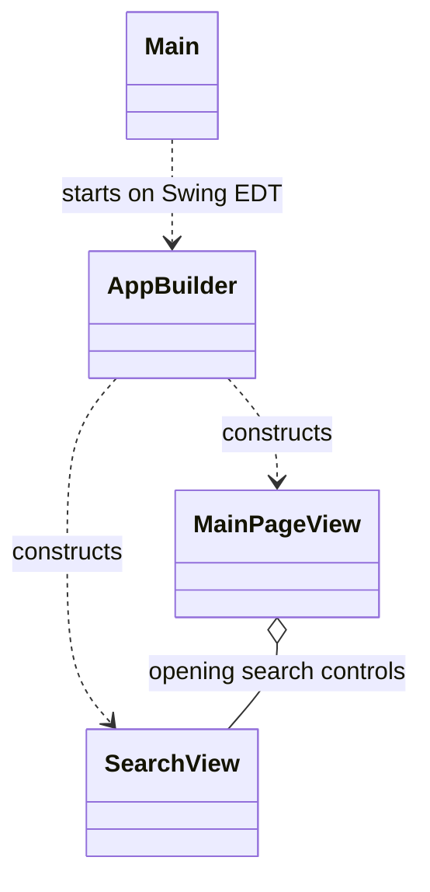
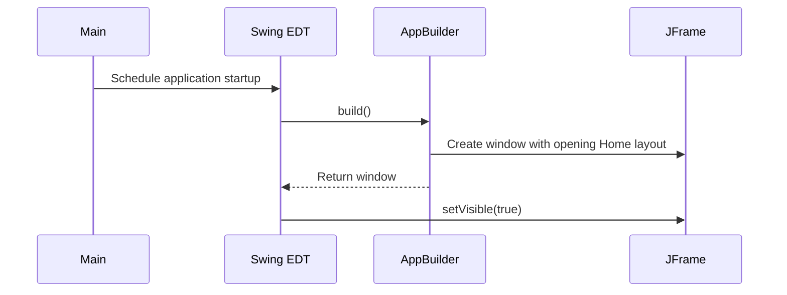

# Team Project

# Project Name

- CocktailCraft

## Team Information

- Team name: Team400
- TUT: 0401 BA2200 Group4

### Team Members

- Qinli Yang
- Enhao Tang
- Jiaqi Shen
- Wenqian Ling

---

## Project Description

CocktailCraft is a Java Swing desktop application for discovering, customizing,
and managing cocktail recipes. Users will browse recipes, search by name and base
spirit, view recipe details and available images, save favourites, and create
personal recipe variations. A personal profile will provide access to each user's
favourites and customized recipes across application sessions.

The project currently provides a shared scaffold. The user stories below describe
planned behaviour; they are not claims that the features have been implemented.

### Domain

- Food: drinks

---

## User Stories

### User Story 1 [Qinli]

As a user, I want to search for cocktails by name and/or base spirit so that I can
find recipes that match my preferences.

### User Story 2 [Enhao]

As a user, I want to customize an existing cocktail and save it as my own recipe
so that I can revisit and edit my variations without changing the original recipe.

### User Story 3 [Jiaqi]

As a user, I want to register, log in, and access my personal profile so that I can
return to my favourites and customized recipes across application sessions.

### User Story 4 [Wenqian]

As a user, I want to browse cocktails, view their recipes and available images,
and save favourites to my personal collection so that I can discover drinks and
revisit recipes I like.

---

## Use Cases

### Use Case 1 [Qinli]

**Inputs**

- An optional cocktail name.
- Zero or more selected base spirits.

**Input Requirement**

The user must enter a name, select at least one base spirit, or both.

**Normal Flow**

1. The user enters a name and/or selects base spirits in the Home search area.
2. The user clicks Search.
3. The system finds matching cocktails. Name matching is case-insensitive and
   supports partial matches. A cocktail may match any selected spirit; when both
   name and spirit criteria are provided, both must be satisfied.
4. The system displays matching cocktails using the same card layout as Home.
5. The user selects a card to open Cocktail Details.
6. The user can clear the search to return to catalog browsing.

**Alternative Flows**

- If neither criterion is provided, the system requests a name or base spirit.
- If no cocktails match, the system displays “No cocktails found.”
- If the catalog cannot be accessed, the system reports the failure and allows retry.

### Use Case 2 [Enhao]

**Inputs**

- An existing recipe selected from Cocktail Details, or the user's saved Custom Recipe.
- A recipe name, ingredient names, quantities, and units.

**Precondition**

The user is logged in.

**Normal Flow**

1. The user opens Cocktail Details and clicks Customize.
2. The system displays an editable copy of the original recipe.
3. The user changes its name, ingredients, quantities, and/or units.
4. The user clicks Save, and the system validates the recipe.
5. The system saves a separate Custom Recipe belonging to the current user.
6. The original recipe remains unchanged.
7. The user opens My Custom Cocktails from Profile to view saved variations.
8. The user can reopen a variation, edit it, and save the changes.
9. Saved variations remain available after restarting and logging in again.

**Alternative Flows**

- Guests are asked to log in before customizing.
- Blank recipe or ingredient names prompt the user to complete them.
- Quantities must be positive numbers, and units must be provided.
- A recipe must contain at least one ingredient.
- Cancel discards unsaved changes.
- Saving failures are reported, and the user's input is preserved for retry.
- An empty personal collection displays an empty-state message.

### Use Case 3 [Jiaqi]

**Inputs**

- A username and password for Login.
- A username, password, and password confirmation for Register.

**Normal Flow — Register**

1. The user opens Register and submits the required information.
2. The system validates the information and checks username availability.
3. The system saves the account and directs the user to Login.

**Normal Flow — Login, Profile, and Logout**

1. The user submits their credentials on Login.
2. The system verifies the credentials and establishes the current-user session.
3. The user opens Profile, which displays their username and access to Favourites
   and My Custom Cocktails.
4. The user can open either collection.
5. Logout ends the session and removes access to the prior user's personal data.

**Alternative Flows**

- Missing information, taken usernames, mismatched confirmations, and invalid
  credentials receive appropriate feedback.
- Guests opening Profile are directed to Login or Register.
- Account storage or network failures are reported and allow retry.

### Use Case 4 [Wenqian]

**Inputs**

- A cocktail selected from Home, Search results, or Favourites.
- The user's Favourite/Unfavourite action.

**Normal Flow — Browse and View Details**

1. Home displays cocktail cards.
2. The user selects a card from Home or Search results.
3. The system displays the cocktail's name, ingredients, quantities, units, and
   available instructions and description.
4. The system requests a matching image from TheCocktailDB and displays it when
   a suitable match is available.
5. The user can return to browsing or choose an available action in Details.

**Normal Flow — Manage Favourites**

1. A logged-in user clicks Favourite in Details.
2. The system saves the cocktail to that user's Favourites and updates its status.
3. The user opens Favourites from Profile and can revisit saved recipes.
4. The user can remove a cocktail from Favourites.
5. Favourites remain available after restarting and logging in again.

**Alternative Flows**

- Missing or ambiguous image matches and API failures use a placeholder image
  while leaving the recipe accessible.
- Missing optional recipe information is omitted or marked unavailable.
- Guests are asked to log in before changing Favourites.
- Empty collections display an empty-state message.
- Save failures are reported without displaying an unsaved change as successful.

---

## Minimal Viable Product (MVP)

| Team Member | MVP Use Case |
|-------------|--------------|
| Qinli | Search by name and/or base spirit, display shared result cards, handle missing input and no matches, and open Details. |
| Enhao | Customize an existing recipe, validate and save a personal variation, and load/edit saved variations through My Custom Cocktails. |
| Jiaqi | Register, Login, Logout, account persistence, current-user session, and Profile entry points to personal collections. |
| Wenqian | Browse catalog cards, view Details and available API images, and Favourite/Unfavourite recipes with Save/Load. |

Beyond MVP: additional search filters, ratings/comments, and public publishing of
Custom Recipes. Saving a personal recipe does not publish it to the public catalog.

---

## Entities

Existing fields and planned additions are distinguished below. Planned entities
and contracts require team agreement before implementation.

### Entity 1

**Cocktail — implemented minimal version**

- `id`
- `name`
- `ingredients`: a list of `RecipeIngredient`
- Planned additions: `instructions` and optional `description`.
- Base-spirit classification and image metadata representation are not finalized.

### Entity 2

**Ingredient — under discussion; no separate Class currently exists**

- A stable ingredient ID and name may be needed.
- Classification/category fields should follow the agreed Search requirements.

### Entity 3

**RecipeIngredient — implemented minimal version**

- `name`
- `amount`: currently a String; the numeric representation must be agreed with Enhao.
- `unit`

### Entity 4

**User — planned; Jiaqi leads the Account contract**

- A stable user identity and username.
- Credential handling and session representation remain to be designed.

### Entity 5

**Custom Recipe — planned; Enhao leads the contract**

- Its own ID, owner user ID, and original recipe reference.
- Recipe name, ingredients, and other agreed recipe fields.
- Whether this is a separate Class or another representation is not finalized.

### Entity 6

**Favourite association — planned; Wenqian leads the contract**

- A user identity linked to a cocktail ID.
- A separate Entity Class is not required unless the design needs one.

---

## API Usage

**API Name:** TheCocktailDB — planned; not implemented.

**Documentation:** [Official API documentation](https://www.thecocktaildb.com/api.php)

**How it is used in the program:** Planned image lookup for Cocktail Details,
with matching and fallback behaviour owned by Wenqian. The bundled Bar Assistant
recipe remains the recipe source. Exact API integration is still pending.

**API Name:** Course User API — candidate; not implemented.

**Documentation:** [Course Login example, db-user branch](https://github.com/CSC207-2026F-UofT/ca-login/tree/db-user)

**How it is used in the program:** Jiaqi will investigate Account persistence.
The example demonstrates username/password operations, but documentation for
associated-JSON Save/Load/Update still needs to be found. Storage of Favourites
and Custom Recipes through this API is not assumed.

The Bar Assistant dataset is a bundled offline snapshot; loading it does not
constitute runtime external API usage. User-data persistence is also outstanding.

---

## Design Diagrams

### UML Class Diagram

Current startup structure (individual use case classes are empty):



Feature-specific diagrams will be added by their owners as implementations grow.
See [architecture handoff](docs/ARCHITECTURE.md) for the current package structure.

### Sequence Diagrams



Search, Profile, Browse, and Customize sequences remain owner work.

---

## How to Run

### Setup

1. Open the Maven project in IntelliJ IDEA.
2. Use JDK 11 or newer. Maven targets Java 11 APIs and bytecode with `--release 11`.
3. Reload the Maven project to download dependencies.

### Launch the application

Run `org.example.cocktailcraft.app.Main`.

The application opens Home with a title, name input, disabled Search/base-spirit/
Clear controls, a disabled Profile button, and a catalog placeholder.
No other pages or navigation are implemented. Feature owners will add their own
Views and connect their use cases. The GUI does not load the dataset at startup.

### Verify dataset loading

Run `org.example.cocktailcraft.app.DataReadCheck`.

Expected output:

```text
Loaded cocktails: 663
Cocktail ID: daiquiri
Cocktail: Daiquiri
Light Rum: 60 ml
Lime juice: 22.5 ml
Simple Syrup: 22.5 ml
```

The check loads the full dataset once, then prints Daiquiri as a known sample.
It is not the application's Search functionality. GUI startup currently does not
load the catalog or make network requests.

### Run shared checks

From the project root:

```bash
mvn test
mvn verify
```

Both commands run the team Checkstyle configuration during `validate`.
`mvn verify` also builds the JAR. IntelliJ Build Project alone does not necessarily
run Maven tests or Checkstyle. The opening-window test is skipped in headless environments.

Reports are in `target/checkstyle-result.xml` and `target/surefire-reports/`.
`target/` is ignored by Git. The JAR is not a standalone executable bundle; Gson
remains a runtime dependency. Use IntelliJ for launching at this stage.

---

## Notes

### Local dataset and shared scaffold status

- The Bar Assistant snapshot contains 663 recipes, 296 ingredient records, and
  8 auxiliary JSON files. Images are not bundled.
- [Dataset source/version](src/main/resources/bar-assistant/SOURCE.md) and
  [upstream license](src/main/resources/bar-assistant/LICENSE) are included.
- `CocktailJsonReader.readAll()` returns a new unmodifiable `List<Cocktail>` per call;
  it does not cache, search, or save user data.
- `cocktail-index.txt` lists recipe resource paths and must be regenerated if recipe
  files are added or removed. The separate Daiquiri example is not counted twice.
- Existing Entity mapping covers ID, name, and ingredient name/amount/unit only;
  instructions/description are shared follow-up work.
- Implemented shared code includes Main/AppBuilder, the opening Home layout,
  offline JSON reading, JUnit checks, and Checkstyle. The four feature groups
  contain empty CA declarations; their Views and behaviour remain owner work.
- The structure follows the [course CA Login Lab](https://github.com/CSC207-2026F-UofT/ca-login/blob/main/LAB_INSTRUCTIONS.md).
- See [course checklist](docs/COURSE_REQUIREMENTS.md) for outstanding requirements.

### Temporary Team Guide — Remove Before Final Submission

> This section is a temporary handoff guide. Remove it before final submission.
> The four feature packages contain **empty class/interface declarations only**:
> no fields, constructors, methods, business logic, or feature wiring.
> Owners may change or remove these starting files as their use cases require.

#### Ownership

All Java paths below are relative to `src/main/java/org/example/cocktailcraft/`.
Each owner completes their feature's use case classes, adapters, Views, concrete
data access implementation, and tests.

| Owner | Feature | Packages and Views |
|---|---|---|
| Qinli | Search & Filter | `use_case/search/`, `interface_adapter/search/`, `view/search/`. `SearchView.java` currently contains only inactive controls for the opening Home layout. |
| Enhao | Customize | `use_case/customize/`, `interface_adapter/customize/`, `view/customize/`. The View folder is empty, tracked with `.gitkeep`. |
| Jiaqi | Profile and Account | `use_case/profile/`, `interface_adapter/profile/`, `view/profile/`. The View folder is empty, tracked with `.gitkeep`. |
| Wenqian | Browse, Details, and Favourites | `use_case/browse/`, `interface_adapter/browse/`, `view/browse/`. `MainPageView.java` currently contains only the opening Home layout. Other Views are not created yet. |

Owners decide whether to split their feature into additional use cases. No
Login, Details, Favourite, or Customize page has been implemented for them.

#### Starting files and their intended purpose

`<Feature>` means Search, Customize, Profile, or Browse. Every feature has the
same starting filenames. These declarations do not define final contracts.

| Package | File | Intended purpose when implemented |
|---|---|---|
| `use_case/<feature>/` | `<Feature>InputBoundary.java` | Entry interface for the use case. |
| `use_case/<feature>/` | `<Feature>InputData.java` | Data submitted to the use case. |
| `use_case/<feature>/` | `<Feature>Interactor.java` | Validation and business rules. |
| `use_case/<feature>/` | `<Feature>OutputBoundary.java` | Interface for reporting the outcome. |
| `use_case/<feature>/` | `<Feature>OutputData.java` | Data returned by a successful use case. |
| `use_case/<feature>/` | `<Feature>DataAccessInterface.java` | Storage operations required by the use case; implemented by a concrete DAO in `data_access/`. |
| `interface_adapter/<feature>/` | `<Feature>Controller.java` | Converts View input into a use case request. |
| `interface_adapter/<feature>/` | `<Feature>Presenter.java` | Converts use case output into display state. |
| `interface_adapter/<feature>/` | `<Feature>ViewModel.java` | Exposes display state and update notifications. |
| `interface_adapter/<feature>/` | `<Feature>State.java` | Holds fields displayed by the View. |

#### Implemented shared files

| File / location | What already works and what it is for |
|---|---|
| `app/Main.java` | Starts the application on the Swing EDT. |
| `app/AppBuilder.java` | Creates the JFrame and opening Home layout. Add completed feature wiring here later. |
| `view/browse/MainPageView.java` | Displays the Home title, search area, inactive Profile button, and catalog placeholder. No catalog behaviour. |
| `view/search/SearchView.java` | Displays name input and disabled search controls. No matching or event handling. |
| `entity/Cocktail.java` | Stores ID, name, and ingredients. |
| `entity/RecipeIngredient.java` | Stores ingredient name, amount (currently String), and unit. |
| `data_access/CocktailJsonReader.java` | Reads one recipe or the indexed dataset into shared Entities; no searching, caching, or saving. |
| `app/DataReadCheck.java` | Loads 663 recipes and prints Daiquiri as a smoke check. It is not Search. |
| `src/main/resources/bar-assistant/` | Bundled JSON dataset, resource index, license, and source/version information. |
| `src/test/java/` and `src/test/resources/` | Check Reader behaviour, basic dependency direction, and the opening window. Individual feature tests still need to be written. |
| `pom.xml` and `config/checkstyle/checkstyle.xml` | Shared dependencies, Java 11 compilation, JUnit execution, and style checks. |

#### Coordinate before changing shared code

- **Entities and dataset access — everyone:** agree before changing Entity fields,
  constructors, quantity types, or the Reader. Reuse the existing dataset; decide
  together how completed features will access the loaded catalog.
- **Home and result cards — Qinli and Wenqian:** coordinate changes to the opening
  Home/search area, shared result display, and passing a cocktail ID to Details.
- **Personal collections — Jiaqi, Enhao, and Wenqian:** agree on user identity and
  Save/Load contracts. Jiaqi owns Profile composition, Enhao owns Custom Recipes,
  and Wenqian owns Favourites.
- **Application wiring and build — everyone:** coordinate AppBuilder, dependency,
  and Checkstyle changes. Runtime API integration and user-data persistence are
  not implemented. Each owner adds their own tests and submits reviewed PRs.

**End of temporary guide — remove before final submission.**
