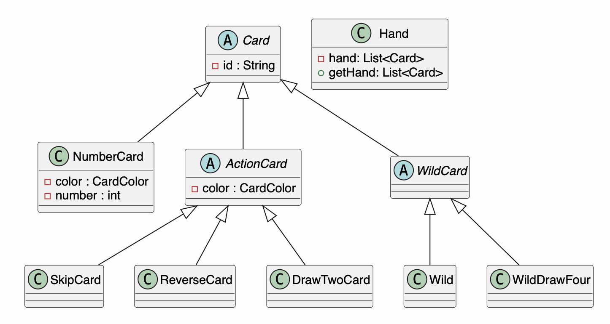

# Team Project

Please keep this up-to-date with information about your project throughout the term.

The readme should include information such as:
- a summary of what your application is all about
- a list of the user stories, along with who is responsible for each one
- information about the API(s) that your project uses
- screenshots or animations demonstrating current functionality

By keeping this README up-to-date,
your team will find it easier to prepare for the final presentation
at the end of the term.

# Project Name: UNO Desktop!

## Team Information

### Team Members
- Catherine Li
- Judy Dai
- Eric Guan
- Cathy Zhu
---

## Project Description

### Domain: Entertainment

Project Description: a digital version of UNO game!

---

## User Stories

### MVP User Stories

#### Account Management and Game Statistics

1. As a player, I want to sign up and log in to my account so that the games I play will be recorded in my account statistics.
2. As a player, I want to play with a computer bot so that I can play UNO even when I can't find other players.
3. As a player, I want my gameplay statistics and rank to be stored so that I can check them later on the "Game Stats" page.

#### Gameplay UI Features

4. As a player, I want to see the winner when a round ends so that I know the results.
5. As a player, I want an indicator of whose turn it is so that I can keep track of what is happening in the game.
6. As a player, I want to know the direction of turns so that I know who I can play cards against.
7. As a player, I want to see the winner when a round ends so that I know the results.

#### UNO Rules

8. As a player, I should be able to declare "UNO" when I only have one card left so that I do not have to draw a penalty card.
9. As a player, I want to draw a card when I have no playable cards so that I can continue playing.
10. As a player, if I have any playable cards, I should be able to play one on my turn so that I can get rid of cards.

**Playable cards include:**
- Playing a card that matches the colour (red, blue, green, or yellow).
- Playing a card that matches the number (0–9).
- Playing a card that matches the symbol or action (Wild, Skip, Reverse, +2, or Wild +4).

**Additional card actions:**
- As a player, I want to choose the colour of a Wild or Wild +4 card when I play one so that other players have to play a card of that colour, or draw 4 cards if it is a Wild +4.
- As a player, I want to play a +2 card when it is playable so that the next player draws 2 cards.
- As a player, I want to play a Skip card when it is playable so that the next player's turn is skipped.
- As a player, I want to play a Reverse card when it is playable so that the turn direction is reversed, and play goes to the previous player instead of the next.

### Additional User Story

#### Online Gameplay

1. As a player, I want to play with other users online so that I can play with my friends.
2. As a player, I want a countdown timer that displays how much time is left in my turn.

#### Interactive Features

3. As a player, I want to throw eggs and tomatoes at other players' avatars so that the game feels more interactive.

#### Customization

4. As a player, I want to be able to draw or upload my own avatar so that I can customize my gaming experience.
5. As a player, I want to customize my game lobby music so that I can enjoy music that matches my preferences.
6. As a player, I want to customize the UNO background so that I can personalize the game's appearance.
7. As a player, I want to modify the "UNO" audio so that I can customize my gaming experience.

#### Accessibility

8. As a player, I want to view the game rules so that I can learn how to play.
9. As a player who has difficulty distinguishing colours, I want cards to display colour labels or symbols so that I can identify them easily.

---

## Use Cases

# UNO Game – Use Cases

### 1. LoginUseCase

- **Name:** LoginUseCase
- **Primary Actor:** User
- **Precondition:** User account exists.
- **Trigger:** User opens the app.
- **Main Success Scenario:**
    1. User inputs their username and password.
    2. System checks the account information.
    3. Login is successful.
    4. User enters the game lobby.
- **Extensions:**
    - **User does not have an account:** User clicks the sign-up button.
    - **User inputs an incorrect username or password:** System displays a notification, and the user retries logging in.

### 2. LogOut

- **Name:** LogOut

### 3. SignUp

- **Name:** SignUp

### 4. Play with Bot

- **Name:** Play with Bot
- **Primary Actor:** User
- **Precondition:** The user is on the main menu.
- **Trigger:** The user selects "Start Game" (or "Play with Bots" if multiplayer is added).
- **Main Success Scenario:**
    1. The game begins.
- **Success Outcome:** Game begins.

### 5. CompleteGame

- **Name:** CompleteGame
- **Primary Actor:** None (event-triggered use case)
- **Preconditions:**
    - A game is currently in progress.
    - A player has met the winning condition.
- **Trigger:** A player plays their final card, causing the game to end.
- **Main Success Scenario:**
    1. The game determines the winner.
    2. The system calculates the statistics resulting from the game.
    3. The system updates the relevant player's statistics.
    4. The system saves the updated statistics.
    5. The system displays the game results.
- **Success Outcome:** The app successfully updates player statistics and displays the round result.

### 6. ViewPlayerStats

- **Name:** ViewPlayerStats
- **Primary Actor:** Player
- **Preconditions:**
    - Player account exists.
    - Player is logged in.
- **Trigger:** Player clicks the "Check Stats" button in the lobby view.
- **Main Success Scenario:**
    1. Player clicks the "Check Stats" button.
    2. Player enters the Player Stats view.
- **Success Outcome:** Statistics of the currently logged-in player are displayed in the app.
- **Extensions:**
    1. Player clicks the "Exit" button.
    2. Player returns to the lobby view.
    3. Use case ends.

### 7. Play Card

- **Name:** Play Card
- **Primary Actor:** User
- **Precondition:** The user has a playable card.
    - **Playable cards include:**
        1. A card that matches the current colour (red, blue, green, or yellow).
        2. A card that matches the current number (0–9).
        3. A card that matches the current symbol or action (Wild, Skip, Reverse, +2, or Wild +4).
- **Trigger:** Player plays a card from their hand.
- **Main Success Scenario:**
    1. User picks a card.
    2. System assesses whether the card is playable.
    3. If the card is playable, the system allows the player to play it.
- **Extensions:**
    - **Wild / Wild +4 Card:**
        - As a player, I want to decide the colour of a Wild or Wild +4 card when I play one so that other players have to play a card of that colour.
        - **Success:**
            - Wild +4: The player going next picks up 4 cards, their turn is skipped, and the player who played the card selects a colour.
            - Wild: The player selects a colour.
    - **+2 Card:**
        - As a player, I want to place down a +2 card when it is playable so that the next player picks up 2 cards.
        - **Success:** The player going next picks up 2 cards, and their turn is skipped.
    - **Skip Card:**
        - As a player, I want to place down a Skip card when it is playable so that it skips the next player's turn.
        - **Success:** The next player's turn is skipped.
    - **Reverse Card:**
        - As a player, I want to place down a Reverse card when it is playable so that the turn goes to the previous player instead of the next.
        - **Success:** The turn switches to the previous player, and the direction of play is reversed.
    - **Unplayable Card:**
        - User picks an unplayable card.
        - System displays an error message.
        - [Incomplete: remaining steps not provided.]

### 8. Draw Card

- **Name:** Draw Card
- **Primary Actor:** User
- **Precondition:** The player has no playable cards, or they wish to draw a card for strategic purposes.
- **Trigger:** The user clicks the deck.
- **Main Success Scenario:**
    1. The player picks up one card.
- **Extensions:** N/A
- **Success Outcome:** The player picks up one card.

### 9. Declare UNO

- **Name:** Declare UNO
- **Primary Actor:** User
- **Precondition:** The player has only one card left in their hand.
- **Trigger:** User clicks the UNO button that appears when they have one card left in their hand.
- **Main Success Scenario:**
    1. The user declares UNO.
- **Extensions:**
    - Another player calls UNO before the user does.
    - The user picks up 2 penalty cards.
    - The game continues.
- **Success Outcome:** User wins the game.

---

## Minimal Viable Product (MVP)

| Team Member | MVP Use Case |
|-------------|--------------|
| Catherine | playcard, drawcard, declareUno   Entities: Hand, Card|
| Judy | signup, logout, login   Entities: DiscardPile, Deck |
| Eric | viewplayerstats, completegame   Entities: Game, GameSettings|
| Cathy   | playwithbot (start with main menu)   Entities: Player, BotPlayer|

SignUp, Logout, Login
Entities: DiscardPile, Deck

---

## Entities

### Card
Represents an individual UNO card.

### Hand
Represents the cards currently held by a player.

### Deck
Represents the draw pile of cards.

### CardPile
Represents the pile of cards that doesn't belong to any player or bot player.

### Player
Represents an individual player.

- **BotPlayer:** Extends `Player`.

### Game
Represents the actual UNO game and its current state.

### GameSettings
Represents the configuration of a game.

---

## API Usage

**API Name: TrophyAPI**

**Documentation:** https://docs.trophy.so/getting-started/introduction

**How it is used in the program:** leaderboard, achievements

---

## Design Diagrams

### UML Class Diagram

### Sequence Diagrams

---

## How to Run

[Instructions for running the program.]

---

## Notes

[Any additional project information.]
