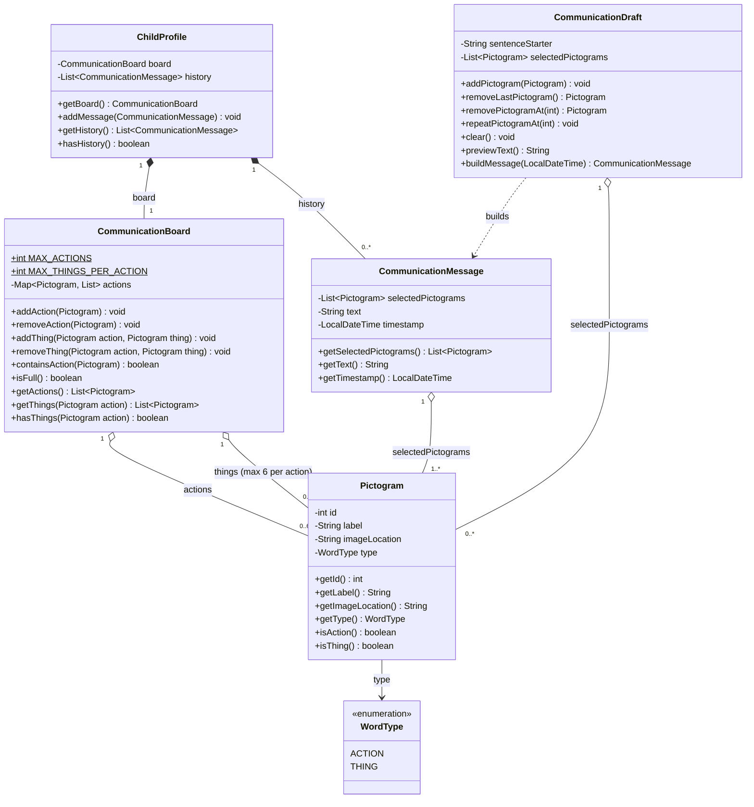
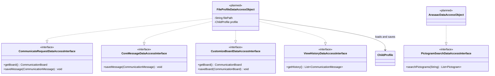

# AACorn - Visual AAC Communication Board

## Team Information

### Team Members

- Harleen Sidhu
- Ruoshui Deng
- Ruohan Tang
- Paul Zhao

---

## Project Description

### Domain

**Augmentative and Alternative Communication (AAC)**

AACorn is a Java-based visual AAC application designed primarily for autistic children around ages 5–12 with limited functional speech.

The goal is to help a child communicate simple everyday needs using pictograms.

**Example:**  
`I want` → `Water` → **"I want water."**

The first version focuses on functional communication rather than emotion detection, pain assessment, behaviour prediction, or other therapy-related features.

### Project Mascot

<p align="center">
  
</p>

AACorn's mascot is an original acorn-inspired character designed by Ruoshui Deng. It is used for project branding rather than as a functional AAC pictogram.

---

## User Stories

### Child

1. **As a child, I want to select pictograms so that I can communicate something I want.**

2. **As a child, I want quick access to Help, Stop, and Break so that I can communicate important needs easily.**

### Caregiver

3. **As a caregiver, I want to search for, add, and remove pictograms so that I can customize the child's communication board.**

4. **As a caregiver, I want to view previous messages so that I can see what the child has communicated.**

---

## Use Cases

### UC1 - Communicate a Request

**Actor:** Child

**Precondition:** The communication board contains at least one available pictogram.

**Trigger:** The child wants to communicate a request.

**Success Outcome:** A completed message is created and can be stored in communication history.

**Main Scenario:**

1. The child selects pictograms from the communication board.
2. The selected pictograms appear in the current message.
3. The child may add, repeat, remove, or clear selections.
4. The system constructs a readable message from the selected pictograms.
5. The completed message is sent.

**Extensions:**

- The same pictogram may be selected more than once.
- The child may remove a selected pictogram.
- An incomplete or cleared draft is not stored as a completed message.

---

### UC2 - Communicate a Core Message

**Actor:** Child

**Trigger:** The child selects **Help**, **Stop**, or **Break**.

**Success Outcome:** The selected core message is immediately available for communication.

**Main Scenario:**

1. The child selects a core message.
2. The system creates the corresponding communication message.
3. The completed message can be stored in communication history.

---

### UC3 - Customize the Communication Board

**Actor:** Caregiver

**Precondition:** The caregiver has entered caregiver mode.

**Trigger:** The caregiver chooses **Customize Board**.

**Success Outcome:** The child's available pictograms are updated.

**Main Scenario:**

1. The caregiver views the current communication board.
2. The caregiver may remove an existing pictogram.
3. The caregiver may select **Add Pictogram**.
4. The caregiver searches ARASAAC by keyword.
5. Matching pictograms are displayed.
6. The caregiver selects a pictogram to add to the board.
7. The updated board is saved.

**Extension:**

- If the API is unavailable or no matching pictogram is found, the system displays an appropriate message.

---

### UC4 - View Communication History

**Actor:** Caregiver

**Precondition:** At least one completed communication message has been saved.

**Trigger:** The caregiver chooses **History**.

**Success Outcome:** Previous communication messages are displayed in chronological order.

**Main Scenario:**

1. The caregiver opens communication history.
2. The system loads saved messages.
3. The messages are displayed with their timestamps.

---

---

### UC6 - Linked Vocabulary (Actions → Related Things)

**Actors:** Caregiver (setup), Child (use)

**Goal:** Each action on the board leads to a short list of related things (e.g. *play → ball, toy, park*), so the child can build requests like "I want to play ball."

**Caregiver scenario:**

1. The caregiver searches ARASAAC and adds an action (at most 6).
2. The system suggests related things for that action (from a built-in starter list, an ARASAAC search, and the child's history).
3. The caregiver chooses which suggestions to add (at most 6 per action).
4. The caregiver can also add any thing, choosing which action(s) it belongs to.
5. The updated board is saved.

**Child scenario:**

1. The child taps an action; it is spoken and added to the message.
2. If the action has related things, the system shows them; otherwise the screen stays the same.
3. The child taps a thing; it is spoken and added to the message.
4. The child taps Speak; the message is spoken and saved to history.

**Extensions:**

- No actions on the board: the caregiver must add an action before adding things.
- Back on the related-things screen returns to the actions and removes that action from the message.
- Help, Stop and Break are always visible, send immediately, and do not change the screen or the message being built.
- Suggestions never change the board automatically; the caregiver always decides.

## Minimal Viable Product (MVP)

Each team member will take the lead on one MVP use case.

| Team Member | MVP Use Case |
|---|---|
| TBD | UC1 - Communicate a Request |
| TBD | UC2 - Communicate a Core Message |
| TBD | UC3 - Customize the Communication Board |
| TBD | UC4 - View Communication History |

> MVP use-case ownership will be finalized before Phase 2 implementation.

---

## Entities

### `Pictogram`

Represents one selectable AAC symbol.

**Instance Variables**

```java
int id
String label
String imageLocation
WordType type        // ACTION (verb) or THING (noun)
```

**Relevant Methods**

```java
getId()
getLabel()
getImageLocation()
getType()
isAction()
isThing()
```

`WordType` is an enum with two values: `ACTION` (e.g. *play*, *eat*) and `THING` (e.g. *ball*, *apple*).
The older 3-argument constructor is kept for compatibility and creates a `THING`.

---

### `CommunicationDraft`

Represents the temporary message currently being constructed by the child.

**Instance Variables**

```java
String sentenceStarter
List<Pictogram> selectedPictograms
```

**Relevant Methods**

```java
addPictogram(...)
removeLastPictogram()
removePictogramAt(...)
repeatPictogramAt(...)
clear()
previewText()
buildMessage(...)
```

---

### `CommunicationMessage`

Represents a completed message sent by the child.

**Instance Variables**

```java
List<Pictogram> selectedPictograms
String text
LocalDateTime timestamp
```

**Relevant Methods**

```java
getSelectedPictograms()
getText()
getTimestamp()
```

A completed `CommunicationMessage` is immutable and is kept separate from the child's current `CommunicationDraft`.

---

### `CommunicationBoard`

Represents the vocabulary available to the child, organized as **actions** and their **related things**.
The main screen shows the actions; tapping an action shows its related things.

```
play  →  ball, toy, park
eat   →  apple, cookie
drink →  water, apple
```

**Instance Variables**

```java
Map<Pictogram, List<Pictogram>> actions   // each action → its related things, in caregiver order
```

**Relevant Methods**

```java
addAction(...)
removeAction(...)
addThing(action, thing)
removeThing(action, thing)
containsAction(...)
isFull()
getActions()
getThings(action)
hasThings(action)
```

**Business Rules**

- The main board holds at most **6 actions**, in the order chosen by the caregiver.
- Each action has at most **6 related things**.
- Only `ACTION` pictograms go on the main board; only `THING` pictograms can be linked to an action.
- A thing can only be added to an action that is already on the board.
- The same thing can be linked to several actions (e.g. *apple* under *eat* and *drink*).
- Removing an action also removes its links to things.
- Help, Stop and Break are fixed core messages and are **not** part of the board.

---

### `ChildProfile`

Represents all saved data for the child using the app.
AACorn is designed for **one child per installation**.

**Instance Variables**

```java
CommunicationBoard board
List<CommunicationMessage> history
```

**Relevant Methods**

```java
getBoard()
addMessage(...)
getHistory()
hasHistory()
```

**Business Rules**

- History is kept in the order messages were sent (oldest first).
- History can only be added to through `addMessage`; it cannot be edited or reordered from outside.

### Entity Relationships

```
ChildProfile
 ├── CommunicationBoard ── up to 6 actions, each linked to up to 6 things (all Pictograms)
 └── history: many CommunicationMessages ── each contains the Pictograms the child selected

CommunicationDraft ── builds ──> CommunicationMessage
Pictogram ── has a ──> WordType (ACTION / THING)
```

---

## API Usage

**API Name:** ARASAAC API

**Documentation:** [ARASAAC API documentation](https://developers.arasaac.org/data-api)

**How it is used in the program:**

- search for pictograms by keyword
- retrieve pictogram metadata
- retrieve pictogram images
- allow caregivers to add selected pictograms to the communication board

**Current Status:** API research and Java integration are in progress. API functionality has not yet been merged into `main`.

---

## Project Structure

The code follows Clean Architecture. Inner layers never depend on outer layers.

| Package | Contents |
|---|---|
| `entity` | Domain classes and business rules (`Pictogram`, `CommunicationBoard`, `ChildProfile`, …) |
| `use_case/<use_case>` | Interactors, input/output data, data access interfaces |
| `interface_adapter/<use_case>` | Controllers, presenters, view models |
| `data_access` | JSON storage and ARASAAC API calls |
| `view` | Java Swing screens |
| `app` | `Main`, where all layers are connected |

Use-case subpackages: `communicate_request` (UC1), `core_message` (UC2), `customize_board` (UC3), `view_history` (UC4).

---
## Persistence

AACorn stores all of the child's data in one local JSON file: `data/profile.json`.

```json
{
  "board": [
    {
      "action": { "id": 6527, "label": "play", "imageLocation": "https://.../6527.png", "type": "ACTION" },
      "things": [
        { "id": 3241, "label": "ball", "imageLocation": "https://.../3241.png", "type": "THING" }
      ]
    }
  ],
  "history": [
    {
      "text": "I want to play ball.",
      "timestamp": "2026-11-24T10:00:00",
      "pictograms": [
        { "id": 6527, "label": "play", "imageLocation": "https://.../6527.png", "type": "ACTION" },
        { "id": 3241, "label": "ball", "imageLocation": "https://.../3241.png", "type": "THING" }
      ]
    }
  ]
}
```

**Design decisions**

- `board` keeps the caregiver's order; `history` is oldest first.
- Each history message stores a **full copy** of its pictograms, not just their IDs. History is a record of what was said, so it must still display correctly after a pictogram is removed from the board or when the ARASAAC API is offline.
- Timestamps use ISO-8601 format so they can be read back with `LocalDateTime.parse()`.
- `board` is a list of actions, each with its linked `things`. Every pictogram stores its `type` so it can be rebuilt exactly.

**Data access interfaces**

Following Clean Architecture, each use case defines the data access it needs in its own `use_case` package. One class in `data_access` will implement all of them by reading and writing `profile.json`.

| Use case | Interface | Methods |
|---|---|---|
| UC1 Communicate a Request | `CommunicateRequestDataAccessInterface` | `getBoard()`, `saveMessage(...)` |
| UC2 Core Message | `CoreMessageDataAccessInterface` | `saveMessage(...)` |
| UC3 Customize Board | `CustomizeBoardDataAccessInterface` | `getBoard()`, `saveBoard(...)` |
| UC4 View History | `ViewHistoryDataAccessInterface` | `getHistory()` |

Development and testing use sample data rather than real clinical data.

---

## Design Diagrams

### UI Flow

AACorn has a child-facing communication interface and a separate caregiver mode.

<p align="center">
  
</p>

Caregiver mode is accessed from the child interface through a settings button and a 4-digit PIN screen.

The caregiver can then choose between:

- **History**
- **Customize Board**

### UML Class Diagram

#### Entities



- A `ChildProfile` owns one `CommunicationBoard` and the message history (composition).
- Boards, drafts and messages refer to `Pictogram`s, which can appear in several places (aggregation).
- A `CommunicationDraft` builds an immutable `CommunicationMessage`.
- A `ChildProfile` owns one `CommunicationBoard` and the message history (composition).
- The board maps each action to its related things; boards, drafts and messages all refer to `Pictogram`s, which can appear in several places (aggregation).
- Each `Pictogram` has a `WordType` (`ACTION` or `THING`).
- A `CommunicationDraft` builds an immutable `CommunicationMessage`.

#### Data Access



- Each use case defines only the data access it needs (Interface Segregation).
- Interfaces live in `use_case`; implementations live in `data_access` (Dependency Inversion).
- Classes marked `<<planned>>` will be implemented in Phase 2.

### Sequence Diagrams

**Status:** To be added during use-case implementation.

---

## Current Development Status

AACorn is currently in **Phase 1: Framework**.

| Area | Owner | Status |
|---|---|---|
| UI design and navigation | Team | Initial design completed |
| Communication logic | Ruoshui | Implemented and tested |
| Data model / architecture | Ruohan | Entities, package structure and JSON format completed; UML in progress |
| ARASAAC API research | Paul | In progress |
| Swing prototype | Harleen | In progress |

### Implemented

- `Pictogram`
- `CommunicationDraft`
- `CommunicationMessage`
- add/remove/repeat pictogram logic
- message preview and construction
- communication edge-case tests
- JUnit configuration
- `CommunicationBoard`
- `ChildProfile`
- Clean Architecture package structure
- JSON storage format

### In Progress

- ARASAAC integration
- Swing GUI
- JSON persistence implementation
- communication history

---

## How to Run

The complete Swing application is not yet integrated.

The currently implemented domain logic and tests can be run with:

```bash
mvn clean test
```

A runnable GUI entry point will be added as the Swing prototype and use cases are integrated.

---

## Notes

### Current Technology

- **Language:** Java 11
- **GUI:** Java Swing
- **Build Tool:** Maven
- **Testing:** JUnit 5
- **External API:** ARASAAC
- **Persistence:** planned local JSON storage
- **Architecture:** Clean Architecture / SOLID principles

### Possible Future Extensions

The following are **not part of the current MVP**:

- text-to-speech
- communication usage statistics
- caregiver-facing vocabulary suggestions
- multiple child profiles
- richer child profile management
- previewing board changes before saving

Development is completed through feature branches and Pull Requests, with completed work reviewed before being merged into `main`.
