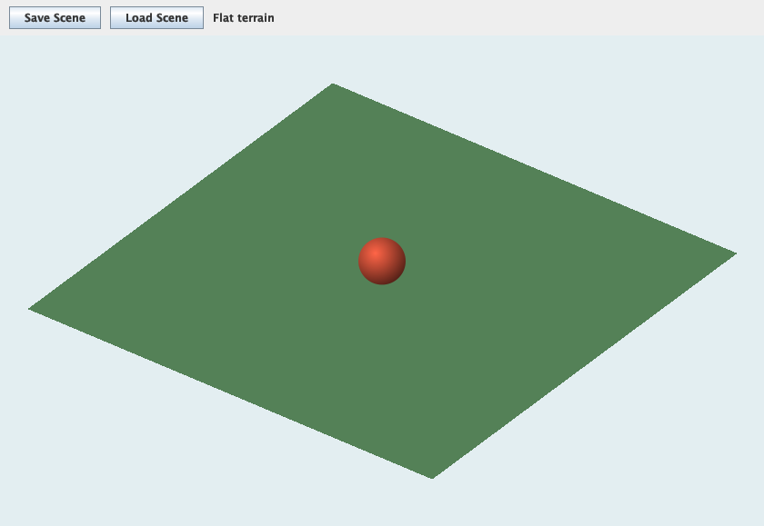

# Terrain Physics Simulator

A Java Swing simulator for dropping spheres onto 3D terrain. The team plan includes terrain generation from a text prompt, object selection and dropping, simulation controls, and saving and loading scenes.

## User stories and owners

| Owner | User story |
| --- | --- |
| Person A | Describe a landscape and generate terrain. |
| Person B | Pick an object, set its drop speed, and drop it on the mini-map. |
| Person C | Play, pause, stop, rewind, and change simulation speed. |
| Nick Wang (Person D) | Save a scene and reopen it later. Person D also owns the 3D renderer. |

The planned terrain APIs and shared architecture are described in [plan.md](plan.md). The preview starts on a flat 16 × 16 grid with one ball. All heights are zero metres and adjacent samples are two metres apart.

## Run the Person D preview

1. Open this Maven project in IntelliJ and select JDK 26 as the project SDK.
2. Run the `main` method in `app.Main`.
3. Drag on the 3D view to rotate. Use **W/S** to move forward/back along the ground, **A/D** to move left/right, and **Q/E** to move up/down. Opening a new terrain centres the camera on it.
4. Use **Save Scene** to export the sample to JSON and **Load Scene** to reopen it.

JSON scenes save terrain samples in metres, the scene name, ball positions and velocities, presets, gravity, and simulation speed. Loading validates the file before replacing the current scene. The [UC4 sequence diagram](docs/uc4-save-load.puml) shows both file actions.

## Model View Presenter

Swing calls a listener in the view when the user clicks Save or Load, presses a movement key, or drags the scene. The listener immediately calls `ScenePresenter`. For file actions, the presenter opens the chooser through the view and passes the selection to the appropriate controller. The model consists of the save/load interactors, the current scene, and the JSON storage gateway.

The interactor reports success, failure, or a file requiring replacement to the same presenter through its output boundary. The presenter updates `SimulationViewModel`. The view model calls `displayChanged` on the presenter, which calls `display` on the Swing view. Camera movement follows the same display update path and changes only the camera pose.

Person A owns the planned LLM-assisted import of real-world terrain data. Person D’s renderer and scene files accept a rectangular grid of heights in metres and its cell spacing through the existing terrain mapper.

For terminal builds, set `JAVA_HOME` to JDK 26. On macOS, run `export JAVA_HOME=$(/usr/libexec/java_home -v 26)`. Run `mvn test` for the suite or `mvn -Dtest=PlaneTerrainTest test` for the flat-terrain cases.
