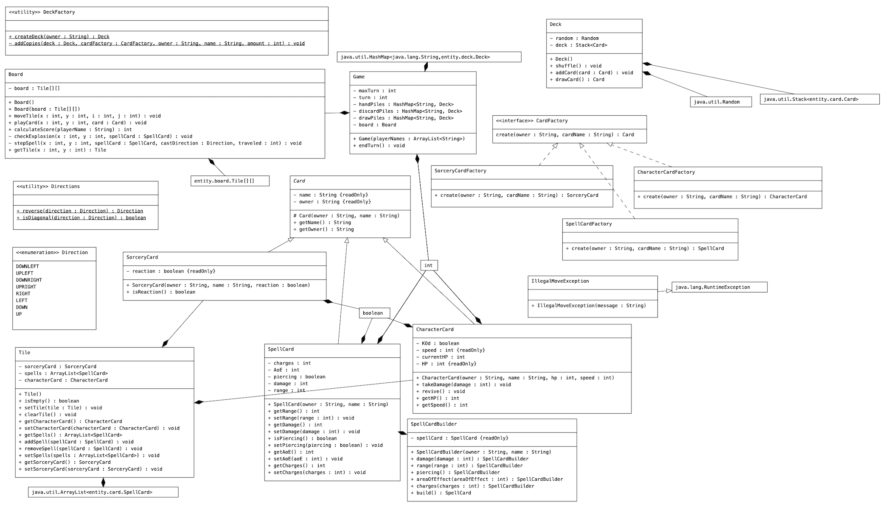

# Spells to Save the World
*This is a group project for UofT's Fall 2026 CSC207 Project*
*This is heavily a work in progress, and this .md will be updated as the term continues.* \
\
**Project Domain:** *Entertainment* 

## Overview
*"Take turns playing characters, teaching them spells, and equipping them with items. Play on a 6x6 grid where positioning and strategy are key to keeping Characters alive long enough to sacrifice them all to win the game... or to have them dragged into a black hole and destroyed."* \
— StStW Description

### Features // Current
- N/A

### Features // WIP
- A 6x6 board where your characters can move around and sling spells
  - 3 Card Types (+1 TBA later, time permitting)
    - Character Cards
    - Spell Cards
    - Sorcery Cards
    - Items (TBA/TBD)
    - X Unique Cards (120 in original design)
- A deck and a hand to draw cards, discard them, and whatever else
- Online Multiplayer (we're trying)

## Project Details
### User Stories
Yinghao \
*"As a player, I want to start a match against another player, then be able to save it to a file and load them."*

Shuai Shao: \
*"As a player, I want to play and move my characters around the board."*

Yuhang: \
*"As a player, I want to have my characters cast spells in some direction."*

Andy Li: \
*"As a player, I want to be able to defend against incoming spells by playing sorcery cards."*

### Use Cases
*~ = TBD*

| Name | Primary Actor | Precondition | Trigger | Extension | Success Outcome |
| --- | --- | --- | --- | --- | --- |
| Start Game | Player | Previous games have finished by the user and no other games are running | Game is Started by Player | ~ | Players and Board are initialized and cards drawn. |
| Save Game | Player | Game must have Started | Game is Saved by Player | ~ | Game is saved successfully |
| Load Game | Player | Saved Game exists | Game is Loaded by Player | ~ | Game is loaded successfully |
| End Turn | Player | Game must have Started | Turn End Declared by Player | ~ | Win condition is checked. Card(s) (is/are) Drawn, and the next player begins their turn. |
| Play Card | Player | Card Exists in Hand | Player Plays Card | ~ | Card is removed from hand and put on the board |
| Move | Player | Game must have Started | Player Picks a Movement Tile | ~ | Card is moved along with its spells to another tile on the board. |
| Cast | Player | Game must have Started | Player Picks a Spell and Cast Direction | ~ | Casting intent is displayed to Opponent. |
| Cast Response | Opponent | Cast Direction was Given by Player and Displayed to Opponent | Opponent Responds with Pass or a Card | ~ | Opponent Cast Response is displayed to Player. Player may respond with another Cast Response. |
| Resolve Cast | System | ~ | A Pass is recieved as a Cast Response | ~ | Spell Effects resolve with all cast responses considered, damage is calculated, KO'd characters are updated, and cards are discarded if necessary. |
*MORE TBA*

### Minimum Viable Product (MVP)
| Name | Use Cases |
| --- | --- |
| Yinghao | Start Game, End Turn |
| Shuai Shao | Play Card, Move |
| Yuhang | Cast |
| Andy | Cast Response, Resolve Cast |

## UML Diagrams
### Entities

## API
### Java Websockets
We will be using Java Websockets to host and join multiplayer (2 player) games.

## AI Usage Disclosure
Generative AI was used to generate part of the code for this project. In particular, the following things are entirely
generated or heavily co-opted by an LLM:
- All JUnit Tests
- All UI Code
- TBA

No AI was used for any of the Artwork in this project.

## Credits
**Artwork & Original Design by** \
*Andy Li —@Ilost333times/andsty* \

**Programming & Development by** \
*Andy Li —@Ilost333times/andsty \
Shuai Shao —@raysterss \
Yinghao Liu —@Yinghao6699 \
Yuhang Zhao —@zhaoyuhang93-sys*
