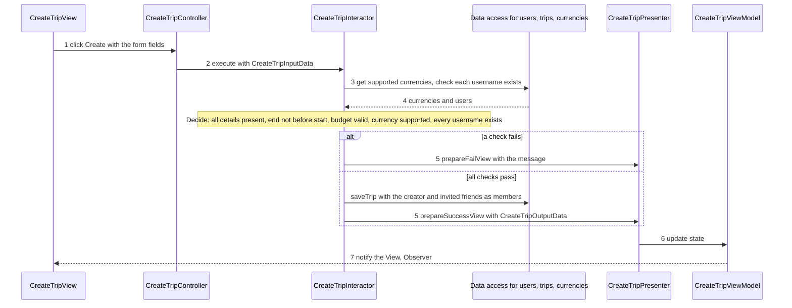
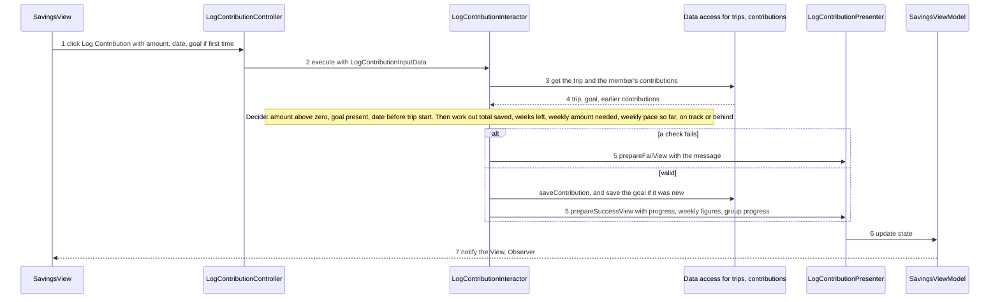
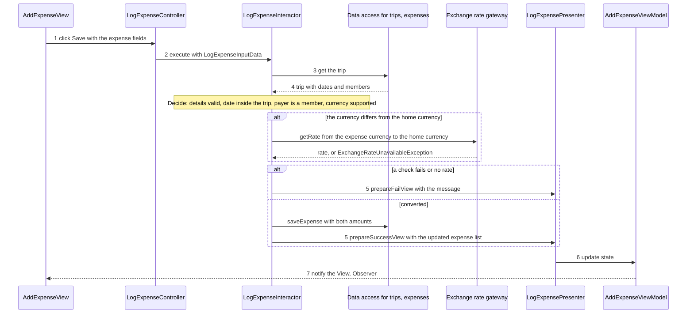
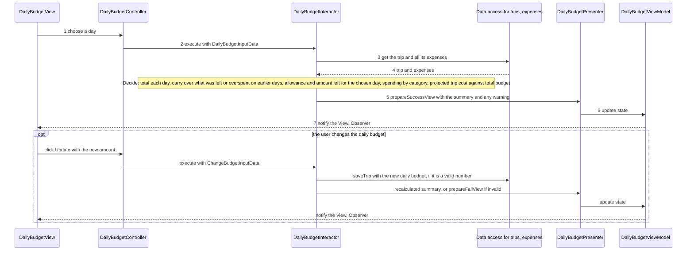
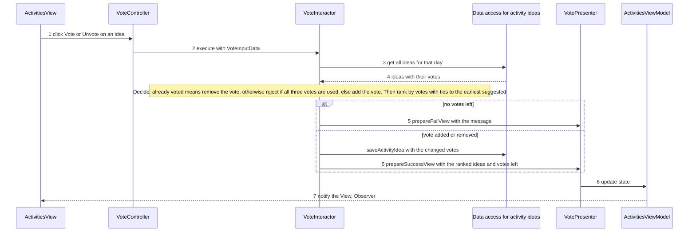

# Trip Planner & Budgeter

**Team name:** _(add team name)_

## Team Members

- Amelia Ha
- Emily Tran
- Jadyn Nok Tong Mo
- Tamima Wadageri
- Yi Xuan (Jessica) Su

---

## Project Description

### Domain

Travel and personal finance.

Planning a trip with friends usually means a group chat, a shared spreadsheet and a currency app, none of which talk to each other. Trip Planner & Budgeter puts the whole trip in one place: the group saves up for it together, decides what to do each day, and keeps track of what everyone spends while they are away.

### Specification

A **user** signs up with a username and password. A user can create a **trip** by giving it a name, a destination, a start date, an end date, a home currency (the currency the group thinks in, such as Canadian dollars) and a daily budget, and, if they like, by naming the friends (other users) who are coming. The user who creates a trip is its first **member**. Each user sees a list of the trips they belong to and can open any of them.

**Before the trip**, each member sets a personal **savings goal** and logs **contributions** as they put money aside. Each time, the app tells them how much they still need to save per week to reach their goal before the trip starts, and whether the pace they have kept so far is enough. The group can also see everyone's combined progress.

**While planning**, members suggest **activity ideas** for specific days of the trip. Each member has three votes per day to spend on that day's ideas, and each day's ideas are ranked by votes so the group can see what is most popular.

**During the trip**, members log **expenses**: what it was, how much, in which currency, which category (such as food, transport or lodging), on which day, and who paid. Amounts paid in another currency are converted into the home currency at the current exchange rate. For any day of the trip, a member can see how much the group may spend that day (the daily budget, plus anything left over from earlier days, or minus anything overspent), how much has been spent, a breakdown by category, and whether the trip as a whole is heading over budget. The daily budget can be changed at any time.

---

## User Stories

1. **Create and share a trip.** As a group trip organizer, I want to create a trip and invite my friends to it at the same time, so that we can all plan and track the same trip together.
2. **Save up together.** As a trip member, I want to log what I put aside and be told whether I am saving fast enough, so that I reach my savings goal before the trip starts.
3. **Log spending in any currency.** As a traveller, I want to log what I spend in whatever currency I paid in, so that the group has one record of spending in our home currency.
4. **Stay on budget each day.** As a traveller, I want to see how much the group can still spend today, counting what was left over or overspent on earlier days, and whether we are heading over budget for the whole trip, so that we know whether we need to cut back.
5. **Decide what to do.** As a trip member, I want to spend my votes on the activity ideas for each day, so that we spend our time on what the group wants most.

---

## Use Cases

There are five use cases, one per user story. Each follows the course's lightweight format. Screen sketches, before and after, including the error cases, are in [`docs/ui-sketches/`](docs/ui-sketches/).

Every use case below assumes the user is signed in (signup, login and logout come from the course starter code).

### Terms and Assumptions

These apply to every use case below, so they are stated once here.

* **Home currency.** The currency a whole trip is tracked in. The daily budget, savings goals, contributions and every total are in the home currency. A home currency must be one of the roughly 30 major currencies the exchange rate service supports.
* **Today** means the date on the user's computer.
* **Days of the trip.** Every date from the start date to the end date, both included. A trip can be a single day (start date equal to end date). The start date can be in the past, so a trip that is already underway can still be set up.
* **Members.** All members of a trip have the same permissions: any member can log expenses, change the daily budget and vote. Invited friends are added straight away and do not have to accept. In this version, members can only be added when the trip is created.
* **Usernames** must be typed exactly as the user signed up, including capital letters.
* **Savings goal.** Each member has one goal. It is set the first time they log a contribution and cannot be changed in this version.
* **Weeks** are counted as whole weeks, rounded up, with a minimum of one.
* **Exchange rates.** The latest rate available is used (the service updates once each working day), not the rate from the day of the expense. Once an expense is recorded, its amount in the home currency does not change.
* **Money** is shown rounded to the cent.

### Use Case 1: Create a trip with members

**Lead:** Tamima Wadageri

**Sketches:** [main flow](docs/ui-sketches/uc1-create-trip.png), [error cases](docs/ui-sketches/uc1-create-trip-errors.png)

**Primary actor:** A user planning a trip

**Preconditions:**

* The user is signed in.

**Trigger:** The user asks to create a new trip.

**Success outcome:** The trip exists with the user and every invited friend as members, each invited friend sees it in their own list of trips, and the user is looking at the new trip.

**Main success scenario:**

1. The user asks to create a new trip.
2. The user provides a trip name, destination, start date, end date, home currency and daily budget, and optionally the usernames of the friends to invite.
3. The system checks the details.
4. If any friends were named, the system checks that every username belongs to an existing user.
5. The system saves the trip with the user and the invited friends as members.
6. The system shows the new trip and its members.

**Extensions:**

* **3a.** A detail is missing.
  1. The system explains which detail is missing and does not create the trip.
* **3b.** The end date is before the start date.
  1. The system explains the problem and does not create the trip.
* **3c.** The daily budget is not a number or is negative.
  1. The system explains the problem and does not create the trip.
* **3d.** The home currency is not one the app supports.
  1. The system explains the problem and does not create the trip.
* **4a.** One or more usernames do not belong to any user.
  1. The system lists the usernames it could not find and does not create the trip.
* **4b.** The same username is listed more than once, or is the user's own.
  1. The system counts each person once.
* **4c.** No friends were named.
  1. The trip is created with the user as its only member.

### Use Case 2: Log a savings contribution

**Lead:** Emily Tran

**Sketches:** [main flow](docs/ui-sketches/uc2-contribution.png), [alternative outcomes](docs/ui-sketches/uc2-contribution-alt.png), [error cases](docs/ui-sketches/uc2-contribution-errors.png)

**Primary actor:** A member of the trip

**Preconditions:**

* The user is a member of the trip and is viewing it.

**Trigger:** The user asks to record money they have put aside for the trip.

**Success outcome:** The contribution is recorded, and the user knows how much more they need to save each week to reach their goal before the trip starts and whether their pace so far is enough. The group's progress includes the new contribution.

**Main success scenario:**

1. The user asks to log a contribution and provides an amount and a date, both in the trip's home currency. If the user has no savings goal yet, the user also provides one.
2. The system checks the details.
3. The system records the contribution (and the goal, if one was provided).
4. The system works out how much the user has saved in total, how much is left to reach the goal, and how many weeks there are from the contribution's date to the trip's start date.
5. The system works out how much the user needs to save per week from now to reach the goal in time, and how much per week they have saved so far (their total savings divided by the weeks from the date of their first contribution to the date of this one).
6. The system shows the user's progress, tells them whether they are on track (their weekly pace so far is at least the weekly amount they now need), and shows the group's progress (everyone's savings out of everyone's goals, where a member with no goal yet counts as a goal of zero).

**Extensions:**

* **2a.** The amount is not a number, or is zero or negative.
  1. The system explains the problem and records nothing.
* **2b.** The user has no savings goal and did not provide a valid one.
  1. The system asks for a goal and records nothing.
* **2c.** The date is on or after the trip's start date.
  1. The system says savings are for before the trip and records nothing.
* **4a.** The user's total savings are now equal to or more than their goal.
  1. The system tells the user their goal is reached and does not show a weekly amount.

### Use Case 3: Log an expense

**Lead:** Jadyn Nok Tong Mo

**Sketches:** [main flow](docs/ui-sketches/uc3-log-expense.png), [error cases](docs/ui-sketches/uc3-log-expense-errors.png)

**Primary actor:** A member of the trip

**Preconditions:**

* The user is a member of the trip and is viewing it.

**Trigger:** The user asks to record money that was spent on the trip.

**Success outcome:** The expense is recorded with its amount in the currency it was paid in and in the trip's home currency, and appears in the trip's list of expenses.

**Main success scenario:**

1. The user asks to log an expense and provides a description, amount, currency, category (flight, transport, food, lodging, activity, shopping or other), date, and who paid.
2. The system checks the details.
3. The system works out the amount in the trip's home currency using the latest exchange rate.
4. The system records the expense.
5. The system shows the trip's expenses, including the new one with both amounts.

**Extensions:**

* **2a.** The description is missing, or the amount is not a number, or is zero or negative.
  1. The system explains the problem and records nothing.
* **2b.** The date is not within the trip's dates.
  1. The system says the date is not part of this trip and records nothing.
* **2c.** The person who paid is not a member of the trip.
  1. The system explains the problem and records nothing.
* **2d.** The currency is not one the app supports.
  1. The system explains the problem and records nothing.
* **3a.** The currency is the trip's home currency.
  1. The system uses the amount as it is, with no conversion.
* **3b.** The exchange rate cannot be found, for example because there is no internet connection.
  1. The system says it could not get the exchange rate and asks the user to try again. Nothing is recorded.

### Use Case 4: View the daily budget

**Lead:** Yi Xuan (Jessica) Su

**Sketches:** [main flow and alternative outcomes](docs/ui-sketches/uc4-daily-budget.png), [changing the budget](docs/ui-sketches/uc4-daily-budget-change.png)

**Primary actor:** A member of the trip

**Preconditions:**

* The user is a member of the trip and is viewing it.

**Trigger:** The user asks to see how spending compares with the budget for a day of the trip.

**Success outcome:** The user sees how much the group may spend that day, how much was spent, how much is left, what the spending was on, and whether the trip as a whole is heading over budget.

**Main success scenario:**

1. The user asks for the budget summary and chooses a day of the trip.
2. The system adds up that day's expenses in the trip's home currency.
3. The system works out what the group may spend that day: the daily budget, plus whatever was left unspent on every earlier day of the trip, minus whatever was overspent.
4. The system works out how much is left for the day.
5. The system works out the projected cost of the whole trip: the average spent per day over the days from the first day of the trip up to and including the chosen day, times the number of days in the whole trip. It compares this with the trip's total budget (daily budget times number of days in the trip).
6. The system shows the amount spent, the amount allowed, the amount left, the spending by category, and the projected cost against the total budget.

**Extensions:**

* **2a.** No expenses were logged that day.
  1. The system treats the day as nothing spent.
* **3a.** The chosen day is the first day of the trip.
  1. The system allows exactly the daily budget, with nothing carried over.
* **4a.** The group spent more than the day's allowance.
  1. The system shows how much over the group is and makes this stand out.
* **5a.** The projected cost is more than the total budget.
  1. The system shows a warning with the amount the trip is projected to go over.
* **6a.** The user changes the daily budget.
  1. The user provides the new amount.
  2. The system checks that it is a number and not negative.
  3. The system saves the new daily budget, which applies to every day of the trip, including earlier days.
  4. The system repeats steps 3 to 6 with the new budget.
  * **6a.2a.** The amount is not a number or is negative.
    1. The system explains the problem and keeps the current budget.

### Use Case 5: Vote on activity ideas

**Lead:** Amelia Ha

**Sketches:** [main flow](docs/ui-sketches/uc5-vote.png), [alternative flows](docs/ui-sketches/uc5-vote-alt.png)

**Primary actor:** A member of the trip

**Preconditions:**

* The user is a member of the trip and is viewing a day's activity ideas, and there is at least one.

**Trigger:** The user asks to vote for an idea.

**Success outcome:** The user's vote is counted once for that idea, the day's ideas are ranked by number of votes (ties go to the idea suggested first), and the user knows how many of their three votes for that day are left.

**Main success scenario:**

1. The user asks to vote for an idea.
2. The system counts how many of their three votes for that day the user has already used.
3. The system records the vote.
4. The system ranks the day's ideas by number of votes.
5. The system shows the ranked ideas and how many votes the user has left for that day.

**Extensions:**

* **2a.** The user already voted for this idea.
  1. The system removes their vote instead.
  2. The use case continues at step 4.
* **2b.** The user has already used all three of their votes for that day, and has not voted for this idea.
  1. The system says there are no votes left, suggests taking a vote back from another idea, and changes nothing.
* **4a.** Two or more ideas have the same number of votes.
  1. The system ranks the idea that was suggested first higher.

---

## Minimal Viable Product (MVP)

All five use cases are in the MVP, and each member leads one. Sign up, log in and log out come from the course's starter code and are shared.

| Team Member | MVP Use Case |
|-------------|--------------|
| Tamima Wadageri | 1. Create a trip with members |
| Emily Tran | 2. Log a savings contribution |
| Jadyn Nok Tong Mo | 3. Log an expense |
| Yi Xuan (Jessica) Su | 4. View the daily budget |
| Amelia Ha | 5. Vote on activity ideas |

Small supporting screens are needed to run these but are not use cases that anyone leads: the list of the user's trips and the trip screen that links to the five use cases, and a basic form to suggest an activity idea (so that there is something to vote on).

---

## Entities

A class diagram is in [`docs/diagrams/entities.puml`](docs/diagrams/entities.puml).

### User
- **Instance variables:** `name: String`, `password: String`
- **Methods:** getters

### Trip
- **Instance variables:** `id`, `name`, `destination`, `startDate: LocalDate`, `endDate: LocalDate`, `homeCurrency` (ISO code such as "CAD"), `dailyBudget: double`, `ownerUsername`, `memberUsernames: List<String>`, `savingsGoals: Map<String, Double>`
- **Methods:** `addMember(username): boolean`, `hasMember(username)`, `containsDate(date)`, `getNumberOfDays()`, `getDates()`, `getTotalBudget()`, `setDailyBudget(amount)`, `setSavingsGoal(username, amount)`, `hasSavingsGoal(username)`, `getSavingsGoal(username)`, `getTotalSavingsGoal()`

### Contribution
- **Instance variables:** `id`, `tripId`, `memberUsername`, `amount: double` (home currency), `date: LocalDate`
- **Methods:** getters

### Expense
- **Instance variables:** `id`, `tripId`, `payerUsername`, `description`, `amount: double`, `currency`, `amountInHomeCurrency: double`, `category: ExpenseCategory`, `date: LocalDate`
- **Methods:** getters
- `ExpenseCategory` is an enum: `FLIGHT, TRANSPORT, FOOD, LODGING, ACTIVITY, SHOPPING, OTHER`

### ActivityIdea
- **Instance variables:** `id`, `tripId`, `day: LocalDate`, `title`, `estimatedCost: double`, `proposedBy`, `createdAt: LocalDateTime`, `voterUsernames: Set<String>`
- **Methods:** `addVote(username)`, `removeVote(username)`, `toggleVote(username)`, `hasVoted(username)`, `getVoteCount()`, and the `BY_RANK` comparator (most votes first, ties broken by earliest suggestion)

All entities check their own inputs (for example, amounts must be positive and currencies must be real ISO codes), so invalid data can never be created.

---

## API Usage

### Frankfurter (exchange rates)

**Documentation:** https://frankfurter.dev

**How it is used in the program:** Converts expenses paid in a foreign currency into the trip's home currency (Use Case 3). The list of supported currencies is also used to check the home currency of a new trip (Use Case 1) and to fill the currency dropdowns. Free, no API key, rates from the European Central Bank, updated every working day. About 30 major currencies are supported.

- Rate request: `GET https://api.frankfurter.dev/v1/latest?base=CAD&symbols=JPY` returns `{"amount":1.0,"base":"CAD","date":"2026-11-16","rates":{"JPY":111.72}}`
- Currency list: `GET https://api.frankfurter.dev/v1/currencies`
- Code: `data_access.FrankfurterExchangeRateGateway`, used through the `use_case.exchange_rate.ExchangeRateDataAccessInterface` interface, so use cases never depend on the API directly.

**Status:** Endpoints confirmed working on Nov 16, 2026. Run `app.ExchangeRateApiDemo` to see live rates from Java.

### Data persistence

Users are saved to `users.csv` (course starter code). Trips, contributions, expenses and activity ideas are saved to `trips.json` by `data_access.JsonFileTripDataAccessObject`, and loaded again when the app starts. Use cases only see small data access interfaces, so the storage could later be swapped for a database without changing any use case code.

---

## Design Diagrams

### UML Class Diagram

- Entities: [`docs/diagrams/entities.puml`](docs/diagrams/entities.puml)

### Sequence Diagrams

Every use case follows the Clean Architecture flow from the course (View, Controller, Interactor, Data Access, Presenter, ViewModel). Each diagram below fills that flow in with what the use case really does: what is loaded and saved, the decision the interactor makes, and the failure path. Class names are proposed and may be renamed by the lead in their own pull request.

#### Use Case 1: Create a trip with members

#### Use Case 2: Log a savings contribution

#### Use Case 3: Log an expense

#### Use Case 4: View the daily budget

#### Use Case 5: Vote on activity ideas

---

## How to Run

1. Open the project in IntelliJ as a Maven project (JDK 11 or newer, as in the course Quickstart).
2. Optional: run `app.SampleDataSeeder` once to create five sample users (`tamima`, `amelia`, `jadyn`, `jessica`, `emily`, password `password`) and a sample trip.
3. Run `app.Main`.

Tests: `mvn test` · Coverage report: `mvn verify`, then open `target/site/jacoco/index.html` · Style check (Google Java Style, same rules as the course notes): `mvn checkstyle:check` · Auto-format: `mvn spotless:apply`

---

## Notes

### Future extensions
- Invite more friends to an existing trip
- Standalone currency converter screen (reuses the same exchange rate interface)
- Set a savings goal and suggest activities as full use cases of their own
- Save flights, transport, restaurants and lodging to the trip with their prices
- Split costs and show who owes whom
- Trip-wide spending charts
- Store data online so members on different laptops share the same trip
