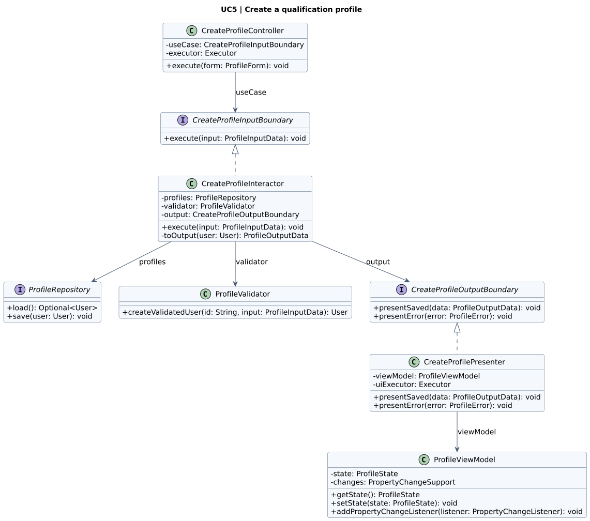
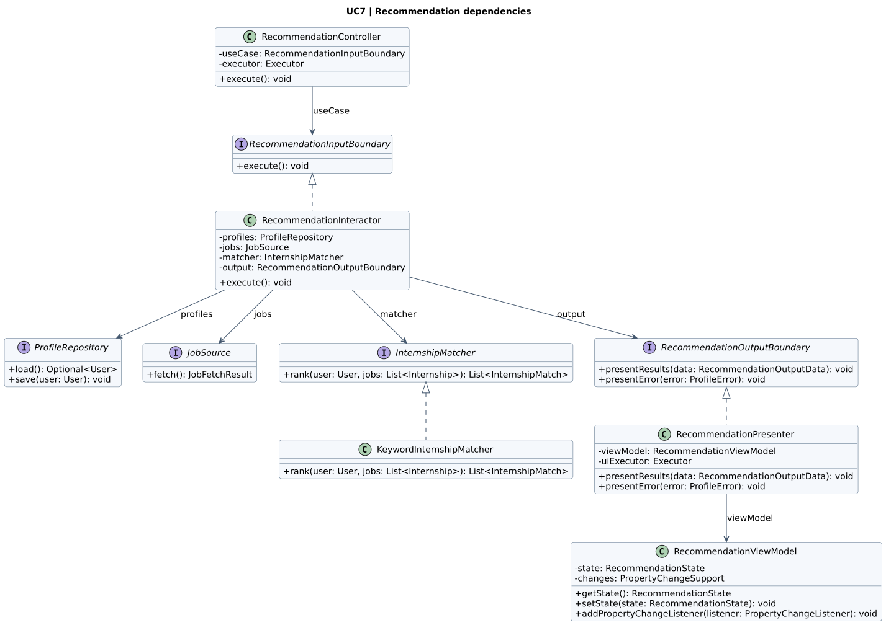
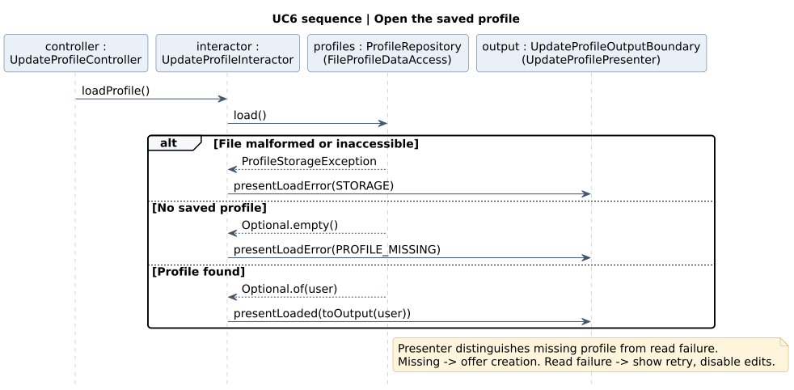
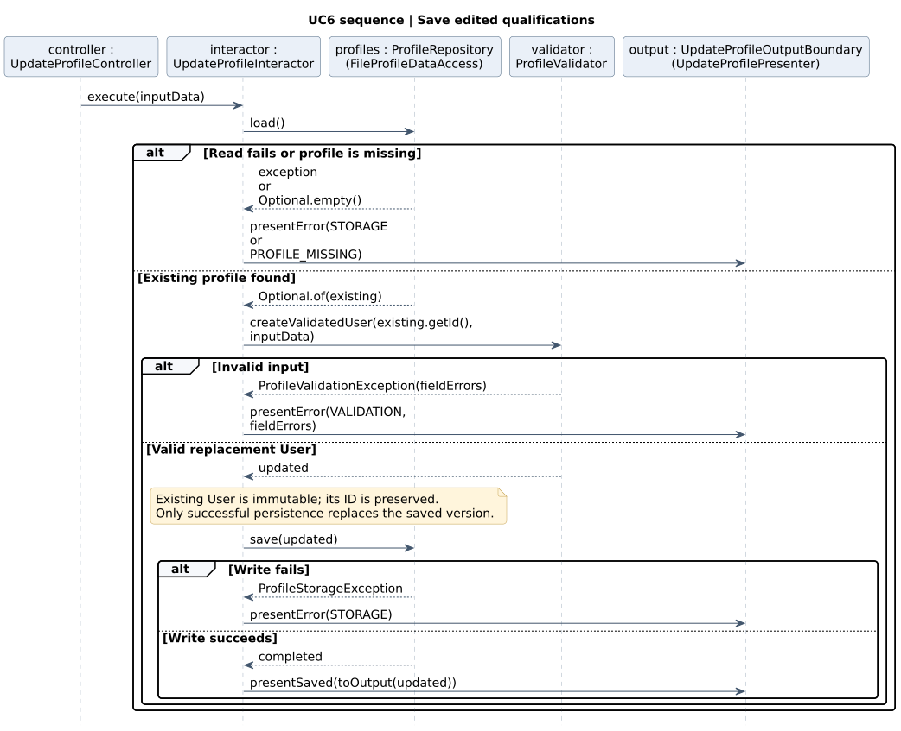
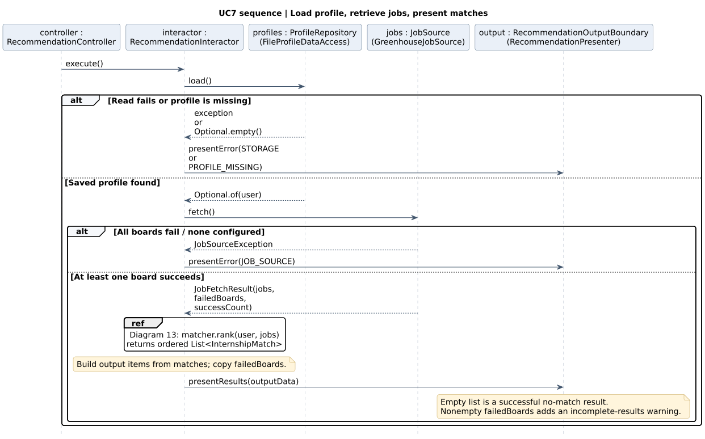

# CSC207: Internship Finder and Tracker
## [TUT0301] Group 40 - BA3185
### Team Members
- Emily Kim
- Jerry Zhou
- Austin Wu
- Yuheng Liu
- Lingnan Meng
---
## Project Description
### Domain
This project will be a Java Swing desktop application that helps students discover internship opportunities, 
create/record the resume used for each application, and track application progress and deadlines.
---
## User Stories
### User Story 1
As a user, I want to search for internship opportunities that match my search keywords so that I can find relevant positions and spend less time browsing company websites.

### User Story 2
As a user, I want to create or upload multiple resume versions and associate them with my saved internship 
applications so that I can keep track of which resume I submitted to each employer.

### User Story 3
As a user, I want to save internship opportunities, update their application statuses, and organize them by priority 
or deadline so that I can manage my applications in one place.

### User Story 4
As a user, I want to have a hub where I can receive a visual summary of my internship application progress, including 
the number of applications submitted over time and the number that have progressed beyond the first interview, 
so that I can evaluate my application progress.

### User Story 5
As a user, I want to create a profile with all my qualifications so that I would be recommended internships without 
having to search

### User Story 6
As a user, I want to save job applications that I may apply to into a shortlist so that I can easily find them and 
work on them later.

### User Story 7
As a user, I want to sort my shortlist of applications by due date so that I can identify which applications have 
the earliest deadlines and prioritize them accordingly.

### User Story 8
As a user, I want to sort my shortlist of applications by relevancy so that I can identify which applications are 
most useful to my career development and prioritize them accordingly.

---
## Use Cases
### Use Case 1
### Use Case 2
Name: Import Resume

Primary actor: A user finding internships

Preconditions: User should be logged in with a profile

Trigger: The user clicks the import resume button

Success outcome: Imported resume is saved on the system

Main success scenario:  
1. User signs in with their profile
2. User clicks on their list of resumes
3. User clicks on a new resume
4. User selects how they want to import a new resume
5. Resume is imported and saved in the list

Extensions:Ask user if they want to add a new resume when they make a new application

### Use Case 3
Name: Create a resume in the system

Primary actor: A user finding internships

Preconditions: User should be logged in with a profile

Trigger: User clicks the resume builder

Success outcome: A resume is saved on the system

Main success scenario:  
1. User signs in with their profile
2. User clicks on the resume builder
3. Program asks if they want to save an externally made resume or build on the program
4. Program asks for user’s specifications
5. Resume is created and program asks for confirmation
6. Resume is saved in the list of resumes

Extensions: Ask user if they would like to build a resume before sending them through the link

### Use Case 4: Search Internship Opportunities
Owner: Yuheng Liu

MVP: Yes

Implementation: [Finder architecture and verification](docs/design/finder.md).
Shared integration contract: [Job source and Ling compatibility review](docs/design/shared-job-contract.md).

Primary actor: A user looking for internship opportunities.

Supporting actor: An external job-listing service, initially the Greenhouse Job Board API.

Preconditions:
- The application is running, and the user can access the Finder feature.
- At least one supported company job board has been configured.
  Trigger:
  The user submits a keyword search.

Success outcome:
The system displays matching internship opportunities, the number of matches, and application links so that the user can review relevant positions.

Main success scenario:
1. The user enters one or more keywords and requests a search.
2. The system checks that the input contains at least one non-empty keyword.
3. The system retrieves job postings from the configured company job boards.
4. The system identifies internship postings and filters them according to the search rules below.
5. The system displays the number of matching postings and each posting’s title, company, location, and application link. Missing location information is displayed as “Not specified.”
6. The user reviews the search results.
   Extensions:
- 2a. The search input is empty or contains only whitespace.
  The system asks the user to enter at least one keyword and does not retrieve job postings. The user may correct the input and return to step 1.
- 3a. All configured job boards fail to return data because of a connection problem, timeout, or service error.
  The system explains that the search could not be completed and allows the user to retry. It does not present the failure as a successful search with zero matches.
- 3b. Some configured job boards fail to return data.
  The system continues to step 4 using the successfully retrieved postings. When displaying the results, it identifies the unavailable sources and states that the results are incomplete.
- 4a. No retrieved internship postings match the search criteria.
  The system displays a result count of zero and explains that no matching internships were found in the retrieved postings. The user may revise the keywords and return to step 1.
- 6a. The user selects an application link.
  The system opens the selected posting’s application page in the user’s browser. Opening the page does not create an application record or mark the position as applied.
  Search rules for the MVP:
- Internship identification uses explicit title indicators, such as “Intern,” “Internship,” or “Co-op.”
- Keyword matching ignores capitalization and leading or trailing whitespace.
- Every submitted keyword must appear in the posting’s title or description for the posting to match.
- Search results cover only the configured company job boards.
- A keyword match indicates relevance, not verified eligibility. Users must review the employer’s requirements before applying.
  Failure guarantee:
  An unsuccessful search does not modify saved jobs, resumes, or application records.

### Use Case 5: Create a Qualification Profile
Lead: Lingnan Meng
MVP: Yes
Primary actor: Student
Preconditions: The application is available, and the student does not have a saved profile.
Trigger: The student requests to create a profile.
Success outcome: The student's qualifications and preferences are saved, are available in later sessions, and can be used for personalized recommendations.

Main success scenario
1. The student requests to create a profile.
2. The system requests their program, optional expected graduation year, skills, and optional internship preferences.
3. The student supplies the information and submits it.
4. The system checks the required information and the format of any graduation year entered. Repeated skill entries are treated as one skill.
5. The system saves the profile and shows the saved information.
6. The system offers personalized suggestions through P3 without requiring a separate search query.
Extensions
- 3a. The student cancels before submission: No profile is created.
- 4a. The program or skills are missing, or the graduation year is invalid: The system identifies the affected information and preserves the entered values. The student corrects them and returns to step 3.
- 5a. Saving fails: The system explains that the profile was not saved and retains the entered values for another attempt.
- 6a. Recommendations are unavailable: The created profile remains saved. P3 handles the recommendation failure.

### Use Case 6: Update a Qualification Profile
Lead: Lingnan Meng
MVP: Yes
Primary actor: Student
Preconditions: The student has a saved profile.
Trigger: The student requests to update their qualifications or preferences.
Success outcome: The revised profile is saved, is visible to the student, and is used for later recommendations.

Main success scenario
1. The student requests to update their profile.
2. The system displays the currently saved qualifications and preferences.
3. The student changes their information and submits the changes.
4. The system checks the same profile rules used during creation.
5. The system saves and displays the updated profile.
6. The student can view recommendations through P3 using the updated information.
Extensions
- 2a. The saved profile cannot be loaded: The system explains the problem and offers another attempt; it does not present an empty profile as the saved one.
- 3a. The student cancels: The previously saved profile remains unchanged.
- 4a. Updated information is invalid: The system explains what needs correction and retains the edits. The previous saved version remains unchanged until valid changes are successfully saved.
- 5a. Saving fails: The system reports the failure, retains the edits for retrying, and preserves the previous saved profile.

### Use Case 7: View Personalized Internship Recommendations
Lead: Lingnan Meng
MVP: Yes; main use case for this feature
Primary actor: Student
Supporting actor: Greenhouse job-posting service
Preconditions: The student has a saved profile that meets the profile requirements.
Trigger: The student opens personalized recommendations, including when continuing from profile creation.
Success outcome: The student sees suggestions based on the latest saved profile, with matching reasons and application links, without entering a manual search query.

Main success scenario
1. The student requests to view personalized recommendations.
2. The system obtains the latest saved profile.
3. The system obtains job postings from the supported company boards.
4. The system identifies internship postings and applies the student's saved role, location, and work-arrangement preferences.
5. The system identifies distinct profile skills mentioned in the remaining postings and orders postings with at least one skill match by the number of matched skills.
6. The system displays each suggestion's title, company, location, work-arrangement information, matched skills, and application link.
Extensions
- 2a. The profile cannot be loaded: The system explains the problem and offers a retry. It does not label generic results as personalized recommendations.
- 3a. All job sources fail: The system explains that recommendations are unavailable and allows a retry. It does not treat a retrieval failure as proof that there are no suitable jobs.
- 3b. Only some company boards fail: The system continues with available postings and identifies that the results are incomplete.
- 4a. A work arrangement is unclear: The system marks it UNKNOWN and keeps it available for review with that label.
- 5a. No postings match: The system explains that no matches were found and offers the option to update the profile or preferences.
Limits: Suggestions indicate keyword relevance, not verified eligibility. Unspecified requirements stay unknown. An empty result is a valid result. The MVP does not automatically submit applications.

### Use Case 8: Add an Application to the Shortlist
Owner: Rui Zhou
Primary actor: User
Preconditions:
- The application is running and the user is logged in.
- The user is viewing the job display page for a specific job.
Trigger: The user clicks the “Save to Shortlist” button for the currently displayed job.
Success outcome: 
- The selected job application is added to the user's shortlist and can be viewed later from the home page or shortlist 
page.
Main Success Scenario: 
1. The user requests to add the currently displayed job application to the shortlist.
2. The system identifies the currently displayed job application.
3. The system checks whether the application is already in the user's shortlist.
4. The system adds the application to the user's shortlist.
5. The system saves the updated shortlist.
6. The system confirms that the application was successfully added.
7. The user can later view the saved application from the shortlist on the home page.
Extensions:
3a. The application is already in the shortlist.
- The system does not add a duplicate application.
- The system informs the user that the application has already been saved.
4a. The application can no longer be saved or does not exist.
- The system does not modify the shortlist.
- The system informs the user that the application could not be added.
5a. The shortlist cannot be saved because of a system or data-storage error.
- The system informs the user that the application could not be saved.
- The user's existing shortlist remains unchanged.

### Use Case 9: Sort Shortlist by Due Date
Owner: Rui Zhou
Primary actor: User
Preconditions:
- The application is running and the user is logged in.
- The user is viewing their shortlist.
- The user has access to their shortlist.
Trigger: The user clicks the button to sort the shortlist by due date.
Success outcome:
- The applications in the shortlist are displayed in order according to their due dates, allowing the user to identify 
the applications with the closest deadlines.
Main Success Scenario:
1. The user requests to sort the shortlist by due date.
2. The system retrieves the applications currently saved in the user's shortlist.
3. The system retrieves the due date associated with each application.
4. The system orders the applications by due date, with the earliest due dates appearing first.
5. The system displays the newly sorted shortlist to the user.
Extensions:
2a. The shortlist is empty.
- The system informs the user that there are no applications to sort.
- The shortlist remains unchanged.
3a. One or more applications do not have a due date.
- The system still sorts all applications that have known due dates.
- Applications without a due date are displayed after applications with known due dates.
3b. Due-date information cannot be retrieved for one or more applications.
- The system sorts applications with available due-date information and places applications with 
unavailable due dates at the bottom of the shortlist.
4a. Multiple applications have the same due date.
- Applications with the same due date are grouped together.
- The system preserves their existing relative order.

### Use Case 10: Sort Shortlist by Relevancy
Owner: Rui Zhou 
Primary actor: User
Preconditions:
- The application is running and the user is logged in.
- The user is viewing their shortlist.
Trigger: The user clicks the button to sort their shortlist by relevancy.
Success outcome: 
- The applications in the shortlist are displayed in descending order of relevancy based on the user's 
preferred career fields, allowing the user to identify applications that best match their career interests.
Main Success Scenario:
1. The user selects the option to sort by relevancy.
2. The system retrieves the user's preferred career fields from their profile.
3. The system retrieves the user’s shortlist.
4. The system identifies keywords in each shortlisted application's job title that match the user's preferred fields or their associated synonyms.
5. The system calculates a relevancy score for each application based on the number of distinct preferred fields matched.
6. The system sorts the applications in descending order of relevancy score.
7. The system displays the sorted shortlist to the user.
Extensions:
2a. The shortlist is empty.
- The system informs the user that there are no applications to sort.
- The shortlist remains unchanged.
2b. The user has not specified any preferred career fields.
- The system informs the user that preferred career fields must be specified to sort applications by relevancy.
- The shortlist remains in its existing order.
4a. No keywords match any of the user's preferred fields.
- The system assigns a relevancy score of zero to every application.
- The system preserves the existing order of the shortlist.
5a. Multiple applications have the same relevancy score.
- The system preserves their existing relative order.
Postconditions:
- The shortlisted applications are displayed in descending order of relevancy based on the user's preferred career 
fields.
- Applications with equal relevancy scores retain their existing relative order.
- No applications are added to or removed from the shortlist.
- The user's saved applications remain unchanged; only their displayed order is affected.

---
## Minimal Viable Product (MVP)
| Team Member | MVP Use Case |
|-------------|--------------|
|Emily Kim| Use Case |
|Jerry Zhou| Use Case |
|Austin Wu|          |
|Lingnan Meng| Use Case |
|Yuheng Liu| UC4: Search Internship Opportunities |
---
## Entities
- User
- Resume
- Application
- JobPosting
---
## API Usage
**API Name:**: Greenhouse Job Board API
**Documentation:** [https://docs.greenhouse.io/job-board.html]
**How it is used in the program:**
The Finder feature will use the Greenhouse Job Board API to retrieve
public job postings from a configured list of company job boards.

The program will send an HTTP GET request to:
`https://boards-api.greenhouse.io/v1/boards/{board_token}/jobs?content=true`

Each `board_token` identifies a company's job board. The `content=true`
parameter includes job descriptions in the JSON response. These public
GET requests do not require authentication or an API key.

The program will parse the response into JobPosting objects containing
information such as the job ID, title, location, description, and
application URL. It will then identify internship postings and apply
keyword matching to their titles and descriptions within the application.

Matching results will be displayed in the Swing interface with links
to the original application pages. Searches will cover only the
configured company job boards.
The packaged Java client successfully retrieved both configured boards (Cloudflare and Figma)
on 2026-11-16. Availability and posting counts can change; use `--check-api` to recheck.
---
## Design Diagrams
### Profile — Class Diagrams






### Profile — Sequence Diagrams







### UML Class Diagram
### Sequence Diagrams
---
## How to Run
UC4 (Finder) is implemented on this branch. Other team features are still in progress.

Prerequisites: **JDK 11** and Maven. In IntelliJ, import `pom.xml` and select an installed
JDK 11 for both the project SDK and Maven runner. Check `mvn -version` before building.

```bash
mvn verify
java -jar target/TeamProject-1.0-SNAPSHOT.jar
```

On macOS with multiple JDKs, select JDK 11 first:

```bash
export JAVA_HOME="$(/usr/libexec/java_home -v 11)"
```

The default boards are Cloudflare and Figma. Enter keywords, press Search (or Enter),
select a result and open its application page. No login or API key is required for Finder.
The application does not automatically apply or mark a job as applied.

For an offline demonstration using clearly labelled fictional listings:

```bash
java -jar target/TeamProject-1.0-SNAPSHOT.jar --demo
```

Try `python` for two sample matches, `java` for one, or `unmatched` for zero.

To configure company boards, create a properties file containing `boardToken=Company Name`
entries and supply its path:

```bash
java -jar target/TeamProject-1.0-SNAPSHOT.jar --boards /path/to/boards.properties
```

API connectivity can be checked separately from the UI and unit tests:

```bash
java -jar target/TeamProject-1.0-SNAPSHOT.jar --check-api
```

Tests use local HTTP fixtures and run without an internet connection once dependencies
are installed. `mvn validate` runs Checkstyle; `mvn verify` also tests and packages.
`mvn spotless:apply` applies the course Google formatter (run it with JDK 11).
See the [Finder design](docs/design/finder.md) for CA boundaries and acceptance coverage.
---
## Notes
[Any additional project information.]
