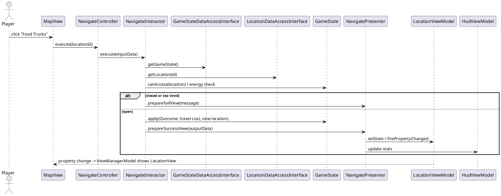
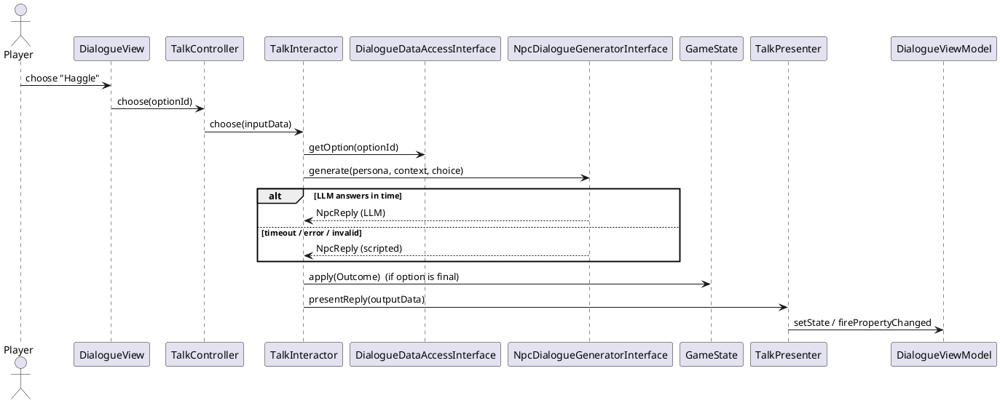

# Team Project

Please keep this up-to-date with information about your project throughout the term.

The readme should include information such as:
- a summary of what your application is all about
- a list of the user stories, along with who is responsible for each one
- information about the API(s) that your project uses 
- screenshots or animations demonstrating current functionality

By keeping this README up-to-date,
your team will find it easier to prepare for the final presentation
at the end of the term.


---
# UofTears: Survive the Semester

## Team Information

### Team Members
- Member 1 (Name) – Environment & Navigation
- Member 2 (Name) – Inventory, Persistence & Transcript
- Member 3 (Name) – NPC Interactions, Combat & LLM
- Member 4 (Name) – Challenges & Accounts

---

## Project Description

### Domain

**Games / Simulation (survival adventure with mini-games).**

UofTears is a Java Swing game in which you play a University of Toronto student trying to survive one chaotic week. You manage four stats: **Energy**, **Money**, **Sanity** and **Academic Survival**. Each day begins with the **real Toronto weather**, which decides which buildings are open, how costly walking is, and how hard every challenge is. The player **navigates** a small campus map (Residence, Robarts, Bahen, Food Trucks, Exam Hall), **collects and uses items**, **talks to NPCs** whose replies are written by an **LLM**, **fights** the shawarma truck lady for a discount, and plays **challenges** such as a reaction race for a Robarts seat and a "midterm from hell" memory test. Games, event logs and day-by-day transcripts are stored in a **local SQLite database**, so players can resume a game and review past runs.

*Noun/verb analysis (→ entities):* player, stats, day, time block, weather, location, item, inventory, buff, NPC, dialogue, challenge, outcome, game state, transcript, run, account. Verbs: start day, travel, pick up, buy, use, talk, choose, fight, play, unlock, save, load, review.

### Core Game Rules
- 7 days; each day has **3 time blocks**, and each NPC conversation or challenge uses one. When blocks run out the day ends (sleep: Energy +20).
- Starting stats: Energy 100, Sanity 100, Academic Survival 50, Money $50. Stats are clamped to 0–100 (Money ≥ 0).
- **Lose** if Energy, Sanity or Academic Survival reaches 0. **Win** by finishing Day 7 with Academic Survival ≥ 60.
- **Weather** gives a Difficulty multiplier on challenges, an energy-loss multiplier, and closures:

| Weather | Difficulty | Energy-loss multiplier | Effect on map |
|---|---|---|---|
| Clear | 0.9 | 1.0 | All open |
| Cloudy | 1.0 | 1.0 | All open |
| Rain | 1.15 | 1.2 | All open |
| Snow | 1.3 | 1.5 | Food Trucks closed |
| Extreme temp (< -15 °C or > 30 °C) | 1.3 | 1.5 | Food Trucks closed |

| Location | What's there | Access rule |
|---|---|---|
| Residence | Free Coffee pickup | Always open |
| Robarts Library | Study-spot race; Earplugs pickup | Always open |
| Bahen Centre | Stressed TA (NPC); Cheat Sheet pickup | Days 1–6 |
| Food Trucks | Shawarma Lady (NPC + fight); item shop | Closed in Snow / Extreme temp |
| Exam Hall | Midterm from Hell | Only Days 3 and 6 |

- Walking costs **5 Energy × weather multiplier**.
- **Buffs:** items can lower difficulty for one challenge type (Earplugs: race −0.2; Cheat Sheet: memory −0.2; Shawarma Coupon: fight −0.25). Effective difficulty = weather difficulty + active buffs (min 0.5); a buff is consumed when used.

---

## User Stories

### User Story 1 – Moving Around Campus (Member 1)
As a player, I want to see the real weather each day and choose which campus building to go to, so that I can plan my day around what is open and how much energy the trip will cost.

### User Story 2 – Items and Progress (Member 2)
As a player, I want to pick up, buy and use items, and to save my game and review a transcript of how I did each day, so that I can prepare for hard challenges, resume later, and see how my week went.

### User Story 3 – Characters and Fights (Member 3)
As a player, I want to talk to lively campus characters and choose how to respond, including fighting the shawarma lady for a discount, so that my choices shape what happens to my stats and items.

### User Story 4 – Challenges (Member 4)
As a player, I want to play quick challenges such as racing for a Robarts seat or surviving a memory-test midterm, so that my skill decides whether my academic survival improves.

### Supporting story
- **Accounts (Member 4):** As a player, I want to sign up and log in so my saves and transcripts belong to me.

---

## Use Cases

Every use case that changes the game ends by building an **Outcome** (stat effects, items gained/lost, locations unlocked, time blocks used, message) and calling `GameState.apply(outcome)`. That one entity method handles clamping, weather scaling, logging, end-of-day and win/lose, so use cases don't duplicate rules and never call each other.

### Use Case 1: Navigate to a Location (Member 1)
- **Primary actor:** Player. **Preconditions:** game in progress; today's weather known.
- **Main success scenario:**
  1. Player selects a building on the map.
  2. System validates accessibility (open today? closed by weather? unlocked?) and that the player has enough Energy.
  3. System deducts the travel cost and updates the current location.
  4. System displays the location's description and what is available there.
- **Alternate flows:** 2a. Closed → message and reason, no cost. 2b. Too tired → message. 3a. Energy reaches 0 → game over.

### Use Case 1b: Start Day (Member 1, supporting)
1. System takes today's weather from the 7-day forecast (fetched from the weather API at New Game and stored with the game).
2. System sets difficulty, energy multiplier and closures, resets time blocks to 3, and moves the player to Residence.
3. System shows the day banner, weather and map.
- *Alt:* weather API failed at New Game → fallback pseudo-weather and a notice. *End:* after Day 7 the system evaluates win/lose.

### Use Case 2: Collect or Buy an Item (Member 2)
- **Preconditions:** player is at a location with a pickup or shop.
- **Main success scenario:** player selects an item → system validates (available today, enough Money for shop items, inventory not full: max 5) → system adds it (and deducts Money) → display updates.
- **Alternate flows:** already taken today; too poor; inventory full → message, no change.

### Use Case 3: Use an Item (Member 2)
- **Main success scenario:** player selects an item and clicks Use → system validates (player has it; a buff is not already active) → system applies an instant effect (e.g. Coffee: Energy +20, Sanity −5) or adds a buff → item removed → stats and inventory refresh.

### Use Case 4: Talk to an NPC (Member 3)
- **Preconditions:** player is at the NPC's location and has a time block left.
- **Main success scenario:**
  1. Player selects an NPC.
  2. System shows the greeting and response options (authored in `dialogues.json`; the in-character wording comes from the LLM).
  3. Player picks a response.
  4. System resolves it: another node, a final **Outcome** (stat effects, item given/stolen, location unlocked), or "start a fight".
  5. System uses one time block and displays the result.
- **Alternate flows:** 1a. No time blocks left → message. 2a/4a. LLM unavailable or too slow (> ~4 s) or returns invalid output → the scripted line is used instead.
- **Rule:** the LLM only writes flavour text; outcomes come from the authored dialogue tree.

### Use Case 5: Fight an NPC (Member 3)
- **Preconditions:** a dialogue option started a fight with an opponent from `opponents.json`.
- **Main success scenario:** a 3-round bout → each round the player picks Strike / Block / Haggle (rock-paper-scissors) → the opponent's move is random; ties go to the opponent when effective Difficulty > 1.1 → at least 2 round wins is victory → system builds and applies the Outcome.
- **Effects (Shawarma Lady):** *Win:* Money −5, Energy +10, Sanity +15. *Lose:* Energy −20 (weather-scaled), Money −15, Sanity −10.

### Use Case 6: Robarts Study Spot Challenge (Member 4)
- **Main success scenario:** "Scanning for seats…" for a random 1–4 s → button turns green → player clicks → system compares reaction time with thresholds divided by effective Difficulty (Great ≤ 300 ms, OK ≤ 500 ms) → applies Outcome.
- **Effects:** *Great:* Academic +10, Sanity +5. *OK:* Academic +5. *Miss:* Sanity −10, Energy −10 (weather-scaled).
- **Alt:** clicking before green is a false start = miss ("Snooze you lose").

### Use Case 7: Midterm from Hell Challenge (Member 4)
- **Preconditions:** player is at the Exam Hall (Days 3 and 6) with a time block left.
- **Main success scenario:** a symbol sequence is shown briefly (length 5; +1 if Difficulty > 1.1; +2 if > 1.25) → hidden → player re-enters it → system scores correct positions → applies Outcome.
- **Effects:** *≥ 80%:* Academic +20, Sanity −10, Energy −15 and the Bahen lab unlocks. *50–79%:* Academic +8, Sanity −15, Energy −15. *< 50%:* Academic −15, Sanity −20, Energy −15.
- **Alt:** incomplete answer → empty positions count as wrong.

### Use Case 8: Save & Load Game (Member 2)
Player clicks Save (also automatic at the end of each day) → system writes the game state to the local database in one transaction. Load reads the latest saved run and restores it. On failure the state is unchanged and an error is shown.

### Use Case 9: Sign Up / Log In (Member 4)
Player enters username/password → system creates or authenticates a local account (salted password hash) → title screen (New Game / Load Game / Past Runs).

### Use Case 10: View Transcript (Member 2)
After a run ends (or from Past Runs) → system loads the run's day summaries and event log → displays a day-by-day table (weather, stats, what happened) and a final report card with a letter grade based on Academic Survival → a finished run is stored in the run history.

### Stretch
Duo Owl NPC (weighted gamble), free-text haggling scored by the LLM, LLM-written "professor's comments" on the report card.

---

## Minimal Viable Product (MVP)

| Team Member | MVP Use Case(s) | Co-owns (integration point) |
|-------------|-----------------|-----------------------------|
| Member 1 | UC1 Navigate (+ UC1b Start Day, weather API) | Items at locations (M2); unlocks (M4) |
| Member 2 | UC2 Collect/Buy, UC3 Use Item, UC8 Save & Load, UC10 Transcript | NPC rewards (M3); user table (M4) |
| Member 3 | UC4 Talk to NPC (with LLM + fallback), UC5 Fight | Difficulty/buffs (M4) |
| Member 4 | UC6 Robarts, UC7 Midterm, UC9 Login | Unlocks (M1); user table (M2) |

Detailed per-person breakdown, schedule, risks: [docs/PROJECT_SUMMARY.md](docs/PROJECT_SUMMARY.md).

---

## Entities

Plain Java; no Swing, JSON, SQL or API dependencies.

- **Player:** `energy, sanity, academicSurvival` (0–100), `money` (≥ 0); `applyEffects(StatEffects)`, `isOutOfStat()`.
- **StatEffects:** `energyDelta, sanityDelta, academicDelta, moneyDelta`; `withEnergyLossScaled(double)`.
- **Weather / WeatherCondition:** CLEAR, CLOUDY, RAIN, SNOW, EXTREME_TEMP; `temperatureC`; `getDifficulty()`, `getEnergyLossMultiplier()`, `closes(Location)`.
- **Location:** `id, name, description, openDays, closedInBadWeather, requiresUnlock, npcIds, challengeIds, pickupItemIds, shopPrices`.
- **Item / Buff / Inventory:** item has `id, name, description, instantEffects, buff`; buff has `ChallengeKind appliesTo` (REACTION, MEMORY, FIGHT) and `difficultyDelta`; inventory holds up to 5 items.
- **NPC / DialogueNode / DialogueOption:** NPC has `id, name, locationId, persona, startNodeId`; node has `text, options`; option has `text` and either `nextNodeId`, a final `Outcome`, or `fightOpponentId`.
- **Outcome:** `effects, itemsGained, itemsLost, unlockedLocationIds, timeBlocksUsed, message`.
- **GameState:** `day, timeBlocksLeft, player, forecast, inventory, activeBuffs, currentLocationId, unlockedLocationIds, pickedUpToday, eventLog, daySummaries`. Methods: `apply(Outcome) → GameStatus` (IN_PROGRESS, DAY_ENDED, WON, LOST), `effectiveDifficulty(kind)`, `consumeBuffs(kind)`, `startNextDay()`.
- **EventRecord / DaySummary / RunSummary:** a logged event (`day, source, message, effects`); an end-of-day snapshot (`day, weather, stats`); a finished run (`result, daysSurvived, finalStats, gradeLetter`).
- **User:** `username, passwordHash`.

---

## API Usage

**API Name:** Open-Meteo (weather forecast, free, no API key)

**Documentation:** https://open-meteo.com/en/docs

**How it is used in the program:**
- When a new game starts, one request fetches the 7-day Toronto forecast (St. George campus: lat 43.6629, lon −79.3957): `daily=weather_code,temperature_2m_max,temperature_2m_min`, `timezone=America/Toronto`. Game day *N* uses forecast day *N*; the forecast is stored with the save.
- WMO weather codes are mapped to our `WeatherCondition` (0–1 clear; 2–3, 45, 48 cloudy; 51–67, 80–82, 95–99 rain; 71–77, 85–86 snow). Extreme temperatures override.
- Accessed through `WeatherDataAccessInterface` (use case layer) implemented by `OpenMeteoWeatherDataAccessObject` (OkHttp + org.json), with a `FallbackWeatherDataAccessObject` for offline play.
- **Status:** *not yet called from Java: first task for Member 1.*

**API Name:** LLM chat API (provider to be chosen; requires a key, supplied via environment variable or git-ignored `.env`)

**Documentation:** *(link to the chosen provider's docs once decided)*

**How it is used in the program:**
- NPC replies in Talk to an NPC (UC4): the request contains the NPC persona, today's weather, a short stats summary and the option the player chose; the response is JSON `{"reply": "..."}` (≤ 40 words).
- The LLM never decides outcomes. `NpcDialogueGeneratorInterface` has an LLM implementation and a scripted implementation; a fallback wrapper uses the scripted lines on timeout, error, invalid output or missing key.
- Calls run off the UI thread (`SwingWorker`).
- **Status:** *not yet called from Java: first task for Member 3.*

**Persistence:** local SQLite database (`org.xerial:sqlite-jdbc`) in `data/uofteart.db`; see Design Diagrams → Database.

---

## Design Diagrams

### UI Design (Java Swing)

One `JFrame` with a `CardLayout`; `ViewManager` shows the card named in `ViewManagerModel` (same pattern as the course login example). In-game screens show a shared `StatsPanel` (four `JProgressBar`s, day, blocks left) and an `InventoryPanel`, driven by view models that every presenter updates.

```
LOGIN                         TITLE
+----------------------+      +--------------------------+
| UofTears             |      |        UofTears          |
| Username [_________] |      |      [ New Game ]        |
| Password [_________] |      |      [ Load Game ]       |
| [Log in] [Sign up]   |      |      [ Past Runs ]       |
+----------------------+      |      [ Log out ]         |
                              +--------------------------+
MAP VIEW
+---------------------------------------------------------------+
| Day 3/7  Blocks 3   E[#######---] $35  S[#####-----] A[###---] |
+--------------------------------------------+------------------+
| Rain, 4 °C  Difficulty x1.15 (energy x1.2) | Inventory        |
|   [Bahen]            [Robarts]             |  Coffee   [Use]  |
|        [Residence]   [Food Trucks]         |  Earplugs [Use]  |
|                      [Exam Hall - closed]  |  [Save]          |
|  (walking costs 6 Energy today)            |                  |
+--------------------------------------------+------------------+

LOCATION VIEW (Robarts)               DIALOGUE VIEW
+----------------------------------+  +----------------------------------+
| StatsPanel                       |  | StatsPanel                       |
| "Silence. Rows of glazed eyes."  |  | Shawarma Lady (LLM):             |
| [Pick up Earplugs]               |  | "Snow AND you're broke? Ten bucks|
| [Play: Find a Seat]              |  |  or walk, kid."                  |
| [Back to map]                    |  | ( ) Pay full price  ( ) Haggle   |
+----------------------------------+  | ( ) Fight her for it   [Choose]  |
                                      +----------------------------------+
FIGHT / ROBARTS / MIDTERM            TRANSCRIPT (report card)
+------------------------------+  +---------------------------------+
| Round 2/3  You 1 - Lady 0    |  | Day Weather  E   S   A   $      |
| [Strike] [Block] [Haggle]    |  |  1  Clear   90  95  55  45      |
| GRAB IT! (green button)      |  |  2  Rain    70  80  60  30  ... |
| Memorize: 4 7 1 9 2 -> [..]  |  | Grade: B   (Academic 72)        |
+------------------------------+  +---------------------------------+
```

- Timed behaviour (Robarts delay, memorization countdown) uses `javax.swing.Timer`; the **view measures time**, the **interactor decides the outcome**.
- Network calls (weather, LLM) and database access run off the UI thread in a `SwingWorker`; presenters update view models on the Event Dispatch Thread.
- Views talk only to controllers and listen (`PropertyChangeListener`) to view models. Presenters never reference views.
- Randomness is injected (`RandomProvider`) so tests are deterministic.

### UML Class Diagram

PlantUML source will be kept in `docs/class-diagram.puml`. Package layout (dependencies point inward):

```
entity/            Player, StatEffects, Weather, WeatherCondition, Location, Item, Buff, Inventory,
                   NPC, DialogueNode, DialogueOption, Outcome, GameState, GameStatus,
                   EventRecord, DaySummary, RunSummary, User
use_case/
  start_day/ navigate/ collect_item/ use_item/ talk_to_npc/ fight/ study_spot/ midterm/
  save_game/ load_game/ view_transcript/ login/ signup/
  (each with Input/OutputBoundary, InputData, OutputData, Interactor)
  DAO interfaces: WeatherDataAccessInterface, LocationDataAccessInterface, ItemDataAccessInterface,
    DialogueDataAccessInterface, OpponentDataAccessInterface, NpcDialogueGeneratorInterface,
    SaveGameDataAccessInterface, TranscriptDataAccessInterface, UserDataAccessInterface,
    GameStateDataAccessInterface, RandomProvider
interface_adapter/ per use case: Controller, Presenter, State, ViewModel; ViewManagerModel, HudViewModel, InventoryViewModel
data_access/       OpenMeteoWeatherDataAccessObject, FallbackWeatherDataAccessObject,
                   LlmNpcDialogueGenerator, ScriptedNpcDialogueGenerator, FallbackNpcDialogueGenerator,
                   Json{Location,Item,Dialogue,Opponent}DataAccessObject,
                   SqliteConnectionProvider, SchemaInitializer, SqliteGameDataAccessObject, SqliteUserDataAccessObject,
                   InMemoryGameStateDataAccessObject
view/              LoginView, TitleView, MapView, LocationView, DialogueView, FightView,
                   StudySpotView, MidtermView, TranscriptView, ResultView, StatsPanel, InventoryPanel
app/               Main, AppBuilder (dependency injection)
```

### Database (SQLite)

| Table | Key columns |
|---|---|
| `users` | `username` PK, `password_hash`, `salt` |
| `runs` | `run_id` PK, `username`, `status`, `days_survived`, final stats, `grade_letter`, `started_at`, `finished_at` |
| `game_saves` | `run_id` PK, `day`, `time_blocks_left`, 4 stats, `current_location_id`, `forecast_json`, `buffs_json`, `unlocked_json`, `picked_up_today_json` |
| `inventory_items` | `run_id`, `slot`, `item_id` |
| `event_log` | `id`, `run_id`, `day`, `source`, `message`, 4 stat deltas |
| `day_summaries` | `run_id`, `day`, `weather`, end-of-day stats |

`GameState` keeps the event log and day summaries in memory; the save use case writes the whole state in one transaction. Tests run against `jdbc:sqlite::memory:`.

### Sequence Diagrams

Use Case 1 – Navigate:


Use Case 4 – Talk to an NPC (LLM with fallback):


Sequence diagrams for the remaining use cases follow the same pattern and will be added by their leads.

---

## Docs

Longer-form documents live in the [docs/](docs/) folder:

- [Project Summary](docs/PROJECT_SUMMARY.md) – the pitch, requirements checklist, architecture decisions, API and database design, per-member breakdown, review rotation, order of work, risks, TA questions and presentation split.
- `docs/class-diagram.puml` – PlantUML class diagram (to be added).

---

## How to Run

1. Requires JDK 17+ and Maven.
2. Clone the repository and open it in IntelliJ (or run `mvn compile`).
3. Weather needs no key. For LLM-written NPC replies, set `LLM_API_KEY` (environment variable or a git-ignored `.env`); without it the game uses scripted dialogue.
4. Run `app.Main`. The database file `data/uofteart.db` is created automatically on first run.
5. Run tests with `mvn test` (no network or key needed).

*(Update once the build is set up.)*

---

## Notes

- **Process:** feature branch + Pull Request for every change, reviewed by a teammate (rotation: M1→M2→M3→M4→M1). PRs that change the design update this README.
- **Testing:** every interactor is tested with in-memory fakes, a fixed `RandomProvider`, fake weather and fake LLM; DAO tests use in-memory SQLite. Goal: full coverage.
- **Design points to justify in the presentation:** use cases never call each other (shared `Outcome` + `GameState.apply`); everything external is behind an interface owned by the use case layer; content is data (JSON) for Open/Closed; Observer, Dependency Injection/Factory, Strategy, Decorator (LLM fallback).
- **Security note:** passwords are stored as salted hashes, which is adequate for a course project but not production-grade. API keys are never committed.
- **Risks:** weather or LLM unavailable → fallbacks; merge conflicts on `GameState` → skeleton PR first; scope → fixed content list (5 locations, 6 items, 2–3 NPCs, 3 challenge types) before any stretch work.


