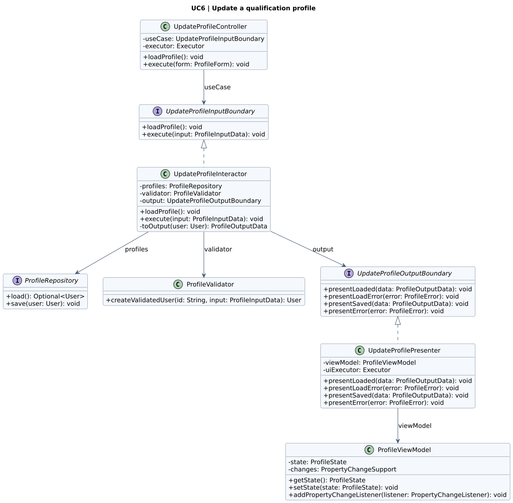
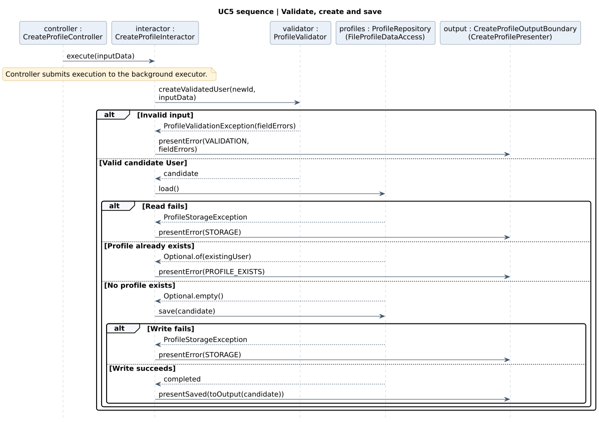

# CSC207: Internship Finder and Tracker
## [TUT0301] Group 40 - BA3185
### Team Members
- Emily Kim
- Jerry Zhou
- Austin Wu
- Yuheng Liu
- Lingnan Meng
---
## Project Description
### Domain
The team is building a Java Swing desktop application for finding internships, recording the resume used for each application, and tracking progress and deadlines.

Finder (UC4) searches public Greenhouse boards and Jooble Canada. Students can also create and update a qualification profile (UC5–UC6) and get personalized recommendations from the configured Greenhouse boards (UC7).

---
## User Stories
### User Story 1
As a user, I want to search for internship opportunities that match my search keywords so that I can find relevant positions and spend less time browsing company websites.

### User Story 2
As a user, I want to create or upload multiple resume versions and associate them with my saved internship 
applications so that I can keep track of which resume I submitted to each employer.

### User Story 3
As a user, I want to save internship opportunities, update their application statuses, and organize them by priority 
or deadline so that I can manage my applications in one place.

### User Story 4
As a user, I want to have a hub where I can receive a visual summary of my internship application progress, including 
the number of applications submitted over time and the number that have progressed beyond the first interview, 
so that I can evaluate my application progress.

### User Story 5
As a user, I want to create a profile with all my qualifications so that I would be recommended internships without 
having to search

### User Story 6
As a user, I want to save job applications that I may apply to into a shortlist so that I can easily find them and 
work on them later.

### User Story 7
As a user, I want to sort my shortlist of applications by due date so that I can identify which applications have 
the earliest deadlines and prioritize them accordingly.

### User Story 8
As a user, I want to sort my shortlist of applications by relevancy so that I can identify which applications are 
most useful to my career development and prioritize them accordingly.

---
## Use Cases
### Use Case 1
### Use Case 2
Name: Import Resume

Primary actor: A user finding internships

Preconditions: User should be logged in with a profile

Trigger: The user clicks the import resume button

Success outcome: Imported resume is saved on the system

Main success scenario:  
1. User signs in with their profile
2. User clicks on their list of resumes
3. User clicks on a new resume
4. User selects how they want to import a new resume
5. Resume is imported and saved in the list

Extensions:Ask user if they want to add a new resume when they make a new application

### Use Case 3
Name: Create a resume in the system

Primary actor: A user finding internships

Preconditions: User should be logged in with a profile

Trigger: User clicks the resume builder

Success outcome: A resume is saved on the system

Main success scenario:  
1. User signs in with their profile
2. User clicks on the resume builder
3. Program asks if they want to save an externally made resume or build on the program
4. Program asks for user’s specifications
5. Resume is created and program asks for confirmation
6. Resume is saved in the list of resumes

Extensions: Ask user if they would like to build a resume before sending them through the link

### Use Case 4: Search Internship Opportunities
Owner: Yuheng Liu

MVP: Yes

Implementation: [Finder architecture and verification](docs/design/finder.md).
Shared integration contract: [Job source and Ling compatibility review](docs/design/shared-job-contract.md).

Primary actor: A user looking for internship opportunities.

**Supporting actors.** Greenhouse Job Board API and Jooble Canada REST API.

**Preconditions.** Finder is open. Live searches need an internet connection. **Company boards** works without credentials. **Jooble Canada** requires a Canada-issued `JOOBLE_API_KEY`.

**Trigger.** The student presses **Search** or Enter after entering keywords.

**Success outcome.** The student can review matching internships and open a listing.

**Main success scenario**

1. Choose **Company boards** or **Jooble Canada** and enter at least one keyword.
2. On **Company boards**, choose all configured boards, one employer, or a Greenhouse board supplied by token or URL. On **Jooble Canada**, optionally fill in **Company**, **Location**, or both.
3. Finder retrieves postings from the selected source and keeps titles containing an internship indicator such as `intern`, `internship`, or `co-op`. Matching ignores case and respects word boundaries, so `Software Engineering Intern` qualifies and `Internal Tools Engineer` does not.
4. Finder shows the number of matches displayed, with each posting’s title, company, and location. A missing location appears as **Not specified**. Jooble shows up to 10 matching internships on the first search. **Load more** appends up to 10 more.
5. Select a row to see its copyable URL. **Open application page** opens that listing in the browser. Applying takes place on the external site. On the Jooble tab, the **Source** link opens Jooble Canada’s homepage.

**Extensions**

- **Blank keywords.** Finder prompts for a keyword before making any network request, even when Company or Location is filled in.
- **No matches.** A successful search can return zero matching internships. Matches indicate keyword relevance. Students review the posting for eligibility.
- **Greenhouse board unavailable.** If some requested boards fail, Finder displays matches from the others and identifies the unavailable boards. If all fail, it displays an error.
- **Jooble request fails.** An initial failure displays an error. If a later page fails, Finder keeps the rows already found and shows a warning. **Load more** retries that page.
- **Browser fails to open.** The selected listing URL remains available to copy.

**Failure guarantee.** A failed search preserves saved jobs, resumes, and application records.

### Use Case 5: Create a Qualification Profile
Lead: Lingnan Meng
MVP: Yes
Primary actor: Student
Preconditions: The application is available, and the student does not have a saved profile.
Trigger: The student requests to create a profile.
Success outcome: The student's qualifications and preferences are saved, are available in later sessions, and can be used for personalized recommendations.

Main success scenario
1. The student requests to create a profile.
2. The system requests their program, optional expected graduation year, skills, and optional internship preferences.
3. The student supplies the information and submits it.
4. The system checks the required information and the format of any graduation year entered. Repeated skill entries are treated as one skill.
5. The system saves the profile and shows the saved information.
6. The system offers personalized suggestions through UC7 without requiring a separate search query.
Extensions
- 3a. The student cancels before submission: No profile is created.
- 4a. The program or skills are missing, or the graduation year is invalid: The system identifies the affected information and preserves the entered values. The student corrects them and returns to step 3.
- 5a. Saving fails: The system explains that the profile was not saved and retains the entered values for another attempt.
- 6a. Recommendations are unavailable: The created profile remains saved. UC7 handles the recommendation failure.

### Use Case 6: Update a Qualification Profile
Lead: Lingnan Meng
MVP: Yes
Primary actor: Student
Preconditions: The student has a saved profile.
Trigger: The student requests to update their qualifications or preferences.
Success outcome: The revised profile is saved, is visible to the student, and is used for later recommendations.

Main success scenario
1. The student requests to update their profile.
2. The system displays the currently saved qualifications and preferences.
3. The student changes their information and submits the changes.
4. The system checks the same profile rules used during creation.
5. The system saves and displays the updated profile.
6. The student can view recommendations through UC7 using the updated information.
Extensions
- 2a. The saved profile cannot be loaded: The system explains the problem and offers another attempt; it does not present an empty profile as the saved one.
- 3a. The student cancels: The previously saved profile remains unchanged.
- 4a. Updated information is invalid: The system explains what needs correction and retains the edits. The previous saved version remains unchanged until valid changes are successfully saved.
- 5a. Saving fails: The system reports the failure, retains the edits for retrying, and preserves the previous saved profile.

### Use Case 7: View Personalized Internship Recommendations
Lead: Lingnan Meng
MVP: Yes; main use case for this feature
Primary actor: Student
Supporting actor: Greenhouse job-posting service
Preconditions: The student has a saved profile that meets the profile requirements.
Trigger: The student opens personalized recommendations, including when continuing from profile creation.
Success outcome: The student sees suggestions based on the latest saved profile, with matching reasons and application links, without entering a manual search query.

Main success scenario
1. The student requests to view personalized recommendations.
2. The system obtains the latest saved profile.
3. The system obtains job postings from the supported company boards.
4. The system identifies internship postings and applies the student's saved role, location, and work-arrangement preferences.
5. The system identifies distinct profile skills mentioned in the remaining postings and orders postings with at least one skill match by the number of matched skills.
6. The system displays each suggestion's title, company, location, work-arrangement information, matched skills, and application link.
Extensions
- 2a. The profile cannot be loaded: The system explains the problem and offers a retry. It does not label generic results as personalized recommendations.
- 3a. All job sources fail: The system explains that recommendations are unavailable and allows a retry. It does not treat a retrieval failure as proof that there are no suitable jobs.
- 3b. Only some company boards fail: The system continues with available postings and identifies that the results are incomplete.
- 4a. A work arrangement is unclear: The system marks it UNKNOWN and keeps it available for review with that label.
- 5a. No postings match: The system explains that no matches were found and offers the option to update the profile or preferences.
Limits: Suggestions indicate keyword relevance, not verified eligibility. Unspecified requirements stay unknown. An empty result is a valid result. The MVP does not automatically submit applications.

### Use Case 8: Add an Application to the Shortlist
Owner: Rui Zhou
Primary actor: User
Preconditions:
- The application is running and the user is logged in.
- The user is viewing the job display page for a specific job.
Trigger: The user clicks the “Save to Shortlist” button for the currently displayed job.
Success outcome: 
- The selected job application is added to the user's shortlist and can be viewed later from the home page or shortlist 
page.
Main Success Scenario: 
1. The user requests to add the currently displayed job application to the shortlist.
2. The system identifies the currently displayed job application.
3. The system checks whether the application is already in the user's shortlist.
4. The system adds the application to the user's shortlist.
5. The system saves the updated shortlist.
6. The system confirms that the application was successfully added.
7. The user can later view the saved application from the shortlist on the home page.
Extensions:
3a. The application is already in the shortlist.
- The system does not add a duplicate application.
- The system informs the user that the application has already been saved.
4a. The application can no longer be saved or does not exist.
- The system does not modify the shortlist.
- The system informs the user that the application could not be added.
5a. The shortlist cannot be saved because of a system or data-storage error.
- The system informs the user that the application could not be saved.
- The user's existing shortlist remains unchanged.

### Use Case 9: Sort Shortlist by Due Date
Owner: Rui Zhou
Primary actor: User
Preconditions:
- The application is running and the user is logged in.
- The user is viewing their shortlist.
- The user has access to their shortlist.
Trigger: The user clicks the button to sort the shortlist by due date.
Success outcome:
- The applications in the shortlist are displayed in order according to their due dates, allowing the user to identify 
the applications with the closest deadlines.
Main Success Scenario:
1. The user requests to sort the shortlist by due date.
2. The system retrieves the applications currently saved in the user's shortlist.
3. The system retrieves the due date associated with each application.
4. The system orders the applications by due date, with the earliest due dates appearing first.
5. The system displays the newly sorted shortlist to the user.
Extensions:
2a. The shortlist is empty.
- The system informs the user that there are no applications to sort.
- The shortlist remains unchanged.
3a. One or more applications do not have a due date.
- The system still sorts all applications that have known due dates.
- Applications without a due date are displayed after applications with known due dates.
3b. Due-date information cannot be retrieved for one or more applications.
- The system sorts applications with available due-date information and places applications with 
unavailable due dates at the bottom of the shortlist.
4a. Multiple applications have the same due date.
- Applications with the same due date are grouped together.
- The system preserves their existing relative order.

### Use Case 10: Sort Shortlist by Relevancy
Owner: Rui Zhou 
Primary actor: User
Preconditions:
- The application is running and the user is logged in.
- The user is viewing their shortlist.
Trigger: The user clicks the button to sort their shortlist by relevancy.
Success outcome: 
- The applications in the shortlist are displayed in descending order of relevancy based on the user's 
preferred career fields, allowing the user to identify applications that best match their career interests.
Main Success Scenario:
1. The user selects the option to sort by relevancy.
2. The system retrieves the user's preferred career fields from their profile.
3. The system retrieves the user’s shortlist.
4. The system identifies keywords in each shortlisted application's job title that match the user's preferred fields or their associated synonyms.
5. The system calculates a relevancy score for each application based on the number of distinct preferred fields matched.
6. The system sorts the applications in descending order of relevancy score.
7. The system displays the sorted shortlist to the user.
Extensions:
2a. The shortlist is empty.
- The system informs the user that there are no applications to sort.
- The shortlist remains unchanged.
2b. The user has not specified any preferred career fields.
- The system informs the user that preferred career fields must be specified to sort applications by relevancy.
- The shortlist remains in its existing order.
4a. No keywords match any of the user's preferred fields.
- The system assigns a relevancy score of zero to every application.
- The system preserves the existing order of the shortlist.
5a. Multiple applications have the same relevancy score.
- The system preserves their existing relative order.
Postconditions:
- The shortlisted applications are displayed in descending order of relevancy based on the user's preferred career 
fields.
- Applications with equal relevancy scores retain their existing relative order.
- No applications are added to or removed from the shortlist.
- The user's saved applications remain unchanged; only their displayed order is affected.

---
## Minimal Viable Product (MVP)
| Team Member | MVP Use Case |
|-------------|--------------|
|Emily Kim| Use Case |
|Jerry Zhou| Use Case |
|Austin Wu|          |
|Lingnan Meng| UC7 View personalized internship recommendations, supported by UC5 Create profile and UC6 Update profile |
|Yuheng Liu| UC4: Search Internship Opportunities |
---
## Entities

- **`JobPosting`** is the shared snapshot of a listing. It holds the title, employer, location, description text, and application URL. `getWorkArrangement()` returns `REMOTE`, `HYBRID`, `ONSITE`, or `UNKNOWN` (the default). `getStableId()` combines the source, board, and external posting ID so Finder can skip a posting it has already shown.
- **`User`** represents a student and has fields for their user ID, name, and email.
- **`Resume`** represents one version of a student's resume, identified by an ID and described by a name and date.
- **`Application`** represents a student's application to a specific `JobPosting`. Its fields link that posting to the `Resume` version used and hold the application's status and priority.
- **`QualificationProfile`** stores the student’s program, expected graduation year, skills, and internship preferences for UC5–UC7. [Profile design](docs/design/profile.md)

A `JobPosting` can appear in many searches. An `Application` records a student’s application to one such posting with a particular resume. The Finder screen only retrieves and opens listings.

---
## API Usage
| Finder tab | Where listings come from | How the search works |
| --- | --- | --- |
| **Company boards** | The public Greenhouse boards selected by the student | Finder downloads each board’s postings and checks every keyword against the combined title and full description, ignoring case. |
| **Jooble Canada** | Employers indexed by Jooble in Canada | Jooble searches job titles and descriptions using the entered keywords and location. Finder applies the optional employer filter to the returned company names. |

### Greenhouse Job Board API

Finder sends `GET https://boards-api.greenhouse.io/v1/boards/{board_token}/jobs?content=true`. The response supplies the full posting description in `content` and the employer’s posting URL in `absolute_url`. The default boards are Cloudflare and Figma. A student can also search another public Greenhouse board directly, even if its postings do not appear in Jooble’s results. A live check of the packaged app retrieved postings from both default boards. [Greenhouse Job Board API](https://docs.greenhouse.io/job-board.html#list-jobs) · [Verification](docs/design/finder.md#verified-on-2026-11-16)

Recommendations match postings from the configured Greenhouse boards to saved qualifications on the student’s device. The packaged app retrieved both default boards during the profile integration check on 2026-11-22.

### Jooble REST API

Finder sends one POST per requested page to `https://ca.jooble.org/api/{key}`. For example, with Keywords `software`, Company `Amazon`, and Location `Toronto`, Finder sends the following first-page request.

```json
{"keywords": "software", "location": "Toronto", "companysearch": false, "page": 1}
```

Finder sends the student’s keywords after trimming and normalizing whitespace. An empty location defaults to `Canada`. For this example, Finder keeps internships whose returned `company` contains `Amazon`, ignoring case. Leaving Company blank includes all matching employers. Finder uses Jooble’s `snippet` for the description and `link` for the listing URL. [Jooble REST API](https://help.jooble.org/en/support/solutions/articles/60001448238-rest-api-documentation)

A live Finder search for `software intern` returned Canadian internship listings from Jooble.

**Search** starts at page 1, even if the fields are unchanged. Finder reads pages in order and skips duplicate posting IDs until it has 10 matching internships or runs out of results. The final batch can contain fewer than 10.

**Load more** shows matches already fetched but not yet displayed. If it can fill the batch from those matches, it makes no API request. Otherwise it continues from the next unread page, making one request per additional page. Finder disables **Load more** once it reaches the end and has shown every match. Editing Keywords, Company, or Location clears the displayed results.

---

## Design Diagrams
### Profile — Class Diagrams





### Profile — Sequence Diagrams




### UML Class Diagram

[UC4 class diagram and Clean Architecture dependencies](docs/design/finder.md#architecture-and-source-dependencies)

[UC5 and UC6 profile persistence](docs/design/profile.md#class-diagram-for-profile-persistence)

### Sequence Diagrams

[UC4 search, pagination, and result display](docs/design/finder.md#runtime-sequence)

[UC7 personalized recommendations](docs/design/profile.md#sequence-diagram-for-recommendations)

---

## How to Run
Use **JDK 11** and Maven. Build and launch the app from the directory containing `pom.xml`. It opens with three tabs: **Finder**, **Profile**, and **Recommendations**. In live mode, open **Finder** to choose **Company boards** or **Jooble Canada**.

```bash
mvn verify
java -jar target/TeamProject-1.0-SNAPSHOT.jar
```

In IntelliJ, import `pom.xml`, select JDK 11 for the project SDK and Maven runner, and run `app.Main`. On macOS with multiple JDKs, run `export JAVA_HOME="$(/usr/libexec/java_home -v 11)"` in the terminal before building. Check the selected JDK with `mvn -version`.

- **Try a company board.** Select **Company boards**, choose **All configured companies** or one employer, enter `software`, and press **Search**. For another board, select **Other Greenhouse board** and enter a token or hosted board URL such as `https://job-boards.greenhouse.io/figma`.
- **Try Jooble Canada.** Set `JOOBLE_API_KEY` in the local environment of the `app.Main` run configuration (or the launching shell), then restart Finder. Enter `software` under **Keywords**, optionally add `Amazon` under **Company** and `Toronto` under **Location**, and press **Search**. Without a key, the Jooble tab displays setup instructions and **Company boards** remains available.

To try Finder offline, launch it with its bundled fictional listings.

```bash
java -jar target/TeamProject-1.0-SNAPSHOT.jar --demo
```

Try `python` for two sample matches, `java` for one, or `unmatched` for zero.

For profile-based recommendations, open **Profile**, enter a program and the skills
`Java, Python`, save, and choose **View recommendations**. The sample Software
Engineering Intern matches both skills. Change the saved skills to `SQL` to see
the Data Science Co-op instead. Profiles persist in `~/.intern-finder/profile.json`.
See the [profile demo and architecture](docs/design/profile.md) for details.

To configure company boards, create a properties file containing `boardToken=Company Name`
entries and supply its path:

```bash
java -jar target/TeamProject-1.0-SNAPSHOT.jar --boards /path/to/boards.properties
```

Greenhouse board connectivity can be checked separately from the UI and unit tests:

```bash
java -jar target/TeamProject-1.0-SNAPSHOT.jar --check-api
```

Tests use local HTTP fixtures and run without an internet connection once dependencies
are installed. `mvn validate` runs Checkstyle; `mvn verify` also tests and packages.
`mvn spotless:apply` applies the course Google formatter (run it with JDK 11).
See the [Finder design](docs/design/finder.md) for CA boundaries and acceptance coverage.
---
## Notes
[Any additional project information.]
