# Team Project

Please keep this up-to-date with information about your project throughout the term.

The readme should include information such as:
- a summary of what your application is all about
- a list of the user stories, along with who is responsible for each one
- information about the API(s) that your project uses 
- screenshots or animations demonstrating current functionality

By keeping this README up-to-date,
your team will find it easier to prepare for the final presentation
at the end of the term.

# PawPortal

## Team Information

### Team Members
- Audrey Luo
- Xinmeng Zhang
- Xiangyu Zhou
- Kenny Gu

---
## Project Description
The problem: The shelter's current process is opaque. 
Adoptable animals are advertised on Instagram, and anyone who wants to adopt must first apply on the shelter's website to become a general "adopter" 
and wait for an interview before they can even see which cats are available. People are blocked by the process before they can make an informed choice.

Our solution: PawPortal lets anyone browse every adoptable cat and dog, 
each with an honest, detailed profile (temperament, health conditions, vaccination and spay/neuter status, adoption fee). 
An adopter compares a pet's needs with their own situation and then applies for that one specific pet. 
The shelter manages pets and reviews applications in one place, and adopters can track the status of their applications online.

Scope: We focus on a small core: browse, match, apply, track, and review. Everything else is listed under Future Work in the Notes section.

### Domain
PawPortal is a pet adoption portal for a nonprofit animal shelter.

---
## User Stories
### User Story 1 (Audrey Luo)
As a visitor, I want to browse and filter all adoptable pets without logging in,
so that I'm not blocked by an approval step before I can see who is available.

### User Story 2 (Audrey Luo)
As an adopter, I want to see how a pet's needs (for example, daily medication or a quiet home) line up with my own situation,
so that I can decide whether to apply with full information instead of guessing.

### User Story 3 (Xiangyu Zhou)
As an adopter, I want to submit an application for one specific pet and track its status online,
so that I always know where things stand without depending on someone replying to a message.

### User Story 4 (Kenny Gu)
As a shelter admin, I want to publish and maintain accurate pet profiles,
so that visitors always see up-to-date information about each animal.

### User Story 5 (Xinmeng Zhang)
As a shelter admin, I want to review applications and update their status in one place,
so that animals are matched with suitable adopters efficiently.

---
## Use Cases

### Use Case 1: Sign up / Admin Sign up / Log in (Xinmeng Zhang)
**Primary actor:** Visitor who wants an adopter account, or shelter admin  
**Preconditions:** To log in, the user already has an account.  
**Trigger:** The user asks to sign up or to log in.  
**Success outcome:** The user has an account, is logged in, and sees the pet gallery.

**Main success scenario:**
1. The user enters a username, id, email and password to sign up (an admin also enters the invite code), or an email and password to log in.
2. The system checks the information.
3. The system creates the account (sign up) or confirms the email and password (log in).
4. The system shows the pet gallery.

**Extensions:**
- 2a. A field is empty, the email is not valid, the password is too short, or the two passwords do not match: the system says what to fix and no account is created.
- 2b. Admin sign up with a wrong invite code: the system refuses and no admin account is created.
- 3a. Sign up with an id or email that is already registered: the system says so and no account is created.
- 3b. Log in with a wrong email or password: the system says the details are not valid and the user stays logged out.

### Use Case 2: Add / Edit / Remove a Pet (Kenny Gu)
**Primary actor:** Shelter admin  
**Supporting actor:** TheCatAPI  
**Preconditions:** The admin is logged in.  
**Trigger:** The admin asks to add a pet, edit a pet, or remove a pet.  
**Success outcome:** The pet's profile is saved and appears in the public gallery, or the removed pet no longer appears.

**Main success scenario:**
1. The admin asks to add a new pet or chooses an existing pet to edit.
2. The admin enters or changes the name, species, breed, age, sex, temperament tags, health notes, vaccinated, spayed/neutered, adoption fee and photo.
3. The system checks the information.
4. The system saves the pet.
5. The system shows the updated list of pets.

**Extensions:**
- 1a. The admin asks to remove a pet: the system asks for confirmation, removes the pet, and it no longer appears in the gallery.
- 2a. The admin chooses a breed: the system suggests the breed's typical temperament and a reference photo from TheCatAPI. If the API cannot be reached, the admin enters the information without suggestions.
- 3a. Information is missing or not valid (for example, the age is not a whole number): the system says what to fix and the admin continues at step 2.
- 4a. The pet cannot be saved: the system says so and nothing changes.

### Use Case 3: Browse and Filter Pets (Audrey Luo)
**Primary actor:** Visitor or adopter  
**Preconditions:** None (no login needed).  
**Trigger:** The user opens the pet gallery.  
**Success outcome:** The user sees the available pets that match the chosen filters.

**Main success scenario:**
1. The user opens the gallery.
2. The system shows every pet whose status is AVAILABLE.
3. The user chooses filters (age range, temperament, health needs).
4. The system shows only the pets that match.
5. The user chooses a pet and the system shows its details.

**Extensions:**
- 2a. No pet is available: the system says so.
- 4a. No pet matches the filters: the system says so and the user can clear the filters.

### Use Case 4: Check Pet Compatibility (Audrey Luo)
**Primary actor:** Adopter  
**Preconditions:** The adopter is logged in and is viewing a pet's details.  
**Trigger:** The adopter asks to check how well the pet fits their situation.  
**Success outcome:** Each relevant trait is shown as a match or a conflict, with a short explanation.

**Main success scenario:**
1. The adopter asks to check compatibility.
2. The system compares the pet's profile with the adopter's saved preferences.
3. The system shows each trait as a match or a conflict, with a short explanation (for example, "Needs daily medication: you said you cannot take this on").

**Extensions:**
- 2a. The adopter has not saved preferences yet: the system asks for them once (children at home, other pets, willingness to care for a pet with medical needs, a kitten or a pregnant cat), saves them, and continues at step 2.

### Use Case 5: Submit an Application (Xiangyu Zhou)
**Primary actor:** Adopter  
**Preconditions:** The adopter is logged in and is viewing the details of an AVAILABLE pet.  
**Trigger:** The adopter asks to apply for this pet.  
**Success outcome:** A PENDING application for this adopter and this pet is recorded.

**Main success scenario:**
1. The adopter asks to apply for the pet.
2. The system shows the application form.
3. The adopter enters housing type, experience with pets, household members, contact information and an optional note, and submits.
4. The system checks that the required information is complete.
5. The system records the application as PENDING for this adopter and this pet.
6. The system confirms that the application was submitted.

**Extensions:**
- 4a. Required information is missing: the system says what to fix and the adopter continues at step 3.
- 5a. The pet is no longer available: the system says so and no application is recorded.
- 5b. The adopter already has an active application for this pet: the system says so and no new application is recorded.
- 5c. The application cannot be saved: the system says so and no application is recorded.

### Use Case 6: Track My Applications (Xiangyu Zhou)
**Primary actor:** Adopter  
**Preconditions:** The adopter is logged in.  
**Trigger:** The adopter asks to see their applications.  
**Success outcome:** The adopter sees each of their applications with its pet, date submitted, current status and the shelter's note.

**Main success scenario:**
1. The adopter asks to see their applications.
2. The system lists each application with the pet's name, the date submitted and the current status (PENDING, INTERVIEW, APPROVED, REJECTED or WITHDRAWN).
3. The adopter chooses an application.
4. The system shows the shelter's note for that application.

**Extensions:**
- 2a. The adopter has no applications: the system says so.
- 2b. A pet is no longer listed: the system still shows the application and says the pet is no longer listed.
- 4a. The application is PENDING and the adopter asks to withdraw it: the system marks it WITHDRAWN.

### Use Case 7: Review Applications (Xinmeng Zhang)
**Primary actor:** Shelter admin  
**Preconditions:** The admin is logged in.  
**Trigger:** The admin asks to see the applications.  
**Success outcome:** The admin has read the adopter's answers for the chosen application.

**Main success scenario:**
1. The admin asks to see the applications.
2. The system lists each application with the pet's name, the adopter's name, the date submitted and the current status.
3. The admin may filter the list by pet or by status.
4. The admin chooses an application.
5. The system shows the adopter's answers.

**Extensions:**
- 2a. There are no applications: the system says so.

### Use Case 8: Update Application Status (Xinmeng Zhang)
**Primary actor:** Shelter admin  
**Preconditions:** The admin is logged in and is viewing an application.  
**Trigger:** The admin asks to change the application's status.  
**Success outcome:** The new status and note are saved, and the adopter sees them when tracking their applications.

**Main success scenario:**
1. The admin chooses the new status (INTERVIEW, APPROVED or REJECTED) and may add a note.
2. The system saves the new status and note.
3. The system shows the updated application.

**Extensions:**
- 2a. The new status is APPROVED: the system also marks the pet as ADOPTED.
- 2b. The change cannot be saved: the system says so and nothing changes.

---
## Minimal Viable Product (MVP)
| Team Member | MVP Use Case |
|-------------|--------------|
| Audrey Luo | Use Case 3: Browse and Filter Pets, Use Case 4: Check Pet Compatibility |
| Kenny Gu | Use Case 2: Add / Edit / Remove a Pet |
| Xiangyu Zhou | Use Case 5: Submit an Application, Use Case 6: Track My Applications |
| Xinmeng Zhang | Use Case 1: Sign up / Log in, Use Case 7: Review Applications, Use Case 8: Update Application Status|
---
## Entities
### User
Id, name, email, passwordHash
role: ADOPTER or ADMIN
preferences (an AdopterPreferences object, adopters only)
### Pet
id, name, breed, ageYears, sex
temperamentTags (list, for example "affectionate", "shy", "good with kids")
healthNotes, needsMedication, vaccinated, spayedNeutered
adoptionFee, photoPath
status: AVAILABLE, PENDING, or ADOPTED
### Application
id, adopterId, petId
housingType, petExperience, householdMembers, contactInfo, note
status: PENDING, INTERVIEW, APPROVED, or REJECTED
adminNote, submittedAt
### AdopterPreferences
hasChildren, 
hasOtherPets, 
canHandleMedicalNeeds, 
canHandleKitten&Pregnancy,
preferredSpecies

---
## API Usage
**API Name: TheCatAPI**
**Documentation:** [ https://developers.thecatapi.com/ ]
**How it is used in the program: When an admin picks a breed in the Add/Edit Pet form, 
the program calls the API to fetch general breed information (typical temperament and a 
reference photo).**

---
## Design Diagrams

### UML Class Diagram

The diagrams are drawn with PlantUML. The source files are in [`docs/uml`](docs/uml).

#### Entities

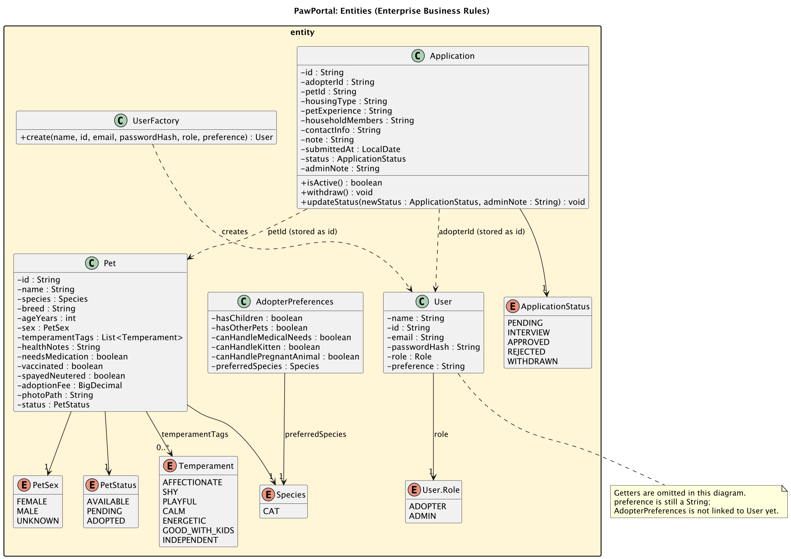

#### Clean Architecture Layers

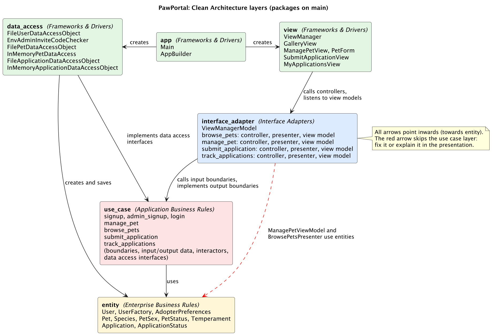

#### Use Case 1: Log in

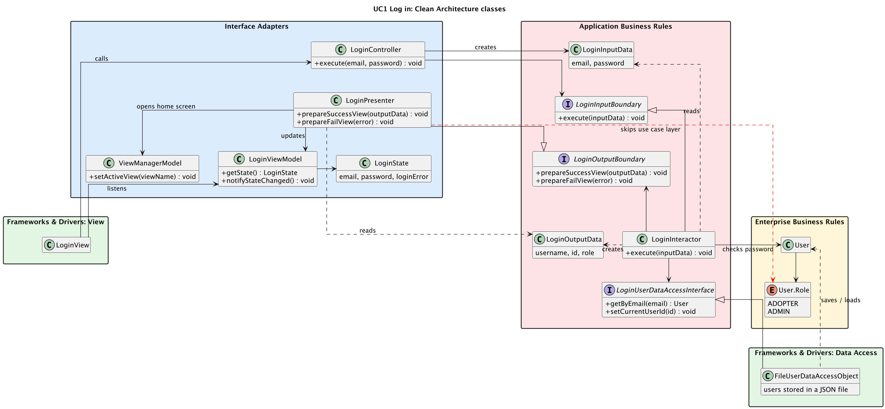

#### Use Case 1: Sign up / Admin Sign up

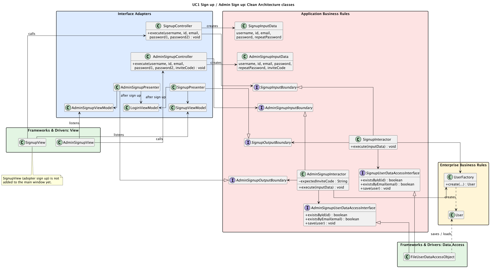

#### Use Case 2: Add / Edit / Remove a Pet

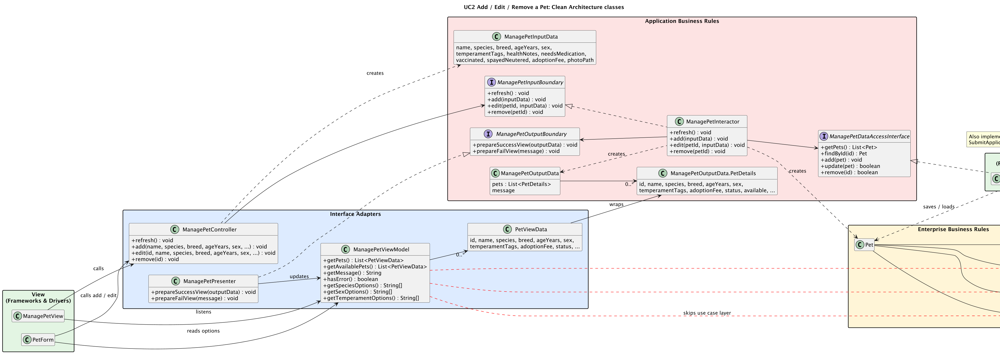

#### Use Case 3: Browse and Filter Pets

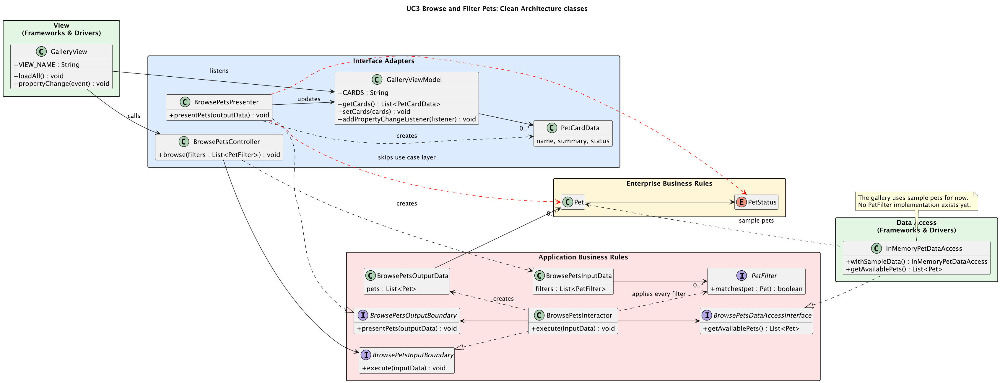

#### Use Case 4: Check Pet Compatibility

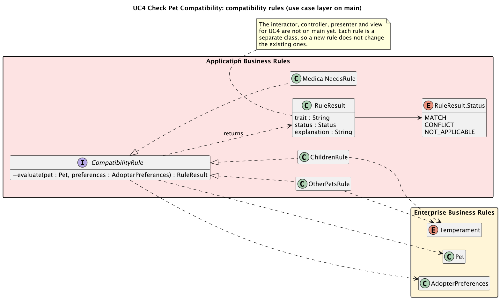

#### Use Case 5: Submit an Application

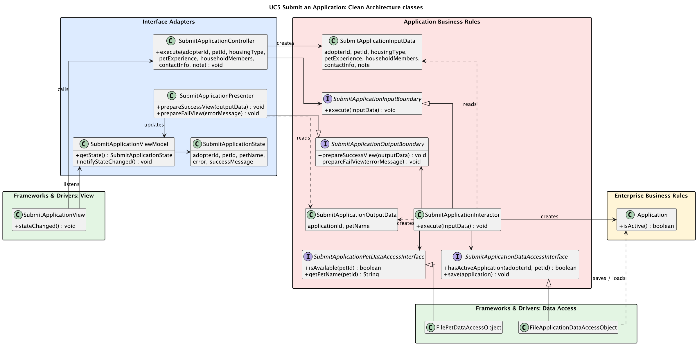

#### Use Case 6: Track My Applications

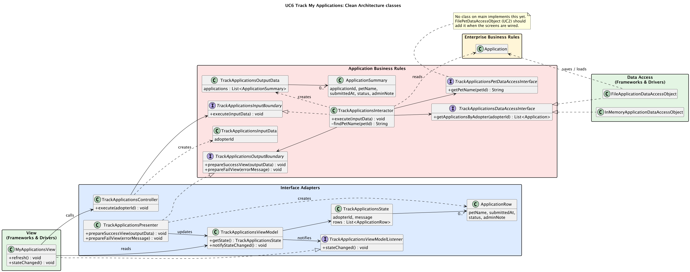

### Sequence Diagrams

#### Use Case 1: Log in

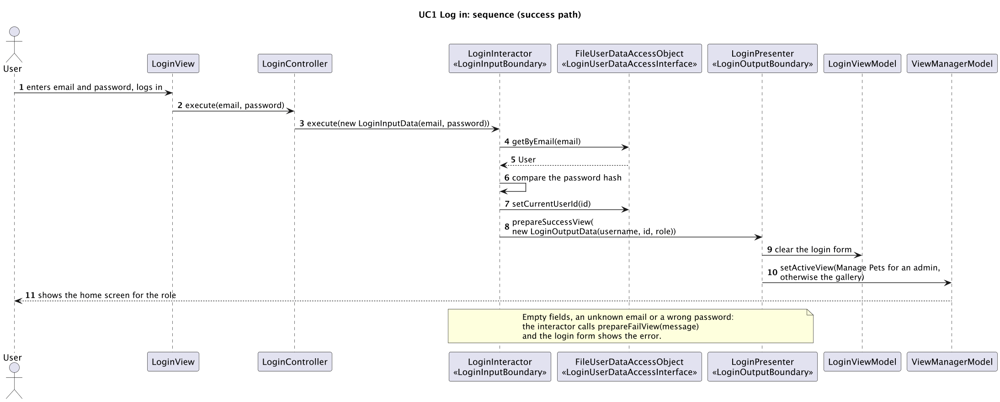

#### Use Case 2: Add a Pet

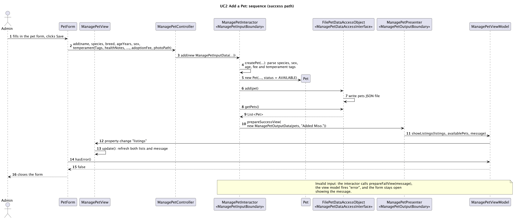

#### Use Case 2: Look up a Breed with TheCatAPI

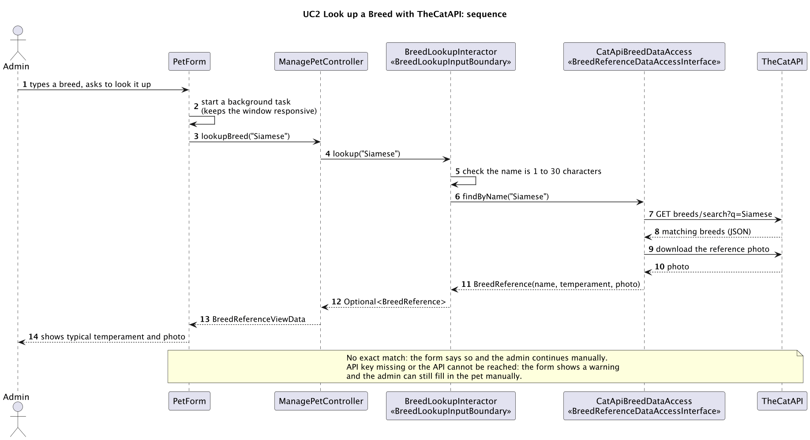

#### Use Case 3: Browse and Filter Pets

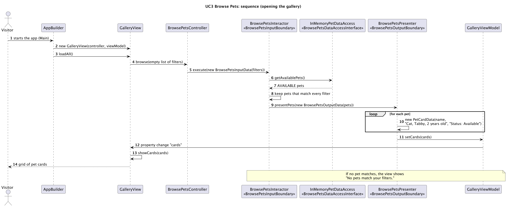

#### Use Case 5: Submit an Application

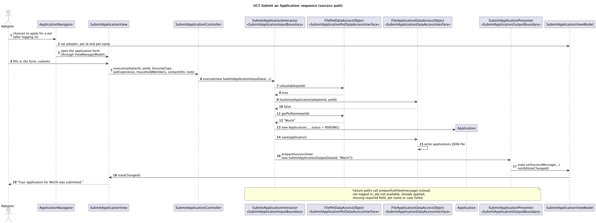

#### Use Case 6: Track My Applications

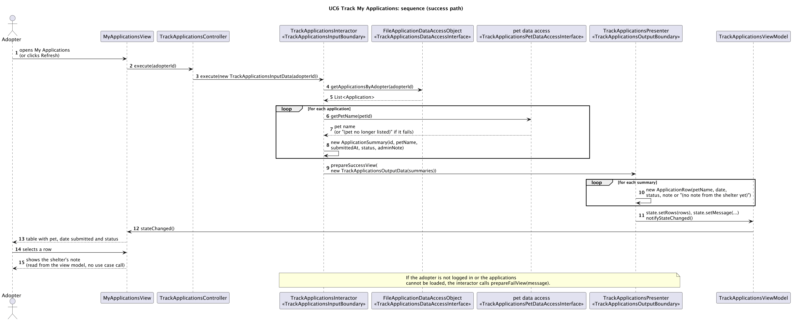

---

## How to Run
1. Clone the repo:

   `git clone [repo URL]`

   `cd [repo name]`

2. Set the admin invite code (needed to sign up as an admin):

   `export PAWPORTAL_ADMIN_INVITE_CODE=your-code-here`
 
3. Run the app:

   `mvn compile exec:java -Dexec.mainClass=app.Main`

---
## Notes
[Any additional project information.]
