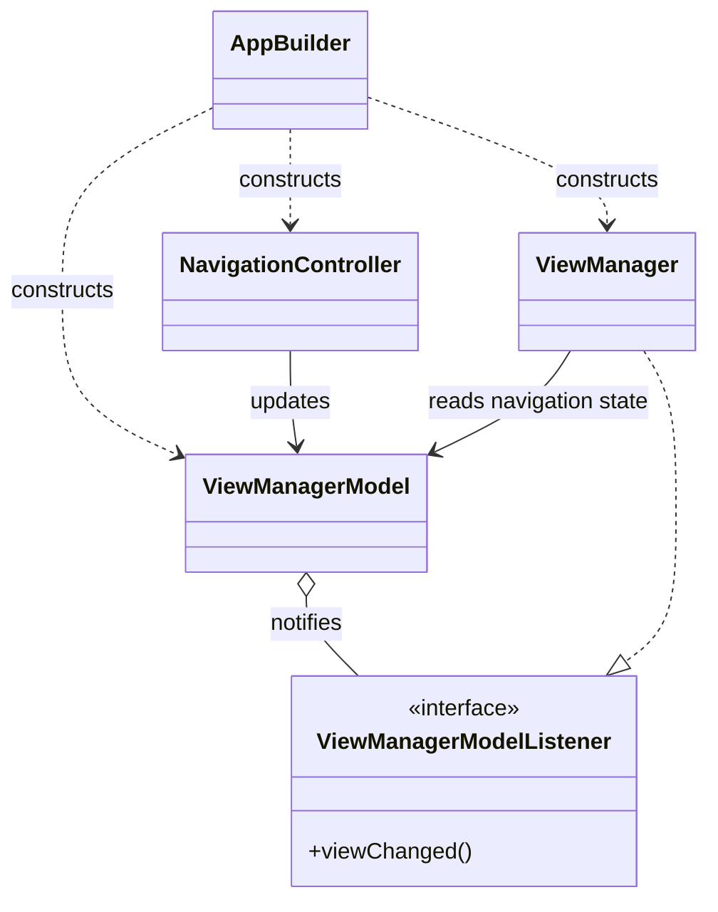
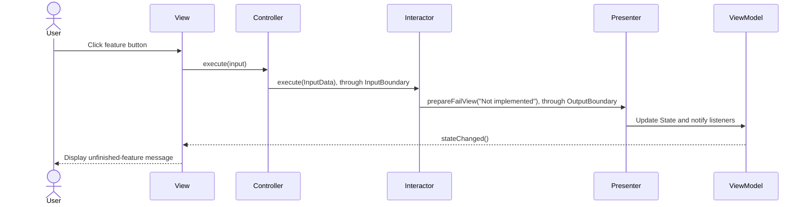

# Team Project

# Project Name

- CocktailCraft

## Team Information

- Team name: Team400
- TUT: 0401 BA2200 Group4

### Team Members

- Qinli Yang
- Enhao Tang
- Jiaqi Shen
- Wenqian Ling

---

## Project Description

CocktailCraft is a Java Swing desktop application for discovering, customizing,
and managing cocktail recipes. Users will browse recipes, search by name and base
spirit, view recipe details and available images, save favourites, and create
personal recipe variations. A personal profile will provide access to each user's
favourites and customized recipes across application sessions.

The project currently provides a shared scaffold. The user stories below describe
planned behaviour; they are not claims that the features have been implemented.

### Domain

- Food: drinks

---

## User Stories

### User Story 1 [Qinli]

As a user, I want to search for cocktails by name and/or base spirit so that I can
find recipes that match my preferences.

### User Story 2 [Enhao]

As a user, I want to customize an existing cocktail and save it as my own recipe
so that I can revisit and edit my variations without changing the original recipe.

### User Story 3 [Jiaqi]

As a user, I want to register, log in, and access my personal profile so that I can
return to my favourites and customized recipes across application sessions.

### User Story 4 [Wenqian]

As a user, I want to browse cocktails, view their recipes and available images,
and save favourites to my personal collection so that I can discover drinks and
revisit recipes I like.

---

## Use Cases

### Use Case 1 [Qinli]

**Inputs**

- An optional cocktail name.
- Zero or more selected base spirits.

**Input Requirement**

The user must enter a name, select at least one base spirit, or both.

**Normal Flow**

1. The user enters a name and/or selects base spirits in the Home search area.
2. The user clicks Search.
3. The system finds matching cocktails. Name matching is case-insensitive and
   supports partial matches. A cocktail may match any selected spirit; when both
   name and spirit criteria are provided, both must be satisfied.
4. The system displays matching cocktails using the same card layout as Home.
5. The user selects a card to open Cocktail Details.
6. The user can clear the search to return to catalog browsing.

**Alternative Flows**

- If neither criterion is provided, the system requests a name or base spirit.
- If no cocktails match, the system displays “No cocktails found.”
- If the catalog cannot be accessed, the system reports the failure and allows retry.

### Use Case 2 [Enhao]

**Inputs**

- An existing recipe selected from Cocktail Details, or the user's saved Custom Recipe.
- A recipe name, ingredient names, quantities, and units.

**Precondition**

The user is logged in.

**Normal Flow**

1. The user opens Cocktail Details and clicks Customize.
2. The system displays an editable copy of the original recipe.
3. The user changes its name, ingredients, quantities, and/or units.
4. The user clicks Save, and the system validates the recipe.
5. The system saves a separate Custom Recipe belonging to the current user.
6. The original recipe remains unchanged.
7. The user opens My Custom Cocktails from Profile to view saved variations.
8. The user can reopen a variation, edit it, and save the changes.
9. Saved variations remain available after restarting and logging in again.

**Alternative Flows**

- Guests are asked to log in before customizing.
- Blank recipe or ingredient names prompt the user to complete them.
- Quantities must be positive numbers, and units must be provided.
- A recipe must contain at least one ingredient.
- Cancel discards unsaved changes.
- Saving failures are reported, and the user's input is preserved for retry.
- An empty personal collection displays an empty-state message.

### Use Case 3 [Jiaqi]

**Inputs**

- A username and password for Login.
- A username, password, and password confirmation for Register.

**Normal Flow — Register**

1. The user opens Register and submits the required information.
2. The system validates the information and checks username availability.
3. The system saves the account and directs the user to Login.

**Normal Flow — Login, Profile, and Logout**

1. The user submits their credentials on Login.
2. The system verifies the credentials and establishes the current-user session.
3. The user opens Profile, which displays their username and access to Favourites
   and My Custom Cocktails.
4. The user can open either collection.
5. Logout ends the session and removes access to the prior user's personal data.

**Alternative Flows**

- Missing information, taken usernames, mismatched confirmations, and invalid
  credentials receive appropriate feedback.
- Guests opening Profile are directed to Login or Register.
- Account storage or network failures are reported and allow retry.

### Use Case 4 [Wenqian]

**Inputs**

- A cocktail selected from Home, Search results, or Favourites.
- The user's Favourite/Unfavourite action.

**Normal Flow — Browse and View Details**

1. Home displays cocktail cards.
2. The user selects a card from Home or Search results.
3. The system displays the cocktail's name, ingredients, quantities, units, and
   available instructions and description.
4. The system requests a matching image from TheCocktailDB and displays it when
   a suitable match is available.
5. The user can return to browsing or choose an available action in Details.

**Normal Flow — Manage Favourites**

1. A logged-in user clicks Favourite in Details.
2. The system saves the cocktail to that user's Favourites and updates its status.
3. The user opens Favourites from Profile and can revisit saved recipes.
4. The user can remove a cocktail from Favourites.
5. Favourites remain available after restarting and logging in again.

**Alternative Flows**

- Missing or ambiguous image matches and API failures use a placeholder image
  while leaving the recipe accessible.
- Missing optional recipe information is omitted or marked unavailable.
- Guests are asked to log in before changing Favourites.
- Empty collections display an empty-state message.
- Save failures are reported without displaying an unsaved change as successful.

---

## Minimal Viable Product (MVP)

| Team Member | MVP Use Case |
|-------------|--------------|
| Qinli | Search by name and/or base spirit, display shared result cards, handle missing input and no matches, and open Details. |
| Enhao | Customize an existing recipe, validate and save a personal variation, and load/edit saved variations through My Custom Cocktails. |
| Jiaqi | Register, Login, Logout, account persistence, current-user session, and Profile entry points to personal collections. |
| Wenqian | Browse catalog cards, view Details and available API images, and Favourite/Unfavourite recipes with Save/Load. |

Beyond MVP: additional search filters, ratings/comments, and public publishing of
Custom Recipes. Saving a personal recipe does not publish it to the public catalog.

---

## Entities

Existing fields and planned additions are distinguished below. Planned entities
and contracts require team agreement before implementation.

### Entity 1

**Cocktail — implemented minimal version**

- `id`
- `name`
- `ingredients`: a list of `RecipeIngredient`
- Planned additions: `instructions` and optional `description`.
- Base-spirit classification and image metadata representation are not finalized.

### Entity 2

**Ingredient — under discussion; no separate Class currently exists**

- A stable ingredient ID and name may be needed.
- Classification/category fields should follow the agreed Search requirements.

### Entity 3

**RecipeIngredient — implemented minimal version**

- `name`
- `amount`: currently a String; the numeric representation must be agreed with Enhao.
- `unit`

### Entity 4

**User — planned; Jiaqi leads the Account contract**

- A stable user identity and username.
- Credential handling and session representation remain to be designed.

### Entity 5

**Custom Recipe — planned; Enhao leads the contract**

- Its own ID, owner user ID, and original recipe reference.
- Recipe name, ingredients, and other agreed recipe fields.
- Whether this is a separate Class or another representation is not finalized.

### Entity 6

**Favourite association — planned; Wenqian leads the contract**

- A user identity linked to a cocktail ID.
- A separate Entity Class is not required unless the design needs one.

---

## API Usage

**API Name:** TheCocktailDB — planned; not implemented.

**Documentation:** [Official API documentation](https://www.thecocktaildb.com/api.php)

**How it is used in the program:** Planned image lookup for Cocktail Details,
with matching and fallback behaviour owned by Wenqian. The bundled Bar Assistant
recipe remains the recipe source. Exact API integration is still pending.

**API Name:** Course User API — candidate; not implemented.

**Documentation:** [Course Login example, db-user branch](https://github.com/CSC207-2026F-UofT/ca-login/tree/db-user)

**How it is used in the program:** Jiaqi will investigate Account persistence.
The example demonstrates username/password operations, but documentation for
associated-JSON Save/Load/Update still needs to be found. Storage of Favourites
and Custom Recipes through this API is not assumed.

The Bar Assistant dataset is a bundled offline snapshot; loading it does not
constitute runtime external API usage. User-data persistence is also outstanding.

---

## Design Diagrams

### UML Class Diagram

Current shared navigation structure:



Feature-specific Entity/Interactor/DAO diagrams must be added as the contracts
and implementations are completed. See [architecture handoff](docs/ARCHITECTURE.md)
for dependency direction and planned extension points.

### Sequence Diagrams

The currently wired skeleton path reports unfinished behaviour:



Completed success and persistence sequences remain owner work.

---

## How to Run

### Setup

1. Open the Maven project in IntelliJ IDEA.
2. Use JDK 11 or newer. Maven targets Java 11 APIs and bytecode with `--release 11`.
3. Reload the Maven project to download dependencies.

### Launch the application

Run `org.example.cocktailcraft.app.Main`.

Current preview routes:

- Home → Profile → Login / Register.
- Home → Preview Details → Preview Customize.

These are layout previews. They do not authenticate a user or select a real
recipe. Feature buttons report `Not implemented`; Save and base-spirit controls
are disabled. Cards, images, and individual business rules are not implemented.

### Verify dataset loading

Run `org.example.cocktailcraft.app.DataReadCheck`.

Expected output:

```text
Loaded cocktails: 663
Cocktail ID: daiquiri
Cocktail: Daiquiri
Light Rum: 60 ml
Lime juice: 22.5 ml
Simple Syrup: 22.5 ml
```

The check loads the full dataset once, then prints Daiquiri as a known sample.
It is not the application's Search functionality. GUI startup currently does not
load the catalog or make network requests.

### Run shared checks

From the project root:

```bash
mvn test
mvn verify
```

Both commands run the team Checkstyle configuration during `validate`.
`mvn verify` also builds the JAR. IntelliJ Build Project alone does not necessarily
run Maven tests or Checkstyle. GUI wiring tests are skipped in headless environments.

Reports are in `target/checkstyle-result.xml` and `target/surefire-reports/`.
`target/` is ignored by Git. The JAR is not a standalone executable bundle; Gson
remains a runtime dependency. Use IntelliJ for launching at this stage.

---

## Notes

### Local dataset and shared scaffold status

- The Bar Assistant snapshot contains 663 recipes, 296 ingredient records, and
  8 auxiliary JSON files. Images are not bundled.
- [Dataset source/version](src/main/resources/bar-assistant/SOURCE.md) and
  [upstream license](src/main/resources/bar-assistant/LICENSE) are included.
- `CocktailJsonReader.readAll()` returns a new unmodifiable `List<Cocktail>` per call;
  it does not cache, search, or save user data.
- `cocktail-index.txt` lists recipe resource paths and must be regenerated if recipe
  files are added or removed. The separate Daiquiri example is not counted twice.
- Existing Entity mapping covers ID, name, and ingredient name/amount/unit only;
  instructions/description are shared follow-up work.
- Working infrastructure includes AppBuilder, CardLayout navigation, observable
  ViewModels/States, eight unfinished CA flows, JUnit tests, and Checkstyle.
- The structure follows the [course CA Login Lab](https://github.com/CSC207-2026F-UofT/ca-login/blob/main/LAB_INSTRUCTIONS.md).
- See [course checklist](docs/COURSE_REQUIREMENTS.md) for outstanding requirements.

### 临时团队实施指引 — 仅用于当前分工，最终提交前删除

> **这是临时的 onboarding / handoff 模块，不属于最终项目介绍。**
> 用来帮助没有参与前期讨论的组员找到自己的代码入口、了解职责和共享边界。
> 完成任务交接后，最迟在最终提交前删除本模块；保留上面的正式 specification、
> 运行说明和数据来源，并按最终实现更新它们。
>
> **当前是 scaffold，不是已完成的 Use Case。** Interactor 只返回 `Not implemented`；
> `OutputData`、`DataAccessInterface` 还是空的 TODO；Presenter 的 success mapping
> 尚未实现。Profile preview 不代表已 Login，也没有真实个人数据。

#### 1. 先看懂目录：每一层做什么

下面的 Java Package 均位于 `src/main/java/org/example/cocktailcraft/`。

| Folder / Package | 用途 | 代码应该放在哪里 |
|---|---|---|
| `app/` | 创建 object、注入 dependency、组装 application。`Main` 启动，`AppBuilder` 连接各层。 | 在 AppBuilder 接入自己的 Controller、Interactor、Presenter 和 DAO；不要在这里实现业务规则。 |
| `entity/` | 各功能共用的核心数据与领域规则。 | 目前有 `Cocktail`、`RecipeIngredient`；constructor、field/type 的改动要先协调。 |
| `use_case/<feature>/` | 某个 Use Case 的 input/output contract、业务规则及需要的 storage interface。 | 本人的 Input/Output Data、Boundaries、Interactor、DataAccessInterface。 |
| `interface_adapter/<feature>/` | 连接 UI 和 Use Case，把 input 转为请求、把 output 转为显示状态。 | 本人的 Controller、Presenter、ViewModel、State。 |
| `interface_adapter/` 根目录 | 共用的 observer 和 navigation infrastructure。 | `ViewModel`、`MessageState`、listener、`ViewManagerModel`、`NavigationController`；修改前协调。 |
| `view/` | Swing layout、用户事件和显示更新。 | 本人的 View；调用 Controller，监听 ViewModel。不要直接调用 Reader、API 或具体 Interactor。 |
| `data_access/` | 实现 Use Case 需要的 DAO interface，处理 JSON、file、HTTP 和外部数据 mapping。 | 每个人新增自己功能的具体 DAO/API adapter；共用现有 Reader，不要复制四份。 |
| `src/main/resources/` | 随 application 打包的只读资源。 | 已有 dataset 和 index。用户运行时保存的数据应放在约定的 writable storage，不写回 bundled dataset。 |
| `src/test/java/` | 可重复执行的 JUnit tests。 | 建立与自己 feature 对应的 tests；现有 scaffold tests 不代表个人 Use Case 已测试。 |
| `config/checkstyle/`、`pom.xml` | 团队共同的 style rules、dependency 和 build configuration。 | 全员用同一套；改规则或 dependency 前通知团队。 |

#### 2. 每个 feature 里有哪些 Class，要写什么

`<Feature>` 代表实际前缀，例如 Search、Login、Customize。不是要求复制这些文字新建 Class。

| Class | 负责人需要完成什么 |
|---|---|
| `<Feature>InputData` | 定义一次请求需要的数据；当前只有起始 field，按 Use Case 补全。Browse、Logout 无 input，因此当前没有这两个 InputData。 |
| `<Feature>InputBoundary` | 定义 Controller 可以调用的 Use Case method；由 Interactor 实现。 |
| `<Feature>Interactor` | 实现 validation 和业务流程，依赖 DAO interface 与 OutputBoundary；本人应主导这里的实现和 tests。 |
| `<Feature>OutputData` | 定义成功后交给 Presenter 的数据；目前为空，需要本人设计。不要把 Swing component 放进来。 |
| `<Feature>OutputBoundary` | 定义 Interactor 向外报告成功或失败的方式；由 Presenter 实现。 |
| `<Feature>DataAccessInterface` | 定义该 Use Case 真正需要的读取/保存 method；目前为空，不是已经定好的 storage contract。 |
| `<Feature>Controller` | 从 View 接收参数，创建 InputData，调用 InputBoundary；不要实现匹配、Login verification 等业务规则。 |
| `<Feature>Presenter` | 把 OutputData 映射到 ViewModel/State，通知 listener；需要时请求 navigation。目前 success method 尚未实现。 |
| `<Feature>ViewModel` / `<Feature>State` | 保存 View 要显示的状态，例如结果、错误、选中信息；本人补充具体 field。 |
| 本人的 View 和具体 DAO | View 负责 Swing 交互；DAO 实现上面的 DataAccessInterface，处理真正的数据读取/保存/API。 |

#### 3. Qinli：Search

**已有入口，需要补全：**

- `use_case/search/`：全部 `Search*` Class，负责 criteria、validation、matching 和 result contract。
- `interface_adapter/search/`：全部 `Search*` Class，负责 input 转换、result/error mapping 和显示状态。
- `view/SearchView.java`：name input、base-spirit selection、Search/Clear 和相关提示。

**需要新增或接入：**

- `data_access/` 中满足 SearchDataAccessInterface 的 catalog adapter；和 Browse/Details 协调复用数据源。
- Search Interactor、Presenter 和 adapter 的 tests；用 fake DAO 先验证业务规则。
- 把 Search results 接入共享 Cards 区域，并复用 Wenqian 提供的 Details 入口。

**完成标准：**按 name/base spirit 搜索；正确处理空 input、无结果；Clear 返回 catalog；
结果能进入同一份 Details。先和 Wenqian 确认 Cards 的展示数据及 cocktail ID 传递方式。

#### 4. Enhao：Customize 和 My Custom Cocktails

**已有入口，需要补全：**

- `use_case/customize/`：全部 `Customize*` Class。当前 InputData 只有 original cocktail ID，
  还没有完整的 recipe edit/save input；本人按流程扩展，必要时拆出 Save/Edit Use Case。
- `interface_adapter/customize/`：全部 `Customize*` Class，负责 form state 和 output mapping。
- `view/CustomizeView.java`：recipe form、ingredient rows、amount/unit、Save、Cancel。

**需要新增或接入：**

- `data_access/` 中 Custom Recipe 的 Save/Load/Edit adapter 和对应 tests。
- My Custom Cocktails 的 collection UI 和必要的 Use Case/adapters，供 Jiaqi 接入 Profile。
- 与团队确认 Custom Recipe ID、owner、original recipe reference，以及 quantity type。

**完成标准：**从原始 recipe 创建独立 variation；原始数据不变；能在个人 collection 查看和编辑；
重启后仍能 Load。公共 Publish 不在 MVP。Account/Login 的实现由 Jiaqi 提供。

#### 5. Jiaqi：Account、Session 和 Profile 组装

**已有入口，需要补全：**

- `use_case/signup/`、`login/`、`logout/`：各 Package 内全部 Class，负责 Account 业务流程。
- `interface_adapter/signup/`、`login/`、`logout/`：对应 Controller、Presenter、ViewModel、State。
- `view/SignupView.java`、`LoginView.java`、`ProfileView.java`：Account form、反馈、Profile 入口。

**需要新增或接入：**

- `data_access/` 中 Account DAO/API adapter、需要的 User/session representation 和 tests。
- 调查课程 User API；确认 associated-JSON 的 Save/Load/Update documentation 后再决定可用范围。
- 提供全员约定的 current-user identity/session contract，处理 Logout 后的个人状态清理。
- 组装 Wenqian 的 Favourites 区域和 Enhao 的 My Custom Cocktails 区域。

**完成标准：**Register/Login/Logout 跑通，Account 能持久化，Profile 显示正确用户，
Logout 后不能继续显示前一位用户的数据。Favourite 和 Custom Recipe 的核心实现不归 Jiaqi。

#### 6. Wenqian：Browse、Details、Favourite 和图片 API

**已有入口，需要补全：**

- `use_case/browse/`、`details/`、`favourite/`：全部对应 Class，负责 catalog、选中 recipe、收藏流程。
- `interface_adapter/browse/`、`details/`、`favourite/`：对应 adapters、显示状态和 result mapping。
- `view/MainPageView.java`：主导 catalog/Cards 区域，与 Qinli 的 Search component 协作。
- `view/CocktailDetailsView.java`：真实 recipe 信息、image、Favourite 状态和 Customize 入口。

**需要新增或接入：**

- 共享的 Cocktail Card component：目前尚未创建，供 Home、Search results 和 Favourites 复用。
- `data_access/` 中 image API adapter、Favourite persistence adapter，以及必要的 catalog adapter。
- Favourites collection UI 和 add/remove/list 所需的 Use Case/adapters，供 Jiaqi 接入 Profile。
- 对应的业务 tests、API mapping/error tests 和 Favourite Save/Load tests。

**完成标准：**能浏览并打开 Details；图片无匹配或失败时仍可使用；当前用户能收藏/取消收藏；
重启后收藏仍存在。当前 FavouriteInputData 只有 cocktail ID，add/remove/list 和 session input
仍需本人完善。真实 Customize 由 Enhao 实现；Account 和 Profile composition 由 Jiaqi 实现。

#### 7. 需要合作共享的内容：谁主导、谁接入

| 共享内容 | 主导 / 协作方式 | 开始前要约定什么 |
|---|---|---|
| `entity/Cocktail.java`、`RecipeIngredient.java` | 全员确认，由一个小 PR 统一修改。 | ID、instructions/description、quantity type、units；不要各自改一套 constructor。 |
| 新的 User/session contract | Jiaqi 主导，Wenqian/Enhao 使用。 | 怎样读取 current-user identity、guest 行为、Logout 后如何清理状态。 |
| Custom Recipe representation | Enhao 主导，全员确认与原始 Cocktail 的关系。 | 独立 ID、owner、original recipe reference、可编辑范围。 |
| Home/Search/Favourites 的 Cards | Wenqian 主导 component，Qinli 负责 Search results integration。 | 展示数据格式、点击 callback、cocktail ID；共用同一份 Details。 |
| `MainPageView.java` | Wenqian 主导 catalog layout，Qinli 接入 Search。 | 哪个区域更新 results；避免两个 PR 同时重写整个 View。 |
| `ProfileView.java` | Jiaqi 主导组装；Wenqian 提供 Favourites，Enhao 提供 My Custom Cocktails。 | collection component/入口、刷新时机、个人数据的清理。 |
| `app/AppBuilder.java` | 每个人接入自己的 wiring，分小 PR review。 | constructor 和 Interface 的变化先通知其他人；不把业务规则放进 AppBuilder。 |
| `ViewManager`、`ViewManagerModel`、`NavigationController`、基础 ViewModel/listeners | 共享 infrastructure，修改前协调。 | route name、selection context、登录前后的 navigation；preview route 不能当权限验证。 |
| `CocktailJsonReader`、dataset 和 index | 全员复用；指定小 PR 修改。 | 谁在启动时 Load、怎样共享 catalog；当前 Main 不 Load，Reader 也不 cache。 |
| Favourite/Custom Recipe storage | Wenqian/Enhao 各自负责业务，涉及 User API 时与 Jiaqi 共同确认。 | format、读写 method、ownership、更新是否覆盖另一份个人数据。 |
| `pom.xml`、Checkstyle、shared tests | 全员共用，变更通过 PR。 | dependency 版本和 style rules 一致；每个人修自己的 violation。 |

#### 8. 每个人从哪里开始，以及怎样交付

1. 先阅读自己的 InputData、Interactor、Presenter 和 View，找到标有本人名字的 TODO。
2. 与相关负责人确认 input/output、Entity、session、Cards 和 storage contract；这些 placeholder
   不是最终 API，不要为了匹配空 Class 而牺牲真实 Use Case 需要。
3. 先定义 narrow DataAccessInterface，使用 fake DAO 编写 Interactor Unit Tests，再实现具体 DAO。
4. Presenter 更新 ViewModel/State，View 监听后刷新；真实 navigation 在完成流程后接入。
5. HTTP/file 工作不能阻塞 Swing EDT；后台完成后回到 EDT 更新 UI/可观察状态。
6. 在 AppBuilder 接入自己的 dependency，运行 `mvn verify`，并手动验证完整流程。
7. 共享 scaffold 经 review 合并后，从更新的 `main` 建个人 branch，分别用 PR 提交自己的实现。
   每人主导至少一个完整 Use Case；不要替其他人完成主要业务逻辑。

**目前还缺什么：**个人算法、真实 Cards/Details、external API、Account/session、用户数据
Save/Load、各自 Use Case tests。Checkstyle 和现有 scaffold tests 已提供基础，不能替代这些工作。
当前页面按钮里的 `scaffold` / `Preview` 提示应在对应真实功能实现时移除。

**临时模块结束 — 最终提交前删除本模块。**
