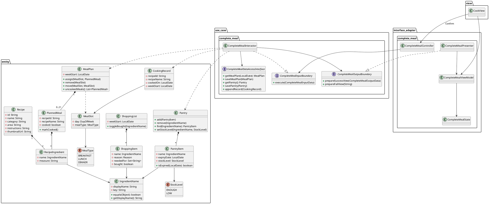
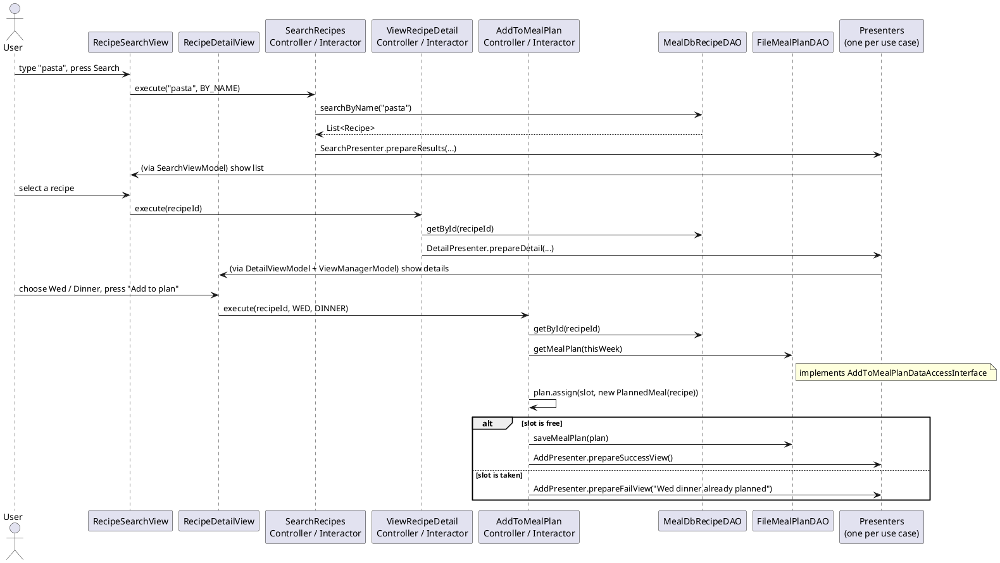
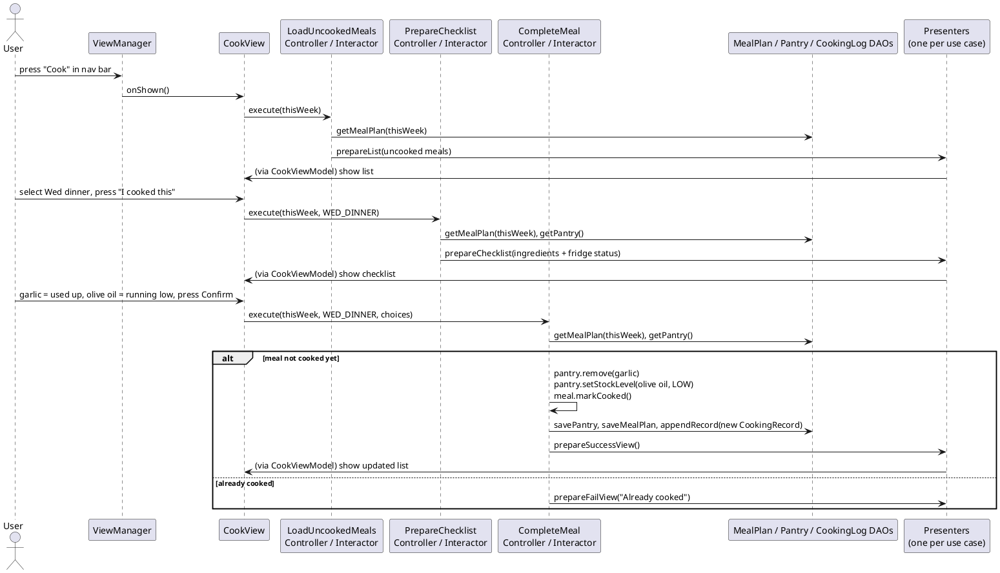

# MealMate

---

## Team Information

### Team Members

| Member | Lead use case (tentative) |
|---|---|
| Zean Du | 1. Browse Recipes |
| Shaoheng Fan | 5. Log Cooking |
| Yilin Hou | TBD (2, 3 or 4) |
| Shengxi Zeng | TBD (2, 3 or 4) |
| Shuyin Hu | TBD (2, 3 or 4) |

---

## Project Description

### Domain

Food & Home / Productivity

MealMate is a desktop app that helps people decide what to cook this week and what to buy. The user keeps track of what is in the fridge, finds recipes from an online recipe database, puts them into a weekly meal plan, and gets a shopping list of only what is missing. After cooking a planned meal, the user marks it done, updates what is left in the fridge, and builds up a cooking history.

**Core loop:** Fridge → Find recipes → Plan the week → Shop for what's missing → Cook and log → Fridge

---

## User Stories

### User Story 1: Browse Recipes
As a user, I want to search for recipes by name or by ingredient and read a recipe's details, so that I can find something to cook and add it to my week.

### User Story 2: Manage Fridge
As a user, I want to record the ingredients I have at home, when they expire, and whether I'm running low, so that I know what I can cook with and what to use first.

### User Story 3: Plan the Week
As a user, I want to see my week as a grid of days and meals and remove or rearrange what I've planned, so that I have a clear plan for what to eat.

### User Story 4: Shopping List
As a user, I want a shopping list generated from my meal plan and my fridge, so that I only buy what I'm missing or running low on.

### User Story 5: Log Cooking
As a user, I want to mark a planned meal as cooked, record which ingredients I used up, and look back at what I've cooked, so that my fridge stays accurate and I can see my cooking habits.

---

## Use Cases

Each use case below is led by one member. A lead owns every View listed under their use case. Each lettered step (1a, 1b, …) is implemented as its own small use case with its own Interactor, boundaries and data access interface; see [Interactors](#interactors) for the full list.

### Use Case 1: Browse Recipes (lead: Zean Du)

**Views owned:** `RecipeSearchView`, `RecipeDetailView` (includes the "Add to meal plan" day/meal picker)

**1a. Search recipes**
- Main flow:
  1. The user opens the Recipes page, types a keyword, and chooses "by name" or "by ingredient".
  2. The system shows a list of matching recipes (name and picture).
- Alternative flows:
  - The keyword is empty: the system asks the user to enter a keyword.
  - Nothing matches: the system says no recipes were found.
  - The recipe service can't be reached: the system shows an error and suggests trying again.

**1b. View recipe details**
- Main flow:
  1. The user selects a recipe from the search results.
  2. The system shows its name, category, cuisine, picture, ingredients with amounts, and instructions.
  3. The user presses "Back" and returns to the search results.
- Alternative flows:
  - The recipe can't be loaded: the system shows an error and stays on the search results.

**1c. Add recipe to meal plan**
- Main flow:
  1. On the details page, the user chooses a day of the current week and a meal (breakfast, lunch or dinner) and presses "Add to plan".
  2. The system saves the recipe into that slot and confirms.
- Alternative flows:
  - The slot already has a meal: the system says so and asks the user to pick another slot (or remove the existing meal from the Meal Plan page first).

### Use Case 2: Manage Fridge (lead: TBD)

**Views owned:** `PantryView`, `AddPantryItemDialog`

**2a. View fridge**
- Main flow:
  1. The user opens the Fridge page.
  2. The system lists every item with its expiry date and stock level, soonest expiry first. Items expiring within 3 days are highlighted; expired items are marked.

**2b. Add an item**
- Main flow:
  1. The user presses "Add", starts typing an ingredient name, and picks one from the suggestions.
  2. The user optionally sets an expiry date and presses "Save".
  3. The new item appears in the list with stock level "enough".
- Alternative flows:
  - The name isn't one of the known ingredients: the system doesn't accept it and asks the user to pick from the suggestions.
  - The ingredient is already in the fridge: the system says so.
  - The expiry date is in the past: the system says the date is invalid.

**2c. Update or remove an item**
- Main flow:
  1. The user selects an item and marks it "running low", "enough", or removes it.
  2. The list updates.

### Use Case 3: Plan the Week (lead: TBD)

**Views owned:** `MealPlanView` (with a side panel for the selected meal)

**3a. View the week**
- Main flow:
  1. The user opens the Meal Plan page.
  2. The system shows a 7 × 3 grid (Monday–Sunday × breakfast/lunch/dinner) for the current week. Each filled slot shows the recipe name and whether it has been cooked.
  3. The user selects a filled slot, and the side panel shows the recipe name and its ingredients with amounts.
- Alternative flows:
  - Nothing is planned yet: the grid is empty and the system suggests going to the Recipes page.

**3b. Remove or move a meal**
- Main flow:
  1. The user selects a filled slot and presses "Remove", or "Move" and picks an empty slot.
  2. The grid updates.
- Alternative flows:
  - The target slot is already filled: the system says so.
  - The meal is already cooked: it can't be moved.

### Use Case 4: Shopping List (lead: TBD)

**Views owned:** `ShoppingListView`

**4a. Generate the list**
- Main flow:
  1. The user opens the Shopping List page. The system shows the last list generated, if any. The user presses "Generate".
  2. The system looks at every meal in this week's plan that hasn't been cooked yet and collects their ingredients.
  3. The system lists what the user needs to buy in two groups:
     - **Missing:** not in the fridge, or in the fridge but expired.
     - **Running low:** in the fridge but marked "running low".
     Each ingredient appears once, with the meals that need it.
- Alternative flows:
  - The plan has no uncooked meals: the system says there is nothing to shop for.
  - Everything is already in the fridge: the system says there is nothing to buy.

**4b. Tick off items**
- Main flow:
  1. While shopping, the user ticks items as bought.
  2. The ticks are saved, so they are still there after restarting the app.
- Alternative flows:
  - The user regenerates the list: items that are still needed keep their ticks; items no longer needed disappear.

### Use Case 5: Log Cooking (lead: Shaoheng Fan)

**Views owned:** `CookView`, `CookingHistoryView`, `CookingStatsView` (extension)

**5a. Complete a planned meal**
- Main flow:
  1. The user opens the Cook page. The system lists this week's planned meals that haven't been cooked yet, by day.
  2. The user selects one and presses "I cooked this".
  3. The system shows the meal's ingredients. For each ingredient that is in the fridge, the user chooses "used up", "running low", or "still enough". Ingredients not in the fridge are shown as "not in fridge" and can't be changed.
  4. The user presses "Confirm".
  5. The system updates the fridge (removes "used up" items, marks "running low" items), marks the meal as cooked in the plan, adds an entry to the cooking history, and refreshes the list (the meal is no longer in it).
- Alternative flows:
  - There are no uncooked meals this week: the system says so and suggests the Meal Plan page.
  - The meal was already marked as cooked (e.g. the list was out of date): the system says so and refreshes the list.
  - The user presses "Cancel": nothing changes.

**5b. View cooking history**
- Main flow:
  1. On the Cook page, the user presses "History".
  2. The system lists everything cooked, newest first, with the date and meal.
- Alternative flows:
  - Nothing has been cooked yet: the system says so.

**5c. View cooking statistics (extension)**
- Main flow:
  1. On the History page, the user presses "Stats".
  2. The system shows the most-cooked recipes, the number of meals cooked per week, and the share of planned meals that were actually cooked.

---

## Minimal Viable Product (MVP)

| Team Member | MVP Use Case | Extensions (after MVP) |
|---|---|---|
| Zean Du | 1a Search, 1b Details, 1c Add to plan | Random recipe; "cook with what's in my fridge" search |
| TBD | 2a View, 2b Add, 2c Update/remove fridge items; ingredient name catalog | Filter by expiring soon |
| TBD | 3a View week and a planned meal, 3b Remove/move | Switch to previous/next week; copy last week |
| TBD | 4a Generate, 4b Tick off | Bought items go straight into the fridge; export as text |
| Shaoheng Fan | 5a Cook a planned meal, 5b History | 5c Stats; undo a completion |

Use cases 1 and 2 don't depend on any other use case, so they are the first end-to-end prototype for Milestone 2.

---

## Interactors

Each lead splits their use case into small Interactors, one per user action. Each Interactor has its own input boundary, output boundary, input/output data, data access interface, Controller and Presenter, in its own package (`use_case.<name>`, `interface_adapter.<name>`), as in ca-login.

| Lead | Interactors (MVP) | Data access interfaces it needs, implemented by |
|---|---|---|
| 1 Recipes | `SearchRecipes`, `ViewRecipeDetail`, `AddToMealPlan` | recipes → `MealDbRecipeDataAccessObject`; meal plan → `FileMealPlanDataAccessObject` |
| 2 Fridge | `LoadPantry`, `AddPantryItem`, `UpdateStockLevel`, `RemovePantryItem`, `LoadIngredientCatalog` | fridge → `FilePantryDataAccessObject`; catalog → `MealDbIngredientCatalogDataAccessObject` |
| 3 Meal Plan | `LoadMealPlan`, `RemovePlannedMeal`, `MovePlannedMeal` | meal plan → `FileMealPlanDataAccessObject` |
| 4 Shopping | `LoadShoppingList`, `GenerateShoppingList`, `ToggleBought` | shopping list → `FileShoppingListDataAccessObject`; meal plan, fridge (read only) |
| 5 Cooking | `LoadUncookedMeals`, `PrepareChecklist`, `CompleteMeal`, `LoadCookingHistory` | meal plan, fridge → their DAOs; history → `FileCookingLogDataAccessObject` |

Every Interactor gets at least one unit test, run against in-memory DAOs.

---

## Entities

All entities are plain Java with no Swing, file or network code.

### IngredientName (value object)
Every ingredient in the app is compared through this class, never through a raw `String`.
- Fields: `displayName: String` (as shown to the user), `key: String` (normalized)
- Normalization: trim, lowercase, `_` → space, collapse repeated spaces. So `"Chicken_Breast"`, `" chicken breast "` and `"Chicken Breast"` are equal.
- Methods: `equals` / `hashCode` on `key` only; `getDisplayName()`
- Why: TheMealDB spells the same ingredient differently in different places (see API Usage). If we later need synonyms (e.g. "chopped tomatoes" ≈ "tomatoes"), only this class (or a matcher it delegates to) changes; no use case code changes.

### RecipeIngredient
- Fields: `name: IngredientName`, `measure: String`
- `measure` is free text from the API ("1/4 cup", "3 cloves", "sprinkling"). It is only displayed, never calculated with.

### Recipe
- Fields: `id`, `name`, `category`, `area`, `instructions`, `thumbnailUrl`, `ingredients: List<RecipeIngredient>`

### StockLevel (enum)
- `ENOUGH`, `LOW`. "Out of stock" is not a level: an item that is used up is removed from the fridge.

### PantryItem
- Fields: `name: IngredientName`, `expiryDate: LocalDate` (optional), `stockLevel: StockLevel`
- Methods: `isExpired(today)`, `expiresWithin(today, days)`

### Pantry
- Fields: `items: Map<IngredientName, PantryItem>`
- Methods: `add(item)` (rejects duplicates), `remove(name)`, `find(name)`, `setStockLevel(name, level)`, `sortedByExpiry()`

### MealSlot (value object) and MealType (enum)
- `MealSlot` fields: `day: DayOfWeek`, `mealType: MealType`
- `MealType`: `BREAKFAST`, `LUNCH`, `DINNER`

### PlannedMeal
- Fields: `recipeId`, `recipeName`, `ingredients: List<RecipeIngredient>` (a copy taken when the meal is added), `cooked: boolean`
- The ingredient copy means use cases 3, 4 and 5 never need the API.
- Methods: `markCooked()` (fails if already cooked). This only changes the `cooked` field; it doesn't create anything.

### MealPlan
- Fields: `weekStart: LocalDate` (always a Monday), `meals: Map<MealSlot, PlannedMeal>`
- Methods: `assign(slot, meal)` (fails if the slot is taken), `remove(slot)`, `move(from, to)` (fails if the target is taken or the meal is cooked), `uncookedMeals()`

### ShoppingItem
- Fields: `name: IngredientName`, `reason: MISSING | LOW`, `neededFor: Set<String>` (recipe names), `bought: boolean`

### ShoppingList
- Fields: `weekStart: LocalDate`, `items: List<ShoppingItem>`
- Methods: `toggleBought(name)`

### CookingRecord
- Fields: `recipeId`, `recipeName`, `cookedOn: LocalDate`, `weekStart: LocalDate`, `slot: MealSlot`
- A new record is appended every time a meal is cooked. A slot can be completed only once, but the same recipe can be cooked many times in different slots and weeks, so counting records gives "most cooked" without contradiction.

### Which use cases use which entities

| Entity | 1 Recipes | 2 Fridge | 3 Plan | 4 Shopping | 5 Cooking |
|---|---|---|---|---|---|
| `IngredientName` | ✓ | ✓ | | ✓ | ✓ |
| `Recipe`, `RecipeIngredient` | ✓ | | ✓ (via `PlannedMeal`) | ✓ (via `PlannedMeal`) | ✓ (via `PlannedMeal`) |
| `Pantry`, `PantryItem`, `StockLevel` | | ✓ | | reads | writes |
| `MealPlan`, `PlannedMeal`, `MealSlot` | writes (1c) | | ✓ | reads | writes `cooked` |
| `ShoppingList`, `ShoppingItem` | | | | ✓ | |
| `CookingRecord` | | | | | ✓ |

---

## API Usage

**API Name:** TheMealDB

**Documentation:** https://www.themealdb.com/api.php

**How it is used in the program:**
- Only two places call the API: the recipe data access object (use case 1) and the ingredient catalog loader (use case 2). Everything else reads local files.
- We use the free test key `1`. Filtering by several ingredients at once is a paid feature, so we don't use it.
- Results are cached in local files, so recipes we've seen still load without internet (useful for the demo).

| Endpoint | Purpose | Used by |
|---|---|---|
| `search.php?s=<name>` | Search by recipe name; returns full recipes | 1a |
| `filter.php?i=<ingredient>` | Search by one ingredient; returns **only** id, name, picture | 1a |
| `lookup.php?i=<id>` | Full recipe by id | 1b |
| `list.php?i=list` | All known ingredient names | 2b (catalog) |
| `random.php` | One random recipe | 1 (extension) |

**What the responses look like** (abridged from real responses):

A full recipe (`search.php`, `lookup.php`):
```json
{
  "meals": [
    {
      "idMeal": "52771",
      "strMeal": "Spicy Arrabiata Penne",
      "strCategory": "Vegetarian",
      "strArea": "Italian",
      "strInstructions": "Bring a large pot of water to a boil...",
      "strMealThumb": "https://www.themealdb.com/images/media/meals/....jpg",
      "strIngredient1": "penne rigate",   "strMeasure1": "1 pound",
      "strIngredient2": "olive oil",      "strMeasure2": "1/4 cup",
      "strIngredient3": "garlic",         "strMeasure3": "3 cloves",
      "strIngredient8": "Parmigiano-Reggiano", "strMeasure8": "sprinkling",
      "strIngredient9": "",               "strMeasure9": "",
      "strIngredient16": null,            "strMeasure16": null
    }
  ]
}
```

A filter result (`filter.php`), which has to be followed by `lookup.php` to get ingredients:
```json
{ "meals": [ { "strMeal": "Chick-Fil-A Sandwich", "strMealThumb": "https://...jpg", "idMeal": "53016" } ] }
```

The ingredient list (`list.php?i=list`), several hundred entries and about 600 KB, so we download it once and cache it:
```json
{ "meals": [ { "idIngredient": "1", "strIngredient": "Chicken", "strDescription": "...", "strThumb": "https://...png", "strType": null } ] }
```

**What this means for our design:**
- Ingredients come as 20 numbered pairs (`strIngredient1`…`strIngredient20`, `strMeasure1`…`strMeasure20`). Unused pairs are `""` or `null`, so the parser has to skip both.
- **Amounts can't be calculated with.** Measures are free text with different units for every ingredient ("1 pound", "1 tin", "6 leaves", "sprinkling"), and the fridge doesn't know how many grams of anything it holds. That is why the fridge uses a stock level (enough / running low) instead of quantities, and why the user tells the app what was used up after cooking.
- **Names aren't spelled consistently.** The catalog says `"Chicken"`, recipes use lowercase like `"garlic"`, and the filter endpoint expects `chicken_breast`. `IngredientName` normalizes all of these.
- When nothing matches, the API is documented to return `{"meals": null}`. The parser must treat `null` and an empty array the same way. (To verify in lab.)

---

## View Architecture

We follow ca-login: a `CardLayout` panel controlled by `ViewManager`, whose state (the name of the visible View) lives in `ViewManagerModel`. On top of that, the main window has a fixed navigation bar with five buttons, one per member: Recipes, Fridge, Meal Plan, Shopping List, Cook.

| View | Owner | Opened from |
|---|---|---|
| `RecipeSearchView` | 1 | Nav bar |
| `RecipeDetailView` | 1 | `RecipeSearchView` |
| `PantryView` (+ `AddPantryItemDialog`) | 2 | Nav bar |
| `MealPlanView` | 3 | Nav bar |
| `ShoppingListView` | 4 | Nav bar |
| `CookView` | 5 | Nav bar |
| `CookingHistoryView` (+ `CookingStatsView`) | 5 | `CookView` |

**Rules for how Views work together:**

1. **A Presenter only writes to its own use case's ViewModel.** No member's Presenter ever changes another member's ViewModel. Presenters may switch the visible View through `ViewManagerModel`, as in ca-login's `LoginPresenter`.
2. **Nobody calls another member's Controller.** A View only holds the Controllers of its own lead's use cases. When a use case needs data that another use case produces, it gets it through its own data access interface, and the DAO that owns that file implements that interface too (see [Data Access](#data-access)). For example, 1c (add to plan) declares `AddToMealPlanDataAccessInterface`, and `FileMealPlanDataAccessObject`, which also serves 3, implements it. Members' pages are connected only through the nav bar.
3. **Views reload whenever they are shown.** Each owner provides a small "load" use case (2a, 3a, loading the saved list in 4, 5b). We add one thing to ca-login's `ViewManager`: every View implements `onShown()`, and `ViewManager` calls it each time a View becomes visible, no matter who switched to it (the nav bar, a Back button, or a Presenter). `onShown()` calls the View's own load controller. So when 1c adds a meal or 5a changes the fridge, the Meal Plan and Fridge pages show the new data the next time they appear, with no messages between members' code.
4. **Moving between pages happens only inside one member's own Views** (search ↔ details, Cook ↔ History), through their own Presenters.

So each member's code depends only on the shared entities, the shared `ViewManagerModel`, and the data access interfaces their own use cases declare.

---

## Data Access

Following ca-login, each use case declares the small data access interface it needs, and one class per stored file implements all the interfaces that touch that file. For example, `FileMealPlanDataAccessObject` implements the interfaces of 1c, 3a, 3b, 4a, 5a and 5c. Every interface also gets an in-memory implementation for unit tests and for working before the file version is ready.

| Stored data | File | Read by | Written by |
|---|---|---|---|
| Recipe cache | `cache/recipes.json` | 1 | 1 |
| Ingredient catalog | `cache/ingredients.json` | 2b | 2 (first run) |
| Fridge | `data/pantry.json` | 2, 4, 5a | 2, 5a |
| Meal plans (by week) | `data/mealplans.json` | 1c, 3, 4, 5a, 5c | 1c, 3, 5a |
| Shopping list | `data/shopping_list.json` | 4 | 4 |
| Cooking history | `data/cooking_log.json` | 5 | 5a |

JSON is read and written with `org.json`, and HTTP calls use OkHttp, the same libraries as ca-login.

**Shared foundation that must be merged into `main` before anyone starts their use case:**
- All entities above, with unit tests (`IngredientName` in particular)
- `ViewManager`, `ViewManagerModel`, the main window with the nav bar, and an `AppBuilder` with an empty slot per View
- The data access interfaces for each use case (method signatures only), plus in-memory versions

---

## Design Diagrams

Drafts to check that the design holds together. They will be updated as we build.

### UML Class Diagram

Entities, plus use case 5a as one example of a full Clean Architecture slice. The other use cases follow the same shape.



This shows only the last step of 5a (confirming). Loading the uncooked meals and preparing the checklist are separate, smaller use cases with the same shape. The `CompleteMealDataAccessInterface` above is a placeholder: in the code it will be split so each method group is implemented by the DAO that owns that file (meal plan, pantry, cooking log).

### Sequence Diagrams

**Flow 1: Search → details → add to plan** (use cases 1a, 1b, 1c, each its own Interactor)



**Flow 2: Cook a planned meal** (use case 5a, all on the Cook page)



---

## How to Run

1. Install JDK 17 or newer and Maven.
2. Clone this repository and open it in IntelliJ.
3. Run `app.Main`.

The first run downloads the ingredient list from TheMealDB, so an internet connection is needed once. (To be finalized.)

---

## Notes

**Known limitations (by design):**
- The app doesn't track amounts, only whether an ingredient is there and whether it's running low (see API Usage for why).
- If a recipe spells an ingredient in a way the catalog doesn't (e.g. "chopped tomatoes" vs "Tomatoes"), the shopping list treats it as missing. A synonym table in `IngredientName` can fix this later.
- Only the current week is shown in the MVP.

**Open questions:**
- [ ] Who leads use cases 2, 3 and 4 (Yilin, Shengxi, Shuyin)?
- [ ] Should "Move" stay in 3's MVP or become an extension?
- [ ] Verify in lab: what `search.php` returns when nothing matches.
