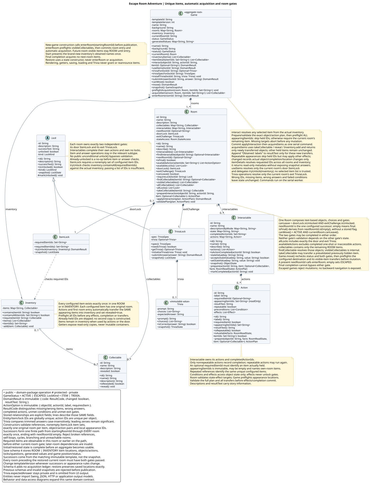

# Escape Room Adventure

## Team Information

### Team Members

- Zhiyu Li
- Wenqi Luo
- Yue Pan
- Jan Fung
- Bohan Zhang

---

## Project Description

### Domain

Escape Room Adventure is a planned Java 11 text-based escape room game with a Java Swing GUI. Players choose a JSON story template, read room and object descriptions, select object actions, automatically obtain items when they appear, and answer questions.

The domain follows the team's hand-drawn structure: `Game` owns its `Inventory` and rooms; each `Room` owns its `Interactable` objects, an `ItemLock`, and an independent `TriviaLock`. `Interactable` owns its `Action` objects and has no lock field or lock relationship. `ItemLock` and `TriviaLock` inherit the common identity, description, success text, and unlocked state from `Lock`.

`ItemLock.requiredItemIds: Set<String>` identifies every item needed to open the room's door. An unlock attempt checks whether the actual inventory contains all those exact IDs. A successful attempt unlocks the door and leaves every item in the inventory. Moving from a room requires both the door unlocked and the room's mandatory exit Trivia passed. These two goals can be completed in either order.

### Puzzle Types

| Puzzle Type | Domain behavior | Example |
|-------------|-----------------|---------|
| Object interaction | An `Action` checks conditions and an optional held tool, then changes object state and makes its configured `appearingItemIds` enter the inventory automatically. | Open a drawer and read “Obtained: Laboratory access card.” |
| Item-based door | The room's `ItemLock` checks all configured item IDs against the inventory. | Hold both `lab-access-card` and `lab-security-badge` to unlock the door. |
| Room question | The room's `TriviaLock` checks a retained template-authored or API-provided `Trivia`. | Answer the exit question before or after opening the door. |

`Action.appearingItemIds: Set<String>` names existing items configured to the action's room. After validating the entire command, `Game` applies the action and moves each newly appearing item from that room into the inventory as one atomic operation. Items already held are skipped by ID. Newly obtained item names are appended to the result text, and all item use leaves held items available.

Items configured as initially visible are obtained automatically when their room is first entered, before the first view of that room is presented. This also applies to the starting room. Visible items in rooms not yet entered remain in those rooms until entry.

### Player Interface and Session State

`GameView` uses a `JTextArea` for story text, room/object descriptions, action results, and newly obtained item names; a `JPanel` of option buttons for object actions, door-unlock attempts, Trivia, movement, and save/load; and a `JTextField` for answers. Actions, held tools and locks use stable IDs. One movement button calls `GameController.move()` without an ID; it displays Next room or Escape according to the current room. The answer field supplies a code or answer for the selected question rather than parsing general commands.

The active `Game` keeps every room's object/action state, item locations, inventory, both locks, retained questions, generated values, and escape status. Each item exists exactly once, either in a room or in the inventory. New sessions generate configured values once; save/load preserves those values and the original questions.

Every command outcome follows interactor → assembler → presenter → view model on the Swing EDT → view render, including errors and unchanged results. The inventory and `canMove` are refreshed immediately after automatic acquisition or completion of the last room gate. The existing output `message` carries only that command's result text and newly obtained names; saving, loading, Trivia, and refreshes do not announce held items again.

### Example Playthrough

1. Select the Abandoned Laboratory story. Its starting room is entered, initially visible items enter the inventory, and their names appear with the first room description.
2. Choose the drawer's action. Its access card enters the inventory automatically, and the result includes “Obtained: Laboratory access card.”
3. Find the security badge through another object action. Repeating an allowed action does not add or announce an item already held.
4. Choose the door-unlock option. The game checks that both required IDs are held, unlocks the door, and keeps both items in the inventory.
5. Pass the mandatory exit Trivia. This can also be done before steps 2–4.
6. Choose Next room. `Game.move()` checks both room locks, then enters the room identified by `nextRoomId`.
7. Continue along the single room path. In the final room, `nextRoomId` is empty; choosing Escape under the same two-gate rule sets the game status to `ESCAPED`.

**Status:** Project planning. Pending course staff approval. The repository contains design and documentation, with no Java game implementation yet.

**Planned features:**

- Selectable JSON story templates, with an initial five-room escape story on one forward path.
- Text descriptions, option buttons, and answer entry through Swing.
- Stateful object actions, optional held-tool requirements, and automatic acquisition of appearing items.
- Automatic acquisition of initially visible items on first room entry, with names shown in the command result.
- Door unlocking based on possession of every configured item ID, with items retained.
- Independent door-unlock and exit-Trivia requirements, both checked on every departure.
- Session-consistent generated values and retained template/API questions.
- Manual JSON saving and validated loading of the complete world.
- SOLID responsibilities and Clean Architecture boundaries between entities, use cases, adapters, and Swing.

---

## User Stories

### User Story 1: Discover and Obtain Items

**As a player, I want items to enter my inventory when they appear so that I can focus on exploring and meeting the room's item requirements.**

**Acceptance criteria:**

1. A successful action automatically acquires the existing items identified by its `appearingItemIds`, which may be empty.
2. Before mutation, `Game` validates the current-room target, conditions, actual held tool, effects, and every physical item transfer. A failed check leaves the whole command unchanged.
3. A valid command atomically applies object changes, records any nonrepeatable completion, marks new items revealed, and transfers the same item objects from the room into the inventory.
4. Inventory ID checks skip items already held. Repeated actions never create another item copy or repeat its obtained-item notice; other valid state effects may still execute.
5. Initially visible items are obtained on first entry to the starting room or a new room before its output is assembled. Items in later rooms remain there until entry.
6. Every item has a globally unique ID and exactly one authoritative location, `ROOM` or `INVENTORY`. The result names only items newly obtained during that command, and the view refreshes the inventory immediately.

### User Story 2: Unlock the Door with All Required Items

**As a player, I want the door to check the items I hold so that I can open it when I have every required item.**

**Acceptance criteria:**

1. The room's `ItemLock` stores a nonempty `requiredItemIds: Set<String>`.
2. `Game.useItems(lockId)` resolves the current room's door lock and passes the actual `Inventory` to `ItemLock.tryUnlock(inventory)`.
3. The lock checks `inventory.containsAll(requiredItemIds)`. A matching item count or a partial match is insufficient.
4. Success changes only the lock's unlocked state and reports its success text. All held items remain available.
5. Missing IDs leave the door and inventory unchanged. Retrying an already unlocked door returns a no-op.
6. Opening the door neither requires passing Trivia first nor moves the player.

### User Story 3: Interact with Objects and Answer Questions

**As a player, I want to choose object actions and answer questions so that I can understand the room and solve its puzzles.**

**Acceptance criteria:**

1. The interface displays room/object descriptions, available actions, action results, and lock success text.
2. `Interactable` stores its identity, descriptions by mode, current state, actions, and completed action IDs. It has no lock field.
3. An action validates its current-room target, conditions, optional held-tool requirement, completion status, effect targets, and all configured item appearances before applying changes.
4. Only nonrepeatable actions record their first completion; repeatable actions remain subject to their conditions and may produce further state changes while already held appearance items are skipped.
5. Invalid choices, incompatible items, and incorrect answers leave the attempted operation unchanged.
6. API questions are fetched on opening, retained for subsequent attempts, and included in saves. Failed requests permit a retry.
7. The mandatory exit Trivia can be opened and answered independently of the door's item progress.
8. Correct and wrong answers, missing questions, API failures, already completed operations, and invalid inputs all produce fresh feedback through the same assembler/presenter/EDT/render path. Passing the last gate immediately refreshes movement availability.

### User Story 4: Choose a Story and Explore Rooms

**As a player, I want to choose a story and move through its rooms so that I can complete the escape.**

**Acceptance criteria:**

1. Selecting a valid template creates independent runtime state in its configured starting room.
2. Every room has `nextRoomId: Optional<String>`: a value names the next room and an empty value identifies the final room.
3. `Game.move()` requires active status and `Room.canLeave()`: `doorLock.isUnlocked() && exitChallenge.isUnlocked()`. If either gate is incomplete, the current room and game status remain unchanged.
4. A permitted move validates the next room and all entry transfers before changing state, then enters that room and automatically acquires its initially visible items in the same command.
5. In the final room, the same checks succeed before status becomes `ESCAPED`; unlocking either gate alone never finishes the game.
6. Escaped games reject further gameplay mutations while remaining available for saving or replacement by start/load.

### User Story 5: Save and Load Game Progress

**As a player, I want to save my game and load it later so that I can resume the same session.**

**Acceptance criteria:**

1. Saving captures every room, current-room ID, item location, object/action state, both room locks, generated value, retained question, and escape status.
2. Schema-4 snapshots contain every configured item exactly once with location `ROOM` or `INVENTORY`.
3. Loading restores saved values and questions and preserves progress whether the item door or exit Trivia was completed first.
4. A candidate passes schema, template-version, single-path navigation, ID/reference, complete-state, item-location, and lock-state validation before replacing the active game. Older schemas and incompatible template versions are rejected.
5. Restoration uses the exact saved item locations and performs no room-entry acquisition, HTTP request, random generation, or action replay.
6. Failed writes preserve the previous save. Missing or invalid saves leave the current session intact and produce a message, including at the main menu.
7. Loading preserves the saved inventory and presents load feedback without producing new obtained-item notices. Saving and ordinary refreshes also show their own feedback without replaying earlier acquisition notices.

---

## Use Cases

The application has seven focused input boundaries, each with its corresponding interactor. Gameplay commands obtain the current game through the shared `GameContext` rather than storing a game reference that loading could replace.

| Use Case | Input and Interactor | Main Flow |
|----------|----------------------|-----------|
| Choose a story | `StartGameInputBoundary` / `StartGameInteractor` | `listStories()` lists templates; `start(templateId)` creates an independent game whose starting-room items have been acquired, replaces context after success, and includes those new inventory names in its first output once. |
| Interact with an object | `InteractInputBoundary` / `InteractInteractor` | `execute(objectId, actionId, itemId)` calls `Game.interact()`; the domain atomically applies the action and acquires its newly appearing room items. |
| Unlock the item door | `UseItemInputBoundary` / `UseItemInteractor` | `execute(lockId)` calls `Game.useItems()`; the door checks all its required IDs against the actual inventory. |
| Answer exit Trivia | `TriviaInputBoundary` / `TriviaInteractor` | `open(lockId)` reuses or initializes the question; `submit(lockId, answer)` calls `Game.submitAnswer()` without fetching again. |
| Move forward or escape | `MoveInputBoundary` / `MoveInteractor` | `execute()` calls `Game.move()`, which checks active status and both room locks, then enters `nextRoomId` and acquires entry-visible items, or sets `ESCAPED` when the link is empty. |
| Save progress | `SaveGameInputBoundary` / `SaveGameInteractor` | `save()` captures an immutable snapshot and persists it through the save port. |
| Load progress | `LoadGameInputBoundary` / `LoadGameInteractor` | `load()` reads a save and compatible template, validates a separate restored candidate, then replaces context. |

Every command returns fresh immutable display data through `GameOutputAssembler` and `GameOutputBoundary`, followed by presenter → EDT view-model update → view render. This includes successful actions and automatic acquisition, correct/wrong answers, uninitialized questions, API failures, blocked movement, invalid inputs, and unchanged results. An unavailable operation preserves the affected state while presenting feedback. Post-command inventory and `canMove` are always recomputed; acquiring an item or completing the last gate therefore appears immediately. Start and load work without an existing game; saving requires a current game. Save and load failures preserve the previous game, and failed writing also preserves the previous save.

---

## Minimal Viable Product (MVP)

The planned MVP is a playable text-choice escape story with stateful objects, automatic item acquisition, checks for all required door items, independent exit questions, and manual save/load. Final scope and ownership remain subject to team discussion.

### Work Split

The five proposed packages below are unassigned. Each package includes its behavior tests and integration with the shared Swing controls. The team will agree on stable IDs, immutable template definitions, and typed input/output contracts before implementation.

#### Option 1: Story Templates and New-Game Setup

**Selected by:** TBD

- Define and validate the single room chain, descriptions, item placement/initial visibility, action appearance IDs, item-lock requirements, questions, and generated values.
- Implement `StoryTemplateDataAccessInterface`, its JSON adapter, `StartGameInteractor`, and new-world creation in `GameFactory`.
- Validate unique IDs, a finite room chain covering every room once, compatible lock definitions, and item/puzzle availability that permits either gate to finish first. Appearance IDs must identify items configured to the action's own room. Required items must be obtainable in the current or an earlier room; review the authored room design so necessary earlier items are not missed.
- Test independent sessions, starting-room acquisition before publication, invalid templates, and consistency between generated clues and authored answers.

**Completion example:** Selecting a valid story starts a fresh world with independent object/lock state, its starting visible items in the inventory, and their names in the first output.

#### Option 2: Rooms, Inventory, and Exploration

**Selected by:** TBD

- Implement `Game`, `GameContext`, `Room`, `Inventory`, and `Collectable`, with `Room.nextRoomId: Optional<String>` for navigation.
- Implement parameterless `MoveInteractor.execute()` and the private `Game.enterRoom()` domain operation, including prevalidated room-entry acquisition, both departure checks, and final-room escape.
- Keep each item in exactly one room or the inventory, transfer its existing instance automatically, prevent duplicate IDs, and expose read-only queries for display and saving.
- Test initial/new-room visible-item acquisition, items retained in later rooms until entry, either incomplete departure condition, atomic failed entry, and final-room completion.

**Completion example:** Moving forward requires both room locks, automatically obtains the next room's visible items, and presents their names with its first description.

#### Option 3: Text Choices and Object Actions

**Selected by:** TBD

- Implement `Interactable`, `Action`, `InteractInteractor`, and the narrow `Condition`/`Effect` contracts.
- Complete descriptions by mode, object state, optional held-tool requirements, `appearingItemIds`, action results, and nonrepeatable completion tracking.
- Use `SetObjectStateEffect` for the supported state changes. Carry appearing IDs in an immutable `ActionPlan`; `Game` validates all effects and item transfers before committing the whole command.
- Test unavailable actions, wrong tools, multiple appearing items, repeated appearances with no duplicate item/notice, further effects on repeatable actions, and failures that preserve all state.

**Completion example:** Opening a valid drawer changes its description, places its card in the inventory, and displays “Obtained: Laboratory access card” in the same result.

#### Option 4: Item Locks and Trivia

**Selected by:** TBD

- Implement `Lock`, `ItemLock`, `TriviaLock`, `Trivia`, `UseItemInteractor`, and `TriviaInteractor` with their focused input boundaries.
- Check every required item ID against the actual inventory and keep all items held after unlocking.
- Implement `TriviaDataAccessInterface` and its HTTP adapter, with retained questions and retry after failed retrieval.
- Test partial/wrong item sets, unchanged inventory after success, already-unlocked no-ops, correct/wrong answers, uninitialized questions, API failures, and either departure-completion order. Every outcome refreshes feedback, inventory, and movement flags.

**Completion example:** Hold both specified items, open the item door, and pass exit Trivia; answering the question first is equally valid.

#### Option 5: Save/Load and Shared Swing Integration

**Selected by:** TBD

- Implement schema-4 `GameSnapshot`, the JSON save adapter, `SaveGameInteractor`, `LoadGameInteractor`, and validated restoration in `GameFactory`.
- Build `GameView`, `GameController`, seven focused input interfaces, `GameOutputBoundary`, `GamePresenter`, `GameViewModel`, and the shared output assembler.
- Present the text area, object-action buttons, and answer field, including current-command obtained names in `message`, inventory, required-item labels, held IDs, and one movement control driven by `canMove` and `finalRoom`.
- Run gameplay and file/API work on one serial worker; marshal view-model updates to Swing's event-dispatch thread.
- Test restart-and-load without new entry/acquisition or obtained-item notices, complete state coverage, retained questions, both gate orders, rejected saves, and failed writes. Verify every success/error/no-op refresh path and coordinate the end-to-end game check.

**Completion example:** Save after an action obtains a card, restart, and resume the same inventory and question without acquiring or announcing that card again.

---

## Entities and Architecture

### StoryTemplate, Game, and Room

`StoryTemplate` is immutable configuration. `Game` owns the runtime room map and inventory, tracks the current room and `ACTIVE`/`ESCAPED` status, and coordinates automatic item transfers and room-level commands. Each `Room` owns its remaining collectables, interactables, mandatory `doorLock: ItemLock`, and independent `exitChallenge: TriviaLock`, and stores `nextRoomId: Optional<String>`.

A present `nextRoomId` identifies the next room; an empty value identifies the final room. `Room.isFinal()` derives this fact rather than storing another flag. `Game.canMove() = (status == ACTIVE) && currentRoom.canLeave()`: active status and both room gates are the complete movement conditions. `Game.move()` performs those checks, then privately enters the next room with its prevalidated visible-item transfers, or sets `ESCAPED` in the final room. The template defines one finite forward chain from its starting room through every configured room, with no backward navigation or destination selection. No public unconditional unlock or end-game command bypasses the gate rule.

Private `Game.enterRoom()` validates the room reference and every initially visible item transfer before changing the current room or inventory. `GameFactory.create()` uses the new-game construction path to enter the starting room before exposing the candidate. Since all inventory entries at that point are new starting-room items, `StartGameInteractor` formats their names in its first message once. Movement returns its new entry items in that command's `DomainResult.resultText`. Restoration uses a separate saved-state construction path and does not call `enterRoom()`.

### Inventory and Collectable

`Inventory.items: Map<String, Collectable>` stores held items and provides ID lookup, read-only item queries, and `containsAll(Set<String>)`. `Collectable` stores its ID, name, description, and revealed state. Automatic acquisition marks an item revealed, removes that same instance from its room, and adds it to the inventory. Items already held are skipped by ID without a duplicate transfer or obtained-item notice. Item use leaves ownership unchanged. An ordinary collectable such as a key fragment is simply a held ID that can satisfy an `ItemLock` requirement.

### Interactable and Action

`Interactable` stores `id`, `name`, `descriptionsByMode`, `state`, `completedActionIds`, and `actions`. It selects its description from current state, lists available choices, prepares an action, and records only nonrepeatable completion. It owns no `Lock`.

`Action` stores `id`, `label`, an optional `requiredItemId`, `appearingItemIds: Set<String>`, `resultText`, `repeatable`, conditions, and effects. The appearing-ID set may be empty and contains only items configured to that object's room. `Condition` reads narrow room facts; the supported effect is `SetObjectStateEffect`, which validates and changes an object's state. An immutable `ActionPlan` contains the exact object/action pair, state effects, appearing IDs, and result text.

`Game.interact()` resolves the actual optional tool from inventory and prevalidates all conditions, effects, and transfers of appearing items not already held. Its atomic commit applies state changes, records any nonrepeatable completion, and transfers the new items. Their labels are appended as “Obtained: …” to `DomainResult.resultText`. A failed check changes none of those facts. A repeated permitted action skips held IDs, still applies its other valid effects, and returns its action text. `DomainResult.changed` is false if neither world state, item ownership, nor a completion record changes. No inventory reference or item-transfer operation enters `Condition` or `Effect`.

### Lock, ItemLock, TriviaLock, and Trivia

`Lock` defines shared identity, description, success text, and unlocked status. Its protected transition is available only to validated subtype operations. `ItemLock` owns `requiredItemIds: Set<String>` and checks the actual inventory. `TriviaLock` owns its question specification and optional initialized `Trivia`, installs a question once, and checks submitted answers. Item and answer operations remain in their respective subtypes.

`Trivia` is an immutable value containing `prompt`, `choices`, and private `expectedAnswer`. It exposes the prompt and choices, compares an answer, and creates a pure saved value. Comparison trims surrounding whitespace and ignores case while preserving internal characters and leading zeroes. Expected answers are saved for accurate restoration but never included in UI output.

### Clean Architecture and SOLID

Source dependencies point inward: `GameView → GameController → InputBoundary ← Interactor → entity`. Interactors depend on use-case-owned output and data-access interfaces; the presenter and JSON/HTTP adapters implement those interfaces. `GameOutputAssembler` reads domain queries and produces immutable application output, including inventory, available object actions, required-item labels, held required IDs, door/Trivia state, `canMove`, and `finalRoom`. The existing `message` contains the current command's result text and newly obtained names. The view uses the two movement flags to enable and label its single movement button; menu output sets both to false. It never exposes answer-bearing snapshots to the view.

| Principle | Design responsibility |
|-----------|-----------------------|
| Single Responsibility | Inventory manages membership; objects/actions manage interactions; locks validate their own rules; `Game` coordinates ownership and movement; adapters perform I/O. |
| Open Closed | New conditions, effects, and external providers implement their existing interfaces. Template tags still require deliberate registration. |
| Liskov Substitution | Lock subtypes share valid common identity/status operations; only the item subtype accepts inventory and only the Trivia subtype accepts answers. |
| Interface Segregation | Seven focused input boundaries and separate read-only room facts/mutation capabilities keep clients dependent on the operations they need. |
| Dependency Inversion | Controllers use input interfaces and interactors use their own output/data-access ports. `AppBuilder` constructs and injects concrete implementations. |

All commands, HTTP requests, and file operations run on one serial worker. Every success, error, and no-op completes the assembler/presenter response path. The presenter constructs its new state inside the Swing EDT callback using the view model's current busy value; property-change notifications render fresh text, inventory, actions, and movement availability. The dispatcher's `finally` queues a final EDT callback after the presenter update, clearing view-model busy and releasing the atomic guard together. The result is rendered before another input is accepted. Entities and use cases remain independent of Swing, executors, JSON libraries, file paths, and HTTP responses.

---

## API Usage and Persistence

**API Name:** TBD (external trivia API).

**Documentation:** TBD after the team selects a provider.

`TriviaInteractor` obtains API questions through the use-case-owned `TriviaDataAccessInterface`. `HttpTriviaDataAccessObject` converts responses into plain `Trivia` values. A successful first open retains the question for all retries and save/load. Retrieval failure leaves the question uninitialized and permits another open request. Template-authored questions start with their configured question and answer.

Schema-4 `GameSnapshot` is an immutable domain memento. It contains the template ID/version, current room, game status, generated values, every item's `ROOM` or `INVENTORY` location and revealed flag, object values and completed action IDs, and every room's two lock states with retained question data. An unlocked item door must agree with possession of all its required IDs; an unlocked Trivia lock retains its answered question. The two locks otherwise remain independent. Navigation and action appearance configuration come from the matching immutable template: the snapshot stores `currentRoomId` and does not duplicate `nextRoomId` or a final-room flag. The saved value structure remains schema 4. Changes to room successors or appearance configuration require a new template version, and loading rejects a version mismatch. An escaped snapshot must identify a room with empty `nextRoomId` and both gates passed.

One configured manual save file defaults to `data/savegame.json`. The JSON adapter writes and closes a temporary file in the same directory before atomically replacing the previous save. A write or replacement failure preserves the previous file and cleans up the temporary file; unsupported atomic replacement reports a save failure.

Loading works from the menu or during play. It validates schema 4, a compatible template and its complete acyclic room chain, the saved current room, complete unique IDs, item ownership, object/action values, lock/question compatibility, and valid final-room completion. Every room preceding the saved current room must have both gates passed, since forward movement requires them. The current room may still have either gate incomplete, in either order. Older schemas are rejected rather than converted. Restoration reconstructs the exact saved item locations and questions without entering a room, acquiring items, replaying actions, drawing randomness, or calling the API. It generates no new obtained-item notices. Only a complete validated candidate replaces `GameContext`; failures preserve the existing session. Load/save/Trivia messages and ordinary refreshes do not reconstruct acquisition notices from the existing inventory, and no notification ledger or extra notification DTO is stored.

---

## Design Diagrams

The eight UML views describe the same classes and contracts. PlantUML is the editable source; each source has SVG and PNG exports.

| View | SVG | PNG | Source |
|------|-----|-----|--------|
| Domain ownership and gameplay contracts | [Domain UML](docs/diagrams/escape-room-domain.svg) | [PNG](docs/diagrams/escape-room-domain.png) | [PlantUML](docs/diagrams/escape-room-domain.puml) |
| Object actions, conditions, and effects | [Behavior UML](docs/diagrams/escape-room-behavior.svg) | [PNG](docs/diagrams/escape-room-behavior.png) | [PlantUML](docs/diagrams/escape-room-behavior.puml) |
| Swing and Clean Architecture boundaries | [Application UML](docs/diagrams/escape-room-class-diagram.svg) | [PNG](docs/diagrams/escape-room-class-diagram.png) | [PlantUML](docs/diagrams/escape-room-class-diagram.puml) |
| All seven interactors and their dependencies | [Use-case UML](docs/diagrams/escape-room-use-cases.svg) | [PNG](docs/diagrams/escape-room-use-cases.png) | [PlantUML](docs/diagrams/escape-room-use-cases.puml) |
| Templates, data access, and complete saved state | [Data-access UML](docs/diagrams/escape-room-data-access.svg) | [PNG](docs/diagrams/escape-room-data-access.png) | [PlantUML](docs/diagrams/escape-room-data-access.puml) |
| Manual save/load module | [Save-system UML](docs/diagrams/escape-room-save-system.svg) | [PNG](docs/diagrams/escape-room-save-system.png) | [PlantUML](docs/diagrams/escape-room-save-system.puml) |
| Choices, item checks, Trivia, and departure | [Gameplay sequence](docs/diagrams/escape-room-trivia-sequence.svg) | [PNG](docs/diagrams/escape-room-trivia-sequence.png) | [PlantUML](docs/diagrams/escape-room-trivia-sequence.puml) |
| Save/load success and failure paths | [Save/load sequence](docs/diagrams/escape-room-save-sequence.svg) | [PNG](docs/diagrams/escape-room-save-sequence.png) | [PlantUML](docs/diagrams/escape-room-save-sequence.puml) |



[Complete design contracts, template definitions, acceptance cases, and rendering instructions](docs/diagrams/escape-room-class-diagram.md).

---

## How to Run

This repository currently contains the design and project plan. Application launch instructions will be added with the Java implementation.

To regenerate every SVG and PNG locally with a separately installed PlantUML JAR:

```sh
JAVA_BIN=/path/to/java PLANTUML_JAR=/path/to/plantuml.jar ./docs/diagrams/render-uml.sh
```

The script renders all eight sources without network requests. PlantUML remains a documentation tool outside the game's Maven dependencies.

---

## Notes

- This README is a planning draft for team discussion.
- Confirm the proposed work split, template schema, and external API provider with the team.
- See [TeamContract.md](TeamContract.md) for the team's collaboration expectations.
