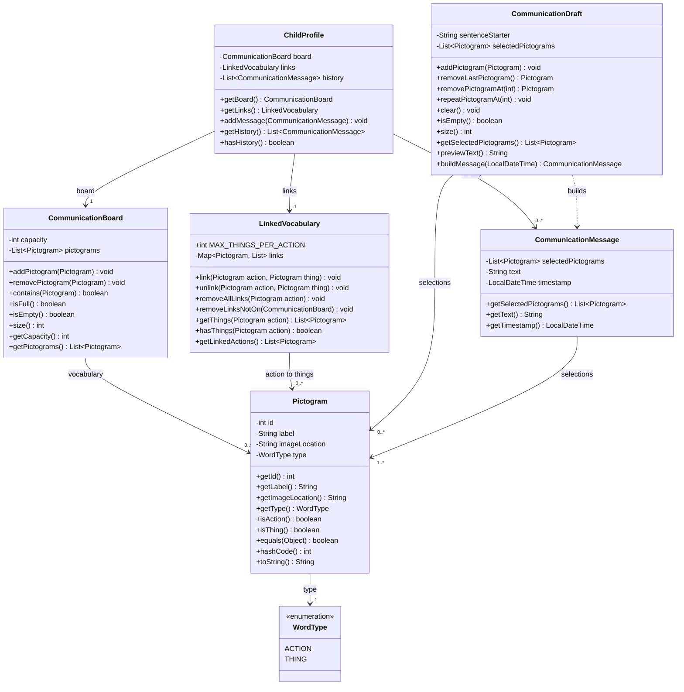
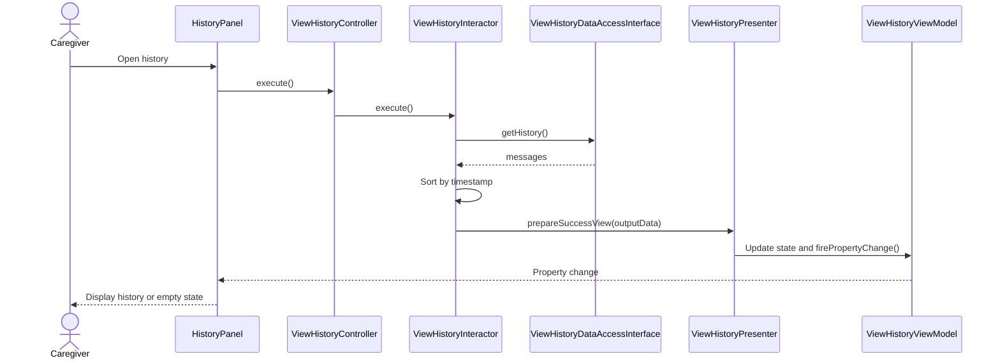

# AACorn - Visual AAC Communication Board

## Team Information

### Team Members

- Harleen Sidhu
- Ruoshui Deng
- Ruohan Tang
- Paul Zhao

## Project Description

### Domain

**Augmentative and Alternative Communication (AAC).** AACorn is a Java Swing application for autistic children aged approximately 5–12 with limited functional speech. Children build and speak requests using pictograms (e.g., `I want` → `water` → “I want water”). Actions can have optional linked things (e.g., `play` → `ball`), so the child can also say “I want to play ball” without the board needing a tile for every noun. Caregivers customize vocabulary, review history and suggestions, and manage access through a PIN. The scope is functional communication, not clinical assessment or therapy.

<p align="center">
  
</p>

<p align="center">
  <strong>Mascot designed by Ruoshui Deng for project branding.</strong>
</p>

## User Stories

1. **US1:** As a child, I want to select, repeat and remove pictograms so that I can build a request.
2. **US2:** As a caregiver, I want to search for, add and remove pictograms so that I can personalize the child's vocabulary.
3. **US3:** As a child, I want to hear my message spoken aloud so that others can understand my needs.
4. **US4:** As a caregiver, I want to review previous messages so that I can understand the child's communication over time.
5. **US5:** As a caregiver, I want to set a PIN so that the child cannot accidentally access caregiver controls.
6. **US6:** As a caregiver, I want vocabulary suggestions so that I can choose useful additions to the board.

## Use Cases

### UC1 – Build a Request

- **Primary actor:** Child
- **Preconditions:** The child is in communication mode; the board contains pictograms.
- **Trigger:** The child starts a request.
- **Success outcome:** A non-empty draft is displayed and ready to speak.

**Main success scenario:**
1. The system displays available pictograms.
2. The child selects a pictogram.
3. The system appends it to the draft and updates the preview.
4. The child repeats steps 2–3 until the request is ready.

**Extensions:**
- **2a.** A repeated selection is appended as a separate occurrence.
- **2b.** If the selected pictogram is an action with linked things, the system also offers those things as optional follow-ups (e.g., `play` → `ball`, `toy`); the child may pick one or stop at the action (“I want to play”).
- **3a.** The child removes a selection; the system updates the preview.
- **3b.** The child clears or abandons the draft; no completed message is recorded.

### UC2 – Customize the Board

- **Primary actor:** Caregiver
- **Preconditions:** Caregiver mode is accessible to the caregiver.
- **Trigger:** The caregiver requests to edit the board.
- **Success outcome:** The updated vocabulary is saved and available to the child.

**Main success scenario:**
1. The system displays the current board.
2. The caregiver requests a pictogram search and supplies a keyword.
3. The system displays matching pictograms.
4. The caregiver selects a pictogram and either adds it to the board as an action or a thing, or links it as a thing to a selected action on the board.
5. The system validates, saves and displays the updated board and links.

**Extensions:**
- **2a.** The caregiver selects an existing pictogram to remove; the system removes it (and, for an action, its links) and saves the board.
- **3a.** No matches or an API error: the system reports the result; the board is unchanged.
- **5a.** Duplicate selection or capacity reached: the system rejects the addition; the board is unchanged.
- **5b.** Linking: only a thing can be linked, only to an action on the board, at most six things per action and no duplicates; otherwise the system rejects the link.

### UC3 – Speak a Message

- **Primary actor:** Child
- **Preconditions:** A non-empty request is ready.
- **Trigger:** The child requests speech output.
- **Success outcome:** The message is spoken aloud and recorded with a timestamp.

**Main success scenario:**
1. The system obtains the completed message text.
2. The system speaks the message.
3. The system records the completed message in history.

**Extensions:**
- **1a.** If speech is requested without a valid message, nothing is spoken or recorded.

### UC4 – View Communication History

- **Primary actor:** Caregiver
- **Preconditions:** The caregiver is in caregiver mode.
- **Trigger:** The caregiver requests communication history.
- **Success outcome:** Previous messages are displayed in chronological order.

**Main success scenario:**
1. The system retrieves the message history.
2. The system orders messages by timestamp, oldest first.
3. The system displays message text and times, grouped by day.

**Extensions:**
- **1a.** If history is empty, the system displays “No messages yet.”

### UC5 – Set a Caregiver PIN

- **Primary actor:** Caregiver
- **Preconditions:** The caregiver is authorized to configure access.
- **Trigger:** The caregiver requests to set a PIN.
- **Success outcome:** Subsequent entry into caregiver mode requires the saved PIN.

**Main success scenario:**
1. The system requests a four-digit PIN.
2. The caregiver enters a PIN.
3. The system validates and saves it.

**Extensions:**
- **3a.** Invalid PIN format: the system requests a valid four-digit PIN without saving the invalid value.

**Access rule:** An incorrect PIN denies entry; the user can return to the child interface.

### UC6 – Review Vocabulary Suggestions

- **Primary actor:** Caregiver
- **Preconditions:** Caregiver mode is active; an action exists on the board (linked-vocabulary design).
- **Trigger:** The caregiver requests suggestions for an action.
- **Success outcome:** The caregiver can review suggestions without automatic changes to the board.

**Main success scenario:**
1. The caregiver selects an action.
2. The system ranks previously used things for that action, supplements them with starter vocabulary and excludes existing links.
3. The system displays up to six suggestions.
4. The caregiver reviews the suggestions and may choose one to add via board customization (UC2).

**Extensions:**
- **2a.** No eligible suggestions: the system reports that none are available and directs the caregiver to search.
- **4a.** The caregiver declines or exits; the board is unchanged.

## Minimal Viable Product (MVP)

| Team Member | MVP Use Case(s) |
|---|---|
| Ruoshui Deng | UC1 - Communicate a Request; UC5 - Add a Caregiver PIN |
| Ruohan Tang | UC4 - View Communication History; UC6 - Review Vocabulary Suggestions |
| Harleen Sidhu | UC3 - Speak the Message |
| Paul Zhao | UC2 - Customize the Board |

Each lead owns the use-case interactor, boundaries, controller, presenter, UI integration and tests in coordination with the team.

## Entities

See the UML class diagram below for the actual instance variables and relevant methods on `main`.

- **`Pictogram`:** Immutable symbol with a `WordType`; equality and hash code are based on its ID.
- **`WordType`:** `ACTION` (a verb such as *play*) or `THING` (a noun such as *ball*).
- **`CommunicationBoard`:** Ordered, duplicate-free vocabulary of actions and things; default capacity is six (configurable).
- **`LinkedVocabulary`:** Optional follow-ups for actions (e.g., *play* → *ball*, *toy*): only things can be linked, only to actions, at most six per action. Kept separate from the board, so the board itself is unchanged.
- **`CommunicationDraft`:** Temporary ordered selections; permits repetition and rejects building an empty message.
- **`CommunicationMessage`:** Immutable, non-empty completed message with text and timestamp.
- **`ChildProfile`:** One board, its linked vocabulary and append-only history; one child per installation.


## API Usage

**API Name:** ARASAAC Data API  
**Documentation:** [ARASAAC Data API](https://developers.arasaac.org/data-api)  
**How it is used in the program:** Search English pictograms by keyword; parse JSON metadata into `Pictogram` objects with IDs, labels, image URLs and word types. The label and type come from the same keyword entry (the one matching the search term, otherwise the first keyword): ARASAAC type 3 (verb) becomes `ACTION`; type 2 (noun), any other type or a missing type becomes `THING`. `ArasaacDataAccessObject` implements `PictogramSearchDataAccessInterface` and handles empty results and request failures.  
**Status:** HTTP request construction and response handling have unit tests using simulated HTTP responses. A successful live call is not yet documented; the adapter is not wired into the Swing search screen on `main`.

## Design Diagrams

### UML Class Diagram



### Sequence Diagrams

**UC4 – View History**



Other sequence diagrams will be updated as their use cases are integrated.

## How to Run

Requires **JDK 11+** and **Maven**. Clone the repository, open it as a Maven project in IntelliJ IDEA, and run `app.Main` (`src/main/java/app/Main.java`).

Run the unit tests from the repository root:

```bash
mvn clean test
```

The current GUI lets the child build a request from the board's pictograms (UC1) and lets the caregiver view sample history (UC4). Help/Stop/Break, speech and PIN access are prototypes; customization/search and suggestion screens are still on feature branches.

## Notes

- **Clean Architecture:** `entity` holds domain rules; `use_case` defines interactors and boundaries; `interface_adapter` holds controllers, presenters and view models; `data_access` implements gateways; `view` contains Swing screens; `app.Main` wires dependencies. Use-case-specific interfaces support interface segregation and dependency inversion.
- **Persistence:** `main` uses `InMemoryProfileDataAccessObject`; data does not survive restarts. Local JSON storage (`data/profile.json`) for board, history and PIN is planned. Only sample data is used for development.
- **Workflow:** Features are developed on branches and reviewed through pull requests before merging into `main`.
- **Scope:** Help/Stop/Break shortcuts are present in the prototype but not yet integrated into message recording. Multiple child profiles and clinical features are out of scope.
