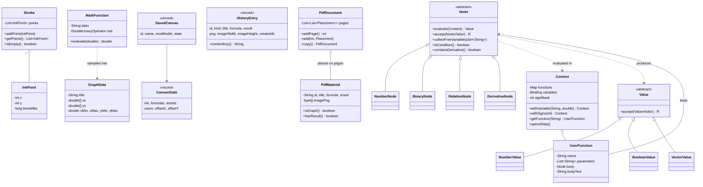
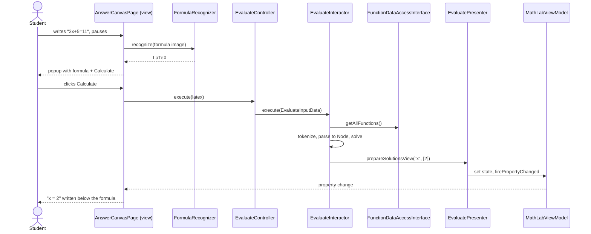

# penTex

Write math by hand. penTex reads it, calculates it, graphs it and exports it as a PDF.

## Team Information

**Project name:** penTex

### Team Members
- Yuanmo (Frank) Zha
- Haoxiang Zhao
- Haoyu Wang
- Bojun (Eric) Yang

---

## Project Description

### Domain

**Education (mathematics)**

penTex is a Java Swing desktop app for students who would rather write math than type it. The window is a single infinite canvas. A student writes a formula with the pen. When they pause after an "=", a neural network we trained reads the ink as LaTeX, and a small popup shows the typeset formula with **Calculate** and **Graph** buttons. **Calculate** writes the answer on the canvas right after the "=", in a handwriting-style font. **Graph** draws the function in a card beside the formula. Every calculation and graph is saved to a local **History** panel. Anything on the canvas or in History can be dragged into the built-in **PDF** editor and exported.

**Specification (for noun/verb analysis).** A *student* draws *strokes* on a *canvas*. Strokes are grouped into *formulas*, and each formula is *recognized* as a LaTeX string. A formula can be *calculated*: evaluated to a *value*, solved as an equation or inequality in one unknown, differentiated, or saved as a *user-defined function* such as f(x) = x². The *answer* is shown next to the formula. A formula of the form y = … or f(x) = … can be *graphed* over an x range. Every calculation, defined function and graph becomes a *history entry* that is kept between sessions. History entries and canvas selections become *materials*, which the student places on the *pages* of a *PDF document* and exports. The whole canvas can be *saved* under a name and *reopened* later.

**What the calculator supports:** arithmetic, fractions, powers and roots, trig, inverse trig and hyperbolic functions, log / ln / exp, ±, user-defined functions, derivatives (at a point and symbolic d/dx), limits, sums and products, equations and inequalities in one unknown, vectors, sets, and logic (∧, ∨, ¬, ⇒, ∀, ∃). Integrals are recognized but not calculated yet.

---

## User Stories

### US1: Handwriting Recognition
**Lead:** Yuanmo Zha

As a student, I want to write mathematical expressions on a digital drawing canvas or upload a photo of handwritten mathematics and have the system recognize them, so that I can input mathematical expressions naturally without manually typing mathematical notation.

### US2: Mathematical Calculation
**Lead:** Haoxiang Zhao

As a student, I want to request calculations for my handwritten mathematical expressions, so that I can obtain solutions and answers to my mathematical problems.

### US3: Result Display on Canvas
**Lead:** Haoxiang Zhao

As a student, I want to see calculated results displayed directly on the canvas near their corresponding original expressions, so that I can easily review the answers in the context of my handwritten work.

### US4: Function Graphing
**Lead:** Haoyu Wang

As a student, I want to enter a mathematical function, such as y = x² + 1, and see its graph, so that I can visualize and understand how the function behaves.

### US5: Export to LaTeX PDF
**Lead:** Bojun (Eric) Yang

As a student, I want to convert my mathematical expressions into properly formatted LaTeX and export them as a PDF, so that I can include cleanly formatted mathematics in my notes or assignments.

### US6: Calculation History and Local Persistence
**Lead:** Bojun (Eric) Yang

As a student, I want my previously recognized expressions, calculated answers, and generated graphs to be saved locally and accessible through a History panel, so that I can reuse my previous work in future study sessions and drag saved content onto my editable PDF documents without having to write it again.

---

## Use Cases

The actor in every use case is the **student**.

### Use Case 1: Recognize a handwritten formula
**User story:** US1 · **Lead:** Yuanmo Zha · **MVP:** yes

**Main flow:**
1. The student writes a formula on the canvas with the pen, ending with "=", e.g. `3x+5=`.
2. The student stops writing for about 1.5 seconds.
3. The system groups the new strokes into one formula, crops them to a dark-on-white image and runs the recognition model on it.
4. The system shows a popup next to the "=" with the typeset LaTeX and the actions that fit it: **Calculate**, **Graph**, or both.

**Alternative flows:**
- **Lasso selection:** the student circles some ink with the lasso (or drags a box). The selection is read as one formula, with or without an "=".
- **Finished equation or inequality:** a formula with something on both sides of the sign, such as `x^2=4` or `2x>5`, gets a popup without a trailing "=". An unfinished one such as `2x>` does not.
- **Still writing:** while the pen is down, no popup appears. The system waits for the next pause.
- **Formula edited:** if the student adds to or erases part of a formula, its old answer is removed and the formula is read again after the next pause.
- **Function definition:** if the formula reads as `f(x)=…`, it is saved straight away (see Use Case 2) and no popup is needed.
- **Recognition fails:** the popup shows the problem instead of a formula, and nothing is calculated.
- **Photo upload:** not implemented yet. Only canvas ink is recognized for now.

**Main classes:** `FormulaRecognizer` (interface), `VitalMiniFormulaRecognizer`, `FormulaImagePreprocessor`, `model.vital_mini` (model runtime), `AnswerCanvasPage`, `AnswerPopup`

### Use Case 2: Calculate a formula
**User story:** US2 · **Lead:** Haoxiang Zhao · **MVP:** yes

**Main flow:**
1. In the popup from Use Case 1, the student clicks **Calculate**.
2. The system splits the LaTeX into tokens and parses it into an expression tree, using any functions the student has defined.
3. The system works out the answer for that kind of formula:
   - no unknowns: the value, e.g. `3+4\cdot2=` gives `11` (one value for each ± choice);
   - an equation or inequality in one unknown: its solutions or intervals, e.g. `x^2=4` gives `x = -2 or x = 2`, and `2x>300` gives `x > 150`;
   - a derivative of an unknown: the derivative written out, e.g. `\frac{d}{dx}(x^3)` gives `3x²`.
4. The system sends the answer to the presenter, which formats it for the canvas (Use Case 3) and passes it on to History and the PDF library.

**Alternative flows:**
- **Function definition:** `f(x)=x^2` is stored and confirmed in a card. Later formulas can use `f`, e.g. `f(3)=` gives `9`.
- **Invalid formula:** for input such as `3+=`, `x+1` (x has no value) or two unknowns, the system shows an *Invalid formula* card with a one-line reason.
- **Can't calculate:** for valid input outside what the calculator handles (integrals, numbers too large, too much work), the system shows a *Can't calculate* card with a short reason.
- **Graph only:** `y=3x` is a function to graph, not a question, so the popup offers only **Graph**.

**Main classes:** `EvaluateController`, `EvaluateInteractor` (with `EvaluateInputBoundary`, `EvaluateOutputBoundary`, `EvaluateInputData` and the output data classes), `FunctionDataAccessInterface` / `InMemoryFunctionDataAccessObject`, `EvaluatePresenter`, `MathLabViewModel`. `CalculateCheckInteractor`, `DefinitionCheckInteractor` and `QuestionCheckInteractor` decide which buttons the popup offers.

### Use Case 3: Show the result on the canvas
**User story:** US3 · **Lead:** Haoxiang Zhao · **MVP:** yes

**Main flow:**
1. After Use Case 2 succeeds, the view model reports the new answer.
2. The system finds the "=" in the student's ink and measures the height of their handwriting.
3. The system writes the answer right after the "=" in a handwriting-style font (Kalam), at the same size as the student's writing, with exponents raised.
4. The answer stays attached to its formula. It is saved with the canvas and is removed when the formula's ink changes.

**Alternative flows:**
- **No "=" at the end:** for an equation or inequality such as `x^2=4` or `2x>5`, the answer is written below the formula. For a lasso selection with no relation sign, such as `3+4`, it goes to the right.
- **Answer too long:** a derivative too long to fit next to the formula is reported as *Can't calculate* instead of being drawn.
- **Error:** an *Invalid formula* or *Can't calculate* notice appears at the top of the canvas and nothing is written in the ink. The notice stays until the student closes it or fixes the formula.

**Main classes:** `EvaluatePresenter`, `AnswerFormatter`, `MathLabViewModel` / `MathLabState`, `AnswerCanvasPage`, `view.answer` (`EqualsSpot`, `AnswerLayout`, `AnswerInk`, `FormulaBook`), `GlassNotices`

### Use Case 4: Graph a function
**User story:** US4 · **Lead:** Haoyu Wang · **MVP:** yes

**Main flow:**
1. The student writes `y = …` or `f(x) = …`, and the popup offers **Graph**.
2. The student clicks **Graph**.
3. The system parses the LaTeX into a function of x and samples 401 points over x ∈ [−10, 10]. It breaks the line at gaps and asymptotes and picks a y window that ignores blow-ups.
4. The system sends the points to the QuickChart API, which returns a PNG.
5. The system shows the graph in a card beside the formula and adds it to History and the PDF library.

**Alternative flows:**
- **Change range:** the student types new x and y ranges in the bar under the graph card, and the graph is redrawn (steps 3–5).
- **Not a function of x:** the popup does not offer **Graph**.
- **Bad range or nothing to draw:** if min ≥ max, the function is undefined on the whole range, or the graph lies entirely outside the y range, the system shows an error notice.
- **Service unavailable:** if QuickChart cannot be reached or returns an error, the system shows *Could not draw the graph* with the reason.

**Main classes:** `GraphController`, `GraphFunctionInteractor` (with its input/output boundaries and data), `GraphRendererGateway` / `QuickChartGraphRenderer`, `LatexFunctionParser`, `GraphPresenter`, `GraphViewModel`, `PopupGraphing`, `GraphRangeBar`. `GraphCheckInteractor` decides whether **Graph** is offered.

### Use Case 5: Build and export a PDF
**User story:** US5 · **Lead:** Bojun (Eric) Yang · **MVP:** yes

**Main flow:**
1. The student clicks **PDF** (top right). The PDF editor opens in a panel beside the canvas, separated by a draggable divider.
2. The library lists this session's formulas, calculations and graphs.
3. The student drags items onto an A4 page. Formulas and answers are typeset from their LaTeX.
4. The student arranges the page: move and resize items, add text notes, edit a formula's LaTeX, add or remove pages, undo and redo.
5. The student clicks **Export** and picks a file. The system writes the PDF.

**Alternative flows:**
- **Canvas content:** the student lasso-selects ink on the canvas and drags it across the divider, or uses **Capture area** to add a screenshot of part of the canvas.
- **Preview:** the student previews the pages before exporting.
- **Split a calculation:** the student splits a placed calculation into separate formula and answer items.
- **File already exists:** the system asks before replacing it.
- **Export fails:** if the file cannot be written, the system shows an error dialog and the document stays open.

**Main classes:** `PdfStudioLauncher`, `PdfEditorController`, `DocumentEditor`, `AutoLayoutInteractor`, `PdfExportInteractor`, `PdfExportGateway` / `PdfPreviewGateway` (implemented by `PdfBoxOutputAdapter` and `PdfExporter`), `MathLibrary`, `MaterialRenderer`, `PdfPanel`, `DocEditorPanel`

### Use Case 6: Browse and reuse history
**User story:** US6 · **Lead:** Bojun (Eric) Yang · **MVP:** no (added after the MVP, now implemented)

**Main flow:**
1. When a formula is calculated, a function is defined or a graph is drawn, the system saves a history entry to `~/.mathlab/history`. Identical entries are stored only once.
2. The student clicks **History** (top left). A panel opens on the left, newest entries first.
3. The student drags an entry onto the canvas, where a copy is placed.

**Alternative flows:**
- **Delete:** the student deletes an entry and can undo the deletion.
- **Formula erased:** if the student erases a formula's ink in the same session, its entry is hidden. It comes back if Undo restores the ink.
- **Damaged file:** an unreadable history file is skipped and the rest of the history still loads.

**Main classes:** `HistoryInteractor`, `HistoryRepository` / `FileHistoryRepository`, `CanvasHistoryLifecycle`, `HistoryBoardPresenter`, `HistoryViewModel`, `HistoryPanel`

### Use Case 7: Save and reopen a canvas
**User story:** US6 · **Lead:** Bojun (Eric) Yang · **MVP:** no (added after the MVP, now implemented)

**Main flow:**
1. The student presses ⌘S / Ctrl+S, or chooses **Save** from the save menu, and names the canvas.
2. The system saves the ink, answers, placed images and view position to `~/.mathlab/canvases`.
3. Later, the student chooses **Open** and picks a saved canvas, and the system restores it.

**Alternative flows:**
- **Save As:** ⌘⇧S / Ctrl+Shift+S saves a copy under a new name.
- **Startup:** the most recently saved canvas is reopened when the app starts.

**Main classes:** `CanvasWorkspace` (`CanvasWorkspaceBoundary`), `CanvasRepository` / `FileCanvasRepository`, `CanvasState`, `SavedCanvas`, `CanvasWorkspaceDialogs`, `GlassSaveMenu`, `SavedCanvasChooser`

---

## Minimal Viable Product (MVP)

| Team Member | MVP Use Case |
|-------------|--------------|
| Yuanmo (Frank) Zha | Use Case 1: Recognize a handwritten formula |
| Haoxiang Zhao | Use Case 2: Calculate a formula; Use Case 3: Show the result on the canvas |
| Haoyu Wang | Use Case 4: Graph a function |
| Bojun (Eric) Yang | Use Case 5: Build and export a PDF |

Added after the MVP (both implemented, led by Bojun (Eric) Yang): Use Case 6, Browse and reuse history, and Use Case 7, Save and reopen a canvas.

---

## Entities

Entity classes live in `src/main/java/entity` plus the `domain` packages of `history`, `workspace` and `pdf_editor`. None of them depend on Swing, files or the network.

### Stroke / InkPoint (`entity`)
One pen stroke, from pen-down to pen-up.
- `Stroke`: `points: List<InkPoint>`. Methods: `addPoint(InkPoint)`, `getPoints()`, `isEmpty()`
- `InkPoint`: `x: int`, `y: int`, `timeMillis: long`. Getters only.
- `InkEditor` (static helpers): `erase(...)`, `eraseAlong(...)`, `removeTouchedAlong(...)` and lasso selection. Each returns new strokes and never changes the old ones.

### Node (`entity.node`)
The parsed expression tree that `MathParser` builds from the tokens produced by `MathLexer`. The subclasses include `NumberNode`, `VariableNode`, `BinaryNode`, `UnaryNode`, `CallNode`, `RelationNode`, `DerivativeNode`, `LimitNode`, `SeriesNode`, `QuantifierNode`, `VectorNode` and `SetLiteralNode`.
- Methods: `evaluate(Context): Value`, `accept(NodeVisitor)`, `children()`, `collectFreeVariables(Set<String>)`, `isCondition()`, `containsDerivative()`, `isApproximate(Context)`, `canBeInfinite(Context)`

### Value (`entity.value`)
The result of evaluating a `Node`.
- Subclasses: `NumberValue` (`value: double`), `BooleanValue` (`value: boolean`), `VectorValue` (`components: List<Double>`), `FiniteSetValue`, `NumberSetValue`
- Methods: `accept(ValueVisitor)`. `Values.areEqual(a, b)` compares two values.

### Context (`entity`)
Everything a `Node` needs while it is evaluated.
- Instance variables: `functions: Map<String, UserFunction>`, `variables` (bound names → values), `signMask: int` (which ± branch), `depth: int`, `budget` (step limit), `derivative: PointDerivative`
- Methods: `withVariable(name, value)`, `withSigns(mask)`, `getVariable(name)`, `getFunction(name)`, `forFunctionBody(name)`, `spendStep()`

### UserFunction (`entity`)
A function the student defined, e.g. `f(x)=x^2`.
- Instance variables: `name: String`, `parameters: List<String>`, `body: Node`, `bodyText: String`
- Methods: getters

### MathFunction / GraphData (`entity`)
- `MathFunction`: `latex: String`, `rule: DoubleUnaryOperator`. Methods: `getLatex()`, `evaluate(x)`
- `GraphData`: sampled points ready to draw. `title: String`, `xs: double[]`, `ys: double[]` (NaN marks a gap), `xMin`, `xMax`, `yMin`, `yMax`. Methods: getters

### HistoryEntry (`history.domain`)
One saved formula, calculation or graph. It is an immutable record.
- Instance variables: `id: String`, `kind: Kind` (`FORMULA`, `CALCULATION`, `GRAPH`), `title: String`, `formula: String`, `result: String`, `png: byte[]` (graphs only), `imageWidth: int`, `imageHeight: int`, `createdAt: Instant`
- Methods: `contentKey()`, a SHA-256 of the content, so identical entries are stored once

### CanvasState / SavedCanvas (`workspace.domain`)
- `CanvasState`: `ink: List<Ink>`, `formulas: List<Formula>` (stroke indexes, answer, position, font size), `assets: List<Asset>` (placed graphs and history items), `zoom: double`, `offsetX: double`, `offsetY: double`
- `SavedCanvas`: `id: String`, `name: String`, `modifiedAt: Instant`, `state: CanvasState`

### PdfDocument / PdfMaterial (`pdf_editor.domain`)
- `PdfMaterial`: something that can be placed on a page. `id`, `title`, `formula`, `result`, `imagePng`, `imageWidth`, `imageHeight`. Methods: `isGraph()`, `hasResult()`, `withText(formula, result)`, `formulaPart(...)` / `resultPart(...)`
- `PdfDocument`: `pages: List<List<Placement>>`, where each `Placement` holds a material or a text note with its `x`, `y`, `width` and `height` on an A4 page. Methods: `addPage()`, `removePage(i)`, `add(...)`, `insert(...)`, `remove(...)`, `find(...)`, `replace(...)`, `reorder(...)`, `copy()`

---

## API Usage

### QuickChart (web API)

**Documentation:** https://quickchart.io/documentation/

**How it is used in the program:** `QuickChartGraphRenderer` sends a `POST` to `https://quickchart.io/chart`. The body is a Chart.js v4 line chart holding the sampled points, the x and y axes and the window. QuickChart returns an 800×500 PNG, which becomes the graph card on the canvas and the graph image in History and the PDF. The renderer sits behind the `GraphRendererGateway` interface, so `GraphFunctionInteractor` never deals with HTTP and the tests can swap in a fake renderer. QuickChart is free and needs no API key.

**Status:** called successfully. The app uses it for every graph, and a test request on 2026-11-17 returned HTTP 200 with `image/png`.

Earlier drafts of this README planned to use the Desmos API. We use QuickChart instead because it returns a plain image over HTTP, which a Swing app can show directly.

### Libraries

These are Java libraries (Maven dependencies), not web APIs. All of them are working in the app.

| Library | Documentation | Used for |
|---|---|---|
| Deep Java Library (DJL) + PyTorch engine 0.39.0 | https://docs.djl.ai/ | Runs our handwriting model (`model_ops.pt`, TorchScript) on CPU, CUDA or Apple MPS |
| Apache PDFBox 2.0.30 | https://pdfbox.apache.org/ | Writes the exported PDF |
| JLaTeXMath 1.0.7 | https://github.com/opencollab/jlatexmath | Typesets LaTeX in popup cards, History items and PDF pages |

---

## Design Diagrams

### UML Class Diagram

Main entities and how they relate:



### Sequence Diagram: Calculate (Use Cases 1–3)



---

## How to Run

**Requirements:**
- JDK 17 or newer (`mvn -v` must show Java 17+; if not, set `JAVA_HOME` to a newer JDK)
- Maven 3.9+
- An internet connection on the first run, when DJL downloads the PyTorch native library to `~/.djl.ai`, and whenever you draw a graph (QuickChart)

**Run the app** from the repository root (the model path is relative to it):

```bash
mvn compile exec:java
```

**Run the tests:**

```bash
mvn test
```

All 1118 tests passed on 2026-11-17.

**Using it:**
- Write a formula ending in "=" and pause. Click **Calculate** or **Graph** in the popup.
- Use the toolbar at the bottom for Pen, Eraser, Lasso, colours, Undo and Clear. Drag its handle to move it to a corner.
- **History** (top left) and **PDF** (top right) open side panels.
- Shortcuts: ⌘Z / Ctrl+Z undo, ⌘S / Ctrl+S save, ⌘⇧S / Ctrl+Shift+S save as, Esc leaves full-screen PDF.

**Local data:** history is saved in `~/.mathlab/history` and saved canvases in `~/.mathlab/canvases`. Delete these folders to start fresh.

---

## Notes

### Clean Architecture layers

| Layer | Packages |
|---|---|
| Entities | `entity`, `entity.node`, `entity.value`, `entity.symbolic`, `entity.calculus`, `history.domain`, `workspace.domain`, `pdf_editor.domain` |
| Use cases | `use_case.evaluate`, `use_case.graph_function`, `use_case.graph_check`, `history.use_case`, `workspace.use_case`, `pdf_editor.use_case` |
| Interface adapters | `interface_adapter.*`, `history.adapter`, `pdf_editor.adapter` |
| Frameworks & drivers | `data_access`, `history.data_access`, `workspace.data_access`, `pdf_editor.data_access`, `view.*`, `pdf_editor.view`, `model` (DJL runtime) |
| Wiring | `app.java`, `app.StackedAppBuilder` |

### Handwriting model
The recognizer (`model.vital_mini`) is a CNN followed by transformer encoder and decoder layers. It outputs LaTeX tokens from a 234-token vocabulary and decodes with beam search. It was trained in Python with PyTorch. The training code, datasets and notes are in `src/neutral network/` (see `DATASETS.md` and `TRAIN_DECODER.md` there). The exported weights are in `src/main/java/model/checkpoints/`. Python is only needed to retrain the model, not to run the app.

### Known limitations
- Integrals are recognized but not calculated.
- Uploading a photo (from US1) is not implemented yet. Recognition works on canvas ink only.
- Graphing needs an internet connection.
