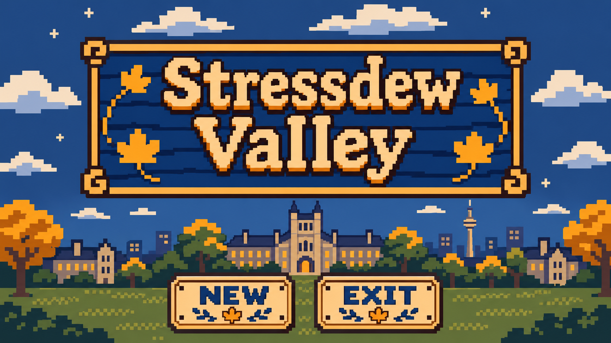

# Team Project

Please keep this up-to-date with information about your project throughout the term.

The readme should include information such as:
- a summary of what your application is all about
- a list of the user stories, along with who is responsible for each one
- information about the API(s) that your project uses
- screenshots or animations demonstrating current functionality

By keeping this README up-to-date,
your team will find it easier to prepare for the final presentation
at the end of the term.

# Project Name
## Team Information
### Team Members
- Yuxiang Yuan
- Xinjia Shen
- Zhenbin An
- Lanxin Fu

---
## Project Description
### Domain
University life simulation, presented as a casual top-down game

---
## User Stories
### User Story 1 — Academics and GPA
As a student player, I want to choose my courses, attend classes and exams so that I can earn a good GPA.

Responsible team member: Lanxin Fu

### User Story 2 — Housing, Days, and Saving
As a player, I want to choose where I live and have each day, the weather, and the terms progress, with my progress
saved, so that my life feels continuous and real.

Responsible team member: Yuxiang Yuan

### User Story 3 — Food and Work (US3)
**Lead:** Zhenbin An (UC3)

As a player, I want to spend Money on food at the food truck or café to restore Energy, and work café shifts to earn Money, so that I can balance my resources throughout the school day.

**Responsibilities within UC3:**
1. Implement food and eating: show available meals, let the player buy food, deduct Money, and restore Energy.
2. Implement café work: let the player complete a shift, earn Money, and spend Energy and time.

**Acceptance criteria:**
- The player can view the day's menu, including each item's price and Energy gain.
- Buying an affordable item deducts its price, restores Energy, and uses part of the current time slot.
- Working a café shift pays Money based on correctly served orders, deducts Energy, and uses the time slot.
- Unaffordable meals, insufficient Energy for a shift, and closed locations give clear feedback without applying an invalid action.
- If the meal API is unavailable, the player can still use a bundled fallback menu.

### User Story 4.1 — Build Campus Relationships
As a player, I want to talk with campus characters and have them remember
my social interactions so that my relationships feel connected across campus.

Responsible team member: Xinjia Shen

### User Story 4.2 — Check Campus Email
As a student player, I want to check my in-game campus email so that I can
keep track of assignment deadlines and decide how to respond to job offers.

Responsible team member: Xinjia Shen

---
## Use Cases
### Use Case 1.1 — Enrol in courses
**Primary actor:** student player

**Preconditions:**
- A game has started
- The player has not finalized their academic choices for the current semester
- The game has a predefined catalogue of majors and courses

**Trigger:** The player asks to set up their academic plan

**Success outcome:** The selected courses are recorded, and the player can view their confirmed academic plan.

**Main success scenario:**
1. The system displays the courses available for that major and the permitted number of selections.
2. The player selects courses and submits their academic plan.
3. The system checks that the selections meet the enrolment rules.
4. The system records the major and selected courses.
5. The system displays the confirmed academic plan.

**Extensions:**
- 2a. The player cancels before confirming.
  The system ends the selection process without changing the recorded academic plan.
- 3a. The selections do not meet the enrolment rules.
  The system explains what must change and allows the player to revise their selections. No invalid plan is recorded

### Use Case 1.2 — Attend a class
**Primary actor:** Student player

**Preconditions:**
- The player is enrolled in a course.
- The current semester is in progress.
- The game has class content available for that course.

**Trigger:** The player asks to attend a class for an enrolled course.

**Success outcome:** The class is recorded as completed, and the player sees their participation result.

**Main success scenario:**
1. The player requests to attend a class for an enrolled course.
2. The system checks that the class is available and has not already been completed.
3. The system presents the class material and a short practice question.
4. The player submits an answer.
5. The system evaluates the answer and displays feedback.
6. The system records the class as completed.
7. The system displays the updated course progress.

**Extensions:**
- 2a. The class is unavailable or already completed.
  The system explains why it cannot be attended. Course progress remains unchanged.
- 4a. The player submits no answer.
  The system asks the player to provide an answer and continues the class.
- 4b. The player leaves before submitting.
  The class is not recorded as completed, and course progress remains unchanged.
- 5a. The answer is incorrect.
  The system explains the correct answer. The class is still recorded as completed, with the actual participation result.

### Use Case 1.3 — Take a course exam
**Primary actor:** Student player

**Preconditions:**
- The player is enrolled in the selected course.
- The game has exam questions and a grading rule for that course.
- The player has an academic record that can store course results.

**Trigger:** The player asks to take the course exam.

**Success outcome:** The exam score and corresponding course grade are recorded, the GPA is recalculated, and the player sees the results.

**Main success scenario:**
1. The player requests to take an exam for an enrolled course.
2. The system checks that the exam is available and has not already been completed.
3. The system explains the exam rules and presents the questions.
4. The player answers the questions and submits the exam.
5. The system checks that all required questions have answers.
6. The system evaluates the answers and calculates the exam score.
7. The system determines the course grade using the agreed grading rule.
8. The system records the result and recalculates the player’s GPA.
9. The system displays the exam score, course grade, and updated GPA.

**Extensions:**
- 2a. The exam is unavailable or already completed.
  The system explains why the exam cannot be started. Grades and GPA remain unchanged.
- 5a. Required answers are missing.
  The system identifies the unanswered questions and allows the player to complete them before resubmitting.
- 4a. The player cancels before submission.
  Under the proposed MVP rule, the attempt is discarded. No grade is recorded, and GPA remains unchanged.
- 8a. The system cannot record the result.
  The system reports that finalization failed and allows a retry without awarding the result twice.

### Use Case 2.1 — End the day
**Primary actor:** Player

**Preconditions:**
- A game is in progress
- The player is at home (their residence room or off-campus apartment).

**Trigger:** The player asks to sleep.

**Success outcome:** The game moves to the next day with the correct day type, real historical weather, and updated stats,
and progress is saved.

**Main success scenario:**
1. The player asks to sleep.
2. The system checks that the player is at home.
3. The system advances the calendar to the next day and determines whether it is an A day or a B day.
4. The system restores the player’s Energy according to when the player went to sleep.
5. The system retrieves the historical weather for the real date that corresponds to the new day and converts it into a
game condition: clear, cloudy, rain, or snow.
6. The system applies the morning commute cost for the player’s housing and the day’s weather.
7. The system saves the game.
8. The system shows the player waking up on the new day, with the day number, day type, weather, any exam scheduled
today, and updated stats.

**Extensions:**
- 2a. The player is not at home.
    1. The system explains that the player must go home to sleep.
    2. The use case ends and the day does not change.
- 3a. The day that just ended was the last day of a week, but not of the term.
    1. The system shows the weekend card, and the player chooses an activity.
    2. The system applies the activity’s effect, and the use case continues at step 3.
- 3b. The day that just ended was the last day of the term.
    1. The system charges rent and shows the break card, or the ending if this was the final term.
    2. The system starts the next term on day 1, and the use case continues at step 4.
- 5a. The weather source is unavailable.
    1. The system uses its bundled copy of the same historical weather data.
    2. The use case continues at step 6.
- 7a. The system cannot save the game.
    1. The system explains that progress was not saved.
    2. The use case continues at step 8.

### Use Case 2.2 — Choose where to live
**Primary actor:** Player

**Preconditions:**
- The player is creating a new game.
- The setup wizard has reached the housing step.

**Trigger:** The player asks to choose their housing.

**Success outcome:** The player’s housing is recorded and their starting location is set.

**Main success scenario:**
1. The system shows the housing options (Residence and Off-campus), each with its rent per term, daily commute cost,
and a short description.
2. The player selects an option.
3. The system records the player’s housing.
4. The system sets the player’s starting location: the residence building, or the transit stop for off-campus players.
5. The system moves the wizard to the next step.

**Extensions:**
- 2a.
    1. The player asks to go back to the previous step.
    2. The system returns to the previous step without recording a choice.
    3. The use case ends.

### Use Case 2.3 — Load a saved game
**Primary actor:** Player

**Preconditions:**
- The application is running and the title screen is displayed.

**Trigger:** The player asks to continue a saved game.

**Success outcome:** The game is restored exactly as it was saved, and the player is at home.

**Main success scenario:**
1. The player asks to continue.
2. The system finds the save file.
3. The system reads the save file and checks that it is valid.
4. The system restores the game state: player profile, stats, timetable, calendar, friendships, and the
term’s stored weather.
5. The system shows the player at home on the saved day.

**Extensions:**
- 2a. No save file exists.
    1. The system explains that there is no saved game and offers to start a new game.
    2. The use case ends.
- 3a. The save file is damaged or comes from an unsupported version.
    1. The system explains that the save cannot be loaded.
    2. The system does not change the file, and the use case ends.

### Use Case 3A — Buy Food and Eat (UC3A)

**Primary actor:** Player

**Trigger:** The player interacts with the food truck or café counter and chooses to eat.

**Preconditions:** A game is in progress, and the location is open in the current time slot.

**Main success flow:**
1. The game obtains today's menu through the menu gateway and shows meal prices and Energy gains.
2. The player selects a meal.
3. The game checks the player's Money, then deducts the price, restores Energy, and uses part of the time slot.
4. The HUD shows the updated Money, Energy, and time.

**Alternatives:** If the meal API fails, use the bundled fallback menu. If the player cannot afford a meal, show the shortfall and do not deduct Money or advance time. If the location is closed, show its opening hours.

**Success outcome:** The player has eaten; Money decreases by the meal price, Energy increases, and time advances.

### Use Case 3B — Work a Café Shift (UC3B)

**Primary actor:** Player

**Trigger:** The player interacts with the café counter and chooses to work a shift.

**Preconditions:** A game is in progress, and the café is open in the current time slot.

**Main success flow:**
1. The game checks that the player has enough Energy and whether the shift overlaps a scheduled class.
2. Customers order menu items; the player chooses the matching items.
3. The game pays Money based on correct orders, deducts Energy, uses the time slot, and updates the HUD.

**Alternatives:** If the player lacks Energy, explain why the shift cannot start. If a shift overlaps a class, warn that the class will be missed and ask for confirmation; if confirmed, UC1 handles the absence. If the café is closed, show its opening hours. If meal data is unavailable, use the bundled fallback menu for customer orders.

**Success outcome:** The completed shift increases Money according to correct orders, decreases Energy, and advances time.

### Use Case 4.1 — Talk with an NPC

**Primary actor:** Player

**Preconditions:**
- A game is in progress.
- The player is near an NPC.

**Trigger:** The player asks to talk with the NPC.

**Success outcome:** The player receives a reply that reflects their
current Friendship level with the NPC. The completed conversation is
recorded, Friendship increases, and game time advances. The updated
Friendship level can influence future conversations.

**Main success scenario:**
1. The player asks to talk with the NPC.
2. The system confirms that the NPC is available and shows the current
   Friendship level.
3. The player sends a message.
4. The system gives an in-character reply based on the current Friendship
   level. The reply may also refer to a character the player has
   previously talked with.
5. The system records the conversation, increases Friendship with this
   NPC, and advances game time.
6. The system shows the reply and updated Friendship level.

**Extensions:**
- **2a. The NPC is unavailable:** The system explains this and ends the
  interaction without changing Friendship or time.
- **3a. The message is empty or too long:** The system asks for a revised
  message and returns to step 3 without changing game state.
- **4a. A suitable reply cannot be obtained:** The system gives an
  in-character fallback reply appropriate to the current Friendship
  level and continues at step 5.
- **4b. The player leaves before a reply is ready:** The late reply is
  ignored; no conversation is recorded and game state does not change.

### Use Case 4.2 — View Friendship Levels

**Primary actor:** Player

**Preconditions:**
- A game is in progress.

**Trigger:** The player asks to view their relationships with NPCs.

**Success outcome:** The player can see their current Friendship level
with each NPC they have talked with.

**Main success scenario:**
1. The player asks to view their relationships.
2. The system lists the NPCs the player has talked with and their
   Friendship levels.
3. The player selects an NPC.
4. The system shows the current Friendship level with that NPC.

**Extensions:**
- **2a. The player has not talked with any NPC:** The system shows that
  there are no relationships to display.

---
## Minimal Viable Product (MVP)
| Team Member | MVP Use Case |
|-------------|--------------|
| Zhenbin An | UC3A — Buy food and eat (spend Money); UC3B — Work a café shift (earn Money) |
| Lanxin Fu | UC1.1, UC1.2, UC1.3 |
| Name | Use Case |
| Name | Use Case |

---
## Entities
### MenuItem (UC3)
Represents a meal offered on the menu, with a name, price, and Energy gain. The game sets prices and Energy values; provider-specific API data stays outside the entity.

### Entity 1
### Entity 2
### Entity 3
(Add additional entities as needed.)

---
## API Usage
**Planned UC3 API:** [TheMealDB](https://www.themealdb.com/api.php)

**How it will be used:** A menu gateway obtains meal data for the food truck and café and converts selected meals into `MenuItem` values. A bundled menu keeps UC3 playable when the service is unavailable. Access requirements and a successful Java request still need to be verified before integration.

**API Name:**
**Documentation:** [Link]
**How it is used in the program:**

---
## Design Diagrams
### UML Class Diagram
### Sequence Diagrams

---
## How to Run
[Instructions for running the program.]

---
## Notes
[Any addi
