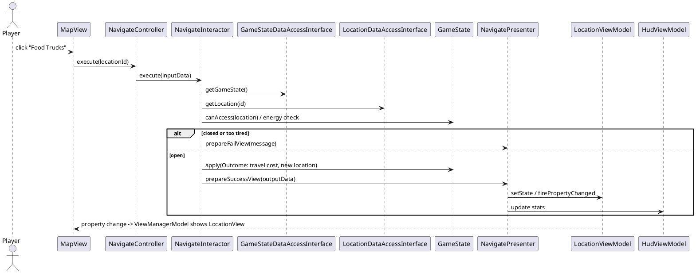
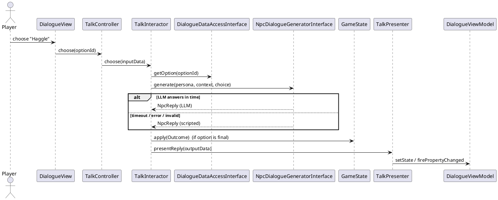

# UofTears: Survive the Semester

*README v1. Earlier versions are archived in [docs/readme-versions/](docs/readme-versions/).*

## Team Information

### Team Members
- Member 1 (Name) – Environment & Navigation
- Member 2 (Name) – Inventory, Persistence & Transcript
- Member 3 (Name) – NPC Interactions, Combat & LLM
- Member 4 (Name) – Accounts, Game Rules & Challenges

---

## Project Description

### Domain

**Games / Simulation (survival adventure with mini-games).**

UofTears is a Java Swing game in which you play a University of Toronto student trying to survive one chaotic week. You manage four stats: **Energy**, **Money**, **Sanity** and **Academic Survival**. Each day begins with the **real Toronto weather**, which decides which buildings are open, how costly walking is, and how hard every challenge is. The player **navigates** a small campus map (Residence, Robarts, Bahen, Food Trucks, Exam Hall), **collects and uses items**, **talks to NPCs** whose replies are written by an **LLM**, and plays **challenges** such as a reaction race for a Robarts seat. Games, event logs and day-by-day transcripts are stored in a **local SQLite database**, so players can resume a game and review past runs.

*Noun/verb analysis (→ entities):* player, stats, day, time block, weather, location, item, inventory, buff, NPC, dialogue, challenge, outcome, game state, transcript, run, account. Verbs: start day, travel, pick up, buy, use, talk, choose, fight, play, unlock, save, load, review.

### Core Game Rules

These are the rules of the finished game. The roadmap below introduces them gradually, so early builds only implement the rules their stories need.

- 7 days; each day has **3 time blocks**, and each NPC conversation or challenge uses one. When blocks run out the day ends (sleep: Energy +20).
- Starting stats: Energy 100, Sanity 100, Academic Survival 50, Money $50. Stats are clamped to 0–100 (Money ≥ 0).
- **Lose** if Energy, Sanity or Academic Survival reaches 0. **Win** by finishing Day 7 with Academic Survival ≥ 60.
- **Weather** gives a Difficulty multiplier on challenges, an energy-loss multiplier, and closures:

| Weather | Difficulty | Energy-loss multiplier | Effect on map |
|---|---|---|---|
| Clear | 0.9 | 1.0 | All open |
| Cloudy | 1.0 | 1.0 | All open |
| Rain | 1.15 | 1.2 | All open |
| Snow | 1.3 | 1.5 | Food Trucks closed |
| Extreme temp (< -15 °C or > 30 °C) | 1.3 | 1.5 | Food Trucks closed |

| Location | What's there | Access rule |
|---|---|---|
| Residence | Free Coffee pickup | Always open |
| Robarts Library | Study-spot race; Earplugs pickup | Always open |
| Bahen Centre | Stressed TA (NPC); Cheat Sheet pickup | Days 1–6 |
| Food Trucks | Shawarma Lady (NPC); item shop | Closed in Snow / Extreme temp |
| Exam Hall | Midterm from Hell | Only Days 3 and 6 |

- Walking costs **5 Energy × weather multiplier**.
- **Buffs:** items can lower difficulty for one challenge type (Earplugs: race −0.2). Effective difficulty = weather difficulty + active buffs (min 0.5); a buff is consumed when used.

---

## Roadmap

We build the game in **three phases of four user stories**. Each member owns exactly one story per phase, so all four of us always work in parallel. Every story is deliberately tiny: ship the thinnest version that works from the screen down to the data layer, and enrich it later.

| Phase | Theme | Stories | What you can do at the end of the phase |
|---|---|---|---|
| **1** | Fundamentals: a game exists | 1–4 | Sign up, log in, start a new game, see your stats on Day 1, have one conversation that changes your stats, save, load, log out. |
| **2** | Core loop: a world with rules | 5–8 | Walk between the five buildings, pick up and use an item, talk to whoever is at your building, end days, and win or lose the week. |
| **3** | Features: what makes it UofTears | 9–12 | Real weather every day, LLM-voiced characters, the Robarts reaction race, and a transcript with past runs. |

| Story | Phase | Owner | Title |
|---|---|---|---|
| 1 | 1 | Member 4 | Sign up, log in and log out |
| 2 | 1 | Member 1 | Start a new game and see my stats |
| 3 | 1 | Member 2 | Save and load my game |
| 4 | 1 | Member 3 | Have my first conversation |
| 5 | 2 | Member 1 | Move around campus |
| 6 | 2 | Member 2 | Pick up and use an item |
| 7 | 2 | Member 3 | Talk to whoever is here |
| 8 | 2 | Member 4 | Survive a week (end the day, win or lose) |
| 9 | 3 | Member 1 | See the real weather |
| 10 | 3 | Member 2 | Review a transcript and past runs |
| 11 | 3 | Member 3 | Hear characters in their own voice (LLM) |
| 12 | 3 | Member 4 | Race for a Robarts seat |

### How we work through the roadmap

- **One story = one feature branch = one Pull Request** (split into several PRs if it gets big). Review rotation: M1 reviews M2, M2 reviews M3, M3 reviews M4, M4 reviews M1.
- **Phase 0 (one meeting, before any code):** agree the entity APIs (`GameState.apply(Outcome)`, `GameStatus`), the DAO interfaces, `RandomProvider`, base ViewModel classes, the JSON content shapes, the first database schema, branch names and the PR template. Write the result into this README.
- **Story 2 merges first.** It contains the skeleton (entities, view manager, `AppBuilder`, `Main`). Until it lands, everyone codes against fakes and in-memory DAOs.
- **A phase is done only when all four stories are merged** and the phase's demo script (below) runs end to end. We demo it to each other before starting the next phase.
- A member who finishes early reviews PRs and writes tests. They start a next-phase story only once its dependencies are merged.

### Dependency map

```
Phase 1:  1 (login) ─────────────┐
          2 (new game, skeleton) ┼─→ 3 (save/load) needs 2 and 1
                                 └─→ 4 (first talk) needs 2

Phase 2:  5 (travel) needs 2          6 (items) needs 2, 3, 5
          7 (NPC at location) needs 4, 5      8 (week) needs 2, 3

Phase 3:  9 (weather) needs 2, 3, 5, 8     10 (transcript) needs 3, 8
          11 (LLM) needs 7 (and 9 for weather context)
          12 (Robarts race) needs 5, 6, 8 (and 9 for difficulty)
```

---

## User Stories

### Phase 1: Fundamentals

*Goal: a player can get into the app, start a game, see something on screen, do one thing, and not lose it.*

#### Story 1: Sign up, log in and log out (Member 4)
**As a player, I want to sign up, log in and log out, so that the game knows who I am.**

- **Done when:** a new username and password creates an account; a duplicate username and a wrong password are rejected with a message; Log out returns to the login screen; accounts survive restarting the app.
- **Builds:** `User` entity; sign-up, log-in and log-out use cases; `LoginView`, `SignupView`, a bare `TitleView` (New Game, Load Game, Log out); salted password hashes.
- **Depends on:** nothing. Starts with an in-memory user DAO and switches to SQLite once Story 3's connection provider has merged.

#### Story 2: Start a new game and see my stats (Member 1)
**As a player, I want to start a new game and see my four stats and the current day, so that I know where I stand at the start of the week.**

- **Done when:** New Game opens a game screen showing Day 1 of 7 and Energy 100, Sanity 100, Academic Survival 50, Money $50; stats never leave their 0–100 range (Money never below 0).
- **Builds (the skeleton PR, merged first):** `Player`, `StatEffects`, `Outcome`, `GameState`, `GameStatus`; `ViewManager`, `AppBuilder`, `Main`; `StatsPanel`; the start-new-game use case.
- **Depends on:** nothing.

#### Story 3: Save and load my game (Member 2)
**As a player, I want to save my game and load it again later, so that I don't lose my progress when I close the app.**

- **Done when:** Save writes the day and the four stats to the local database under my account; Load restores them exactly; saving twice overwrites instead of duplicating; Load with no save shows a friendly message; the database file is created automatically on first run.
- **Builds:** `SqliteConnectionProvider`, `SchemaInitializer`, `SqliteGameDataAccessObject` (`users`, `runs`, `game_saves` tables); save and load use cases; Save and Load buttons.
- **Depends on:** Story 2 for the entities (use a fake until it merges); Story 1 for the username (use a fixed test username until then).

#### Story 4: Have my first conversation (Member 3)
**As a player, I want to talk to a character and pick one of two responses, so that my choices change my stats.**

- **Done when:** a Talk button on the game screen opens a short scripted conversation with the Shawarma Lady (a greeting and two response options); choosing one applies a stat change and the stats panel updates; the conversation text comes from `dialogues.json`.
- **Builds:** `NPC`, `DialogueNode`, `DialogueOption`; `JsonDialogueDataAccessObject`; the talk use case; `DialogueView`. No locations, time blocks or LLM yet.
- **Depends on:** Story 2 (`Outcome` and `GameState.apply`). This story sets the pattern every later action follows: build an `Outcome`, apply it, refresh the view.

**Phase 1 demo:** sign up → log in → New Game → see Day 1 stats → talk to the Shawarma Lady and watch a stat change → Save → quit → log in → Load → same stats → Log out.

### Phase 2: Core loop

*Goal: the game has a world, a clock and an ending. A full week can be played with only walking, items and talking.*

#### Story 5: Move around campus (Member 1)
**As a player, I want to choose which campus building to go to, so that I can see where I am and spend energy to get around.**

- **Done when:** a map shows the five buildings; selecting one moves me there, costs 5 Energy and shows my current location; a new game starts at Residence; I cannot travel without enough Energy; a closed building (Bahen on Day 7, Exam Hall outside Days 3 and 6) is greyed out on the map, shows the reason when clicked, and costs nothing.
- **Builds:** `Location`; `locations.json` and its DAO; the navigate use case; `MapView`, `LocationView`.
- **Depends on:** Story 2. Opening days are tested against a fixed day until Story 8 makes days advance.

#### Story 6: Pick up and use an item (Member 2)
**As a player, I want to pick up a free item where I'm standing and use it later, so that I can recover my stats when I need to.**

- **Done when:** the Residence offers a free Coffee; picking it up puts it in an inventory panel (maximum 5 items); Use applies its effect (Coffee: Energy +20, Sanity −5) and removes it; a full inventory or an already-taken pickup shows a message and changes nothing; saves also store the inventory.
- **Builds:** `Item`, `Inventory`; `items.json` and its DAO; collect and use use cases; `InventoryPanel`; the `inventory_items` table.
- **Depends on:** Story 2; Story 5 for locations (use a fake location until it merges); Story 3 for saving.

#### Story 7: Talk to whoever is here (Member 3)
**As a player, I want to talk to the character who is at my current building, so that exploring the map leads to different conversations.**

- **Done when:** the Shawarma Lady is at the Food Trucks and the Stressed TA at Bahen, each with a small branching scripted conversation; the Talk button appears only where someone is; each conversation uses one time block and is refused when none are left; at least one response gives the player an item.
- **Builds:** `NPC.locationId`, multi-node dialogue trees, `start(npcId)` and `choose(optionId)` in the talk use case, the Talk button in `LocationView`.
- **Depends on:** Story 4; Story 5 for locations; Story 6 for the item reward; Story 8 for time blocks (`Outcome.timeBlocksUsed` is already in the contract, so this can be built before it merges).

#### Story 8: Survive a week (Member 4)
**As a player, I want to end my day and move on to the next, and to win or lose at the end of the week, so that the game has stakes and a finish line.**

- **Done when:** each day has 3 time blocks shown on screen; talking uses one; when they run out, or I click End Day, the day ends (sleep: Energy +20), the day number goes up, blocks reset, I return to Residence and pickups reset; after Day 7, Academic Survival ≥ 60 shows a win screen, otherwise a lose screen; any of Energy, Sanity or Academic Survival reaching 0 loses immediately; the game autosaves at the end of each day.
- **Builds:** `GameState.startNextDay`, `GameStatus` transitions, the end-day use case, `ResultView`, the End Day button, an autosave hook.
- **Depends on:** Story 2; Story 3 for autosave.

**Phase 2 demo:** log in → New Game → walk Residence → Bahen → Food Trucks → pick up Coffee and use it → talk to the NPC at each stop → end the day → play through to a win or loss screen.

### Phase 3: Features

*Goal: the things that make this UofTears and not a generic stat game.*

#### Story 9: See the real weather (Member 1)
**As a player, I want each day to start with the real Toronto weather, so that rain and snow make my week harder.**

- **Done when:** a new game fetches the 7-day forecast from Open-Meteo and stores it in the save; each day shows its weather and temperature; walking costs scale with the weather; the Food Trucks close in snow and extreme temperatures; if the API fails the game uses seeded fallback weather and tells the player; loading a game restores the same forecast.
- **Builds:** `Weather`, `WeatherCondition`; `WeatherDataAccessInterface` with the Open-Meteo and fallback implementations; the day banner; `GameState.effectiveDifficulty(kind)`; `forecast_json` in saves.
- **Depends on:** Stories 2, 3, 5 and 8.

#### Story 10: Review a transcript and past runs (Member 2)
**As a player, I want a day-by-day transcript and a letter grade when my run ends, plus a list of my past runs, so that I can see how my week went.**

- **Done when:** every applied outcome is logged and every day's end-of-day stats are recorded; the result screen opens a transcript table (day, weather, stats, what happened) with a letter grade based on Academic Survival; finished runs are archived; the title screen has a Past Runs list that opens any run's transcript.
- **Builds:** `EventRecord`, `DaySummary`, `RunSummary`; `event_log` and `day_summaries` tables; the view-transcript use case; `TranscriptView`; the Past Runs list.
- **Depends on:** Stories 3 and 8. The weather column shows "–" until Story 9 merges.

#### Story 11: Hear characters in their own voice (Member 3)
**As a player, I want characters to reply in their own voice and react to the weather and my stats, so that conversations feel alive.**

- **Done when:** NPC replies (at most 40 words) are written by an LLM from the character's persona, today's weather, a short stats summary and the option I chose; outcomes still come only from the dialogue tree; with no key, no network, a timeout of about 4 seconds or an invalid response, the scripted line is used and the game never freezes; a typing indicator shows while waiting; keys come from an environment variable or a git-ignored `.env`.
- **Builds:** `NpcDialogueGeneratorInterface` with LLM, scripted and fallback implementations; a background worker and typing indicator in `DialogueView`; a manual test class for the real API.
- **Depends on:** Story 7; Story 9 for the weather context (until then the context says "unknown").

#### Story 12: Race for a Robarts seat (Member 4)
**As a player, I want to play a quick reaction game at Robarts, so that my skill decides whether my academic survival improves.**

- **Done when:** Robarts has a Play button; "Scanning for seats…" shows for a random 1–4 seconds and then a button turns green; clicking measures reaction time against thresholds divided by the effective difficulty (Great ≤ 300 ms, OK ≤ 500 ms); Great: Academic +10, Sanity +5; OK: Academic +5; a miss or early click: Sanity −10, Energy −10 (weather-scaled); it uses one time block; Earplugs (picked up at Robarts) lower the race difficulty by 0.2 for one race.
- **Builds:** `StudySpotInteractor`, `StudySpotView` (the view times the click, the interactor judges it); `Buff`, `consumeBuffs(kind)`; the Earplugs item as data.
- **Depends on:** Stories 5, 6 and 8; Story 9 for weather difficulty (the multiplier is 1.0 until then).

**Phase 3 demo:** log in → New Game → see today's real weather → travel to the Food Trucks → LLM-voiced conversation (and the scripted fallback with the network off) → race at Robarts with Earplugs → finish the week → read the transcript → find the run under Past Runs.

### Backlog (not yet scoped)

Ideas from the original plan that we will revisit once Phase 3 is merged: the three-round fight with the Shawarma Lady, buying from the Food Trucks shop, the "Midterm from Hell" memory challenge that unlocks the Bahen lab, the Duo Owl NPC, free-text haggling scored by the LLM, LLM-written professor's comments, extra content and sound.

---

## Use Cases

Every use case that changes the game ends by building an **Outcome** (stat effects, items gained/lost, locations unlocked, time blocks used, message) and calling `GameState.apply(outcome)`. That one entity method handles clamping, weather scaling, logging, end-of-day and win/lose, so use cases don't duplicate rules and never call each other.

The use cases below describe the **finished behaviour**. The first version of each is the smaller one defined in its story above.

| Use case | Introduced by | Extended by |
|---|---|---|
| UC9 Sign Up / Log In / Log Out | Story 1 | |
| UC11 Start New Game | Story 2 | Story 9 (weather) |
| UC8 Save & Load | Story 3 | Stories 6, 8, 9 (more data saved) |
| UC4 Talk to an NPC | Story 4 | Stories 7, 11 |
| UC1 Navigate | Story 5 | Story 9 |
| UC2 Collect / UC3 Use Item | Story 6 | Story 12 (buffs) |
| UC12 End Day / Win or Lose | Story 8 | Story 10 |
| UC1b Start Day | Story 8 | Story 9 |
| UC10 View Transcript | Story 10 | |
| UC6 Robarts Study Spot | Story 12 | |
| UC5 Fight, UC7 Midterm | Backlog | |

### Use Case 11: Start New Game (Member 1)
- **Preconditions:** player is logged in.
- **Main success scenario:** player selects New Game → system creates a game on Day 1 with the starting stats, an empty inventory and the player at Residence → system shows the game screen with the stats panel.
- **Later:** the system also fetches and stores the 7-day forecast (Story 9).

### Use Case 12: End Day / Win or Lose (Member 4)
- **Main success scenario:** the last time block is used, or the player selects End Day → system applies sleep (Energy +20), advances the day, resets time blocks and pickups, moves the player to Residence and autosaves → system shows the new day.
- **Alternate flows:** after Day 7, system compares Academic Survival with 60 and shows win or lose. Any of Energy, Sanity or Academic Survival at 0 ends the game immediately as a loss. The run is archived (Story 10).

### Use Case 1: Navigate to a Location (Member 1)
- **Primary actor:** Player. **Preconditions:** game in progress.
- **Main success scenario:**
  1. Player selects a building on the map.
  2. System validates accessibility (open today? closed by weather? unlocked?) and that the player has enough Energy.
  3. System deducts the travel cost and updates the current location.
  4. System displays the location's description and what is available there.
- **Alternate flows:** 2a. Closed → message and reason, no cost. 2b. Too tired → message. 3a. Energy reaches 0 → game over.

### Use Case 1b: Start Day (Member 4 with Member 1)
1. System takes today's weather from the 7-day forecast (fetched at New Game and stored with the game).
2. System sets difficulty, energy multiplier and closures, resets time blocks to 3, and moves the player to Residence.
3. System shows the day banner, weather and map.
- *Alt:* weather API failed at New Game → fallback pseudo-weather and a notice.

### Use Case 2: Collect or Buy an Item (Member 2)
- **Preconditions:** player is at a location with a pickup or shop.
- **Main success scenario:** player selects an item → system validates (available today, enough Money for shop items, inventory not full: max 5) → system adds it (and deducts Money) → display updates.
- **Alternate flows:** already taken today; too poor; inventory full → message, no change.

### Use Case 3: Use an Item (Member 2)
- **Main success scenario:** player selects an item and clicks Use → system validates (player has it; a buff is not already active) → system applies an instant effect (e.g. Coffee: Energy +20, Sanity −5) or adds a buff → item removed → stats and inventory refresh.

### Use Case 4: Talk to an NPC (Member 3)
- **Preconditions:** player is at the NPC's location and has a time block left.
- **Main success scenario:**
  1. Player selects an NPC.
  2. System shows the greeting and response options (authored in `dialogues.json`; the in-character wording comes from the LLM).
  3. Player picks a response.
  4. System resolves it: another node or a final **Outcome** (stat effects, item given/stolen, location unlocked).
  5. System uses one time block and displays the result.
- **Alternate flows:** 1a. No time blocks left → message. 2a/4a. LLM unavailable or too slow (> ~4 s) or returns invalid output → the scripted line is used instead.
- **Rule:** the LLM only writes flavour text; outcomes come from the authored dialogue tree.

### Use Case 6: Robarts Study Spot Challenge (Member 4)
- **Main success scenario:** "Scanning for seats…" for a random 1–4 s → button turns green → player clicks → system compares reaction time with thresholds divided by effective Difficulty (Great ≤ 300 ms, OK ≤ 500 ms) → applies Outcome.
- **Effects:** *Great:* Academic +10, Sanity +5. *OK:* Academic +5. *Miss:* Sanity −10, Energy −10 (weather-scaled).
- **Alt:** clicking before green is a false start = miss ("Snooze you lose").

### Use Case 8: Save & Load Game (Member 2)
Player clicks Save (also automatic at the end of each day) → system writes the game state to the local database in one transaction. Load reads the latest saved run and restores it. On failure the state is unchanged and an error is shown.

### Use Case 9: Sign Up / Log In / Log Out (Member 4)
Player enters username/password → system creates or authenticates a local account (salted password hash) → title screen (New Game / Load Game / Past Runs / Log out). Log out returns to the login screen.

### Use Case 10: View Transcript (Member 2)
After a run ends (or from Past Runs) → system loads the run's day summaries and event log → displays a day-by-day table (weather, stats, what happened) and a final report card with a letter grade based on Academic Survival → a finished run is stored in the run history.

### Backlog use cases
- **UC5 Fight an NPC:** a three-round Strike / Block / Haggle bout against the Shawarma Lady, won with at least two round wins; difficulty and buffs apply.
- **UC7 Midterm from Hell:** a memory challenge at the Exam Hall (Days 3 and 6) whose result can unlock the Bahen lab.

Full descriptions: [docs/readme-versions/README_v0.md](docs/readme-versions/README_v0.md).

---

## Minimal Viable Product (MVP)

The MVP is the end of Phase 3: twelve stories merged and the Phase 3 demo running.

| Team Member | Phase 1 | Phase 2 | Phase 3 | Co-owns (integration point) |
|-------------|---------|---------|---------|-----------------------------|
| Member 1 | S2 New game and stats | S5 Move around campus | S9 Real weather | Items at locations (M2); days and unlocks (M4) |
| Member 2 | S3 Save and load | S6 Pick up and use an item | S10 Transcript and past runs | NPC rewards (M3); user table (M4) |
| Member 3 | S4 First conversation | S7 Talk to whoever is here | S11 LLM voices | Difficulty and buffs (M4) |
| Member 4 | S1 Sign up, log in, log out | S8 Survive a week | S12 Robarts race | Days and unlocks (M1); user table (M2) |

Longer reasoning, risks and the presentation split: [docs/PROJECT_SUMMARY.md](docs/PROJECT_SUMMARY.md).

---

## Entities

Plain Java; no Swing, JSON, SQL or API dependencies. Entities appear in the phase where they are first needed:

| Phase | Entities |
|---|---|
| 1 | Player, StatEffects, Outcome, GameState, GameStatus, User, NPC, DialogueNode, DialogueOption |
| 2 | Location, Item, Inventory |
| 3 | Weather, WeatherCondition, Buff, EventRecord, DaySummary, RunSummary |

- **Player:** `energy, sanity, academicSurvival` (0–100), `money` (≥ 0); `applyEffects(StatEffects)`, `isOutOfStat()`.
- **StatEffects:** `energyDelta, sanityDelta, academicDelta, moneyDelta`; `withEnergyLossScaled(double)`.
- **Weather / WeatherCondition:** CLEAR, CLOUDY, RAIN, SNOW, EXTREME_TEMP; `temperatureC`; `getDifficulty()`, `getEnergyLossMultiplier()`, `closes(Location)`.
- **Location:** `id, name, description, openDays, closedInBadWeather, requiresUnlock, npcIds, challengeIds, pickupItemIds, shopPrices`.
- **Item / Buff / Inventory:** item has `id, name, description, instantEffects, buff`; buff has `ChallengeKind appliesTo` (REACTION, MEMORY, FIGHT) and `difficultyDelta`; inventory holds up to 5 items.
- **NPC / DialogueNode / DialogueOption:** NPC has `id, name, locationId, persona, startNodeId`; node has `text, options`; option has `text` and either `nextNodeId`, a final `Outcome`, or `fightOpponentId`.
- **Outcome:** `effects, itemsGained, itemsLost, unlockedLocationIds, timeBlocksUsed, message`.
- **GameState:** `day, timeBlocksLeft, player, forecast, inventory, activeBuffs, currentLocationId, unlockedLocationIds, pickedUpToday, eventLog, daySummaries`. Methods: `apply(Outcome) → GameStatus` (IN_PROGRESS, DAY_ENDED, WON, LOST), `effectiveDifficulty(kind)`, `consumeBuffs(kind)`, `startNextDay()`.
- **EventRecord / DaySummary / RunSummary:** a logged event (`day, source, message, effects`); an end-of-day snapshot (`day, weather, stats`); a finished run (`result, daysSurvived, finalStats, gradeLetter`).
- **User:** `username, passwordHash`.

---

## API Usage

**API Name:** Open-Meteo (weather forecast, free, no API key)

**Documentation:** https://open-meteo.com/en/docs

**How it is used in the program:**
- When a new game starts, one request fetches the 7-day Toronto forecast (St. George campus: lat 43.6629, lon −79.3957): `daily=weather_code,temperature_2m_max,temperature_2m_min`, `timezone=America/Toronto`. Game day *N* uses forecast day *N*; the forecast is stored with the save.
- WMO weather codes are mapped to our `WeatherCondition` (0–1 clear; 2–3, 45, 48 cloudy; 51–67, 80–82, 95–99 rain; 71–77, 85–86 snow). Extreme temperatures override.
- Accessed through `WeatherDataAccessInterface` (use case layer) implemented by `OpenMeteoWeatherDataAccessObject` (OkHttp + org.json), with a `FallbackWeatherDataAccessObject` for offline play.
- **Status:** *not yet called from Java. Built in Story 9 (Member 1).*

**API Name:** LLM chat API (provider to be chosen in Phase 0; requires a key, supplied via environment variable or git-ignored `.env`)

**Documentation:** *(link to the chosen provider's docs once decided)*

**How it is used in the program:**
- NPC replies in Talk to an NPC (UC4): the request contains the NPC persona, today's weather, a short stats summary and the option the player chose; the response is JSON `{"reply": "..."}` (≤ 40 words).
- The LLM never decides outcomes. `NpcDialogueGeneratorInterface` has an LLM implementation and a scripted implementation; a fallback wrapper uses the scripted lines on timeout, error, invalid output or missing key.
- Calls run off the UI thread (`SwingWorker`).
- **Status:** *not yet called from Java. Built in Story 11 (Member 3). The game is fully playable with scripted dialogue before then, and without a key afterwards.*

**Persistence:** local SQLite database (`org.xerial:sqlite-jdbc`) in `data/uofteart.db`; see Design Diagrams → Database.

---

## Design Diagrams

### UI Design (Java Swing)

One `JFrame` with a `CardLayout`; `ViewManager` shows the card named in `ViewManagerModel` (same pattern as the course login example). In-game screens show a shared `StatsPanel` (four `JProgressBar`s, day, blocks left) and an `InventoryPanel`, driven by view models that every presenter updates. The mockups show the finished game; early phases build simpler versions of the same screens.

```
LOGIN                         TITLE
+----------------------+      +--------------------------+
| UofTears             |      |        UofTears          |
| Username [_________] |      |      [ New Game ]        |
| Password [_________] |      |      [ Load Game ]       |
| [Log in] [Sign up]   |      |      [ Past Runs ]       |
+----------------------+      |      [ Log out ]         |
                              +--------------------------+
MAP VIEW
+---------------------------------------------------------------+
| Day 3/7  Blocks 3   E[#######---] $35  S[#####-----] A[###---] |
+--------------------------------------------+------------------+
| Rain, 4 °C  Difficulty x1.15 (energy x1.2) | Inventory        |
|   [Bahen]            [Robarts]             |  Coffee   [Use]  |
|        [Residence]   [Food Trucks]         |  Earplugs [Use]  |
|                      [Exam Hall - closed]  |  [Save]          |
|  (walking costs 6 Energy today)            |                  |
+--------------------------------------------+------------------+

LOCATION VIEW (Robarts)               DIALOGUE VIEW
+----------------------------------+  +----------------------------------+
| StatsPanel                       |  | StatsPanel                       |
| "Silence. Rows of glazed eyes."  |  | Shawarma Lady (LLM):             |
| [Pick up Earplugs]               |  | "Snow AND you're broke? Ten bucks|
| [Play: Find a Seat]              |  |  or walk, kid."                  |
| [Back to map]                    |  | ( ) Pay full price  ( ) Haggle   |
+----------------------------------+  |                        [Choose]  |
                                      +----------------------------------+
ROBARTS RACE                         TRANSCRIPT (report card)
+------------------------------+  +---------------------------------+
| GRAB IT! (green button)      |  | Day Weather  E   S   A   $      |
|                              |  |  1  Clear   90  95  55  45      |
|                              |  |  2  Rain    70  80  60  30  ... |
|                              |  | Grade: B   (Academic 72)        |
+------------------------------+  +---------------------------------+
```

- Timed behaviour (Robarts delay) uses `javax.swing.Timer`; the **view measures time**, the **interactor decides the outcome**.
- Network calls (weather, LLM) and database access run off the UI thread in a `SwingWorker`; presenters update view models on the Event Dispatch Thread.
- Views talk only to controllers and listen (`PropertyChangeListener`) to view models. Presenters never reference views.
- Randomness is injected (`RandomProvider`) so tests are deterministic.

### UML Class Diagram

PlantUML source will be kept in `docs/class-diagram.puml`. Package layout (dependencies point inward):

```
entity/            Player, StatEffects, Weather, WeatherCondition, Location, Item, Buff, Inventory,
                   NPC, DialogueNode, DialogueOption, Outcome, GameState, GameStatus,
                   EventRecord, DaySummary, RunSummary, User
use_case/
  start_game/ navigate/ collect_item/ use_item/ talk_to_npc/ end_day/ study_spot/
  save_game/ load_game/ view_transcript/ login/ signup/ logout/
  (each with Input/OutputBoundary, InputData, OutputData, Interactor)
  DAO interfaces: WeatherDataAccessInterface, LocationDataAccessInterface, ItemDataAccessInterface,
    DialogueDataAccessInterface, NpcDialogueGeneratorInterface,
    SaveGameDataAccessInterface, TranscriptDataAccessInterface, UserDataAccessInterface,
    GameStateDataAccessInterface, RandomProvider
interface_adapter/ per use case: Controller, Presenter, State, ViewModel; ViewManagerModel, HudViewModel, InventoryViewModel
data_access/       OpenMeteoWeatherDataAccessObject, FallbackWeatherDataAccessObject,
                   LlmNpcDialogueGenerator, ScriptedNpcDialogueGenerator, FallbackNpcDialogueGenerator,
                   Json{Location,Item,Dialogue}DataAccessObject,
                   SqliteConnectionProvider, SchemaInitializer, SqliteGameDataAccessObject, SqliteUserDataAccessObject,
                   InMemoryGameStateDataAccessObject
view/              LoginView, SignupView, TitleView, MapView, LocationView, DialogueView,
                   StudySpotView, TranscriptView, ResultView, StatsPanel, InventoryPanel
app/               Main, AppBuilder (dependency injection)
```

### Database (SQLite)

| Table | Key columns | Arrives in |
|---|---|---|
| `users` | `username` PK, `password_hash`, `salt` | Story 1 / 3 |
| `runs` | `run_id` PK, `username`, `status`, `days_survived`, final stats, `grade_letter`, `started_at`, `finished_at` | Story 3 (finished-run fields: Story 10) |
| `game_saves` | `run_id` PK, `day`, `time_blocks_left`, 4 stats, `current_location_id`, `forecast_json`, `buffs_json`, `unlocked_json`, `picked_up_today_json` | Story 3 (more columns in Stories 5, 6, 8, 9, 12) |
| `inventory_items` | `run_id`, `slot`, `item_id` | Story 6 |
| `event_log` | `id`, `run_id`, `day`, `source`, `message`, 4 stat deltas | Story 10 |
| `day_summaries` | `run_id`, `day`, `weather`, end-of-day stats | Story 10 |

`GameState` keeps the event log and day summaries in memory; the save use case writes the whole state in one transaction. Tests run against `jdbc:sqlite::memory:`.

### Sequence Diagrams

Use Case 1 – Navigate (Story 5):


Use Case 4 – Talk to an NPC, LLM with fallback (Story 11):


Sequence diagrams for the remaining use cases follow the same pattern and will be added by their story owners.

---

## Docs

Everything beyond this README lives in [docs/](docs/):

```
docs/
  PROJECT_SUMMARY.md        reasoning, risks, TA questions, presentation split
  TeamContract.md           team norms and communication
  readme-versions/
    README_v0.md            original template-based spec
    README_v1.md            roadmap version (snapshot of this file)
  class-diagram.puml        PlantUML class diagram (to be added)
```

This README is the single source of truth for scope, stories and ownership. When it changes meaningfully, add a new snapshot to `docs/readme-versions/`.

---

## How to Run

1. Requires a JDK and Maven. `pom.xml` currently targets Java 11; the version is still to be confirmed with the TA.
2. Clone the repository and open it in IntelliJ (or run `mvn compile`).
3. Weather needs no key. For LLM-written NPC replies (Story 11 onwards), set `LLM_API_KEY` (environment variable or a git-ignored `.env`); without it the game uses scripted dialogue.
4. Run `app.Main`. The database file `data/uofteart.db` is created automatically on first run.
5. Run tests with `mvn test` (no network or key needed).

*(Update once the build is set up in Story 2.)*

---

## Notes

- **Process:** feature branch + Pull Request for every story, reviewed by a teammate (rotation: M1→M2→M3→M4→M1). PRs that change the design update this README.
- **Testing:** every interactor is tested with in-memory fakes, a fixed `RandomProvider`, fake weather and fake LLM; DAO tests use in-memory SQLite. Goal: full coverage.
- **Design points to justify in the presentation:** use cases never call each other (shared `Outcome` + `GameState.apply`); everything external is behind an interface owned by the use case layer; content is data (JSON) for Open/Closed; Observer, Dependency Injection/Factory, Strategy, Decorator (LLM fallback).
- **Security note:** passwords are stored as salted hashes, which is adequate for a course project but not production-grade. API keys are never committed.
- **Risks:** weather or LLM unavailable → fallbacks; merge conflicts on `GameState` → Story 2 skeleton first; scope → twelve small stories before any backlog item.
