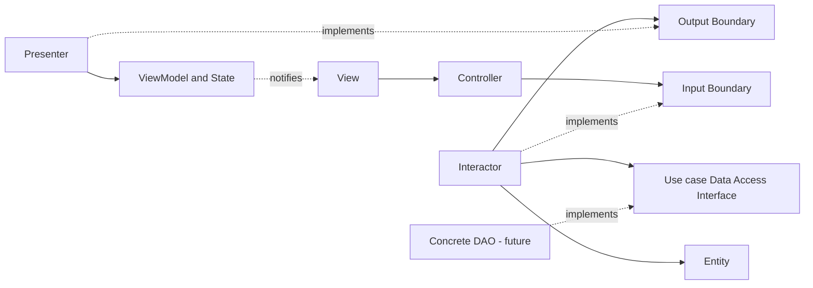

# Architecture and Implementation Handoff

## Working infrastructure versus skeletons

The UI starts, navigates among six layouts, and reports unfinished feature calls
through Controller → Input Boundary → Interactor → Output Boundary → Presenter →
ViewModel → listener → View. The eight feature flows are deliberately incomplete.
Interactors do no matching, authentication, selection, saving, or HTTP calls.
They only report `Not implemented`. Success Presenter methods throw explicitly
until their owners define output data and real success behaviour.

`InputData` classes contain only starting inputs, not validated domain objects.
`OutputData` and `DataAccessInterface` are empty TODO slots, not finished contracts.
Do not add a generic DAO or a fake storage implementation just to fill them.
Feature owners define the needed methods and inject actual implementations in
AppBuilder after discussing shared IDs, quantities, ownership, and session handling.
The initial Favourite input is only a cocktail ID; its add/remove/list operations,
and the Customize Save/Edit inputs, remain owner work.

## Dependency direction

The diagram describes the target extension points. The DAO dependencies are not
wired yet. The View never imports Gson, the JSON reader, or an Interactor.
Inner layers must not import Swing, Views, Presenters, or concrete DAOs.
The source import guard is a basic check, not proof of complete CA adherence.

Navigation follows `NavigationController → ViewManagerModel → ViewManager →
CardLayout`. Layout-preview routes do not establish a session or select a recipe.
Owners add guarded real navigation through Presenters once their flows exist.
All current UI state changes run on the EDT. Future HTTP/file work must run off
the EDT and deliver UI/model updates back to it.

## Ownership

| Feature packages | Owner | Implementation still required |
|---|---|---|
| `search` | Qinli | Criteria, classification, matching, result output, shared cards integration, tests |
| `browse`, `details`, `favourite` | Wenqian | Catalog/cards, selected recipe, images, add/remove/list Favourites and persistence, tests |
| `signup`, `login`, `logout` | Jiaqi | Validation, accounts, session, Account API/storage, Profile integration, tests |
| `customize` | Enhao | Edit form, quantities, save/edit commands, recipe ownership, collection, persistence, tests |

AppBuilder has one wiring block per skeleton. Feature owners replace their block
with the full dependencies; do not put business rules into AppBuilder or Views.
A single significant user story can contain several related use cases.

## How to complete an owner flow

1. Agree on input, success output, failure cases, and required DAO operations.
2. Extend the existing Input/Output Data and the feature's State.
3. Define narrow Data Access Interface methods inside `use_case`.
4. Implement business rules in Interactor using injected interfaces; add Unit Tests
   with in-memory fakes rather than making real network requests in unit tests.
5. Implement DAO/HTTP adapters in `data_access`, with their own mapping/error tests.
6. Map output in Presenter, notify ViewModel listeners, and navigate where needed.
7. Connect the View's controls, then wire real dependencies in AppBuilder.
8. Run `mvn verify`, manually exercise the user flow, and open a reviewed PR.

Do not interpret the existing shell tests as completed use case tests.

## Shared decisions pending

- Base-spirit classification and any independent Ingredient Entity.
- Numeric quantity type, accepted units, and validation for Customize.
- Adding instructions/description to Cocktail and mapping nullable descriptions.
- User identity/session contract and namespacing stable recipe IDs across sources.
- Custom Recipe ID, owner, original recipe reference, and edit semantics.
- Account API associated-JSON documentation and update/merge behaviour.
- Persistence storage and collection contracts, including save failures.
- Image matching, caching, HTTP threading, and fallback behaviour.
- Home/Search card reuse and selected-recipe navigation.

Public publishing, ratings, and comments are beyond MVP. No shared-user storage
or API endpoint is assumed by this scaffold.

## Design explanation for review

AppBuilder is the composition root, inspired by the course Builder example; its
current API is simply `build()` and is not claimed as a full fluent Builder.
ViewModels/listeners provide Observer-style notifications. Separating construction,
UI rendering, data mapping, and use case contracts supports SRP; depending on
Boundaries supports DIP. These are starting points to demonstrate in completed
features, not a claim that unfinished use cases already satisfy every principle.
