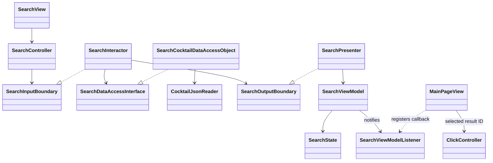
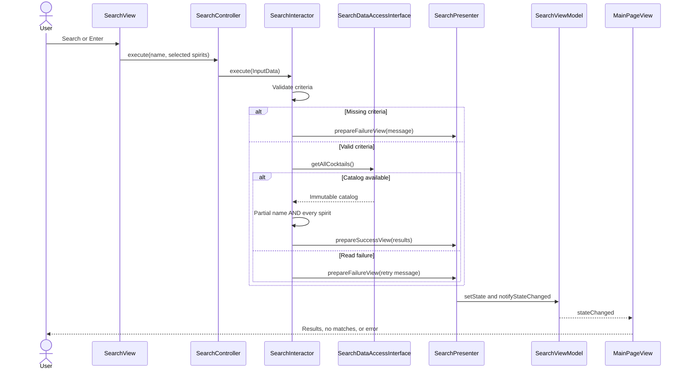

# Minimal Shared Scaffold

The package structure follows the course
[CA Login example](https://github.com/CSC207-2026F-UofT/ca-login/blob/main/LAB_INSTRUCTIONS.md).
Only application startup, the opening Home layout, and the existing offline data
reader are implemented.

## Feature packages

`use_case`, `interface_adapter`, and `view` each contain four feature folders:
`search`, `customize`, `profile`, and `browse`.

Each use case group contains empty InputBoundary, InputData, Interactor,
OutputBoundary, OutputData, and DataAccessInterface declarations. Each adapter
group contains empty Controller, Presenter, ViewModel, and State declarations.
Owners define their contracts and implementation; there are no feature methods,
fields, inheritance relationships, or TODO flows in these starting files.

The opening Home layout uses `view/browse/MainPageView` and
`view/search/SearchView`. Other View folders are tracked with `.gitkeep`.
No Details, Login, Register, Profile, or Customize pages or navigation are provided.

## Working shared code

- Main schedules window construction on the Swing EDT.
- AppBuilder creates the JFrame and Home layout.
- Home displays a title, search controls, an inactive Profile button, and a catalog
  placeholder. All feature buttons are disabled and have no action listeners.
- The existing dataset, index, Entities, Reader, DataReadCheck, and Reader tests
  are unchanged. DataReadCheck loads the dataset; GUI startup does not.

## Extending the scaffold

Owners implement their own input/output contracts, business rules, adapters,
Views, concrete data access, and tests. AppBuilder connects completed components.
Coordinate shared Entity and Home layout changes. Keep Swing rendering in Views,
business rules in use cases, and concrete storage/HTTP code in data_access.
Navigation, API integration, and user-data persistence remain future owner work.

## Search & Filter

This section describes the implemented Search feature and supersedes the historical
scaffold descriptions above for Search. Other features retain their owners' code.

Search follows the course CA Login structure: a Controller creates InputData,
the Interactor validates and filters through an inward-facing data-access
interface, and the Presenter updates SearchState in the ViewModel. The existing
SearchViewModelListener interface implements the same observer approach as the
course example. Home listens for state changes and renders the results.

The Interactor owns matching rules and missing-input validation. It has no Swing,
JSON, filesystem, or concrete DAO imports. The DAO owns lazy loading and caches an
immutable snapshot only after a successful read. The AppBuilder accepts a
SearchDataAccessInterface for wiring tests or another catalog implementation;
production uses the existing bundled JSON reader. This separation supports the
Dependency Inversion and Single Responsibility principles. The listener interface
provides observer notifications without coupling the Presenter to Swing widgets.

Clear is an explicit controller/boundary operation: it loads the full catalog
without applying missing-input validation, then presents browsing state. Startup
uses the same operation. A startup read failure becomes display state instead of
aborting construction. After retry succeeds, Clear restores the recovered catalog
rather than the initially empty list. It also clears the current Home selection,
which keeps the existing Customize action from using a stale recipe.

Search results reuse Home's current list presentation; Search does not implement
a separate card design or change Details/Customize business rules. Home passes
the ID from the displayed results to the existing Details controller and passes
the same selected entity to the existing Customize action.
