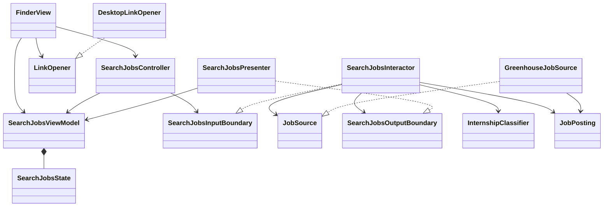
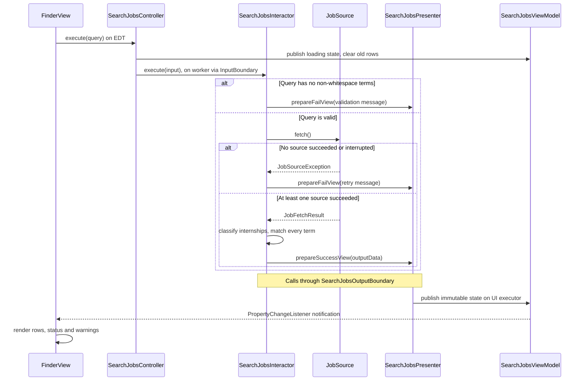

# Finder design: UC4 implementation

Owner: Yuheng Liu

Status: Implemented on `feature/finder`, based on main `c833a73`.
The scope is manual internship search. Profile, resumes, saved applications and
analytics remain separate team features.

See [the shared job contract and Ling review](shared-job-contract.md) for the
canonical entity, API signatures, failure semantics and remaining integration work.

## Architecture and source dependencies

The arrows below describe source dependencies, not runtime call order.

Input Boundary, Output Boundary, input/output data and the job-source contract
belong to `use_case`. The Interactor imports only entities, use-case types and
standard Java utility classes. HTTP, JSON, HTML parsing and Swing remain outside.

| Package | Types and responsibilities |
| --- | --- |
| `entity` | Immutable `JobPosting` and `WorkArrangement`; no storage or UI dependency. |
| `use_case.port` | `JobSource`, `JobFetchResult`, `JobSourceException`, `SourceFailure`. |
| `use_case.common` | Pure shared `InternshipClassifier`. |
| `use_case.search_jobs` | Input Boundary/Data, Interactor, Output Boundary/Data. |
| `interface_adapter.search_jobs` | Controller, Presenter, observable ViewModel and immutable State/Row. |
| `data_access` | `GreenhouseJobSource`, JSON/HTML mapper, company-board configuration value, explicit offline `DemoJobSource`. |
| `view` | Swing `FinderView` and the browser-opening adapter. |
| `app` | Configuration loading, `FinderApplication` composition root and `Main`. |

## Runtime sequence

The controller disables duplicate searches while one is running. Blocking HTTP
never runs on the event-dispatch thread. The presenter uses an injected UI
executor; production supplies `SwingUtilities::invokeLater`. The composition root
closes the worker when the window closes.

## Search behaviour

- Blank, null and whitespace-only input fails before fetching any source.
- Whitespace separates query terms. Case folding uses `Locale.ROOT`.
- Every term must occur as a literal substring in the title or plain description.
  Terms can match across the two fields; this is not stemming or eligibility analysis.
- Titles must contain an explicit intern/internship/co-op indicator with word
  boundaries. "Internal", "International" and "Internet" do not qualify.
- A successful empty retrieval or no matching postings is a valid zero result.
- Partial failures retain available matches and display failed-board warnings,
  including when there are zero matches.
- Total retrieval failure is an error with retry available.
- Results display title, company and location. Selecting a row exposes its
  copyable application URL and enables the browser button. Table sorting preserves
  the association between the displayed row and its original URL.
- Opening a link only asks the browser to open an HTTP(S) URL. It does not save,
  upload or submit an application or modify any profile, resume or application.

## Design principles and patterns

- SRP: matching rules, HTTP/JSON mapping and display formatting have separate
  reasons to change.
- DIP: the Interactor depends on `JobSource` and the output boundary; real and
  fake sources are interchangeable.
- OCP: another provider can implement `JobSource` without changing the search
  orchestration.
- Observer: `PropertyChangeSupport` notifies the View of ViewModel changes.
- Builder: `JobPosting.Builder` supports readable construction of immutable
  snapshots with optional fields, rather than a long positional constructor.
  This is newly implemented code, not merely a pattern label on a diagram.

These demonstrate course patterns. They do not by themselves satisfy the rubric's
Exceptional requirement for an appropriate pattern not presented in class.

## Verification

Run `mvn verify` with JDK 11. Tests include:

- Input normalization, AND matching, internship word boundaries and locale handling.
- Empty, partial and failed retrieval; read-only collection ownership.
- A local HTTP server exercising the real Java client, mapping, timeouts,
  unsuccessful status codes, invalid records and interruption.
- Presenter scheduling and warnings; controller busy-state, retry and executor failure.
- The real composition root and Swing controls on the EDT, including sorting,
  URL selection and a slow background source.
- An import guard for Entities/Use Cases. This guards ordinary import dependencies;
  it supplements rather than replaces review of architecture and runtime behaviour.

Checkstyle uses the course Google configuration with pinned engine 10.26.1.
The only package-name exception preserves existing CSC207 underscore packages.
Untouched teammate entity/placeholder files have explicit baseline exclusions.
All Finder production and test files are checked.

A deterministic UI preview can be rendered without a display:
`mvn -Dtest=FinderViewTest -Dfinder.preview.path=target/finder-preview.png test`.
Tests assert behaviour rather than pixel equality.

`Main --check-api` is a separate, explicit live-service smoke check. Normal tests
do not call the internet. `--demo` uses fictional listings and labels them as such.
