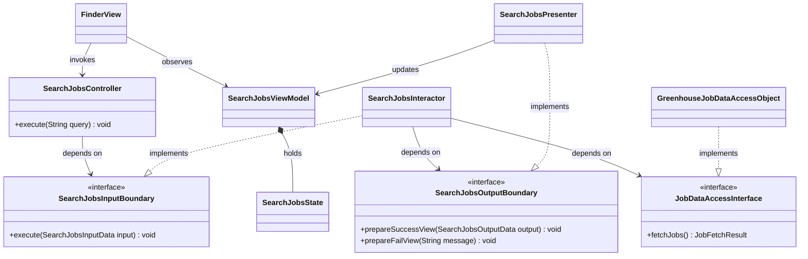
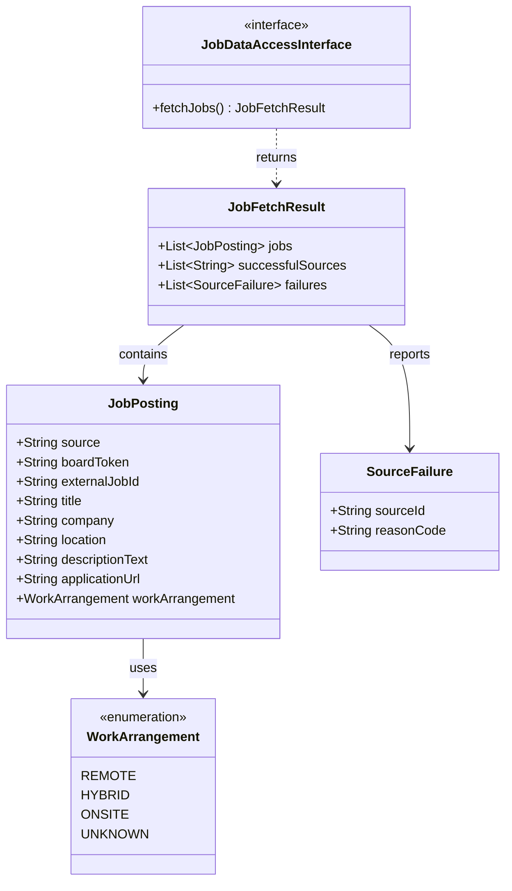
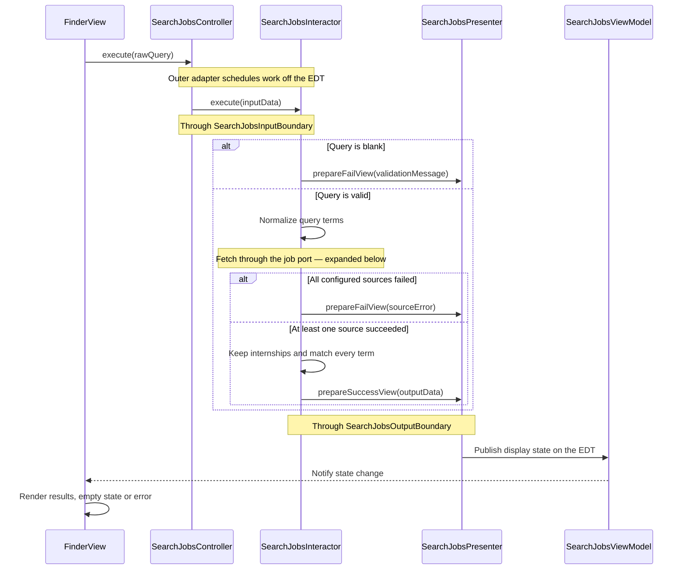
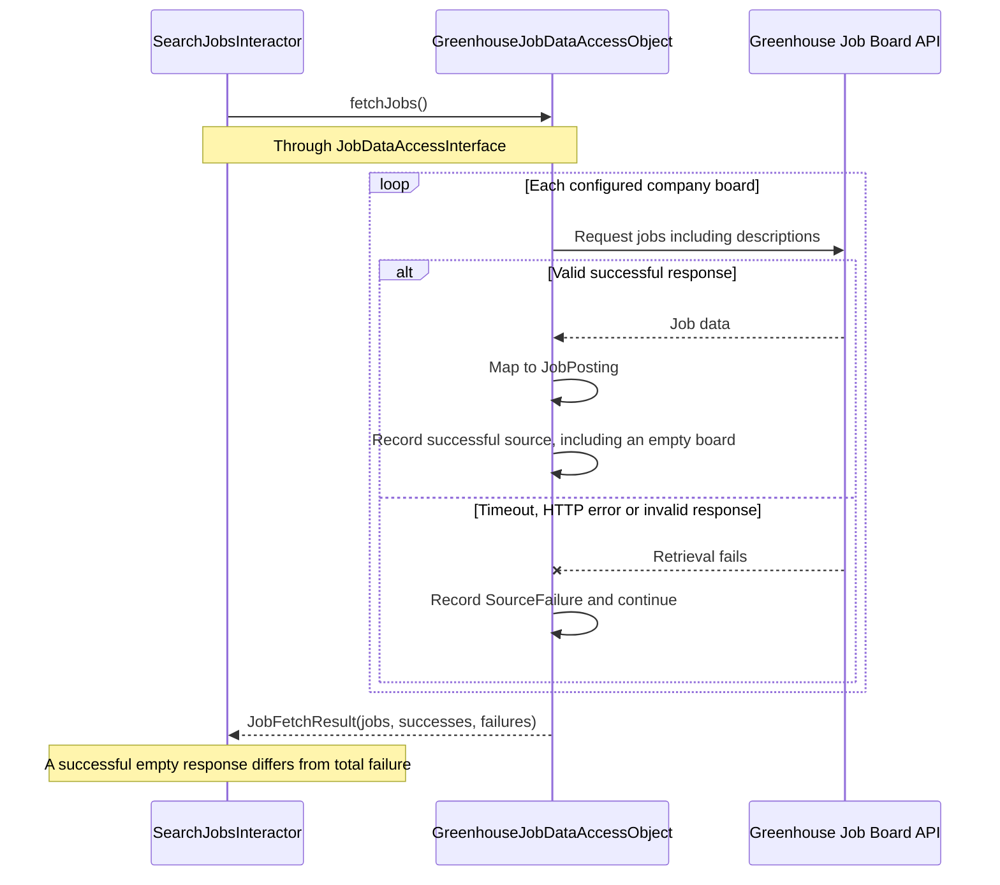

# Finder design: UML, sequences, and integration contracts

Owner: Yuheng Liu

Status: Proposed design for implementation and team review; not implemented Java code.

Baseline: [main at b767d5d](https://github.com/emilykim-rendered/team-project/tree/b767d5de9383271274d102cf85735e5789393ad9), including merged PR #3 and Use Cases 4–7.

Scope: Finder / Use Case 4. This document does not change main or implement another member's feature.

## 1. Responsibilities and dependency rule

Finder validates a manual query, retrieves jobs from configured boards, identifies internships, applies AND keyword matching, and presents results and application links. Blank input must not trigger a fetch. Opening an application link does not create an application or mark it applied.

The source-code dependencies point toward the use-case interfaces. Runtime calls can cross outward through those interfaces. All input/output/data-access boundaries below belong to `use_case`; Swing, HTTP, JSON and filesystem implementations stay outside it. The outer `app` package wires concrete implementations.

### Core class diagram

Arrows represent source relationships, not the order of execution. Dashed hollow-triangle arrows mean interface realization; the composition diamond means state ownership.



The view's observer callback is not a dependency from the ViewModel to the concrete FinderView. Use an observer/listener abstraction. The Interactor must not import SearchJobsPresenter or GreenhouseJobDataAccessObject.

### Finder-owned production files

| Package | Type | Responsibility |
| --- | --- | --- |
| `view` | `FinderView` | Render query input, results, selection and errors; bind controls. No HTTP, JSON parsing or matching policy. |
| `interface_adapter.search_jobs` | `SearchJobsController` | Build input data and invoke the input boundary. |
| `interface_adapter.search_jobs` | `SearchJobsPresenter` | Implement the output boundary and prepare display state. |
| `interface_adapter.search_jobs` | `SearchJobsViewModel` | Hold observable state; reuse the shared course-style base where available. |
| `interface_adapter.search_jobs` | `SearchJobsState` | Display rows, count, loading, selection, error and incomplete-result warnings. |
| `use_case.search_jobs` | `SearchJobsInputBoundary` | Declare the search operation. |
| `use_case.search_jobs` | `SearchJobsInputData` | Carry the query as plain Java data. |
| `use_case.search_jobs` | `SearchJobsInteractor` | Validate input, fetch through a port, classify internships, match all terms, and handle outcome categories. |
| `use_case.search_jobs` | `SearchJobsOutputBoundary` | Declare success and failure callbacks. |
| `use_case.search_jobs` | `SearchJobsOutputData` | Plain result data, result count and source warnings; no Swing model or HTTP response. |
| `data_access` | `GreenhouseJobDataAccessObject` | Implement the shared job port; HTTP requests, response mapping and per-board failures. |

A small result-row DTO can be nested in OutputData or introduced separately when implementation needs it. The table describes the core design, not a required class-count target.

## 2. Shared job contract: agree with Profile/Recommendations first

The existing source contains `entity.Internship`, while the README API section says `JobPosting`. The name `JobPosting` below is a proposal. Choose one canonical entity and map any existing implementation to it; do not create competing models just to match this diagram.



Shown fields describe the data contract, not a recommendation for public mutable Java fields. Prefer private fields, accessors and defensive copies. Use ordinary classes compatible with the agreed JDK.

| Contract | Proposed rule | Why both features need it |
| --- | --- | --- |
| Canonical identity | Stable tuple of source, board token and external job ID; do not use title or result-row index as identity. | Search and recommendations must identify the same posting when saving. |
| Searchable description | DAO converts service-specific content to readable plain text. | Both keyword matching and skill matching consume the same text. |
| Missing location | Preserve absence in domain data; presenter displays "Not specified." | Avoid inventing a location or using a display label as a real matching value. |
| Work arrangement | REMOTE / HYBRID / ONSITE / UNKNOWN; do not guess an absent value. | UC7 retains UNKNOWN for review even with a work-arrangement preference. |
| Internship classification | Shared pure `use_case.common.InternshipClassifier`; explicit title indicators, with an agreed boundary rule that does not match "Internal" as "Intern". | Prevent search/recommendations from disagreeing about which postings are internships. |
| Fetch outcome | Jobs plus successful sources and source failures. A successful empty board is still a successful source. | Distinguish empty results, partial retrieval and complete failure. |
| Failure representation | Source identity and a safe reason code; no HTTP/JSON library objects in the use-case contract. | Both presenters can explain incomplete results without depending on the transport library. |
| Collection ownership | Return defensive/read-only collections; consumers must not mutate a shared cached job list. | Recommendation sorting must not reorder Finder's results unexpectedly. |

Suggested signatures:

```java
// use_case.port
public interface JobDataAccessInterface {
    JobFetchResult fetchJobs();
}

// use_case.search_jobs
public interface SearchJobsInputBoundary {
    void execute(SearchJobsInputData input);
}

public interface SearchJobsOutputBoundary {
    void prepareSuccessView(SearchJobsOutputData output);
    void prepareFailView(String message);
}
```

The board list is injected into the DAO/configuration at app startup. A configured non-empty board list is UC4's precondition. The same port and DAO implementation can serve SearchJobsInteractor and RecommendationInteractor. Neither use case should call the other's concrete Interactor.

## 3. Search sequence

Participants show the concrete runtime roles. The controller calls the InputBoundary; the Interactor calls the OutputBoundary. Interface use is recorded in notes instead of adding artificial runtime objects for the interfaces.



OutputData includes source warnings even when the available sources yield zero matching jobs. Some-source failure must still be visible in that empty-result view. An unsuccessful search never modifies profiles, saved applications or resumes.

The outer controller/adapter schedules blocking work off the Swing event-dispatch thread. An outer UI dispatcher/presenter adapter marshals state publication back to the EDT; the Interactor imports no Swing classes. If concurrent searches are allowed, the outer presentation layer must prevent a late old result from replacing a newer search; alternatively, disable duplicate submission while a search runs.

## 4. Job retrieval sequence



This is a logical sequence; it does not require parallel HTTP requests. Inject the HTTP client and configured boards, apply timeouts, and keep response parsing inside data_access.

## 5. Handoffs to other team members

| Feature | Shared boundary | Ownership |
| --- | --- | --- |
| Profile / Recommendations (Ling) | Canonical job entity, job port, fetch-result format, work-arrangement values and internship classification. | Ling owns saved profile rules, preference filtering, distinct-skill matching and ranking. Finder owns manual AND keyword search. |
| Tracker (Jerry) | Selected stable job key plus a plain job snapshot passed to Tracker's save controller/input boundary. | Tracker owns duplicate prevention, persistence, application IDs, deadlines, priority and status history. |
| Resumes (Emily) | Indirect association through Tracker's application ID and resumeVersionId. | Finder does not upload or attach resumes. |
| Analysis (Austin) | Indirect access through Tracker's submission dates and historical milestones. | Opening a link or saving a job does not count as submitting an application. |

A Save button may be displayed in FinderView, but it invokes the Tracker controller as a separate use case. SearchJobsInteractor does not call a concrete Tracker Interactor or write application storage.

## 6. Compatibility review with Ling

**Observed snapshot, 2026-11-16:** PR #3 has merged and main contains UC5–7. The inspected remote refs were main and Jerry/shortlist; the inspected main tree contained no UML/design file and no implemented profile/recommendation module. This does not establish whether Ling has unpushed local work or work elsewhere. No implementation-to-implementation compatibility verdict is possible from this snapshot.

Use Ling's pushed UML and actual interface/entity declarations to fill in the comparison below before treating the shared contract as agreed.

| Check | Finder proposal | Ling implementation to verify | Current status |
| --- | --- | --- | --- |
| Entity identity | One JobPosting/Internship type and stable composite identity | Exact package, constructor, field types and identity semantics | Unverified |
| Retrieval signature | JobDataAccessInterface.fetchJobs(): JobFetchResult | Parameter/return types, collection types and ownership | Unverified |
| Empty vs failed fetch | Explicit successful sources and failures | Does an empty list hide an exception or total API failure? | Unverified |
| Partial retrieval | Keep successful jobs and report missing boards | Are warnings preserved through output data/presenter? | Unverified |
| Description contract | Plain description text in canonical entity | Raw HTML vs plain text and missing descriptions | Unverified |
| Work arrangement | Shared four-value enum; UNKNOWN retained | Enum spelling, missing-value rules, UNKNOWN filtering | Unverified |
| Internship recognition | Shared pure title rule | Same indicator and word-boundary behavior | Unverified |
| Search vs recommendation | Separate Interactors with one job port | No dependency on FinderView or concrete SearchJobsInteractor | Unverified |
| Profile commit boundary | Recommendations read latest successfully saved profile | Failed save preserves old profile; recommendation failure does not undo save | Unverified |
| App wiring and thread use | Inject compatible DAO; keep I/O off EDT | Constructor arguments, thread safety and view updates | Unverified |

A class diagram can reveal duplicate entities, incompatible signatures, wrong dependency direction and unclear ownership. Sequence diagrams reveal ordering and failure-handling assumptions. Neither proves that the current code follows the diagrams. Compare source declarations and run small contract/integration tests once both implementations exist.

### Shared fixtures for the first integration check

1. The same posting found by search and recommendation produces the same stable ID and only one Tracker record when saved twice.
2. Both features receive identical canonical data for missing location and UNKNOWN work arrangement.
3. One successful board plus one failed board produces useful results with an incomplete-results warning.
4. All boards failing produces an error; a successful board with zero jobs produces a valid empty result.
5. Internship classification treats "Software Engineering Intern" as an internship and does not classify "Internal Tools Engineer" from the word "Internal".
6. Recommendation sorting does not mutate the data collection used by Finder.
7. Editing and successfully saving a profile affects recommendations without changing Finder's manual query or historical application records.

## 7. Finder acceptance checks and implementation order

- Blank/whitespace query: fail validation before invoking the DAO.
- Normalize capitalization and surrounding whitespace; every submitted term must occur in title or description.
- Match only internships on configured boards. Results indicate relevance, not eligibility.
- Show title, company, location, application link and count.
- Distinguish zero matches, partial-source failure and all-source failure.
- Open the employer URL through an outer browser/link adapter without changing application status.
- Use a fake DAO and recording output boundary to test use-case rules without Swing or live HTTP.
- Add DAO mapping/timeout checks, then wire app and Swing.
- Capture actual Checkstyle evidence separately; this diagram alone is not proof of the rubric's additional design-pattern requirement.

First agree the shared job contract with Ling and the save contract with Jerry. Then implement and test the Interactor, add the presentation adapters, and finally connect the real DAO.
