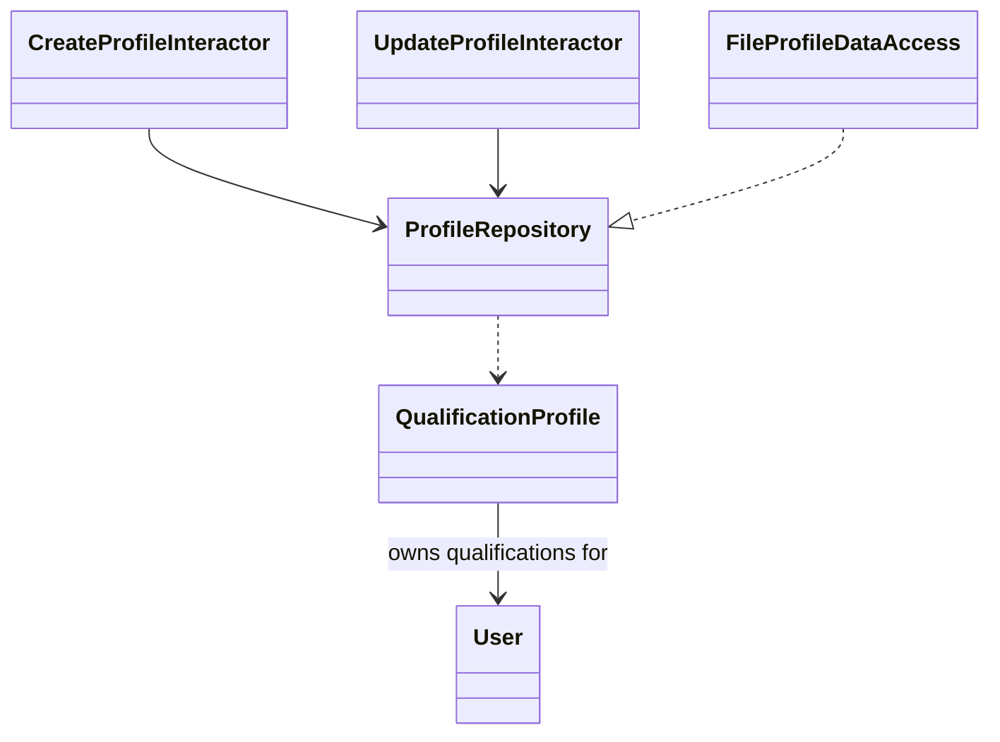
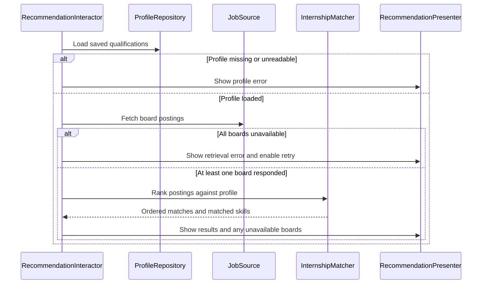

# Student profile and internship recommendations

Lingnan Meng leads UC5 (create a profile), UC6 (edit it) and UC7 (view personalized recommendations). UC7 is the main MVP use case. A student can enter qualifications once, close the app, and use them again in a later session.

## Walk through the demo

1. Run `mvn verify` with JDK 11, then `java -jar target/TeamProject-1.0-SNAPSHOT.jar --demo`.
2. Open **Profile**. Enter `Computer Science` as the program and `Java, Python` as skills. Leave the other fields empty and keep the default work arrangement. Choose **Save profile**.
3. Choose **View recommendations**. **Software Engineering Intern** ranks first with Java and Python. **Data Science Co-op** ranks second with Python. Each row gives its matching skills and the employer's application link.
4. Choose **Edit profile**, replace the skills with `SQL`, and choose **Save changes**. Reopen recommendations. **Data Science Co-op** is now the only match.
5. Close and reopen the app. The Profile tab shows the saved SQL skill. **Cancel edits** restores the last saved values.

The default file is `~/.intern-finder/profile.json`, with one student per file. For a classroom demo in a separate file, start the JAR with `java -Dinternfinder.profile=demo-profile.json -jar target/TeamProject-1.0-SNAPSHOT.jar --demo`. The demo source supplies fictional listings. The default launch uses the configured Greenhouse boards. Both modes run the same use cases and matcher.

## Clean Architecture

Each use case has a controller, input boundary, interactor, output boundary and presenter. Creating and editing share the form and its view model. Opening the Recommendations tab reloads the saved profile and fetches the board listings on the worker. Presenters publish display updates on the Swing event-dispatch thread. [Application wiring](../../src/main/java/app/ProfileApplication.java) · [CSC207 Clean Architecture example](https://github.com/CSC207-2026F-UofT/ca-login)

| Use case | Entry point | Responsibility of the interactor |
| --- | --- | --- |
| UC5 Create profile | `CreateProfileController.execute` | Validate entered fields, create a local student identity, persist the first profile and present the saved values. |
| UC6 Update profile | `UpdateProfileController.loadProfile` and `execute` | Load the saved qualifications, validate the edits and preserve the student's identity when saving. |
| UC7 View personalized recommendations | `RecommendationController.execute` | Load the latest saved profile, fetch postings through the shared job source, apply the matching strategy and report results or source failures. |

### Class diagram for profile persistence

`QualificationProfile` contains the program, optional graduation year, skills, preferred roles, preferred locations and optional work arrangement. It enforces a nonblank program, at least one distinct skill and a four-digit year when supplied. `User` holds the stable student identity. On a failed save the form keeps the draft, and a failed load leaves **Reload profile** available.

### Sequence diagram for recommendations

The interactor calls the presenter through `RecommendationOutputBoundary`. The presenter formats rows, including the actual matched skills, and the view observes `RecommendationViewModel`. [Interactor](../../src/main/java/use_case/recommendation/RecommendationInteractor.java) · [Presenter](../../src/main/java/interface_adapter/recommendation/RecommendationPresenter.java)

### Design choices

- **Strategy.** `InternshipMatcher` defines the ranking operation. `KeywordInternshipMatcher` implements the MVP rules. A different ranking rule can implement that interface and be selected in `ProfileApplication`. [Matching strategy](../../src/main/java/use_case/recommendation/KeywordInternshipMatcher.java)
- **Observer.** The profile and recommendation view models use `PropertyChangeSupport`. Each Swing view listens for the latest state. This lets the presenter publish results without knowing which Swing components display them. [Observable view model](../../src/main/java/interface_adapter/ObservableViewModel.java)
- **Dependency inversion.** Interactors depend on the inner `ProfileRepository` and `JobSource` interfaces. The outer adapters handle JSON files and Greenhouse HTTP. Only board requests go to Greenhouse. Profile data and ranking stay local. [Profile repository](../../src/main/java/use_case/profile/ProfileRepository.java) · [Shared job contract](shared-job-contract.md)

## How recommendations work with Finder

Both features receive the same `JobSource` instance, use the same `JobPosting` entity and identify internships through `InternshipClassifier`. Finder accepts a manual keyword query (UC4). Recommendations take their input from the saved profile (UC7). They do not alter the shortlist or create an application when a link is opened.

1. Keep internships and co-ops identified by the shared title rule. Apply any preferred roles to the title and any preferred locations to the posting location. Each supplied category must match at least one of its entries. With a work-mode preference, retain the chosen mode and postings marked `UNKNOWN`.
2. Find distinct profile skills in the title or description using case-insensitive whole terms and phrases. A Java skill matches “Java” and skips “JavaScript”. The app displays those skills as the reason for the match. Program and graduation year are saved for reference. The matcher does not infer eligibility.
3. Include each posting with at least one matched skill once, using its stable board and job ID. Order by descending number of matched skills. Break ties by title, company, then stable ID.
4. Display a warning naming unavailable boards when some boards succeed. An empty successful search shows a no-match message. A failed fetch offers a retry.

Jerry's shortlist can read `QualificationProfile.getPreferredRoles()` for its preferred career fields. UC7 ranks available postings by skills, independently of the ordering of saved applications.

[UC7 interactor tests](../../src/test/java/use_case/recommendation/RecommendationInteractorTest.java) · [Ranking tests](../../src/test/java/use_case/recommendation/KeywordInternshipMatcherTest.java) · [Persistence tests](../../src/test/java/data_access/FileProfileDataAccessTest.java) · [Swing workflow tests](../../src/test/java/view/ProfileWorkflowTest.java)
