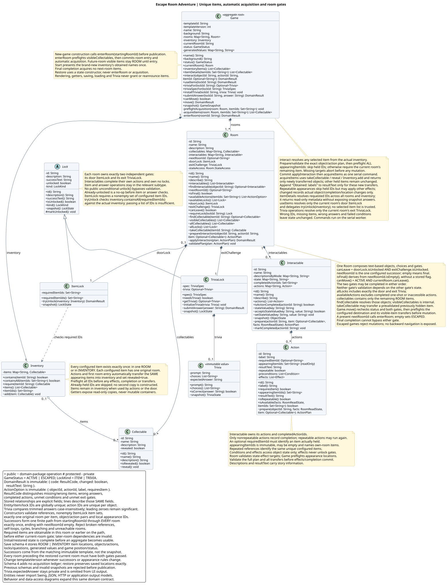
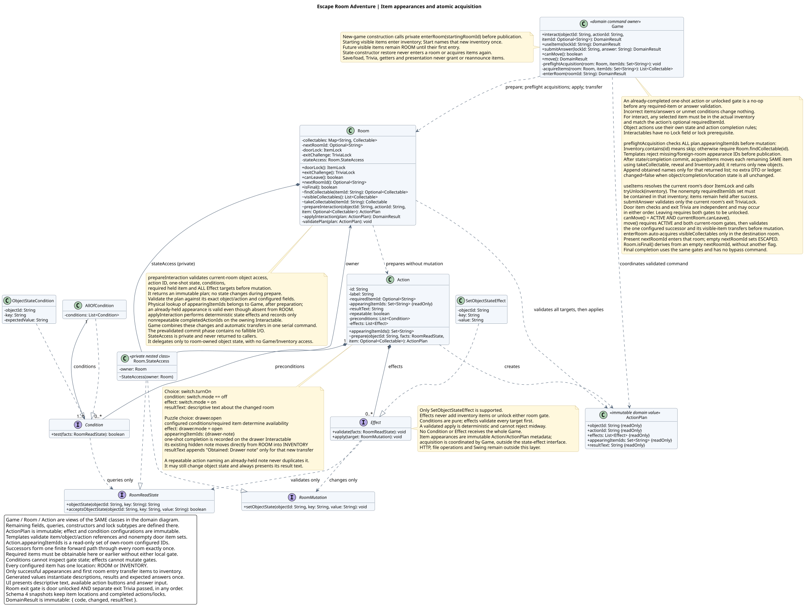
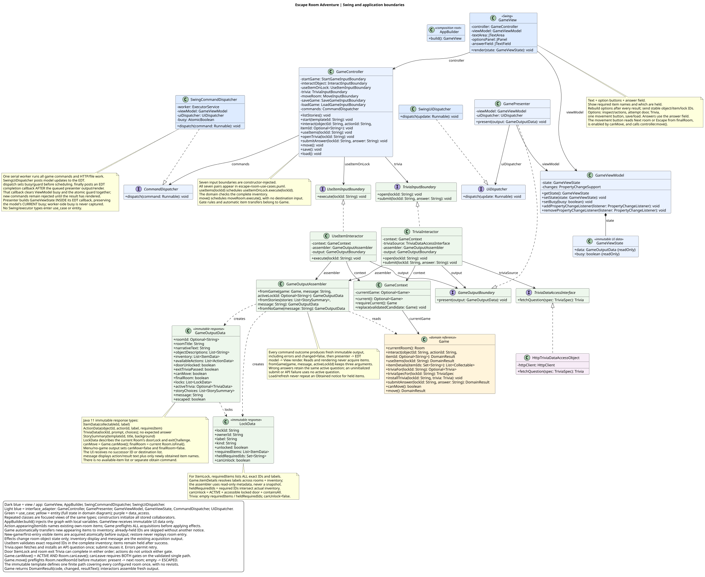
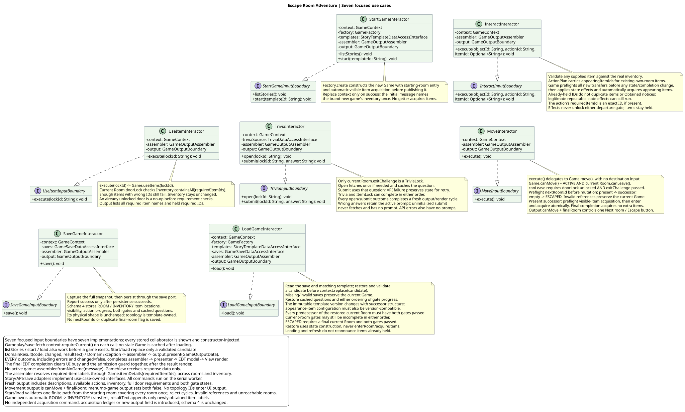
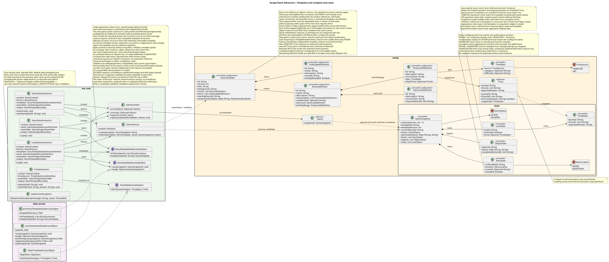
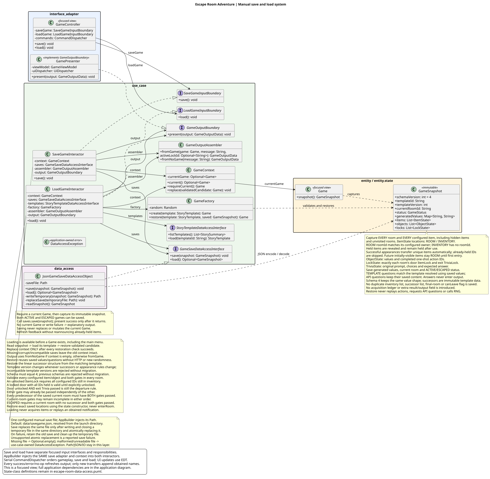
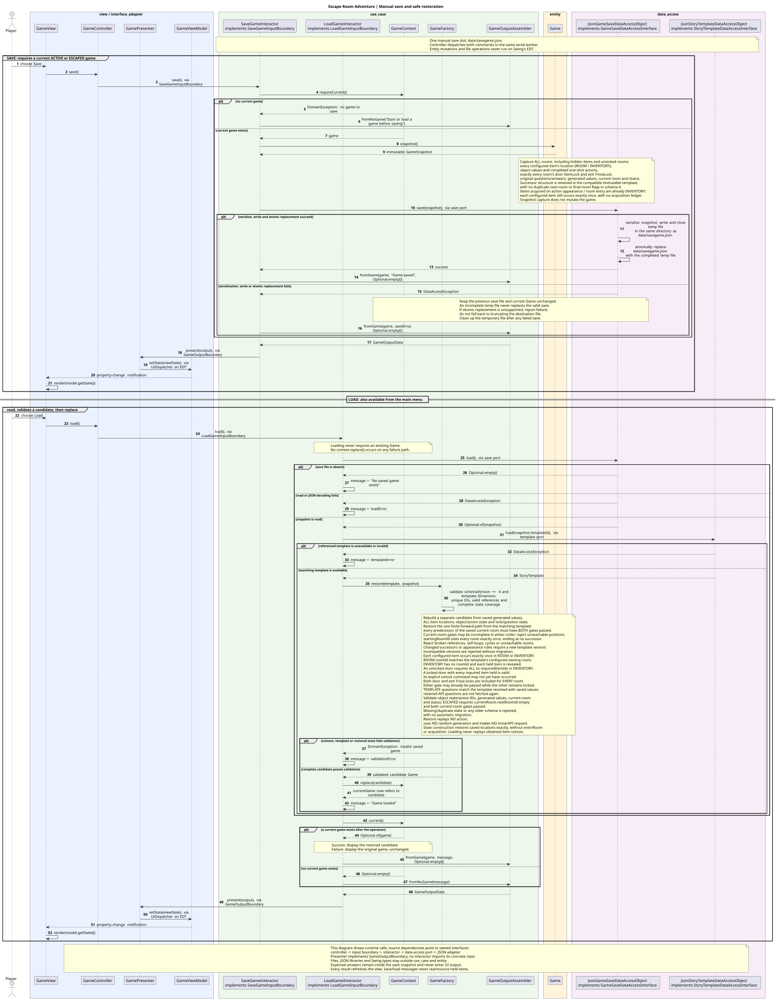
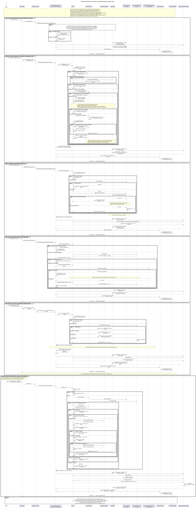

# Escape Room Adventure UML

This Java 11 design uses the team's hand-drawn domain model as its foundation. `Game` owns rooms and an inventory; each `Room` owns interactive objects, an `ItemLock` and a separate `TriviaLock`. `Interactable` owns its actions. `ItemLock` and `TriviaLock` extend `Lock`, and a `TriviaLock` holds its initialized `Trivia`.

This document defines design contracts only. The repository does not yet implement the Java game.

## Editable diagrams

| View | Exports | Editable source |
| --- | --- | --- |
| Domain state and ownership | [SVG](escape-room-domain.svg) · [PNG](escape-room-domain.png) | [PlantUML](escape-room-domain.puml) |
| Object actions, conditions and effects | [SVG](escape-room-behavior.svg) · [PNG](escape-room-behavior.png) | [PlantUML](escape-room-behavior.puml) |
| Swing and application boundaries | [SVG](escape-room-class-diagram.svg) · [PNG](escape-room-class-diagram.png) | [PlantUML](escape-room-class-diagram.puml) |
| All seven concrete use cases | [SVG](escape-room-use-cases.svg) · [PNG](escape-room-use-cases.png) | [PlantUML](escape-room-use-cases.puml) |
| Templates, data access and saved state | [SVG](escape-room-data-access.svg) · [PNG](escape-room-data-access.png) | [PlantUML](escape-room-data-access.puml) |
| Manual save/load module | [SVG](escape-room-save-system.svg) · [PNG](escape-room-save-system.png) | [PlantUML](escape-room-save-system.puml) |
| Choices, item checks and departure sequence | [SVG](escape-room-trivia-sequence.svg) · [PNG](escape-room-trivia-sequence.png) | [PlantUML](escape-room-trivia-sequence.puml) |
| Save/load success and failure sequence | [SVG](escape-room-save-sequence.svg) · [PNG](escape-room-save-sequence.png) | [PlantUML](escape-room-save-sequence.puml) |

PlantUML is the editable source; SVG and PNG are exports of the same eight diagrams. Repeated classes are focused views of the same type. The domain diagram defines complete runtime members, the application/use-case diagrams define collaborators, and the data-access diagram defines saved values. Relationship lines describe the identically named fields. Constructors validate dependencies and state before exposing an object. Collection queries return read-only copies.

## Mapping the hand-drawn model

The core ownership and inheritance relationships are preserved. `Game.currentRoomId` resolves to a room in `Game.rooms`; it represents the sketch's current-room reference without saving a second object identity. `Game.background` carries the sketch's story text. `GameStatus.ACTIVE` and `ESCAPED` make the Boolean game-status meaning explicit.

`Room.doorLock` is the sketch's `itemLock`, and `Room.exitChallenge` is its `triviaLock`. Both belong to the room. `Interactable` has descriptions, object state and actions, with no lock field, getter or lock association. `Action` and `Trivia` have explicit contracts below.

`Room.nextRoomId: Optional<String>` implements the sketch's single next-room link. A value names the next room; an empty value identifies the final room. `Room.nextRoomId()` exposes the link and `Room.isFinal()` derives whether it is empty. `Game.move()` controls all forward transitions and final-room completion. No movement command accepts a destination ID, and no unconditional end-game or unlock command bypasses the rules.

## Domain state and ownership



| Class | Stored state | Responsibility |
| --- | --- | --- |
| `Game` | Template ID/version, name/background, rooms, inventory, current-room ID, status, generated values | Validate current-room commands; acquire appearing items once; coordinate actions, room gates, movement and complete snapshots |
| `Room` | ID/name/description, item/object maps, `nextRoomId: Optional<String>`, `doorLock`, `exitChallenge`, private state access | Resolve local targets; prepare/apply actions; report `nextRoomId()`, `isFinal()` and both gate states through `canLeave()` |
| `Inventory` | `items: Map<String,Collectable>` | Query actual possession by ID, test `containsAll`, add prevalidated automatically acquired items |
| `Collectable` | ID/name/description, revealed flag | Identify an existing item and its visibility |
| `Interactable` | ID/name, descriptions by mode, state values, completed action IDs, actions | Describe an object, prepare its actions, track nonrepeatable completion and capture its state |
| `Action` | ID/label, optional required item ID, `appearingItemIds: Set<String>`, result text, repeatability, conditions and state effects | Validate a selected choice and produce an immutable action plan |
| `Lock` | ID/description/success text, unlocked status, kind | Share identity, status and snapshot behavior; protect the validated status transition |
| `ItemLock` | Base fields and `requiredItemIds: Set<String>` | Unlock only when the actual inventory contains every configured ID |
| `TriviaLock` | Base fields, `TriviaSpec`, optional initialized `Trivia` | Install one question, reuse it and validate submitted answers |
| `Trivia` | Prompt, choices, expected answer | Compare text answers and capture an immutable question value |

Every item has a globally unique ID and exactly one authoritative location: one room's remaining-item map or `Inventory.items`. Items are initially assigned to rooms by the template. When an item appears to the player, the same `Collectable` moves directly from its room into inventory and becomes revealed. There is no separate acquisition command or button. Item use never removes an item, and there is no drop command.

Appearance has two explicit sources: `CollectableDefinition.initiallyRevealed` for items visible when a room is first entered, and a successful `Action.appearingItemIds` for objects discovered by a choice. These are configured IDs; descriptions are not parsed to infer item ownership. A key fragment is an ordinary `Collectable` whose ID may be required by an `ItemLock`.

Before the first output of a new game, the new-game constructor enters the starting room and acquires its initially visible items. Entering a successor room does the same for that room. Items in unentered rooms stay there, even if configured initially visible. `GameFactory.create()` publishes only the completed independent game; the start interactor names the brand-new game's initial inventory once in its start message.

`Game.preflightAcquisition(room,itemIds)` validates every requested transfer before mutation. An ID already in the inventory is skipped first. Otherwise it must resolve to a remaining item in that room. `Game.acquireItems(room,itemIds)` runs only after preflight, moves those same objects, marks them revealed, and returns only newly transferred items. `Game.enterRoom(roomId)` validates the destination and its visible-item transfers before committing entry. Domain results append `Obtained: <item names>` only for actual new transfers. Merely rendering or querying the game never acquires an item or repeats this notification.

`Game.itemDetails(itemIds)` returns read-only item metadata for the requested IDs by resolving their current room or inventory location. The output assembler uses this query to show all required item names, including missing items. It does not inspect answer-bearing snapshots or fetch the template again.

## ItemLock and the two departure conditions

```text
ItemLock.requiredItemIds: Set<String>
ItemLock.tryUnlock(inventory: Inventory): DomainResult
Inventory.containsAll(itemIds: Set<String>): boolean
Game.useItems(lockId: String): DomainResult

Room.canLeave() = doorLock.isUnlocked() && exitChallenge.isUnlocked()
Room.isFinal() = nextRoomId.isEmpty()
Game.canMove() = ACTIVE && currentRoom.canLeave()
```

The required set is nonempty and contains valid configured item IDs. `Game.useItems(lockId)` verifies that the game is active and the ID is the current room's `ItemLock`. It supplies its actual `Inventory`, rather than accepting a caller's claimed list of held IDs. The lock first checks whether it is already unlocked; a repeat returns an unchanged result. Otherwise it tests `inventory.containsAll(requiredItemIds)` and unlocks on success. It never consumes or transfers items.

For example, requirements `{ "brass-key", "access-card" }` need both exact IDs. Two unrelated items, one matching item, or identical labels with different IDs do not qualify. Extra items are allowed. A failed check preserves the lock and the entire inventory; success changes only the lock and leaves every item held. Required items can therefore be reused by other configured locks or actions.

The exit Trivia can be opened and answered before or after collecting items and unlocking the item gate. Neither gate command requires the other to be complete. Actions needed to obtain mandatory items must remain reachable without completing either departure gate. Because navigation is forward only, required items and action prerequisites must be obtainable in the current room or earlier on the chain. Templates must not require a later room's item to complete the current room.

The team handles missed later requirements through authored room design: arrange mandatory room content so players do not leave behind an item needed later. This does not add a third runtime departure gate or a universal requirement that an item's source-room door must require it.

`Game.move()` always requires active status and both gate conditions, even if a caller bypasses the UI. On a validated world, `canMove()` is exactly the active-status and gate predicate. With either gate incomplete, movement preserves the current room and status. With both passed, a present `nextRoomId` is resolved and its initially visible item transfers are prevalidated before entry and automatic acquisition commit together. An empty value changes status to `ESCAPED` without another room entry. Unlocking a gate alone never moves or finishes the game. Earlier rooms retain their state for complete saving, but there is no backward navigation. Escaped games reject gameplay changes while remaining available for saving or replacement by start/load.

## Interactable, Action and Trivia



`Interactable.describe()` selects a description from `descriptionsByMode` using its current state. `actions()` exposes configured choices; `isActionCompleted(actionId)` identifies a completed nonrepeatable choice. Its package-level `prepare(actionId,item,facts)` validates the selected action and returns an `ActionPlan`; `markCompleted(actionId)` records nonrepeatable completion during commit. Repeatable actions do not add completion IDs. State values and completed nonrepeatable action IDs are included in `ObjectState`.

`Action.isAvailable(facts,itemIds)` tests its pure conditions, optional required item and state-effect validity. `prepare(objectId,facts,item)` rechecks these requirements and returns the configured `appearingItemIds` with the state effects. `appearingItemIds()` exposes a read-only set; it may be empty. Template validation ensures every appearance ID originally belongs to that action's room. `Game.interact(objectId,actionId,itemId)` resolves any supplied tool from the actual inventory; an unheld item cannot satisfy an action, while a held tool from an earlier room may. Tools remain held.

A nonrepeatable action completes once. A repeatable action may run whenever its other prerequisites remain valid, including after one of its appearance items has been acquired. The inventory-ID check skips that item without reporting a missing room target or creating a copy. Other valid state effects still apply. `DomainResult.changed` reflects actual state, completion-record or item-location changes; result text and UI feedback are still produced for an unchanged attempt.

| Type | Contract | Purpose |
| --- | --- | --- |
| `ActionPlan` | Read-only object ID, action ID, state-effect list, `appearingItemIds`, result text | Carry a prepared action whose full acquisition preflight is completed by `Game` |
| `Condition` | `test(RoomReadState): boolean` | Evaluate a pure room-local predicate |
| `ObjectStateCondition` | Object ID, key, expected value | Check a configured state value |
| `AllOfCondition` | Nonempty condition list | Require every predicate |
| `Effect` | `validate(RoomReadState)` and `apply(RoomMutation)` | Validate a target before deterministic mutation |
| `SetObjectStateEffect` | Object ID, key, value | Change an existing object's configured state |
| `RoomReadState` | Object-state and accepted-value queries | Supply narrow read-only facts |
| `RoomMutation` | Set object state | Limit effects to room-local state changes |
| `Room.StateAccess` | Private owner reference | Implement both interfaces without exposing mutation capability |

`Room.prepareInteraction()` validates the local object/action, completion status, actual required item, conditions and all state-effect targets without mutation. `Game` then prevalidates every appearance transfer against the actual room and inventory. Only after all checks succeed does `Room.applyInteraction()` apply the deterministic state effects and nonrepeatable completion record; `Game` transfers new items in the same command. `Room.validatePlan()` checks that the owner/action, effects and appearance IDs match the prepared configured choice. This atomic commit has no external I/O and cannot reject midway after preflight. Wrong choices, tools, conditions or missing runtime targets leave both world and inventory unchanged. Effects receive neither `Game` nor `Inventory`; they cannot unlock gates, construct items or transfer ownership.

For example, a correct switch action changes `mode` from `off` to `on` and lists `lab-card` in `appearingItemIds`. The same command changes the description, transfers that existing card to inventory and displays the action text plus `Obtained: Laboratory card`. Repeating an allowed action cannot obtain the same ID again. A readable terminal may instead have an empty appearance set and return only a clue.

`Trivia` is an immutable value. `prompt()` and `choices()` provide display content; `isCorrect(answer)` compares a supplied answer; package-level `snapshot()` captures prompt, choices and expected answer. Answers are strings so codes retain leading zeroes. Comparison is case-insensitive after trimming surrounding whitespace; internal characters and leading zeroes remain significant. An empty choices list represents a text/code question; a nonempty list represents choices using their submitted answer text. Constructors reject a blank prompt or expected answer and reject invalid choice data.

`TriviaLock` holds `TriviaSpec` and an optional initialized `Trivia`. `initializeTrivia()` installs the first successful question and cannot replace it on retry. `submitAnswer()` requires an initialized question, preserves a wrong attempt and unlocks on a correct answer. An already unlocked lock returns an unchanged result. Only `TriviaLock` accepts answers and only `ItemLock` checks inventory; `Lock` declares neither unsupported subtype operation.

`DomainResult` is an immutable value with `code`, `changed` and `resultText`. Codes distinguish unavailable actions, missing required items, wrong answers, uninitialized questions, completed actions, already unlocked gates and either missing departure condition. `DomainException` reports query/precondition failures. Neither type contains widgets or application output objects.

## Swing interaction and Clean Architecture



The view uses a `JTextArea`, a `JPanel` of option buttons and a `JTextField` for answers. It renders room/object descriptions, action result text, newly obtained item names and lock success text. Actions, tools and locks use stable IDs. A single movement button invokes parameterless `GameController.move()`; output `finalRoom` selects the label Next room or Escape and `canMove` controls availability. Save/load controls also remain parameterless. The answer field submits an answer for the selected Trivia lock. Inventory and required/missing item names are displayed as text and options. Item appearance has no separate player control.

| Package | Responsibility |
| --- | --- |
| `entity`, `entity.state` | Domain rules, immutable configuration, runtime entities and pure saved values |
| `use_case` | Input/output boundaries, interactors, shared context/factory, output assembly and data-access ports |
| `interface_adapter` | Controller, presenter, view model/state and dispatcher abstractions |
| `view` | Swing widgets and command/EDT dispatcher implementations |
| `data_access` | JSON and HTTP implementations of use-case-owned interfaces |
| `app` | `Main` / `AppBuilder` constructing and injecting the object graph |

```text
GameView -> GameController -> InputBoundary <- Interactor -> entity
Interactor -> GameOutputBoundary <- GamePresenter -> GameViewModel
Interactor -> DataAccessInterface <- JSON/HTTP adapter
Interactor -> GameContext -> Game
Interactor -> GameFactory -> entity / entity.state
GameView -> GameViewModel
```

These are source dependencies. Runtime calls reach concrete adapters through the interfaces owned by the use-case layer. Entities contain no Swing, JSON, HTTP, file-path or application-output dependencies.

### Seven use cases



| Input boundary | Interactor | Entry and coordination |
| --- | --- | --- |
| `StartGameInputBoundary` | `StartGameInteractor` | `listStories()` / `start(templateId)`; load a template, create an independent game and replace context only on success |
| `InteractInputBoundary` | `InteractInteractor` | `execute(objectId,actionId,itemId)` -> `Game.interact()` including automatic acquisition and result text |
| `UseItemInputBoundary` | `UseItemInteractor` | `execute(lockId)` -> `Game.useItems()` using the full actual inventory |
| `TriviaInputBoundary` | `TriviaInteractor` | `open(lockId)` / `submit(lockId,answer)`; reuse/fetch/install one room question and submit to the domain |
| `MoveInputBoundary` | `MoveInteractor` | `execute()` -> `Game.move()` enforcing active status and both gates, then entering the next room or completing the final room |
| `SaveGameInputBoundary` | `SaveGameInteractor` | `save()` -> complete snapshot and save port |
| `LoadGameInputBoundary` | `LoadGameInteractor` | `load()` -> read snapshot/template, restore candidate and replace only after validation |

Each interactor stores `context`, `assembler` and `output`, plus only its needed factory/data-access ports. `GameContext` holds `Optional<Game>` with `current()`, `requireCurrent()` and `replace(validatedCandidate)`. All use cases obtain the current game through this holder on every command. Listing stories, starting and loading also work from the menu before a game exists.

`GameOutputAssembler` creates a fresh immutable response using `fromGame(game,message,activeLockId)`, `fromStories(stories,message)` or `fromNoGame(message)`. `GamePresenter.present()` creates `GameViewState(data,busy)` and updates the view model. The model stores state plus `PropertyChangeSupport`; the view listens for changes and rebuilds its text and available controls. Loading clears selections from the old session.

Every command outcome follows assembler -> output boundary/presenter -> EDT model update -> view render, including automatic acquisition, correct and wrong Trivia answers, uninitialized submissions, API errors, unavailable choices and unchanged results. A wrong answer retains the same active initialized question; an uninitialized question or failed fetch has no active prompt. Submit never fetches. Passing the second gate immediately refreshes `canMove` and the movement button. The existing output `message` carries this command's result and newly obtained names; no extra notification history or obtained-item ledger is stored. Saving, loading, querying and redrawing do not announce old inventory as newly obtained.

`GameController` stores all seven focused input interfaces and a `CommandDispatcher`. `SwingCommandDispatcher` uses one serial `ExecutorService`, the view model, `UiDispatcher` and an atomic busy guard. It sets busy before scheduling and rejects conflicting work while busy. Its `finally` schedules the completion callback on the EDT after the output update; that callback clears model busy state and releases the guard together so input is not re-enabled ahead of the result render. Presenter state construction also runs in its EDT callback and preserves the current busy value. All gameplay, HTTP and file commands run on the worker. Interactors remain synchronous and know nothing about Swing or executors.

### Output values

| Type | Fields |
| --- | --- |
| `GameOutputData` | Optional room ID, title/narrative, object descriptions, inventory, available actions, door and Trivia flags, `canMove`, `finalRoom`, locks, active Trivia, story choices, message, escaped flag |
| `ItemData` | `collectableId`, label |
| `ActionData` | `objectId`, `actionId`, label, `requiresItem` |
| `LockData` | `lockId`, owner ID, label, kind, unlocked, `requiredItems: List<ItemData>`, `heldRequiredIds: Set<String>`, `canUnlock` |
| `TriviaData` | `lockId`, prompt, choices |
| `StorySummary` | Template ID, title, background |

For an item lock, `requiredItems` includes every required ID and label, including missing items. `heldRequiredIds` is the intersection with actual inventory IDs. `canUnlock` requires an active game, the current-room item lock still locked and every exact ID held. Trivia lock output uses empty item requirements and `canUnlock == false`; answers use the separate Trivia commands. Correct answers never enter output data. The assembler reads domain queries, not snapshots. `canMove` comes from `Game.canMove()` and `finalRoom` from `Game.currentRoom().isFinal()`. Menu/no-game output uses false for both. The view has one movement option and no destination list.

### SOLID responsibilities

| Principle | Application |
| --- | --- |
| Single Responsibility | Inventory manages possession; actions validate object behavior; lock subtypes validate their own inputs; Game coordinates local access and transitions; adapters handle I/O |
| Open Closed | Conditions, effects and external providers have interfaces; new implementations keep existing orchestration stable, with template tags registered explicitly |
| Liskov Substitution | Both lock subtypes support identity/status/snapshots; inventory and answer operations belong only to their respective subtype |
| Interface Segregation | Seven focused input boundaries; separate room-read and room-mutation interfaces; no generic interface forcing item and answer handling together |
| Dependency Inversion | Controllers use input boundaries; interactors use their output/data-access ports; outer concrete adapters implement those interfaces |

## Immutable story configuration

| Definition | Fields |
| --- | --- |
| `StoryTemplate` | ID/version/title/background, rooms, global items, starting-room ID, randomization rules |
| `RoomDefinition` | ID/name/description, interactables, `nextRoomId: Optional<String>`, `doorLock: ItemLockDefinition`, `exitChallenge: TriviaLockDefinition` |
| `CollectableDefinition` | ID/name/description, owning `roomId`, `initiallyRevealed` |
| `InteractableDefinition` | ID/name, descriptions by mode, initial state, actions including their `appearingItemIds` |
| `ItemLockDefinition` | ID/description/success text, `requiredItemIds: Set<String>` |
| `TriviaLockDefinition` | ID/description/success text, `spec: TriviaSpec`, `initialTrivia: Optional<Trivia>` |
| `TriviaSpec` | `source: TriviaSource`, optional category/difficulty |
| `RandomizationRule` | Minimum inclusive, maximum exclusive, numeric formatting width |

ID/text fields are strings; optional text uses `Optional<String>`. `TriviaSource` is `TEMPLATE` or `API`. TEMPLATE requires an authored initial question. New API locks start without a question; restore may install their saved question without fetching. All items are initially assigned to their designated room; the starting-room entry acquires its visible items before the new game is published. Mutable runtime rooms, items, locks and object state are independent between games. Immutable action/rule configurations can be shared safely.

Template validation checks global IDs/references, lock ownership/subtype, allowed state keys/modes, action IDs unique within an object, state-effect targets, own-room appearance IDs and all item requirements. Several actions may name the same item ID; inventory membership still permits only its first transfer. Following `nextRoomId` from the starting room must visit every configured room exactly once and end at an empty link. Reject missing destinations, self-links, cycles and unreachable rooms. There is exactly one final room and one forward path. Every room has exactly one item gate and a separate Trivia gate. Each item gate has a nonempty required set. Required items and object-action prerequisites must be reachable in the current or an earlier room without completing either current room gate; the team reviews the authored story to avoid inaccessible or missed later requirements. No universal source-door item rule is added. Display text and authored answers must resolve all configured generated placeholders consistently.

`GameFactory` stores an injected Java 11 `Random`. `create()` draws configured values once and substitutes them into descriptions, action/lock results and authored answers. A seeded generator supports deterministic future implementation checks. `restore()` resolves text with saved generated values and never draws new values.

## Manual save and validated restoration



The use-case layer owns `StoryTemplateDataAccessInterface`, `TriviaDataAccessInterface` and `GameSaveDataAccessInterface`. JSON and HTTP adapters implement these ports and translate external failures into `DataAccessException`. A missing save returns `Optional.empty()`; malformed or unreadable data is an error. JSON nodes, HTTP responses and paths never cross into the domain.

`TriviaInteractor.open()` reuses the existing question or requests an API question only when none is initialized, then installs it once. A failed fetch permits a retry without state changes. Submit never fetches; retries and loads retain the original question. TEMPLATE questions use their authored answers.

`GameSnapshot` belongs to `entity.state` and has **schema version 4**, template ID/version, current-room ID, game status, generated values and these complete lists:

| Saved value | Fields |
| --- | --- |
| `ItemState` | Item ID, `ROOM` or `INVENTORY`, optional room ID, revealed flag |
| `ObjectState` | Object ID, state values, completed nonrepeatable action IDs |
| `LockState` | Lock ID, unlocked flag, optional `TriviaState` |
| `TriviaState` | Original prompt, choices, expected answer |

The snapshot includes every configured item and every room's object/action and gate state, including unvisited rooms and hidden items. A room ID exists exactly for `ROOM` and matches the item's configured owner; inventory items have no room ID and are revealed. A visible item in an unentered room remains there until entry. A normal current-session snapshot records appearing items already in inventory because acquisition completes before presentation or saving. There are exactly two lock states per room. An item lock has no question state. A passed Trivia lock retains its question. Departure permission and first acquisition are derived from authoritative saved locations; no duplicate obtained-item flag or ledger is stored.

Restoration validates schema/template versions, complete unique IDs, locations, allowed object state/action IDs, lock subtypes and question data, and required generated values. An unlocked item gate requires all its exact IDs still in inventory because use never removes them. A locked gate with all IDs held remains valid because unlocking requires an explicit command. A passed Trivia gate with incomplete item collection is also valid, as is an unlocked item gate with incomplete Trivia. The saved current room must belong to the validated chain, and every preceding room must have both gates passed. Otherwise the saved position could not have been reached through `Game.move()`. Either gate may still be incomplete in the current room, with no required completion order. An escaped game must identify its final room (`nextRoomId` empty) and both passed gates. TEMPLATE question values match the resolved configuration; initialized API values are structurally validated and retained.

`GameFactory.restore()` uses the saved-state constructor to create a separate candidate without room-entry acquisition, action replay, question fetching, random generation or obtained-item notifications. It restores the saved item locations exactly. The existing schema, ID/location, lock/question and preceding-room gate validation above is retained; this change adds no future-room state or action-history validation. `LoadGameInteractor` replaces `GameContext` only after those checks succeed. Missing, invalid or incompatible data leaves the original context unchanged, including an empty context at the menu. The snapshot value structure remains schema 4: `currentRoomId` is saved, while `nextRoomId`, action appearance configuration and final-room status come from the compatible immutable template. Changes to navigation or appearance configuration require a new template version, so an older manual-acquisition template is not treated as compatible. Older snapshot schemas and incompatible template versions are rejected with an explanatory message; no migration is included in this design.



There is one manual save slot, default `data/savegame.json`, resolved from the launch directory and injected by `AppBuilder`. The same save adapter and context are shared by save and load. Saving an active or escaped current game captures an immutable snapshot, writes and closes a temporary file in the same directory, then atomically replaces the prior save. Failure preserves the old save and cleans up the temporary file. Unsupported atomic replacement reports a failure. Saving never changes the current game.



## Gameplay walkthrough



1. Select a JSON story; load/validate its template and create an independent world.
2. Read descriptions and choose object actions. A valid action may reveal an existing room item or change a clue's description.
3. A correct object's action causes the configured card or key fragment to appear. It immediately enters inventory and the result text names the newly obtained item; the item gate's held-ID display updates in the same response.
4. Select the item-lock option. `Game.useItems(lockId)` checks the actual complete inventory and unlocks without removing items.
5. Open and answer the room Trivia. This may happen before steps 2–4; the original question is retained.
6. Choose Next room or Escape. `GameController.move()` -> `MoveInputBoundary.execute()` -> `MoveInteractor.execute()` -> `Game.move()` takes no destination argument. It checks both gates, then enters `nextRoomId` or sets `ESCAPED` when the link is empty.
7. Save at any stage; loading restores the same valid item, object, gate, question and generated state, with no repeated acquisition or obtained-item notice.

## Design verification and future acceptance cases

Rendering verifies PlantUML syntax and exports; it does not execute the planned Java behavior. The future implementation needs meaningful acceptance cases:

- Hold only part of the item requirement, or enough unrelated IDs: unlock fails with inventory and lock unchanged.
- Hold every exact required ID plus extras: unlock succeeds and all items remain held. Repeating it changes nothing.
- Complete one gate only: movement stays blocked in intermediate and final rooms. Complete both, in either order: enter the configured next room, or set `ESCAPED` when `nextRoomId` is empty.
- Complete Trivia before item discovery: preserve it and allow remaining object actions. Open/submit must not require an unlocked door.
- Interact with an unheld required item or an invalid/foreign target: leave state and inventory unchanged and show fresh feedback.
- Start a game or enter the next room: acquire its initially visible items before the first output. Visible items in unentered rooms stay there.
- Complete an action with multiple appearance IDs: validate every target before changing effects/completion/items, then acquire each new item once and name only new acquisitions.
- Repeat an allowed action or let another action name an already held item: no duplicate, no missing-room-item error and no second obtained-item notice; other valid state effects may still apply.
- Submit correct, wrong or uninitialized Trivia, encounter an API failure, or receive an unchanged result: present fresh output and render the current inventory/gates. Completing the last gate immediately enables movement.
- Retry a completed nonrepeatable action: no repeated effect. Move forward: retain all earlier room descriptions, actions and gate state in the complete snapshot.
- Save/load before and after automatic acquisition, actions, either gate and final escape: restore all rooms, hidden items and original question/value data without repeating entry or obtained-item notifications.
- Reject missing/duplicate item or lock IDs, invalid room ownership, wrong schema/template version, broken/cyclic/incomplete room chains, invalid current-room IDs, a preceding room with either gate incomplete, or an unlocked item gate missing required held items, without replacing context.
- Preserve the previous save after write/atomic-replacement failure; permit loading at the menu and report missing data clearly.

## Regenerate diagrams

```sh
JAVA_BIN=/path/to/java PLANTUML_JAR=/path/to/plantuml.jar ./docs/diagrams/render-uml.sh
```

The script renders all eight sources to SVG and PNG locally using PlantUML's internal layout engine. It makes no network requests. PlantUML remains a documentation tool outside the game's Maven dependencies.
