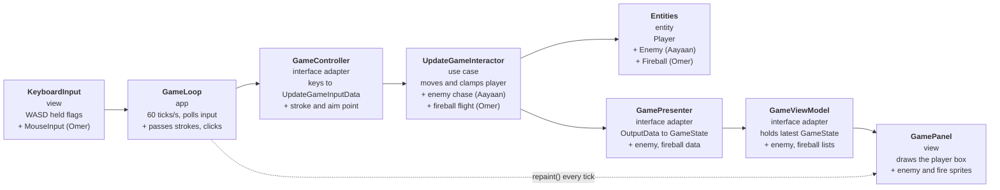

# SpellBook: Enemy & First Spell Spec

2026-11-16 · Jordan Lin

## Overview

This milestone adds the first enemy (Aayaan) and the first spell, a fireball (Omer), on top of the core loop that already moves the player with WASD. Everything below is a starting proposal: numbers and designs marked *proposed* are defaults to confirm or change when we talk them through (see Open questions).

| Owner | Feature | Branch (proposed) | Done when |
| --- | --- | --- | --- |
| Aayaan | Enemy that chases the player | `feat/enemy` | An animated enemy walks to the player and stops on contact |
| Omer | Fireball spell | `feat/fireball-spell` | Drawing a circle, then clicking, launches an animated fireball toward the click |

Both features build on `feature/core-loop` (the movable player), which is not on `main` yet. Branch from it, or wait until it merges. Commits follow Conventional Commits, and each feature goes in by pull request with one teammate reviewing.

## How new features plug in

Neither feature needs a new architecture. Each one adds to the same once-per-tick path the player already uses, so work through it in the order shown. Lines starting with `+` are new this milestone (proposed).

Key presses and mouse strokes are only recorded by the `view` layer. `GameLoop` reads them 60 times a second and calls the controller. The interactor applies the game rules to the entities, and the presenter turns the result into a `GameState` that `GamePanel` draws. Imports only point inward (`view` → `interface_adapter` → `use_case` → `entity`). The use case reaches the presenter only through the `UpdateGameOutputBoundary` interface.

## Aayaan: first enemy

One enemy appears, walks toward the player using an animated sprite, and stops when it reaches them. It has no HP, does no damage and cannot die yet.

**Behaviour (proposed)**

- Spawns once at game start, at a fixed point near a screen edge, so it is easy to test.
- Moves toward the player every tick at 2 px per tick. That is half the player's 4 px, so the player can always outrun it.
- Stops when its hitbox touches the player's hitbox, and starts chasing again when the player moves away.
- Faces the direction it is moving (sprite flips left/right) and plays an idle animation while stopped.

**Pathfinding**

The world is currently an empty 960 × 640 px box with no walls. With nothing in the way, moving in a straight line toward the player is the shortest path. Step one is that straight-line chase. Real pathfinding, such as A\* on a grid of 32 px tiles (30 × 20 tiles), only matters once the map has obstacles. Whether obstacles are part of this milestone is an open question.

**Sprites**

- A walk animation and an idle animation, as PNG sprite sheets in `src/main/resources/sprites/enemy/`.
- Images are loaded and drawn only in the `view` layer. The `Enemy` entity knows nothing about images. It only exposes state the view needs: position, facing direction, and whether it is moving.
- The view picks the animation frame from that state plus a tick counter. For example, it could change frames every 8 ticks, which is about 7.5 frames per second.

**Where the code goes**

| Layer | Change |
| --- | --- |
| `entity` | New `Enemy` with position, size, speed, `moveToward(player)` and an overlap check |
| `use_case/update_game` | `UpdateGameInteractor` moves the enemy after the player each tick. `UpdateGameOutputData` gains the enemy's state |
| `interface_adapter/game` | `GameState` gains an enemy snapshot. `GamePresenter` fills it |
| `view` | `GamePanel` draws the enemy sprite. A small sprite-sheet loader is shared with Omer |
| `app` | `Main` creates the enemy (or a `GameWorld` that holds it) |

**Done when**

- [ ] The enemy spawns, walks to the player and stops on contact
- [ ] Walk and idle animations play, facing the right way
- [ ] Diagonal movement is not faster than straight movement
- [ ] A unit test drives `UpdateGameInteractor` with a fake presenter and checks that the enemy gets closer each tick and stops at contact

## Omer: first spell (fireball)

The player draws a circle with the mouse to ready a fireball, then clicks to launch an animated fire sprite toward the cursor. This is the game's core mechanic, so the stroke-recognition design should leave room for more spells later.

**Player flow (proposed)**

1. The player holds the left mouse button and draws. A faint trail shows the stroke as they draw.
2. When they release the button, the stroke is checked. If it is a circle, the fireball becomes *ready* (shown with a small icon or glow on the player). If not, nothing happens and the trail fades.
3. While a fireball is ready, the player clicks anywhere. A fireball spawns at the player's centre and flies in a straight line toward the click point.
4. The fireball disappears when it hits the enemy or leaves the screen. It deals no damage yet.

**Recognising a circle**

There are two options to choose between:

- **Simple circle check.** Find the stroke's centre point, then measure each point's distance from it. Accept the stroke if those distances vary by less than about 25%, the end is close to the start, and the radius is at least 20 px. This is quick to write but only knows circles.
- **$1 Unistroke Recognizer.** This is a well-known algorithm of about 200 lines that compares a stroke against saved templates. It takes longer to write, but each later spell (lightning zigzag, shield square) is just a new template.

The rule "a circle means fireball" is game logic, so the recogniser lives in `use_case` or `entity`, never in `view`.

**Where the code goes**

| Layer | Change |
| --- | --- |
| `view` | New `MouseInput` (like `KeyboardInput`) records the stroke points, the release and the click point. `GamePanel` draws the trail and the fire sprite |
| `app` | `GameLoop` passes any finished stroke and click into the controller each tick |
| `interface_adapter/game` | `GameController` adds the stroke and aim point to the input data. `GameState` gains the fireball list and a "spell ready" flag |
| `use_case` | Proposed: a new `cast_spell` use case turns a stroke into a ready spell. `UpdateGameInteractor` spawns and moves fireballs |
| `entity` | New `Fireball` with position, direction and speed (proposed 10 px per tick) |

**Threading**

Mouse events arrive on Swing's thread, but the game loop runs on its own thread. A finished stroke is a list of points, so it can't be shared through a `volatile` boolean the way WASD keys are. Hand it over through a thread-safe queue such as `ConcurrentLinkedQueue`, so a stroke is never read while it is still being built and never lost between ticks.

**Done when**

- [ ] Drawing a rough circle readies a fireball. A line or scribble does not
- [ ] Clicking while ready launches a fireball toward the cursor, and readiness is used up
- [ ] The fire sprite animates and points the way it travels
- [ ] The fireball disappears on hitting the enemy or leaving the screen
- [ ] Unit tests feed recorded strokes into the recogniser: several circles pass, and a line and a zigzag fail

## Shared pieces and coordination

Both features edit the same five files: `UpdateGameInteractor`, `UpdateGameOutputData`, `GameState`, `GamePresenter` and `GamePanel`. Agreeing on these shared pieces first avoids painful merge conflicts.

| Shared piece | Proposed owner | Why it is shared |
| --- | --- | --- |
| Hitbox overlap check (axis-aligned boxes) in `entity` | Aayaan | The enemy stops on contact, and the fireball disappears on hitting the enemy |
| Sprite-sheet loader in `view` (load PNG, cut frames, pick frame by tick) | Aayaan | Enemy and fireball are both animated |
| `GameState` shape: lists of enemy and fireball snapshots | Both, agreed up front | Both add fields to it and to `UpdateGameOutputData` |
| Order of steps inside one tick | Both, agreed up front | The fireball's hit check needs the enemy's position for that tick |

**Proposed tick order** inside `UpdateGameInteractor.execute`:

1. Move and clamp the player
2. Handle a finished stroke (ready a spell) and a click (launch a fireball)
3. Move the enemy toward the player, stopping on contact
4. Move fireballs and remove any that hit the enemy or left the screen
5. Send everything to the presenter

**Conventions to keep**

- Coordinates are pixels with the origin at the top-left, and y grows downward.
- Entities store positions as `double`. Only the presenter rounds to `int`.
- Entities never import Swing. The use case talks to the presenter only through `UpdateGameOutputBoundary`.

## Out of scope

These wait for a later milestone, so neither feature should build them now:

- HP, damage and death, for both the player and enemies
- Waves, more than one enemy, and different enemy types
- Spells other than the fireball, plus mana and cooldowns
- Upgrades, chests and sound

## Open questions

Settle these with Aayaan and Omer before coding starts, then tick each one off and update the sections above.

**For Aayaan**

- [ ] Does this milestone include obstacles? If yes, the enemy needs grid pathfinding (A\*). If no, a straight-line chase is enough.
- [ ] Where does the sprite art come from (made ourselves or a free asset pack), and what size are the frames?
- [ ] Is 2 px per tick the right enemy speed, and should it stop on touching or a few pixels before?

**For Omer**

- [ ] Simple circle check or the $1 Unistroke Recognizer?
- [ ] Does aiming fire on a separate click, or on the release of a second drag?
- [ ] Does a ready fireball expire after a few seconds if not used?
- [ ] A new `cast_spell` use case, or fold everything into `update_game`?

**For both**

- [ ] Does each person need their own use case for the course rubric? If yes, how do we split `update_game`?
- [ ] Should `Player`, `Enemy` and the fireballs move into a single `GameWorld` entity now, or later?
- [ ] Who writes the shared hitbox check and sprite loader, and by when?
