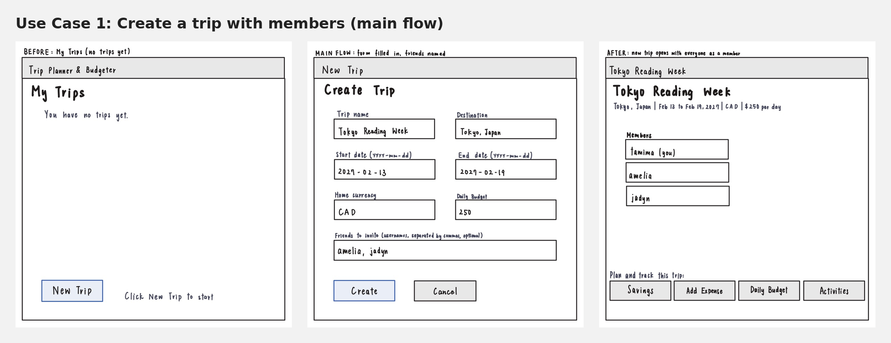
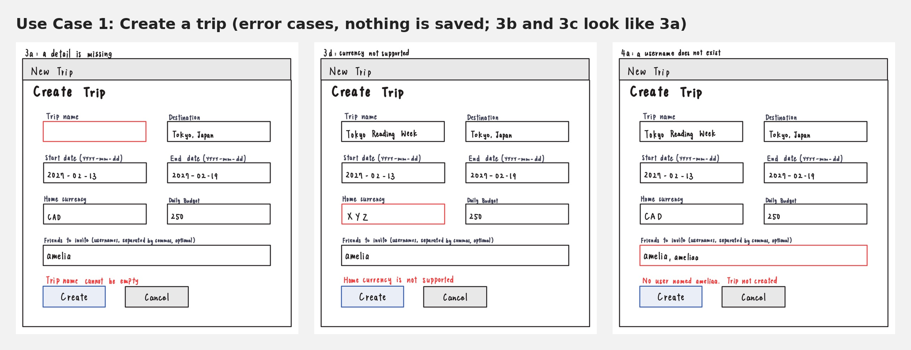
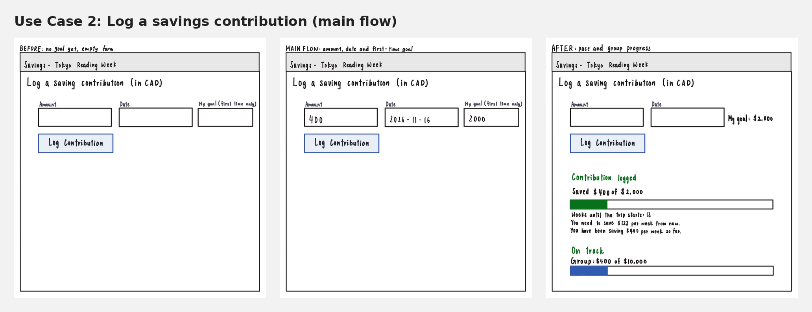
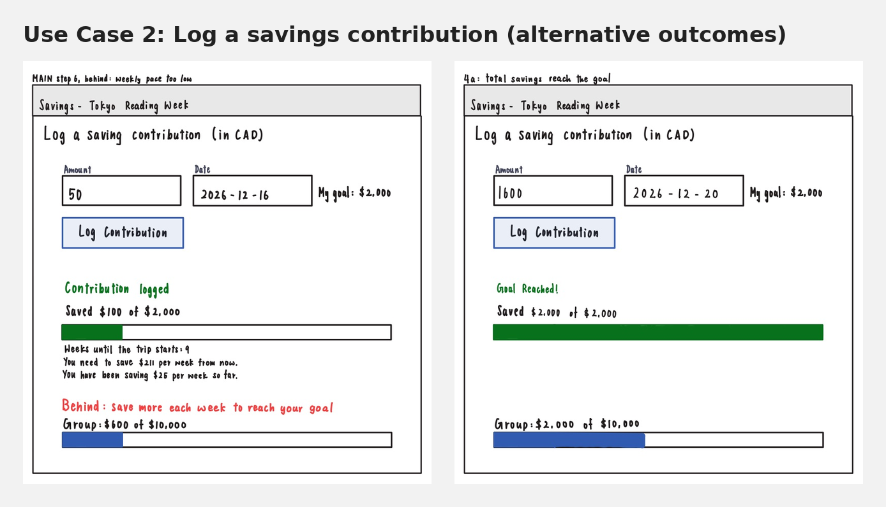
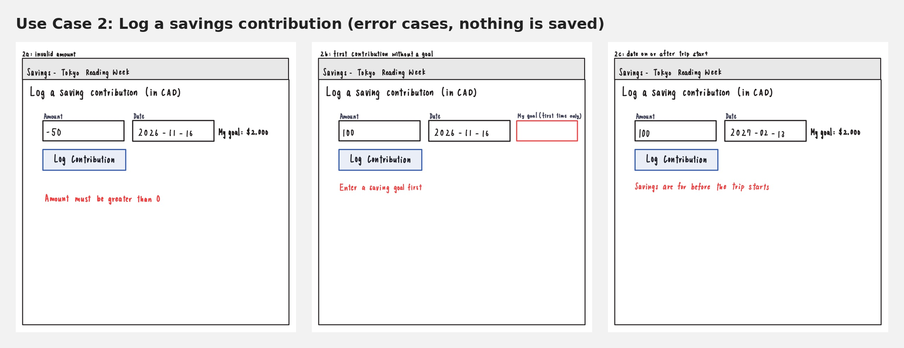
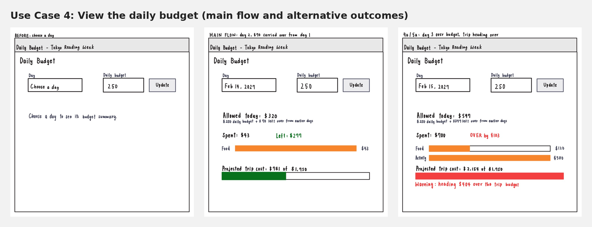
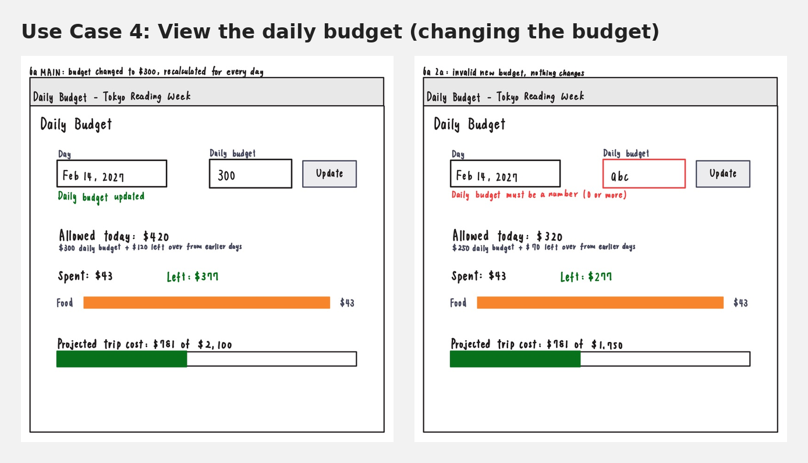
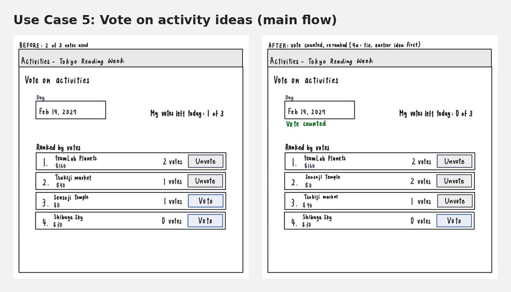
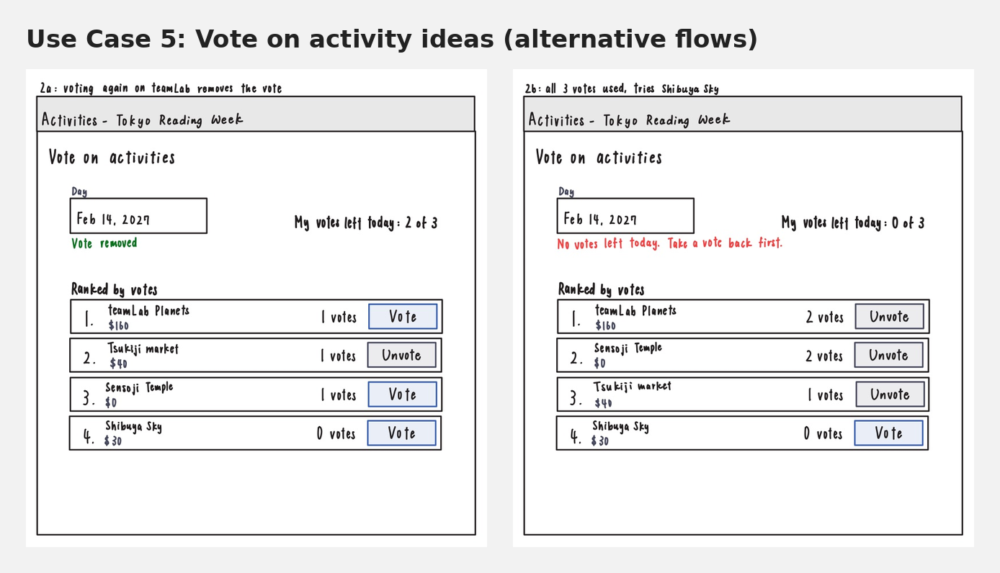

# UI sketches

Sketches of the main screens for each of the five use cases: what the view looks like **before** the use case, during the **main flow**, and **after**, plus the alternative flows and error cases ([Developing a Use Case: The View](https://q.utoronto.ca/courses/444184/pages/developing-a-use-case-the-view)). They are a starting point: each lead should adjust their own screens as they build them, and update the picture in the same pull request.

Labels like "2a" and "3b" match the extension labels of the use cases in the [README](../../README.md).

## Use Case 1: Create a trip with members

## Use Case 2: Log a savings contribution

## Use Case 3: Log an expense

## Use Case 4: View the daily budget

## Use Case 5: Vote on activity ideas

