# UI sketches

Last week's lab (Lab 7) asked each team to show their TA a sketch of the main UI for the MVP: what each view looks like **before** and **after** each use case, for the main flow and for alternative flows ([Developing a Use Case: The View](https://q.utoronto.ca/courses/444184/pages/developing-a-use-case-the-view)). These are our sketches. They are a starting point: each lead should adjust their own screens as they build them, and update the picture in the same PR.

Numbers like "2a" and "3b" match the extension labels in the use cases in the [README](../../README.md).

## Use Cases 1a, 1b, 1c: Create a trip, invite a member, open a trip
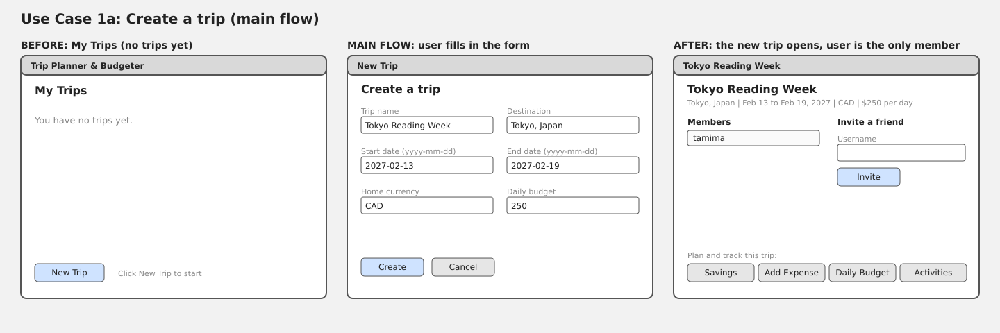
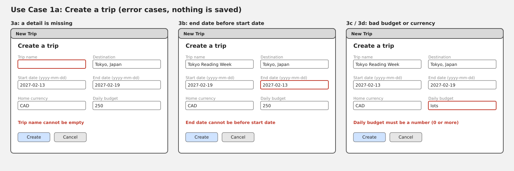
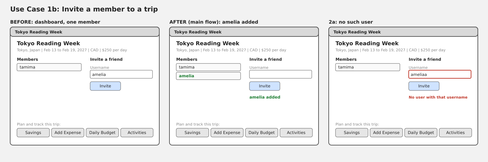
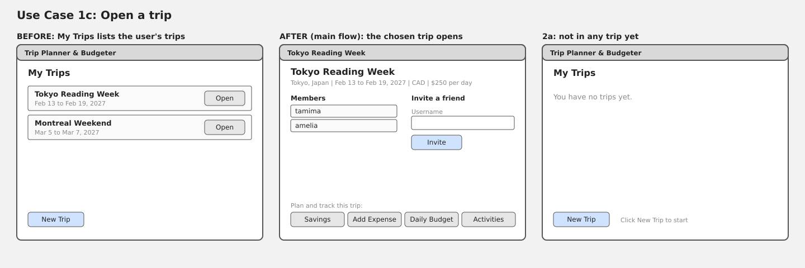

## Use Cases 2a, 2b: Savings goal and contributions
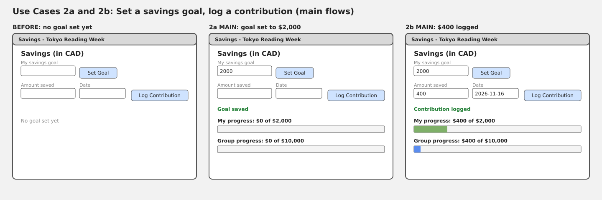
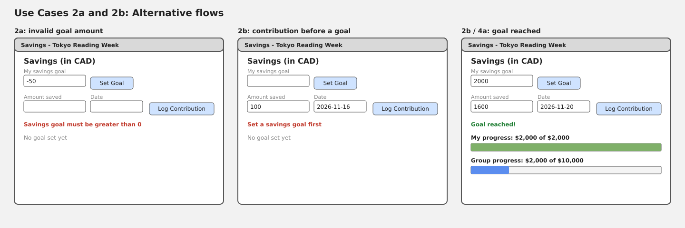

## Use Case 3: Log an expense
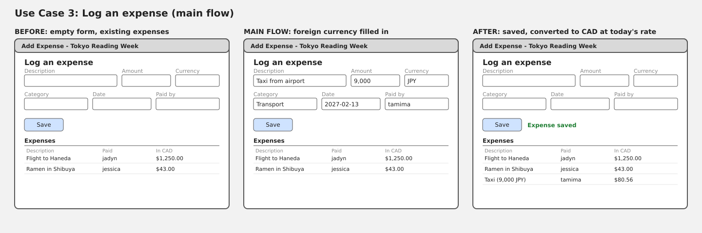
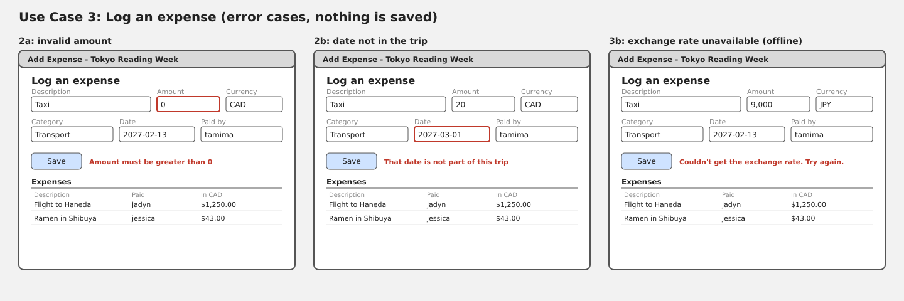

## Use Cases 4a, 4b: Daily budget summary

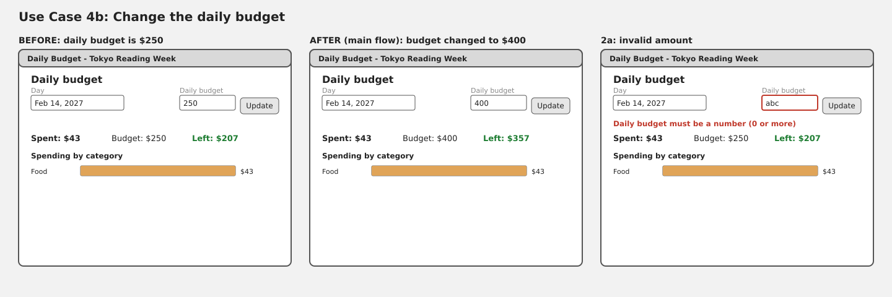

## Use Cases 5a, 5b: Suggest and vote on activities
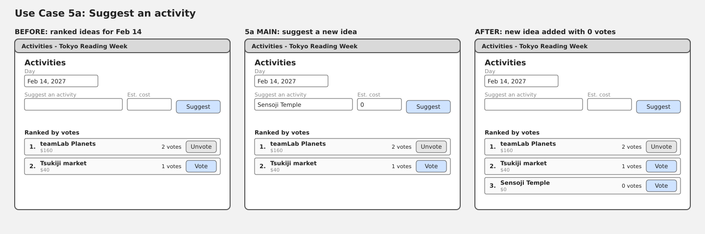
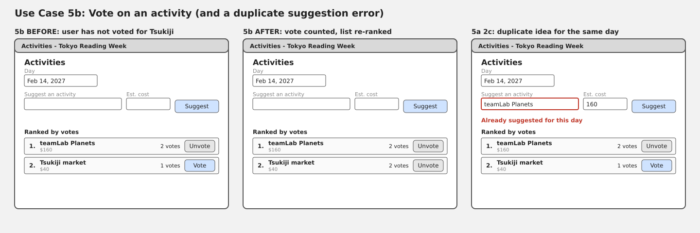
