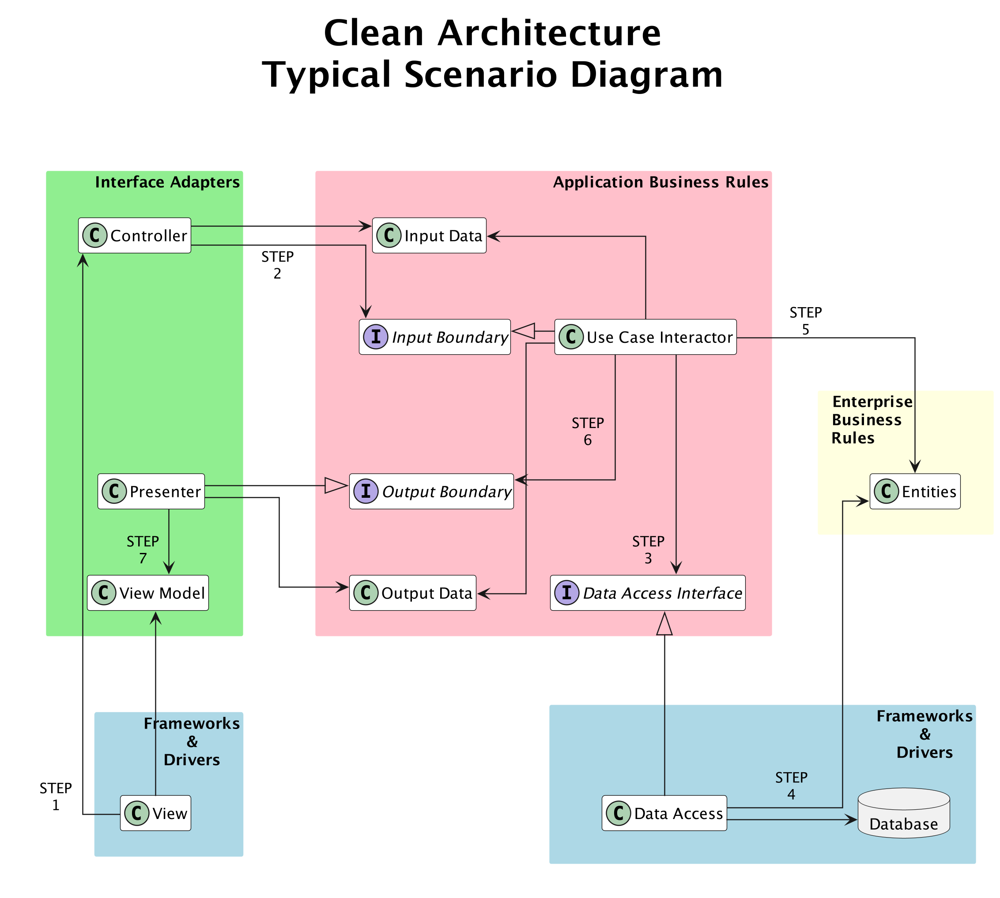

Project stucture, based on the CA-Lab Repo. Each CA layer is kept (mostly) self-contained per directory, with 
subdirectories indicating division per perspecive + use case. For example, the 
`UseCases` Subdirectory contains folders for `/Buyers` and `/Sellers` perspectives, and each will contain further
subfolders to accomodate each MVP UseCase.

The CA Engine diagram is attached below for reference purposes ONLY to cross-check against whilst
working with the project structure, and should be removed before the final presentation.
